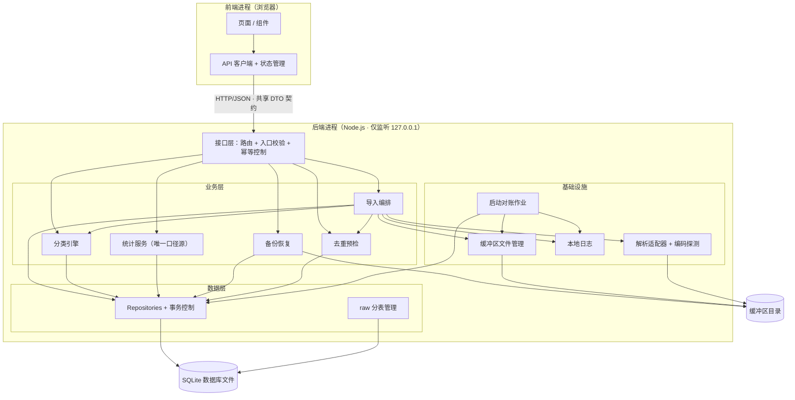

# 个人财务分析仪表盘 · 架构评审与分层设计 v1.0

| 项目 | 内容 |
|------|------|
| 评审对象 | 《个人财务分析仪表盘-PRD-v1.0.md》（内部版本 v1.1）及产品经理需求评审报告 |
| 评审人 | Bob（架构师） |
| 评审轮次 | 第 1 轮 · 架构侧评审（架构原则 / 分层与信任边界 / 契约与校验 / 技术选型 / 依赖 / 排期风险） |
| 日期 | 2026-10-22 |
| 结论 | **5 条架构原则全部成立，无需推翻；其中原则 3、4 需补充精确定义（本报告已给出）。分层草案、技术选型、依赖与排期结论可直接进入 PRD v2.0 相应章节。** |

---

## 一、评审结论摘要

1. **架构原则**：委托方提出的 5 条原则与 PRD 无冲突，全部采纳。原则 1/2/5 结论为「确认（附补充定义）」；原则 3 结论为「需补充定义」（契约形式、入口校验清单、契约变更追溯机制本报告已补齐）；原则 4 结论为「需补充定义 + 防误读修正」——其原表述「内部信任接口做的检测」存在被误读为「信任前端输入」的风险，本报告第三节给出显式信任边界定义与建议替代表述，请产品经理写入 v2.0。
2. **分层设计**：后端划分为接口层 / 业务层 / 数据层 / 基础设施四层，前端为展示层，一层一类业务。**统计计算单一来源落位于后端业务层「统计服务（stats-service）」**，与需求侧 P0-2/P0-4 口径结论（direction 为准 + status≠excluded + pending 计入并单列未分类）完全对齐，架构侧无修正、无冲突。
3. **技术选型唯一推荐**：前端 **React 18 + TypeScript + Vite**；后端 **Node.js + TypeScript + Express**；数据库 **SQLite（better-sqlite3）**；契约采用**前后端共享 TypeScript DTO + zod**。理由要点：全栈单一语言使「类型检测」获得编译期强制力（原则 3 的最直接支撑），个人项目长期自持成本最低；zod 在系统入口等价实现 FastAPI/Pydantic 的运行时校验优势，无需引入 Python 双运行时。
4. **排期主要风险集中在 M2**：P0-3 删除意图落库 + 启动对账作业、幂等控制（EX-18）、事务故障注入用例、FR-08 升 Must 四项合计约 **+2~2.5 人日**，而 M2 仅 1 周。建议：FR-08 拆分为「原始库查看 + 批次追溯」（M2）与「按批次重算」（M3，因其依赖 M3 的分类引擎）；M2 出口标准由「回滚可验」扩充为「回滚 / 对账 / 幂等三项可验」；新增风险登记行 RK-09~RK-15。
5. **10.3 口径 M4 启动前冻结作为入口条件可行**（修订均为文档级，冻结物可实现为 stats-service 内单一过滤函数）；**Q-01 fallback 在架构侧完全支持**——渠道映射模板采用适配器模式，样例就绪后补充精确模板属于数据/配置级插入，不改代码、不返工。

---

## 二、架构原则逐条评审

| # | 原则原文 | 结论 | 评审意见与补充定义 |
|---|----------|------|--------------------|
| 1 | 前后端分离 | **确认（附补充定义）** | 与 PRD 5.1/5.2 已选方案一致。补充三点定义：① 分离指**同一台机器上的两个进程**（前端 dev server/静态服务 + 后端 REST 服务），通信仅经 HTTP/JSON，服务仅绑定 127.0.0.1；② **展示层不含统计计算**（保证 FR-16/FR-19 同口径，统计为后端单一计算源）；③ 前端不得直连数据库文件或缓冲区目录，一切数据访问经后端 API。 |
| 2 | 分层设计，一层负责一类业务 | **确认（附补充定义）** | 「一层一类业务」的精确定义：**接口层**只负责协议与入口校验；**业务层**承载全部领域逻辑（导入编排、分类、统计、备份）；**数据层**只负责持久化与事务；**基础设施**提供文件、编码、日志、启动作业等横切能力；**展示层**只负责渲染与交互。约束：跨层依赖必须逐层经接口，**禁止接口层直连数据层（跳层）**；业务层内部模块间可经接口互相依赖（如导入编排→分类引擎）。 |
| 3 | 模块之间依赖接口，需做类型检测、数据校验 | **需补充定义** | 原则成立，但需补齐三件事（本报告第四节给出完整方案）：① **契约形式**：推荐前后端共享 TypeScript DTO + zod schema，编译期 + 运行期双重保障，不采用 OpenAPI 代码生成方案（理由见 4.1）；② **入口校验清单**：文件格式/大小/编码、字段映射合法性、金额/时间/方向合法性、恢复操作二次确认等，在系统入口一次性完成（清单见 4.2）；③ **契约变更可追溯机制**：共享契约为单一事实源 + git 版本管理 + 变更记录（见 4.4）。 |
| 4 | 内部信任接口做的检测，不做重复防御 | **需补充定义 + 防误读修正** | 原则意图正确（避免层层重复校验的性能与维护浪费），但原表述有被误读为「信任前端输入」的风险，**必须显式定义信任边界**。修正后建议表述（请产品经理写入 v2.0）：<br>「**信任边界以进程为界**：前端→后端跨进程边界的输入（上传文件、接口参数）一律视为不可信，必须在系统入口一次性完成校验；后端内部模块之间信任已通过契约校验的数据，不做重复校验。数据访问层的参数化查询属数据库驱动职责，不构成应用层重复防御。」<br>另需堵住第二类误读：「内部信任」≠「不检查业务规则」——状态机守卫（如确认入库时批次状态必须为「待确认」）、唯一性约束等**业务不变量**由业务层在操作入口强制执行一次，属业务逻辑而非重复防御。完整信任边界定义见 4.3。 |
| 5 | 框架追求可拓展性和复用性 | **确认（附补充定义）** | 落地为四个具名扩展点 + 一个预留设计（第五节）：① 分类规则引擎（数据驱动，关键词+字段+优先级+启停）；② 渠道映射模板（适配器模式，新增渠道不改主管道）；③ 报表周期（月/季/年复用统一口径，新增周期不得复制统计逻辑）；④ 系统设置（键值 + 类型化读取）；⑤ REST 资源化设计为后续云同步预留复用基础。 |

---

## 三、分层设计草案

### 3.1 系统分层与模块依赖总览



### 3.2 模块职责表

**后端**

| 模块 | 所属层 | 职责 | 明确不负责 |
|------|--------|------|------------|
| api-routes（路由与控制器） | 接口层 | HTTP 路由、请求解析、**入口校验（zod）**、统一响应封装、错误码映射 | 业务逻辑、统计计算、SQL |
| idempotency-guard（幂等控制） | 接口层（业务规则前置） | 确认入库 / 丢弃等写操作的状态机守卫，重复提交返回 409（EX-18） | 数据加工 |
| import-orchestrator（导入编排） | 业务层 | 上传→解析→映射→预检→确认入库全流程编排；**组织单事务边界**（raw 分表写入 + 主数据层写入）；事务成功后触发删文件与导入报告 | 文件 IO 细节、SQL 细节、编码实现 |
| classification-engine（分类引擎） | 业务层 | 规则评估（按优先级降序、同级取最新）、待确认判定、批量修正、重算执行（只处理未经人工修正/排除记录，P1-4） | 规则存储、界面 |
| stats-service（统计服务） | 业务层 | **唯一统计计算源**：KPI、分类占比、趋势、Top 商户、三期报表数据；统一口径过滤（direction ∈ income/expense 且 status≠excluded；pending 计入并单列「未分类」） | 展示决策、前端加工 |
| backup-service（备份恢复） | 业务层 | 库文件整体备份、JSON/CSV 全量导出、恢复前自动备份当前库（EX-19）、恢复执行与预览 | 文件选择对话框 |
| dedup-checker（去重预检） | 业务层 | 指纹比对（只读）、逐条标注新增/重复、汇总计数、强制新增标记留痕（P0-1）、指纹字段缺失不参与去重（EX-21） | 写库 |
| reconciliation-job（启动对账作业） | 基础设施 | 服务启动时执行「已入库批次 ↔ 缓冲区文件」对账：发现已入库批次仍有文件→按已落库的删除意图自动补删或列待清理；扫描孤儿文件（EX-13/16/23） | 定义业务规则 |
| buffer-file-manager（缓冲区文件管理） | 基础设施 | 文件落盘、删除、目录扫描、占用统计、上传中断半成品清理（EX-17） | 批次状态管理 |
| parser-adapters（解析适配器） | 基础设施 | CSV/XLSX 解析、编码探测（UTF-8/GBK/GB18030）与转码、表头识别 | 字段映射决策 |
| logger（本地日志） | 基础设施 | 导入、删除、对账等本地事件日志（仅存本机） | 任何上传 |
| repositories（数据访问） | 数据层 | staging_batch / raw_YYYY_MM / transaction / rule / category / setting 的 CRUD、**事务控制、参数化查询（唯一 SQL 出口）** | 业务规则 |
| raw-table-manager（raw 分表管理） | 数据层 | 按交易月份动态建表/写入/查询；无数据月份不建空表 | 清洗分类 |

**前端（展示层）**

| 模块 | 职责 | 明确不负责 |
|------|------|------------|
| pages（页面） | 仪表盘、月/季/年报、流水明细、导入向导（上传→预览→映射→预检→确认）、缓冲区管理、原始库查看、规则管理、待确认队列、设置、帮助说明（FR-23） | 统计聚合 |
| components（组件） | KPI 卡、图表、表格、向导步骤、二次确认对话框 | 业务规则 |
| api-client（API 客户端） | 基于共享 DTO 的强类型 fetch 封装、统一错误处理 | 数据加工 |
| state（状态管理） | 服务端状态缓存（TanStack Query）+ 向导本地状态 | 持久化业务数据 |

### 3.3 模块间接口依赖关系（谁依赖谁的接口）

| 依赖方 | 被依赖方接口 | 依赖性质 |
|--------|--------------|----------|
| 前端 api-client | 后端 REST 接口（共享 DTO 契约） | 跨进程，编译期类型约束 |
| 接口层 api-routes | 业务层各 Service 接口 | 跨层，逐层依赖 |
| 导入编排 | 解析适配器接口、映射模板仓储、去重预检、分类引擎、Repositories（事务）、缓冲区文件管理 | 层内 + 跨层 |
| 统计服务 | Repositories 查询接口（transaction 表） | 跨层 |
| 分类引擎 | 规则仓储接口 | 跨层 |
| 启动对账作业 | 批次仓储接口、缓冲区文件管理接口、日志接口 | 基础设施 → 数据层/基础设施 |
| Repositories | better-sqlite3 驱动 | 数据层 → 驱动 |

**统计计算单一来源的落位说明**：`/stats/*`、`/reports/*`、`/transactions/summary` 三类 API 在接口层**全部委托 stats-service 的同一组计算函数**（仅周期参数不同），口径过滤在 stats-service 内单一实现；接口层与展示层禁止任何统计聚合逻辑。这是 FR-16 与 FR-19「同口径核对一致」验收的结构性保障，也是 P0-2/P0-4 需求结论在架构上的对应物。

---

## 四、接口契约与类型检测 / 数据校验策略

### 4.1 契约形式：共享 TypeScript DTO + zod（唯一推荐）

| 维度 | 共享 TS DTO + zod（推荐） | OpenAPI 规范 + 代码生成（不推荐） |
|------|---------------------------|----------------------------------|
| 类型安全 | **编译期强制**：契约类型单一来源，前后端共享；契约不同步时编译报错 | 生成代码才是类型来源，spec 与实现易漂移；运行期校验为主 |
| 工具链成本 | 零代码生成、零额外服务，一个 `shared/` 目录 | 需维护 spec + 生成管线 + 版本同步 |
| 运行时校验 | zod schema 在入口 `parse` 即校验，schema 即文档 | 需额外校验库或框架内建 |
| 个人项目长期自持 | 一个语言、一套依赖、一处修改 | 双轨（spec + 代码）维护负担 |
| 后续云同步 | 同一 DTO 可直接复用于同步协议 | 亦可，但无额外优势 |

**结论**：采用 `shared/` 目录（或本地 workspace 包）存放全部请求/响应 DTO 类型与 zod schema，前后端共同 import。zod schema 同时充当：后端入口运行时校验器 + 前端表单校验器 + 接口文档来源。若未来需要对外文档，可后置补充 `zod-to-openapi` 生成，**不作为主契约**。

### 4.2 入口校验清单（系统入口一次性完成）

| 校验项 | 入口 | 规则 | 失败处理 |
|--------|------|------|----------|
| 文件扩展名 / MIME | 上传 | 白名单 .csv/.xlsx，MIME 交叉验证 | 400，EX-01 |
| 文件大小 | 上传（流式落盘时同步检测） | ≤5MB；写入过程检测磁盘剩余空间 | 400/507，清理半成品文件，EX-17 |
| 数据行数 | 解析 | ≤50,000 行 | 提示分批，EX-05 |
| 编码 | 解析 | 探测 UTF-8/GBK/GB18030；失败引导「另存为 UTF-8 CSV」 | 批次停留可重试，EX-02 |
| 表头 / 结构 | 解析 | 表头可识别；空文件拒绝 | EX-03/EX-04 |
| 字段映射合法性 | 映射确认 | 五个核心字段（时间/金额/方向/对方/商品）必须映射；direction 值合法枚举；渠道模板归属合法 | 阻断确认，FR-03 |
| 金额 / 时间 / 方向（逐行） | 解析 | 金额清洗符号后转整数分；时间识别受支持格式；方向∈{income,expense,neutral} | **不阻断**，该行置待确认并标注，EX-06/07 |
| 指纹完整性 | 预检 | 指纹字段缺失的记录不参与自动去重，提示人工核对 | EX-21 |
| 确认入库（幂等） | 业务入口 | 批次状态必须为「待确认」 | 409 冲突并提示当前状态，EX-18 |
| 丢弃批次 | 业务入口 | 状态允许流转 + 前端二次确认 | 409 |
| 恢复备份 | 业务入口 | 备份文件有效性预检 + 二次确认 + **恢复前自动备份当前库** | 阻断执行，EX-19 |
| 规则 / 分类管理 | 业务入口 | 关键词非空、目标分类存在且启用、优先级为整数 | 400 |
| 系统设置 | 业务入口 | 键值类型校验（阈值>0、备份间隔≥1 天等） | 400 |

### 4.3 信任边界定义（原则 4 的精确化，防误读）

```
┌─────────────────────────── 不可信区域 ───────────────────────────┐
│ 前端进程：用户上传的文件、页面提交的所有参数                       │
└──────────────────────────┬──────────────────────────────────────┘
                           │ 跨进程边界（HTTP）——唯一校验点
                           ▼
┌─────────────────────────── 系统入口（接口层）────────────────────┐
│ 入口校验：4.2 清单全部项，zod parse + 文件检查，一次性完成         │
│ 失败 → 400/409 + 结构化错误码，绝不进入业务层                     │
└──────────────────────────┬──────────────────────────────────────┘
                           ▼
┌─────────────────────────── 信任区域（后端进程内）────────────────┐
│ 业务层 ←→ 数据层 ←→ 基础设施：传递已校验数据，不做重复校验        │
│ · 数据层参数化查询 = 数据库驱动职责，不构成应用层重复防御         │
│ · 状态机守卫 / 唯一性约束 = 业务不变量，在操作入口执行一次，      │
│   属业务逻辑，不属「重复防御」                                     │
└──────────────────────────────────────────────────────────────────┘
```

三条硬性结论：
1. **信任以进程为界，不以「接口」为界**——前端→后端边界的输入一律不可信，必须在入口一次性校验；「内部信任」指后端模块之间。
2. **不重复校验**指不重复校验数据形状与取值（类型、范围、格式）；业务不变量（状态机、幂等、唯一性）的强制执行是业务规则，不是重复防御，两者不矛盾。
3. **参数化查询是驱动职责**：SQL 注入防护由 better-sqlite3 的参数化查询保证，不在应用层额外做「字符串消毒」类重复防御。

### 4.4 契约变更可追溯机制

- **单一事实源**：`shared/` 中的 DTO 类型 + zod schema 是唯一契约；任何接口变更必须先改 shared，再改两端（编译器强制对齐）。
- **版本管理**：shared 随 git 提交历史天然可追溯；破坏性变更（字段删除/语义变更）在提交信息中标注 `contract:` 前缀并在 `docs/` 维护一份简短契约变更记录。
- **统一响应封装**：所有 API 响应统一为 `{ code, data, message }`；错误码集中定义（枚举），前端按码映射提示文案。
- **数据格式约定**：金额一律整数分（禁止浮点累计）；时间一律 ISO 8601 本地时间字符串存储与传输（账单时间为平台导出的本地时间，单用户本机无跨时区场景，避免 UTC 转换引发「昨天/今天」错乱）。

---

## 五、可扩展与可复用设计点

| 扩展点 | 设计 | 扩展方式（不改主管道） |
|--------|------|------------------------|
| 分类规则引擎 | 规则数据驱动：关键词 + 匹配字段（对方/商品/交易类型）+ 目标分类 + 优先级 + 启停；评估顺序=优先级降序、同级取最新创建；默认规则包以配置文件形式种子化 | 新增规则=插一行数据；未来扩展匹配算法（如正则）= 引擎内策略扩展 |
| 渠道映射模板 | **适配器模式**：定义统一「解析适配器」接口（表头探测 + 行→标准字段映射），微信/支付宝/银行卡各一实现；用户映射模板按渠道持久化 | 新渠道=新增一个适配器实现 + 一条模板记录，导入编排零改动；样例文件就绪后补精确模板属数据级插入，**支撑 Q-01 fallback** |
| 报表周期 | stats-service 计算函数以「周期→日期区间」为唯一变量；月/季/年只是不同的区间解析器 | 新增周期=新增一个区间解析器，**禁止复制统计逻辑**；口径表（10.3）为唯一口径源 |
| 系统设置 | 键值表 + 类型化读取器（阈值、备份间隔、每周起始日） | 新设置=新键 + 默认值 |
| REST 资源化 | 资源名词 + 统一动词 + `/api/v1` 版本前缀 + 统一响应封装 | 为 5.3 演进路径 v1.2「可选加密云同步」预留：现有 API 即可被同步层复用，无需重构 |

---

## 六、技术选型建议（唯一推荐组合）

**推荐：React 18 + TypeScript + Vite（前端）｜ Node.js LTS + TypeScript + Express（后端）｜ SQLite + better-sqlite3（数据库）**

| 决策点 | 推荐 | 理由 |
|--------|------|------|
| 前端框架 | **React 18 + TS + Vite** | ① 与后端同一语言，共享 DTO 契约零摩擦，是原则 3「类型检测」的最直接支撑；② 仪表盘类生态成熟（MUI 组件库、ECharts 图表、TanStack Query 服务端状态）；③ Vue3 + TS 同为合格备选，但共享契约 + 表单校验生态在 React 侧更成熟，且与团队默认栈一致，减少选型分歧成本 |
| 后端框架 | **Node.js + TS + Express** | ① 单语言全栈：用户机器只需维护 Node 一个运行时，个人项目长期自持成本最低；② Express 零opinion、生态最大、足够承载本项目规模；③ **不选 Nest**：DI/模块/装饰器机制对单用户个人项目过重，分层用目录结构约定即可承载；④ **不选 Python FastAPI**：破坏全栈单一语言与共享 DTO 的直接性（需 OpenAPI 代码生成或手写重复类型），且需额外维护 Python 环境；其招牌的自动校验能力可由 zod 在入口等价实现 |
| 数据库驱动 | **SQLite（better-sqlite3）** | ① 单文件零维护，契合隐私优先与本机部署；② better-sqlite3 同步 API、`BEGIN IMMEDIATE` 精确事务控制、内置参数化查询，对 3 年约 8,000 笔规模性能裕量极大；③ 注意：原生模块依赖预编译二进制，需在文档中写明安装说明，备选 node-sqlite3（异步）或 sql.js（WASM），风险等级低（见 RK-15） |
| Excel / 编码生态 | **xlsx（SheetJS）+ csv-parse + jschardet + iconv-lite** | CSV 流式解析 + GBK/GB18030 探测转码 + xlsx 读取，覆盖 FR-01/02 全部要求；Python 侧 pandas/openpyxl 生态更强，但本项目导入量小（≤5 万行）且以 CSV 为主，**单一语言收益大于解析库差异** |
| 其他关键库 | zod（契约+校验）、multer（上传落盘）、react-router-dom、@tanstack/react-query、echarts、pino（文件日志） | 按职责最小化引入，避免过度工程 |

---

## 七、依赖分析表

### 7.1 内部模块依赖

| 依赖项 | 所属 | 状态 | 分级 | 最晚就绪时限 | 影响与替代方案 |
|--------|------|------|------|--------------|----------------|
| 前端 ↔ API 契约（shared DTO） | 研发 | 未就绪（随技术选型确定后即可搭建脚手架） | **阻塞**（前端开发启动的前提） | M1 第 1 周内搭好骨架；M4 前端全面开发前冻结字段级细节 | 契约先行：M1 后端定义路由与 DTO 即产生契约；前端可先基于 shared DTO + mock 数据开发，不等后端完成 |
| 导入链路 ↔ 映射模板 | 研发 | 未就绪 | 并行 | M1 内（FR-03 范围） | 模板表结构简单；渠道适配器可先做通用实现，精确模板后补（Q-01 fallback） |
| 统计计算 ↔ 数据层 | 研发 | 未就绪 | 并行 | M4 启动前（stats-service 依赖 transaction 表结构，M2 已定型） | transaction 表结构 M2 入库链路即确定，stats-service 可在 M3 后期先行开发并用种子数据验证 |
| 启动对账作业 ↔ 批次表（staging_batch + 待删除标记） | 研发 | 未就绪 | 并行 | M2 内 | 依赖 P0-3「删除意图先落库」的字段设计（staging 增加待删除标记），须在 M2 数据库设计时一并落定，**不建议后补** |

### 7.2 外部依赖

| 依赖项 | 所属 | 状态 | 分级 | 最晚就绪时限 | 影响与替代方案 |
|--------|------|------|------|--------------|----------------|
| Q-01 账单样例文件（微信/支付宝/银行卡各 ≥1 份，可脱敏） | 用户提供 | 未就绪 | **阻塞**（有 fallback） | 理想 M1 启动前；就绪窗口 M1–M2 之间 | 影响字段映射精确度与默认规则包质量。替代（架构侧完全支持）：① M1 以通用表头识别 + 手动映射 + 渠道模板兜底；② 默认规则包以保守关键词集交付；③ 样例就绪后补精确模板=数据级插入，不改架构不返工；④ M3 启动仍未就绪则「默认规则包可用」降级为「规则引擎 + 保守包可用」 |
| 技术栈决策（本报告第六节） | 委托方 | 待确认 | **阻塞** | M1 第 1 天（编码启动前） | 拖延直接阻塞 M1。本报告已给出唯一推荐组合，主理人/用户确认即可解锁 |
| 本地运行环境（Node LTS、现代浏览器） | 本人 | 就绪 | 并行 | M2 联调前 | 无 |
| 备份介质策略（本机备份 vs 引导外部介质拷贝） | 用户决策 | 未决策 | 可绕过 | M5 前 | 影响 FR-20 验收措辞与 FR-23 帮助页内容。默认按「本机备份 + 产品内明示引导外部介质」实现，不阻塞开发（见第八节待明确事项 Q1） |

---

## 八、排期风险评估与里程碑建议

### 8.1 逐里程碑评估

| 里程碑 | 原内容 | 架构侧新增 / 调整 | 工作量影响 | 结论与建议 |
|--------|--------|-------------------|------------|------------|
| M1（第 1–2 周） | 后端骨架 + FR-01~04 | 入口校验框架（zod + shared DTO 脚手架）；EX-17 上传磁盘满与半成品清理；EX-20 映射模板同渠道冲突规则（默认覆盖+二次确认）；EX-21 指纹字段缺失不参与去重 | +0.5~1 人日（两周窗口可吸收） | **维持原范围**；出口标准措辞弹性化为「一份真实账单（脱敏）或构造样例可完成上传、解析、映射、预检」 |
| M2（第 3 周） | FR-05~08 入库链路 | ① P0-3 删除意图落库 + 启动对账作业（EX-16/23）≈ +1~1.5 人日；② 幂等控制（EX-18）≈ +0.5 人日；③ 事务故障注入用例 ≈ +0.5 人日；④ FR-08 升 Must：**拆分处理**——「按月查看 + 批次追溯」入 M2（+0.5 人日），「按批次重算」移 M3 | **+2~2.5 人日 / 单周，存在超载风险（RK-12）** | ① FR-08 重算移 M3 的理由：重算=重新执行清洗与分类，**依赖 M3 的分类引擎**，放在 M2 只能交付空壳；② M2 出口标准由「回滚可验」扩充为「**回滚 / 启动对账 / 幂等三项可验**」；③ 弹性杠杆：FR-07 中 should 级条目（缓冲区占用展示与阈值提醒）可后移 M3 |
| M3（第 4 周） | FR-09~12 分类引擎 | FR-08「按批次重算」+0.5~1 人日（**与 FR-11 历史重算合并为单一重算服务**，同一事务与口径实现，按批次/按规则范围两种触发入口）；P1-4 重算规则（默认不覆盖人工修正/排除记录、失败整体回滚） | +0.5~1 人日 | 维持；出口标准按 Q-01 fallback 弹性化：「默认规则包可用」→「规则引擎 + 保守规则包可用」 |
| M4（第 5 周） | 前端框架 + 仪表盘 + 明细 | 后端 **stats-service（统计单一来源）+ /stats、/reports API 与前端并行开发**（原里程碑未显式包含，但为仪表盘必需，属关键路径）；口径冻结列为 M4 入口条件 | 内含于原范围，但为关键路径项 | **10.3 口径 M4 前冻结作为入口条件可行**：修订均为文档级（P0-2/P0-4），v2.0 定稿即可冻结；冻结物实现为 stats-service 内单一过滤函数，改动面小。建议 M3 后期前端基于 shared DTO + mock 提前起步，降低 M4 风险 |
| M5（第 6 周） | 报表三期 + 备份恢复 + 设置 | FR-23 帮助与说明页 ≈ +0.5 人日；EX-19 恢复前自动备份当前库 + 一键回退 ≈ +0.5 人日；P2-3「备份提醒间隔」明确为 Must 或本期不可配 | +1 人日 | 轻微上浮，观察即可；FR-23 成本极低但承载口径明示承诺（9.5），不建议再砍 |

### 8.2 关键排期问题裁定

1. **FR-08 升 Must 的 +0.5~1 人日落点**：产品经理原估计落在 M2。架构侧修正为**拆分落点**——M2 只承担「原始库按月查看 + 批次追溯」（+0.5 人日）；「按批次重算」移入 M3（+0.5~1 人日），因其依赖 M3 分类引擎，且与 FR-11 历史重算合并实现反而比两处各做一遍更省。M2 出口标准相应调整（不再含重算）。
2. **10.3 口径 M4 前冻结**：**可行，且应作为硬性入口条件**。冻结动作 = v2.0 定稿时口径表（含 P0-2/P0-4 修订）宣告冻结；M4 第一天由前后端共同核对 stats-service 实现与口径表一致，作为 M4 启动检查项。若未冻结即启动 M4，前端按 v1.1 口径 mock 有返工风险（RK-14）。
3. **Q-01 fallback 下 M1/M3 出口弹性化**：M1 出口改为「真实账单（脱敏）**或构造样例**可完成上传、解析、映射、预检」；M3 出口「默认规则包可用」在样例未就绪时降级为「规则引擎 + 保守规则包可用」。架构侧确认：渠道映射模板适配器设计保证样例就绪后的补充是数据/配置级操作，**不改代码、不返工、不影响架构**。
4. **事务故障注入用例进 M2**：建议固化为 4 条用例并作为 M2 出口证据——① 事务写入中模拟失败 → raw 与主数据层无残留、批次回「待确认」、原文件保留（EX-10）；② 事务提交后删文件前模拟进程中断 → 重启后启动对账发现残留并自动补删/列待清理（EX-16，验证删除意图落库）；③ 并发双提交确认入库 → 仅一次成功、二次 409（EX-18）；④ 模拟磁盘满上传 → 半成品清理（EX-17，可与 M1 合并验证）。
5. **新增里程碑风险**：启动对账作业（M2，+1~1.5 人日）与幂等设计（M2，+0.5 人日）是本报告识别的主要新增量；两者都源于需求侧 P0-3/P1-2 结论，属必须项。叠加后 M2 单周约 +2~2.5 人日，**若不拆分 FR-08 则 M2 大概率溢出**——这是本报告最重要的排期结论。

### 8.3 风险登记册新增行建议（RK-09 起）

| 编号 | 风险描述 | 类别 | 概率 | 影响 | 风险值 | 等级 | 应对措施 | 责任人 | 状态 |
|------|----------|------|------|------|--------|------|----------|--------|------|
| RK-09 | 入库事务提交后、删文件前进程崩溃/断电，敏感文件残留（P0-3/EX-16） | 数据 | 2 | 4 | 8 | 中 | 删除意图先落库 + 启动对账自动补删/列待清理；M2 交付并以故障注入用例验证 | 本人 | 跟踪中 |
| RK-10 | 并发/重复点击确认入库产生重复事务与数据（EX-18） | 数据 | 3 | 3 | 9 | 中 | 批次状态机幂等 + 入库中锁定 + 409 拒绝；M2 验证 | 本人 | 跟踪中 |
| RK-11 | 恢复备份失败/中断电导致原库不可逆损坏（EX-19） | 数据 | 1 | 5 | 5 | 中 | 恢复前自动备份当前库 + 失败一键回退；M5 交付 | 本人 | 跟踪中 |
| RK-12 | M2 工作量膨胀：FR-08 升 Must + 幂等 + 启动对账 + 故障注入 ≈ +2~2.5 人日/单周 | 进度 | 3 | 3 | 9 | 中 | FR-08 拆分（重算移 M3）；故障注入用例化控制范围；FR-07 should 级条目可后移 | 本人 | 跟踪中 |
| RK-13 | Q-01 样例延期导致默认规则包精确度不足 | 需求 | 3 | 3 | 9 | 中 | fallback 保守规则包 + 待确认队列承接；就绪窗口 M1–M2；M3 出口措辞弹性化 | 本人 | 跟踪中 |
| RK-14 | 10.3 口径未冻结即并行开发 M4，前后端口径漂移 | 质量 | 2 | 4 | 8 | 中 | 口径冻结列为 M4 入口条件；stats-service 单一来源；M4 首日核对用例 | 本人 | 跟踪中 |
| RK-15 | better-sqlite3 原生模块在用户机（尤其 Windows）构建失败 | 技术 | 2 | 3 | 6 | 低 | 依赖预编译二进制自动下载；文档写明 rebuild 步骤；备选 node-sqlite3 / sql.js | 本人 | 观察 |

---

## 九、待明确事项（需委托方拍板，≤3 条）

| # | 问题 | 架构默认方案（待确认后写入 v2.0） | 影响 |
|---|------|-----------------------------------|------|
| Q1 | **备份介质策略**：EX-15 场景下本机备份与数据库可能同损（误删/磁盘故障）。是否在产品内（FR-20 备份页 + FR-23 帮助页）明示引导用户定期将备份拷贝至外部介质（U盘/移动硬盘），并纳入 FR-20 验收措辞？ | 按「本机备份 + 产品内明示引导外部介质」实现，提醒文案进帮助页 | 影响 M5 验收措辞与帮助页内容；不阻塞开发 |
| Q2 | **重算机制是否合并**：FR-08「按批次重算」与 FR-11「历史重算」是否合并为单一「重算服务」（同一事务与口径实现，按批次/按规则范围两种触发入口）？ | 按合并方案实现，FR-08/FR-11 在 v2.0 中互相引用同一规则集（默认不覆盖人工修正/排除、失败整体回滚） | 影响 M3 实现方式；合并可避免两套实现口径漂移，且更省工作量 |
| Q3 | **数据目录策略**：数据库文件与缓冲区目录默认固定于项目数据目录（如 `./data/`），本期不支持用户自定义位置，以保证一键启动脚本、备份路径、启动对账的简洁可靠。是否接受？ | 固定目录 + 一键启动脚本明示路径；若必须可配置，则需增加路径合法化校验与迁移向导，M1/M5 各 +0.5 人日 | 影响 M1/M5 工作量边界 |

---

## 十、与需求侧结论的对齐确认

| 需求侧结论 | 架构侧确认 |
|------------|------------|
| P0-2/P0-4 统计口径唯一准绳（direction + status≠excluded，pending 计入单列未分类，统计仅后端单一完成） | 完全采纳，落位于业务层 stats-service 单一实现（3.3 节），接口层与展示层禁止聚合 |
| P0-3 删除意图先落库 + 启动对账 + EX-16 | 采纳，落位于基础设施 reconciliation-job + staging 待删除标记字段；列为 M2 必须交付与出口证据 |
| P1-2 确认入库幂等 + EX-17~21 | 采纳；幂等落位于接口层幂等守卫（状态机），EX-17/20/21 分别落位 M1 上传/映射/预检入口 |
| P1-3/P1-4 raw 只增不改、明细仅可编辑分类/备注、重算不覆盖人工修正且事务化 | 采纳；重算与 FR-11 合并为单一服务（待明确事项 Q2），Repositories 提供事务控制 |
| P1-5 新增 FR-23 帮助与说明（Must） | 采纳；展示层静态页面，M5 交付，成本约 0.5 人日 |
| P1-6 FR-08 升 Must | 采纳并修正落点：查看/追溯入 M2，重算入 M3（依赖分类引擎） |
| 10.3 口径 M4 前冻结 | 确认可行，列为 M4 硬性入口条件 |
| Q-01 阻塞 + fallback + M1/M3 出口弹性化 | 架构侧完全支持（映射模板适配器=数据级扩展，无返工） |

---

*本报告为架构侧评审意见，未修改 PRD 原文件；v2.0 定稿由产品经理在本结论回传后统一产出。*

---

## 十一、v1.1 决策对齐修订（2026-10-22 · 委托方决策）

> 本节为追加节，**不改动第一节~第十节原文**（原文为评审记录，保留溯源价值）。委托方已对 4 个决策点拍板，其中技术选型未采纳本报告第六节推荐；本节记录决策内容及对报告结论的逐项变更，供产品经理写入 v2.0 时对照。

### 11.1 决策对照表

| # | 决策点 | 委托方决策 | 影响章节 | 结论变更（改前 → 改后） |
|---|--------|-----------|----------|------------------------|
| 1 | 技术选型 | 前端 React 18 + TypeScript + Vite（ECharts / TanStack Query / React Router）；后端 Python 3.11+ + FastAPI + Pydantic v2 + uvicorn；SQLite（标准库 sqlite3，显式 BEGIN IMMEDIATE 事务）；解析 openpyxl / csv / chardet；上传 python-multipart 流式落盘 | 4.1 契约形式；4.4 契约追溯机制；第六节选型表；RK-15 | 4.1「共享 TS DTO + zod」→「Pydantic v2 模型为单一事实源（入口运行期类型检测+数据校验），FastAPI 自动生成 OpenAPI 3 文档，前端 TS 类型自 OpenAPI 生成（openapi-typescript）或按约定手工对齐」；第六节选型表按委托方组合重写；RK-15「better-sqlite3 原生模块构建失败」→「Python 运行环境与依赖安装在用户机的可用性」 |
| 2 | 备份介质策略 | 仅本机备份，产品内不引导外部介质 | 7.2 外部依赖表；第九节 Q1 | 「备份介质策略」行状态改为「已决策：仅本机备份」；Q1 标记「已关闭（仅本机备份）」 |
| 3 | 重算机制 | FR-08 与 FR-11 合并为单一重算服务（与本报告默认一致） | 第九节 Q2；8.1 M3 行 | Q2 标记「已关闭（按默认合并方案）」；「单一重算服务落 M3」结论保留 |
| 4 | 数据目录 | 支持用户自定义（与本报告默认相反） | 第九节 Q3；8.1 M1/M5 行 | Q3 标记「已关闭（支持自定义）」；新增排期影响：路径合法化校验进 M1（+0.5 人日）、数据迁移向导进 M5（+0.5 人日）、启动对账/备份路径/一键启动脚本适配自定义目录、FR-22 增「数据目录位置」设置项 |

### 11.2 决策 1（技术选型）对报告的具体影响

**11.2.1 契约形式（替换 4.1 结论）**

| 项 | 改前（原 4.1） | 改后（委托方决策） |
|----|----------------|---------------------|
| 契约单一事实源 | shared/ 目录的 TS DTO + zod schema | **后端 Pydantic v2 模型** |
| 类型检测机制 | 编译期强制（TS）+ 运行期（zod） | **入口运行期强制（Pydantic）+ OpenAPI 3 契约文档集中化**；前端 TS 类型自 OpenAPI 生成（openapi-typescript）或按约定手工对齐，以提交前检查/CI 保证生成类型与 OpenAPI 同步 |
| 校验落地 | zod schema 在入口 parse | 4.2 入口校验清单 13 项全部由 Pydantic schema + 自定义校验器落地，同样只在系统入口执行一次 |
| 后续云同步 | 同一 DTO 复用 | OpenAPI 契约同样可被同步层复用，结论不变 |

客观说明：委托方在知悉本报告「不选 FastAPI」的理由（双运行时维护成本、契约需代码生成/手工对齐而非编译期强制）后仍选定 FastAPI。该选择对契约机制的影响为：类型安全从「编译期强制」调整为「入口运行期强制（Pydantic）+ 契约文档集中化（OpenAPI）+ 前端类型生成同步」，需以契约变更流程（11.2.2）弥补编译期强制力的缺失。分层与信任边界不受影响：Pydantic 校验仍只发生在系统入口一次，4.3 信任边界定义继续适用。

**11.2.2 契约变更可追溯机制（替换 4.4「单一事实源」表述）**

- 改前：shared/ 为唯一契约，编译器强制对齐。
- 改后：**Pydantic 模型 + 由其生成的 OpenAPI 文档**为单一事实源；契约变更流程 = 改 Pydantic 模型 → 重新生成 OpenAPI → 前端同步生成类型（或手工对齐）→ docs/ 记录契约变更；破坏性变更仍以 `contract:` 提交前缀标注。
- 统一响应封装 `{code, data, message}`、错误码集中枚举、金额整数分、ISO 8601 本地时间字符串等约定**保持不变**。

**11.2.3 技术选型表（替换第六节，按委托方组合重写）**

| 决策点 | 委托方选定 | 架构侧记录 |
|--------|-----------|-----------|
| 前端框架 | React 18 + TypeScript + Vite（ECharts / TanStack Query / React Router） | 与本报告推荐一致；与 3.2 展示层模块职责（pages/components/api-client/state）完全对应 |
| 后端框架 | Python 3.11+ + FastAPI + Pydantic v2 + uvicorn | 采纳。Pydantic 承担入口运行期校验，等价实现 4.2 清单；「不选 FastAPI」的理由已向委托方明示，委托方仍选定，此处客观记录其影响（见 11.2.1） |
| 数据库与驱动 | SQLite（标准库 sqlite3，显式 BEGIN IMMEDIATE 事务） | 采纳。标准库零额外依赖、参数化查询内置；事务控制需显式编写 BEGIN IMMEDIATE/COMMIT/ROLLBACK（较 better-sqlite3 封装略多代码，本项目事务点少，量小可接受）；容量裕量结论（3 年约 8,000 笔）不变 |
| Excel / 编码解析 | openpyxl / csv / chardet | 采纳。Python 生态对 GBK/GB18030 探测与 xlsx 解析成熟度高于 Node 方案；3.2 parser-adapters 接口不变，仅实现替换 |
| 文件上传 | python-multipart 流式落盘 | 采纳。落盘过程同步检测磁盘剩余（EX-17）与半成品清理要求不变 |

**11.2.4 RK-15 改写（替换 8.3 原行）**

| 项 | 改前 | 改后 |
|----|------|------|
| 风险描述 | better-sqlite3 原生模块在用户机（尤其 Windows）构建失败 | **Python 运行环境与依赖安装在用户机的可用性** |
| 分级 | 技术 / 概率 2 / 影响 3 / 风险值 6 / 低 / 观察 | 技术 / 概率 2 / 影响 3 / 风险值 6 / 低 / 观察（不变） |
| 应对措施 | 预编译二进制、文档写明 rebuild 步骤、备选 node-sqlite3/sql.js | 文档写明 Python 3.11+ 环境要求与依赖安装步骤；一键启动脚本内含环境检查与依赖安装引导。原生模块编译风险随标准库 sqlite3 方案自然消除 |

### 11.3 决策 2/3/4 对报告的具体影响

**决策 2（备份介质：仅本机备份）**
- 7.2 外部依赖表「备份介质策略」行：状态由「未决策」改为「**已决策：仅本机备份**」；影响 = FR-20 验收措辞与 FR-23 帮助页内容（备份指引仅述本机备份与妥善保管提醒，不引导外部介质拷贝），**不阻塞 M5**。
- 第九节 Q1：标记「**已关闭（仅本机备份）**」。

**决策 3（重算机制：合并）**
- 与本报告 8.1/8.2 默认方案一致：FR-08「按批次重算」与 FR-11「历史重算」合并为单一重算服务（同一事务与口径实现，按批次/按规则范围两种触发入口；默认不覆盖人工修正/排除记录，失败整体回滚）。
- 第九节 Q2：标记「**已关闭（按默认合并方案）**」；「单一重算服务落 M3（+0.5~1 人日）」结论保留。

**决策 4（数据目录：支持自定义）**
- 第九节 Q3：标记「**已关闭（支持自定义）**」。
- 新增排期影响（并入 8.1 对应行）：
  - FR-22 增加「数据目录位置」设置项（数据库文件 + 缓冲区目录统一根目录）；
  - 入口**路径合法化校验进 M1（+0.5 人日）**：自定义目录须为合法本地绝对路径，禁止指向系统敏感目录或网络位置；
  - **数据迁移向导进 M5（+0.5 人日）**：更换目录时搬移数据库文件与缓冲区文件、更新启动配置；
  - 启动对账作业、备份路径、一键启动脚本均适配自定义目录——3.2/3.3 的模块划分已预留（配置读取集中化），改造量为配置层，**无架构变化**；
  - M1 与 M5 各 +0.5 人日、合计 +1 人日，建议作为 M1/M5 观察项跟踪，不改变里程碑结构。

### 11.4 「其余结论继续有效」确认清单（stack-agnostic）

除 11.2/11.3 涉及的技术栈相关内容与三项决策相关条目外，本报告第一节~第十节其余结论**均为技术栈中立、继续有效**，产品经理可在 v2.0 中直接引用：

| # | 继续有效的结论 | 所在章节 |
|---|----------------|----------|
| 1 | 5 条架构原则的逐条评审结论（确认 / 需补充定义的分级与补充内容） | 第二节 |
| 2 | 原则 4 信任边界的精确表述：前端→后端输入一律不可信、入口一次性校验、后端内部信任已校验数据、参数化查询属数据库驱动职责、业务不变量（状态机/幂等/唯一性）非重复防御 | 第二节 / 4.3 |
| 3 | 后端四层（接口/业务/数据/基础设施）+ 前端展示层的分层草案、「一层一类业务」定义、禁止跳层约束 | 3.1 / 3.2 |
| 4 | 模块职责表（13 个后端模块 + 4 个前端模块，含「明确不负责」列）与模块间接口依赖关系 | 3.2 / 3.3 |
| 5 | stats-service 统计计算单一来源落位：/stats、/reports、/transactions/summary 三类 API 全部委托同一组计算函数，接口层与展示层禁止聚合 | 3.3 |
| 6 | 入口校验清单 13 项（文件扩展名/MIME、大小、行数、编码、表头、映射合法性、金额/时间/方向、指纹完整性、幂等、丢弃、恢复、规则/分类、设置）及失败处理 | 4.2 |
| 7 | 信任边界图与三条硬性结论 | 4.3 |
| 8 | 数据格式约定：金额整数分、ISO 8601 本地时间字符串、`{code, data, message}` 统一响应、错误码枚举 | 4.4 |
| 9 | 可扩展设计点：规则引擎数据驱动、映射模板适配器模式、报表周期区间解析器（新增周期不得复制统计逻辑）、设置键值化、REST 资源化预留云同步 | 第五节 |
| 10 | 依赖分析主体：7.1 内部模块依赖四项；7.2 外部依赖中 Q-01（阻塞 + fallback）、本地运行环境两项 | 第七节 |
| 11 | M2 超载结论与 FR-08 拆分：查看/追溯入 M2、重算入 M3 | 8.1 / 8.2 |
| 12 | M2 出口标准三项可验（回滚/启动对账/幂等）与事务故障注入 4 条用例 | 8.2 |
| 13 | RK-09~RK-14 六条风险登记行（删文件前崩溃、并发入库、恢复失败、M2 膨胀、样例延期、口径漂移） | 8.3 |
| 14 | 10.3 口径 M4 启动前冻结作为硬性入口条件（含 M4 首日核对动作） | 8.2 |
| 15 | Q-01 阻塞分级 + fallback 方案 + M1/M3 出口弹性化措辞 | 7.2 / 8.2 |
| 16 | 与需求侧结论的对齐确认全表（P0-2 / P0-3 / P0-4 / P1-2 ~ P1-6） | 第十节 |

> 注：清单第 6 项校验清单的**技术落地**由 Pydantic 承担（见 11.2.1），但清单内容与信任边界定义本身不变；清单第 10 项中「技术栈决策时限」外部依赖已由本次委托方决策关闭。
