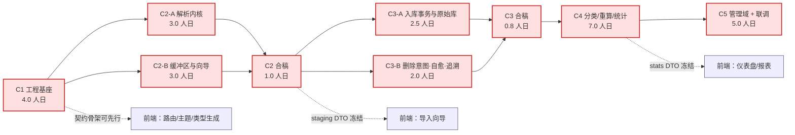

# 个人财务分析仪表盘 · 后端开发周期总览 v1.0

> 上游依据：《个人财务分析仪表盘-软件设计文档-v1.0》§4 模块设计、§5 数据设计、§6 接口设计、§7 关键流程、§14 任务分解、§13 测试设计。
> 本文件只回答三个问题：**分几个周期、每个周期交付什么、周期之间靠什么衔接**。具体到文件与断言的执行细节见 C1~C5 分册与《联调方案与端到端验收》。

---

## 1. 划分原则

| # | 原则 | 具体做法 | 反面案例（禁止） |
|---|------|----------|------------------|
| P1 | **垂直切片**，不按技术分层切 | 每个周期结束时，服务能起来、能跑通一条业务链、有可执行的验收命令 | 周期 1 只写"全部 Repository"、周期 3 才第一次启动服务 |
| P2 | **依赖单向** | `api → services → repositories → infra`，周期 N 只依赖周期 ≤ N 的产物 | 周期 2 反向依赖周期 4 的统计服务 |
| P3 | **契约先冻结** | 每个周期收口时冻结本周期暴露的 DTO 与端点签名，写入 `CONTRACT-CHANGELOG.md` | 周期 5 联调时才发现 DTO 字段名不一致 |
| P4 | **不变量即验收** | I1~I14 每条都要落到某个周期的具体测试用例，不留在"联调再看" | `base_filter` 在 C4 才引入，C3 写了第二套过滤 |
| P5 | **失败路径同周期交付** | 正常路径与 EX-* 异常路径在同一周期完成，不允许"先做通、异常后补" | 入库成功即算完成，回滚与幂等推到联调期 |
| P6 | **可回退** | 每个周期打一个 tag（`c1-done` ~ `c5-done`），联调期任何回归都能定位到引入周期 | 全量堆到分支末尾一次性合并 |

---

## 2. 五个周期一览

| 周期 | 名称 | 核心目标 | 对外端点 | 人日 | 前置 | 里程碑 | 周期出口证据 |
|------|------|----------|----------|------|------|--------|--------------|
| **C1** | 工程基座与横切能力 | 服务能起来、库能建、错误与日志全站统一 | `/health` | 4.0 | — | M1（前半） | `uv run account-dashboard run` → `/health` 200；12 张表就位；退出码 1~5 可复现 |
| **C2** | 解析内核与导入缓冲区 | 一份真实账单可完成「上传 → 解析 → 预览 → 映射 → 预检」 | `/staging/*`（15 个） | 6.0 → **7.0**（A/B 并行） | C1 | M1（后半） | 微信 689 行 / 支付宝 669 行全解析；预检零写入；EX-17/20/21 通过 |
| **C3** | 入库、原始库与故障自愈 | 确认入库单事务、按月分表、删除意图与启动对账 | `/staging/*/confirm`、`/raw/*`、`/maintenance/*` | 4.5 → **5.3**（A/B 并行） | C2 | M2 | 跨 5 月 → 5 张 raw 表（101/136/182/143/107）；故障注入 4 条全绿；并发双提交仅一次成功 |
| **C4** | 分类、重算与统计 | 规则引擎、唯一重算服务、唯一统计口径、12 指标 | `/rules`、`/categories`、`/transactions/*`、`/recalc/*`、`/stats/*`、`/reports/*`、`/pending/*` | 7.0 | C3 | M3 + M4 | 三入口数字一致（FR-19）；口径核对清单 10 项全勾；P95 ≤ 200ms |
| **C5** | 管理域、契约冻结与全链路联调 | 设置/备份/恢复/迁移可用，全链路端到端打通并出包 | `/settings/*`、`/backup/*`、`/maintenance/events` | 5.0 | C4 | M4 + M5 | 备份→恢复→回退可验；数据目录迁移演练通过；`wheel` 单机 5 条命令可跑；E2E 全绿 |

**合计：28.8 人日（后端）**，不含评审、返工与前端。按单人有效产能 4~5 人日/周，整体 6~7 周；C2 的 A/B 并行可把墙钟压到约 3.5 天，C3 的 A/B 并行可压到约 3.3 天。

> 与 SDD §14 的口径差异（有意为之，已记账）：
> 1. SDD 的 T05 含前端 7.0 人日，本计划**只取 T05.5（备份/设置/迁移）与 T05.6 的后端部分**，前端另行排期。
> 2. SDD 的 T02.3 为 1.0 人日，本计划拆出「缓冲区文件管理」的磁盘余量与流式落盘细节（仍并入 C2.3，不增人日，只提前暴露风险）。
> 3. 新增 C5.6「全链路联调」2.0 人日 —— SDD 的 T05.6 只覆盖打包回归，未覆盖跨模块联调。这是本计划的**唯一增量**，理由见 §6。
> 4. C2 拆为 **A 线（解析内核 3.0）+ B 线（缓冲区与向导 3.0）+ 合稿（1.0）**。相比串行 6.0 增加 1.0 人日的契约冻结与合稿成本，换取墙钟时间从约 6 天降到约 3.5 天；等价于**用 17% 的人日换 40% 的交付周期**。见 §3 并行机会与 `C2-合稿与耦合收口.md`。
> 5. C3 拆为 **A 线（入库事务与原始库 2.5）+ B 线（删除意图、自愈与追溯 2.0）+ 合稿（0.8）**。相比串行 4.5 增加 0.8 人日，换取墙钟从约 4.5 天降到约 3.3 天。性价比低于 C2，收益主要来自**不可逆写入周期的风险隔离**（写路径出错不影响读路径独立验证）与长极并行化；单人开发时不要拆。见 `C3-合稿与耦合收口.md` §1。

---

## 3. 周期依赖与并行机会

- **关键路径**：C1 → C2 → C3 → C4 → C5，**无并行余量**，任一周期的验收不过就整体顺延。
- **C2 已拆分并行**（C2 本身是瓶颈中最大的一块）：
  - **A 线**（解析内核 3.0）：`infra/parsers/**` + `models/internal.py`，零 DB、零 HTTP。
  - **B 线**（缓冲区与向导 3.0）：`infra/buffer_file.py` + repositories + services + 15 个端点，零格式知识（用 FakeParser）。
  - **合稿 1.0**：契约冻结、`errors.py` 中性化、Fake→Real 切换、真实样例端到端。
  - 文件交集为零（除 Gate 0 的 `errors.py`）；代价是 +1.0 人日的协调成本，收益是墙钟从约 6 天降到约 3.5 天。
- **C3 已拆分并行**（不可逆写入周期，风险隔离价值大于速度价值）：
  - **A 线**（入库事务与原始库 2.5）：`services/ingest_service.py` + `repositories/{raw_repo,transaction_repo,staging_repo}.py`，**不删任何文件**（经 `DeleteFailureSink` 外抛）。
  - **B 线**（删除意图、自愈与追溯 2.0）：`services/cleanup_service.py` + `infra/reconciliation.py` + `/raw/*` + `/maintenance/*` + `trace`，**不写 `raw_*` 与 `transaction`**（用 SQL 夹具预置数据）。
  - **合稿 0.8**：Gate 0 契约冻结（`models/ingest.py`、`services/ingest_ports.py`、`infra/raw_naming.py`、`tests/helpers/ingest_state.py`）、`NullSink → CleanupService`、真实样例端到端、4 条故障注入合跑、崩溃自愈闭环。
  - 文件交集为零（除 `api/deps.py` 只增不改）；代价 +0.8 人日，收益墙钟从约 4.5 天降到约 3.3 天。**单人开发时不要拆**。
- **其他可并行**：
  - C2 期间可并行启动前端基建（用 `/health` + mock 数据），前置是 C1.3 的统一响应已冻结。
  - C4 的 `stats_service` 与前端图表页可并行，前置是 C4.5 导出的 `openapi.json`。
  - C3-B 的 `/raw/*` 浏览与 C4.1（分类引擎）可并行，两者只共享 `transaction` 表读接口。
- **不可并行**：C4.3 重算 与 C4.4 统计 **必须串行**（重算改 `status`，统计依赖 `status`）。SDD §14.8 把两者画成 DAG 上的兄弟节点，实际是伪并行，本计划显式纠正。

---

## 4. 契约冻结点

联调失败的根因九成是"契约在开发过程中悄悄变了"。因此设四个冻结点，冻结即写入 `CONTRACT-CHANGELOG.md`，后续变更必须留记录并触发回归。

| 冻结点 | 时点 | 冻结内容 | 变更代价 |
|--------|------|----------|----------|
| **FZ-1 基座契约** | C1 收口 | `ApiResponse{code,data,message}`、`ErrorCode` 全量枚举、`PageMeta`、启动退出码 1~5、`/health` 响应形状 | 低（仅 C1 内部） |
| **FZ-2 导入契约** | C2 收口 | `BatchDTO`、`BatchDetailDTO`、`ParseMetaDTO`、`MappingReq`、`PrecheckResultDTO`、7 个批次状态字面量 | 中（前端向导绑定） |
| **FZ-3 数据契约** | C3 收口 | `IngestReportDTO` 四数字、`raw_YYYY_MM` 列定义、`RawRecordDTO`、`pending_delete_flag` 语义、状态机 7×6 矩阵 | 高（已入库数据不可回溯） |
| **FZ-4 统计契约** | C4 收口 | 12 指标 DTO、`base_filter` 语义、`period/anchor` 格式、`null` 语义（储蓄率/同比/环比）、`/transactions/summary` 与报表同源 | 高（三处页面口径） |

> **冻结不等于不可改**：改可以，但必须同时（a）更新 `CONTRACT-CHANGELOG.md`；（b）跑对应回归用例；（c）通知下游。禁止"只改代码不改记录"。

---

## 5. 每周期通用出口标准（DoD）

任何周期未全部满足以下 7 条，**不得进入下一周期**：

| # | 门禁 | 命令 / 证据 |
|---|------|-------------|
| 1 | 静态检查干净 | `uv run ruff check src tests` 零告警 |
| 2 | 类型检查通过 | `uv run mypy src` 零 error（`strict` 可逐步收紧，但不允许新增 `# type: ignore`） |
| 3 | 单测全绿 | `uv run pytest -q` 全通过，且本周期新增用例覆盖本周期每条验收点 |
| 4 | 覆盖率不低于阈值 | 解析/统计模块 ≥ 90%；其余 ≥ 70%（SDD §13.6） |
| 5 | 分层不被破坏 | `tests/integration/test_layering.py`：`api` 不 import `repositories`，`infra` 不 import `services` |
| 6 | 异常路径有对应用例 | 本周期涉及的 EX-* 至少各 1 条用例，断言 HTTP + `code` 双字段 |
| 7 | 文档同步 | `CONTRACT-CHANGELOG.md` 有本周期条目；本周期分册的"实际产出 vs 计划"差异已更新 |

---

## 6. 为什么必须有独立的联调周期（C5.6）

SDD §14 把联调隐含在 T05.6，但本项目的三个特性决定它必须显式排期：

| 特性 | 后果 | 联调要专门验什么 |
|------|------|------------------|
| **唯一口径源**（I12/§9.1） | `/stats`、`/reports`、`/transactions/summary` 三处独立路由，实现易分叉 | 逐分类金额三元比对（FR-19），不允许"差不多" |
| **状态机 + 单事务**（I9/I10/§7.5） | C3 的幂等闸门与 C4 的重算都写 `status`，交错时会互相破坏 | 并发确认、重算中编辑、删文件失败后重算 |
| **物理分表 + 回溯**（I7/I8） | raw 与 `transaction` 一旦分叉，只能在联调期用真实数据发现 | 随机抽行回溯 `batch_id+row_no`，全量字段一致 |

因此 C5.6 的 2.0 人日不是"重复测试"，而是**跨周期交互**的专项：C1~C4 各自绿，组合起来仍可能红。

---

## 7. 工作量与节奏

| 周期 | 人日 | 建议自然周 | 关键路径占用 | 缓冲 |
|------|------|------------|--------------|------|
| C1 | 4.0 | 第 1 周 | 100% | 0 |
| C2 | 7.0（A 3.0 + B 3.0 + 合稿 1.0） | 第 2 周（A/B 并行） | A/B 各 100%，合稿串在末尾 | 0（最紧，解析器必须 TDD） |
| C3 | 5.3（A 2.5 + B 2.0 + 合稿 0.8） | 第 3 周（A/B 并行） | A/B 各 100%，合稿串在末尾 | +0.3 |
| C4 | 7.0 | 第 4~5 周 | 100% | −1.0（超载，见下） |
| C5 | 5.0 | 第 6 周 | 100% | +0.5 |

**C4 超载的卸载杠杆**（沿用 SDD §14.9，本计划只动后端内部的切分）：

1. **C4.4 与 C4.5 交换**：先冻结 `/stats/overview` 与 `/reports/monthly` 的 DTO（0.5 人日），其余报表端点（quarterly/yearly 的同比逻辑）移到 C5.6 联调期补齐 —— 不影响前端先行，也不破坏口径单一性。
2. **C4.2 的批量修正延后**：`POST /transactions/batch-category` 属增强，可移到 C5.1 之后（0.5 人日）。
3. **禁止**用"少写测试"换进度 —— C4 是口径集中地，测试欠账会在 C5 以 3 倍成本偿还。

---

## 8. 风险登记（本计划层面）

| # | 风险 | 触发信号 | 应对 |
|---|------|----------|------|
| R1 | 解析器被真实样例"打脸" | C2.1 的表头打分为 0，或行数与 689/669 差 > 0 | 立即停下来对齐 SDD §8.2 样例事实，不允许在适配器里打补丁绕过探测 |
| R2 | 状态机被绕过 | C3 出现"业务层直接 UPDATE status"的代码 | 代码评审硬规则：`status` 只能由 §5.7 列出的 4 个写入点修改 |
| R3 | 统计口径分叉 | C4 出现第二处 `direction IN (...)` 字面量 | CI 加 grep 门禁：`direction IN (` 只允许出现在 `stats_service.py` |
| R4 | Windows 文件锁/删除失败 | C3 的 `EX-11` 用例在 Windows 上必现 | 删除前 `gc` + 重试 3 次（100ms 退避），仍失败入待清理，不阻塞 |
| R5 | 联调期发现 DTO 不匹配 | C5.6 出现大量 E1008/422 | 说明冻结点被绕过，回溯 `CONTRACT-CHANGELOG.md` 定位周期 |

---

## 9. 分册索引

| 文件 | 内容 | 读者 |
|------|------|------|
| `00-后端开发周期总览-v1.0.md` | 本文：划分、依赖、冻结点、DoD | 全员 |
| `C1-工程基座与横切能力.md` | 29 个模块的落地顺序与断言（含实施记录） | 后端 |
| `C2-解析内核与导入缓冲区.md` | C2 验收基线（行数/金额/时间/零写入等硬指标） | 后端 |
| `C2-A-解析内核线.md` | 解析协议、表头打分、清洗、三个适配器（3.0 人日，零 DB/HTTP） | 后端 A |
| `C2-B-缓冲区与向导线.md` | 缓冲区、批次状态机、映射模板、预检（3.0 人日，零格式知识） | 后端 B |
| `C2-合稿与耦合收口.md` | K1~K10 耦合点、Gate 0、M1~M6 合稿步骤、D-1~D-4 裁决 | 后端 A+B |
| `C3-入库原始库与故障自愈.md` | **C3 验收基线**：单事务边界、幂等闸门、raw 分表、对账、故障注入 4 条 | 后端 |
| `C3-A-入库事务与原始库线.md` | A 线：单事务、二次去重、`RawTableManager`、报告四数字、故障注入 1/3/4（2.5 人日） | 后端 A |
| `C3-B-删除意图自愈与追溯线.md` | B 线：删除意图、待清理队列、启动对账、`/raw/*`、`trace`、故障注入 2（2.0 人日） | 后端 B |
| `C3-合稿与耦合收口.md` | K1~K10 耦合点、Gate 0、M1~M6 合稿步骤、D-5~D-8 裁决、前端缺口清单 | 后端 A+B |
| `C4-分类规则重算与统计.md` | 规则优先级、重算语义、12 指标口径 | 后端 |
| `C5-管理域与交付收口.md` | 设置/备份/迁移、契约冻结、打包 | 后端 |
| `联调方案与端到端验收-v1.0.md` | 三级联调、30 条验收项、缺陷分级、回退 | 全员 |
| `CONTRACT-CHANGELOG.md` | 契约变更流水 | 全员（只追加） |
