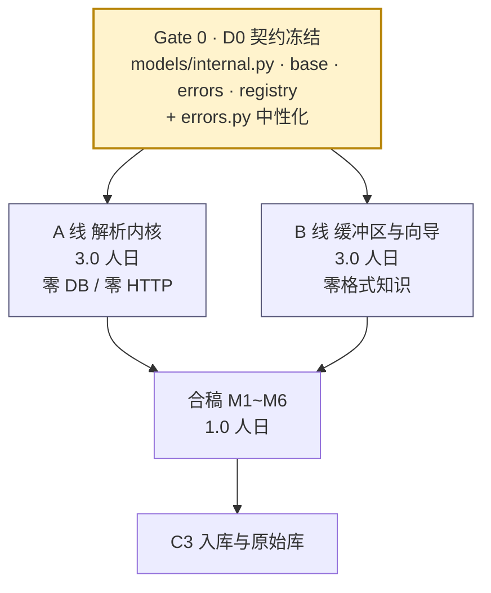

# C2 合稿与耦合收口

> 定位：A 线（解析内核）与 B 线（缓冲区与向导）各自绿 ≠ C2 绿。本文件定义**两条线之间到底靠什么咬合**、按什么顺序合并、以及合不起来时怎么判责与回退。
> 人日：**1.0**（Gate 0 契约与错误重构 0.35 + 合稿验证 0.65）
> 关联：[`C2-A-解析内核线.md`](./C2-A-解析内核线.md)、[`C2-B-缓冲区与向导线.md`](./C2-B-缓冲区与向导线.md)、验收基线 [`C2-解析内核与导入缓冲区.md`](./C2-解析内核与导入缓冲区.md)

---

## 1. 为什么值得并行（以及代价）

| 维度 | 串行（原 C2） | A/B 并行 |
|------|--------------|----------|
| 人日 | 6.0 | **7.0**（+1.0 协调成本） |
| 墙钟时间 | 约 6 天 | **约 3.5 天**（max(3.0,3.0) + 1.0 合稿） |
| 风险 | 单点串行，解析器卡住整条线停摆 | 解析器卡住时 B 线仍可推进 |
| 返工点 | 无 | 契约签字不严 → 两侧都要改 |

**结论**：只有当 D0 契约真正冻结时，并行才划算。契约含糊带来的返工，会把省下的 2.5 天全部吃掉。



---

## 2. 耦合点全景（K1~K10）

| # | 耦合点 | A 侧交付 | B 侧消费 | 合不上的典型症状 |
|---|--------|----------|----------|------------------|
| **K1** | 内部模型与协议 | `ParsedRow`/`ParseResult`/`MappingSpec`/`ParserAdapter`/`ParserRegistry` | 全部 | 字段名差一个下划线，B 线 AttributeError |
| **K2** | 解析结果 → 批次字段 | `encoding`/`adapter`/`header_row_no`/`meta`/`columns` | 写 `staging_batch` | 详情页 `parse_meta` 为空、行数对不上 |
| **K3** | 解析异常 → HTTP 错误码 | 四个异常子类（不带 code） | 映射为 `E1002/E1003/E1004/E1006` | 编码失败返回 500 而不是 422 |
| **K4** | 指纹 → 预检 label | `fp`（缺字段为 `None`） | `new/dup/pending_manual` | 缺时间的行被算进 `new`，去重漏判 |
| **K5** | 映射 spec → 重放 | `parse(path, spec)` | precheck 时用 `mapped_fields` 重放 | 用户改了映射，预检结果仍按默认列算 |
| **K6** | 模板与默认列序 | `spec=None` 时自动映射的列索引 | 存为模板、下次复用 | 模板复用后行列错位 |
| **K7** | 文件 ↔ 批次顺序 | — | 落盘→建批次→解析 | 孤儿计数与批次详情互相矛盾 |
| **K8** | 空行/异常行计数 | `empty_rows_skipped`、`issues` | 报告/详情展示 | 报告说 669，明细只有 667 |
| **K9** | 依赖注入 | — | `api/deps.py` 提供 registry/orchestrator | 路由直接 `new` 适配器，无法替换 Fake |
| **K10** | 错误模块归属 | — | `services` 需抛 `AppError` | `services → api` 被分层测试拦下 |

---

## 3. Gate 0：合稿前必须先做完的两件事

### 3.1 契约签字（0.2 人日）

按 `C2-A` §2 的五个文件提交后，B 线逐字段评审并签字。签字清单：

- [ ] `ParsedRow` 13 个字段名、类型、`None` 语义
- [ ] `row_no` 是 **1-based 数据行**（不含前言/表头），与未来 `raw.row_no` 一致
- [ ] `ParseResult.columns` 含尾随空列（支付宝 13）
- [ ] `MappingSpec.amount_scale ∈ {1,100}`，语义为「原始值 → 分」的倍率
- [ ] `ParserAdapter.parse(path, spec=None)` 的 spec 分支必须可重放（同 spec 两次结果相同）
- [ ] 异常族四个子类的触发条件

### 3.2 `errors.py` 中性化（0.15 人日）—— K10 的解法

C2 起 `services` 必须抛 `AppError`（`E1007`、`E2002`、`E2003`…），但 C1 的分层门禁禁止 `services → api`。两条线会同时撞墙，所以必须在 Gate 0 一次解决：

```
src/account_dashboard/errors.py          ← 新增：ErrorCode / AppError / 四个子类（纯领域词汇）
src/account_dashboard/api/errors.py      ← 保留：三个处理器 + re-export（兼容既有 import）
tests/integration/test_layering.py       ← 允许任意层 import account_dashboard.errors（叶子模块）
```

步骤：

1. 把 `ErrorCode`、`DEFAULT_STATUS`、`AppError`、`EntryValidationError`/`BusinessRuleError`/`TransactionError`/`FileIOError` 整体搬到 `account_dashboard/errors.py`（代码零改动，只换位置）。
2. `api/errors.py` 改为 `from account_dashboard.errors import ...` 并 `__all__` 重新导出，保证 `from account_dashboard.api.errors import ErrorCode` 仍可用（C1 的测试与后续代码不返工）。
3. 分层测试的规则从"禁止 api"改为"错误模块是叶子，任何层可用"。
4. `CONTRACT-CHANGELOG` 记 **INTERNAL**：37 个码值、HTTP 映射、响应形状全部不变，仅模块位置变化。

> 不做这一步的后果：A 线想抛 `E1003` → 只能 import `api` → 分层测试红；B 线为了绕开 → 在 service 里返回 `(code, message)` 元组 → 两套错误风格并存，C3 更难收。

---

## 4. 合稿步骤（M1~M6，每步可独立验证）

### M1 · 契约对齐（0.1 人日）

```bash
# 两侧分支各自绿
git checkout c2a-done && uv run pytest tests/unit -q
git checkout c2b-done && uv run pytest tests/integration -q

# 文件交集必须为空（除 Gate 0 的 errors.py）
git diff --name-only c2a-done..c2b-done | grep -v '^\(src/account_dashboard/errors.py\|tests/\)' || echo "no overlap"
```

断言：`models/internal.py` 只被 A 改过、`models/staging.py` 只被 B 改过。

### M2 · Fake → Real（0.1 人日）

只改一处注入：

```python
# api/deps.py
def get_parser_registry() -> ParserRegistry:
    return default_registry()          # 原来返回 FakeRegistry()
```

```bash
uv run pytest tests/integration -q     # B 线的 15 个端点用例应全部仍绿
```

若此时大面积红 → 说明 K1 契约没对齐，回 M1，**不要**改 B 线业务代码去迁就。

### M3 · 真实样例端到端（0.25 人日）

```bash
# 用真实全量样例（tests/fixtures/local/，不进 git）
uv run pytest tests/integration/test_upload_parse_flow.py -q
```

| 断言 | 微信 | 支付宝 |
|------|------|--------|
| `staging_batch.total_rows` | 689 | 669 |
| `header_row_no` | 17 | 23 |
| `adapter` | `wechat_xlsx` | `alipay_csv` |
| `encoding` | `xlsx` | `gb18030` |
| 预览列数 | 11 | 13 |
| `meta.empty_rows_skipped` | 0 | 0 |

### M4 · 异常路径对齐（0.15 人日）

| 场景 | A 抛 | B 返回 | 断言 |
|------|------|--------|------|
| 坏字节 CSV | `EncodingDetectFailed` | 422 `E1002` | 批次 `failed` + 可重试 |
| 无表头 | `HeaderNotRecognized` | 422 `E1003` | 批次 `failed`，文案引导手动映射 |
| 0 数据行 | `EmptyDocument` | 422 `E1004` | 「文件里没有数据行」 |
| >5 万行 | `RowLimitExceeded` | 422 `E1006` | 「请按月份分批导出」 |
| 金额解析失败 | 行级 issue | 200 | `parse_meta.issues.AMOUNT_PARSE > 0`，批次仍 `mapped_pending` |

**关键判定**：前四个是**批次失败**（`failed`），金额/时间问题是**行级**（批次照常成功）。这条边界两侧必须一致，否则用户会看到"整批失败但文件没问题"。

### M5 · 映射重放与预检（0.2 人日）

```
① 上传（默认映射）→ 记录 rows_default
② PUT mapping（用默认 spec 原样）→ prechecked
③ precheck → summary
④ 断言：summary.total == rows_default 的有效行数 + pending_manual 数
⑤ 换一个故意错位的 spec → precheck → 金额/时间 issue 显著上升（证明 spec 真的生效）
```

没有第 ⑤ 步，"映射生效"只是口头承诺 —— 这是合稿最容易漏测的一条。

### M6 · 性能与内存（0.1 人日）

| 指标 | 预算 | 测量 |
|------|------|------|
| 669 行 上传+解析 | < 500ms | `perf_counter` |
| 669 行 预检（空库） | < 200ms | 同上 |
| 5MB 上传峰值内存 | < 8MB | `tracemalloc` |
| 同 spec 解析两次一致性 | 逐字段相同 | 直接 `==` |

---

## 5. 需要签字的裁决（D-1 ~ D-4）

这四条在 SDD 里要么冲突、要么没展开。合稿前必须有人拍板，否则 C3 会带着歧义往下写。

| 编号 | 争议 | 本方案裁决 | 理由 | 记录位置 |
|------|------|-----------|------|----------|
| **D-1** | §5.6 图说「mapped_pending → prechecked：映射确认 + 预检完成」，矩阵却说 `mapped_pending` 预检 ❌ | **矩阵优先**：`PUT /mapping` 成功即置 `prechecked`；`precheck` 只在 `prechecked` 上允许，可重复；`mapped_pending` 上 precheck → 409 | 保证预检永远基于已确认映射；7×6 矩阵其余行不用动 | B §4.2 |
| **D-2** | T02.4 写「五核心字段缺失阻断」，但 `MappingReq` 里 `counterparty`/`item` 可选 | **硬三软二**：`occurred_at`/`amount`/`direction` 缺 → `E1007`；另两列缺 → 200 + warning | 银行 CSV 常无「商品」列，硬卡五列会让通用渠道不可用 | B §4.3 + `CONTRACT-CHANGELOG` |
| **D-3** | EX-07 说「时间无法识别 → 已置为待确认」，但 `transaction.occurred_at` 是 `NOT NULL` | **C2 不落库**：这类行留在 `ParseResult` 里（`is_valid=False`、`fp=None`），预检标 `pending_manual`；**C3 入库时按 `skipped_invalid` 计入报告，不写 `transaction`** | 不违反 DDL，也不静默丢数据；报告页能解释"少了几行" | 本文 §6 + C3 待办 |
| **D-4** | `MappingSpec.amount_scale` 语义未展开 | **定义为「原始值 → 分」的倍率**：`1` 走 `×100`（元），`100` 表示文件已是分（不再乘） | 名称与行为一致，两个真实样例都用 `1` | A §2.4 |

> D-3 的影响面最大：它决定了"有问题的行"从预检到入库的完整归宿。C3 开工第一件事就是按 D-3 写 `skipped_invalid`，不要临场发挥。

---

## 6. 合稿验收清单（12 条，逐条留证据）

| # | 场景 | 期望 |
|---|------|------|
| 1 | 上传微信全量 | `total_rows=689`、`header_row_no=17`、`adapter=wechat_xlsx` |
| 2 | 上传支付宝全量 | `total_rows=669`、`header_row_no=23`、`encoding=gb18030` |
| 3 | 预览 | 20 行、列名→字段识别与 §8.8 一致 |
| 4 | 保存默认映射 | 状态 `prechecked`；`mapped_fields` 与预览建议一致 |
| 5 | 预检 | `summary` 四数字自洽，`total=689/669` |
| 6 | override 单行 | `dup→new` 且 `override=true`；再预检 `new+1` |
| 7 | 重新解析 `prechecked` | 回 `mapped_pending`，计数重算，`mapping_snapshot` 不被写 |
| 8 | 编码失败 | 422 `E1002`；批次 `failed`；换正确文件重试成功 |
| 9 | 表头失败 | 422 `E1003`；generic 手动映射可救回 |
| 10 | 数据区空行 | `empty_rows_skipped>0` 且详情页可见；`total` 与有效行数之差可解释 |
| 11 | 重复上传同一文件 | 第二次预检全 `dup`（用 SQL 预置 `transaction` 行模拟） |
| 12 | 性能 | 上传+解析 < 500ms；预检 < 200ms；峰值内存 < 8MB |

**必须保留的反例**：`transaction` 表在 C2 结束时仍为 0 行。若有行，说明有人越界写了入库逻辑，整条线的边界失效。

---

## 7. 文件所有权（防冲突）

| 文件/目录 | 归属 | 说明 |
|-----------|------|------|
| `models/internal.py` | **A** | B 只读 |
| `infra/parsers/**` | **A** | B 只允许 import `base`/`registry`/`errors` |
| `infra/buffer_file.py` | **B** | A 不碰 |
| `models/staging.py` | **B** | A 不碰 |
| `repositories/*_repo.py` | **B** | A 不碰数据库 |
| `services/{import_orchestrator,mapping_service,dedup_checker}.py` | **B** | |
| `api/routers/staging.py`、`api/deps.py`、`api/validators.py` | **B** | |
| `errors.py`（新） | **Gate 0** | 一次搬完，之后谁都不改 |
| `scripts/make_fixtures.py`、`tests/fixtures/**` | **A** | B 用生成的夹具 |
| `tests/fakes/fake_parser.py` | **B** | 合稿后保留（后续 C3 故障注入要用） |

**规则**：需要改对方文件时，提 PR 说明并让对方 review；不要"顺手改一下"。

---

## 8. 合稿出口（DoD）

- [ ] A 线出口检查表全勾（`c2a-done`）
- [ ] B 线出口检查表全勾（`c2b-done`）
- [ ] Gate 0 的 `errors.py` 中性化完成，分层测试仍绿
- [ ] M1 文件交集为空（除 `errors.py` 与 `tests/`）
- [ ] M2 换成真 registry 后，B 线用例零改动全绿
- [ ] M3 真实样例 689/669 全部通过
- [ ] M4 五类异常路径的批次状态与错误码正确
- [ ] M5 错误 spec 能让 issue 上升（证明映射真的生效）
- [ ] 12 条合稿验收全勾
- [ ] `transaction` 表 0 行
- [ ] 覆盖率：`infra/parsers` ≥ 90%、`services` ≥ 75%
- [ ] `CONTRACT-CHANGELOG` 有 D-2、D-4 的条目
- [ ] 打 tag `c2-done`

---

## 9. 回退方案

| 场景 | 动作 | 影响 |
|------|------|------|
| M2 全红 | 回退 `deps.get_parser_registry` 到 Fake，回 M1 查契约 | 零数据影响 |
| M3 行数差 1 | **停止**，回 A 线查夹具/行号；不允许在 B 线"补偿" | 零数据影响 |
| M4 错误码不对 | 只改映射表（`services/import_orchestrator`），不动 A 线 | 零数据影响 |
| 裁决 D-3 被推翻 | 只需改 C3 的入库跳过逻辑，C2 代码不变 | 零数据影响 |
| 合稿期发现契约缺字段 | 走 `CONTRACT-CHANGELOG` BREAKING，两侧同改；**只允许在 C2 内发生**，C3 起禁止 | 需重跑 A/B 出口 |

> 所有合稿验证都在 `tmp_path` 数据目录里跑，绝不指向真实 `data/`。

---

## 10. 留给 C3 的接口（明确不越界）

| 项 | C2 状态 | C3 接手 |
|----|---------|---------|
| `confirm` / `report` | 未实现 | C3.1（单事务 + 幂等闸门） |
| `mapping_snapshot` | 字段留空 | C3 入库时写一次（I11） |
| `pending_delete_flag` | 恒 0 | C3 入库后置 1，删文件后清零 |
| `discard` 的删除失败 | 同步失败、状态不变 | C3 改为「先置状态 + 入 `cleanup_queue`」 |
| `skipped_invalid` | 无 | C3 按 D-3 计入报告 |
| `orphans/cleanup` | 只读清单 | C3 加清理动作（二次确认 + 白名单） |
| `raw_*` 分表 | 不存在 | C3.2 |
