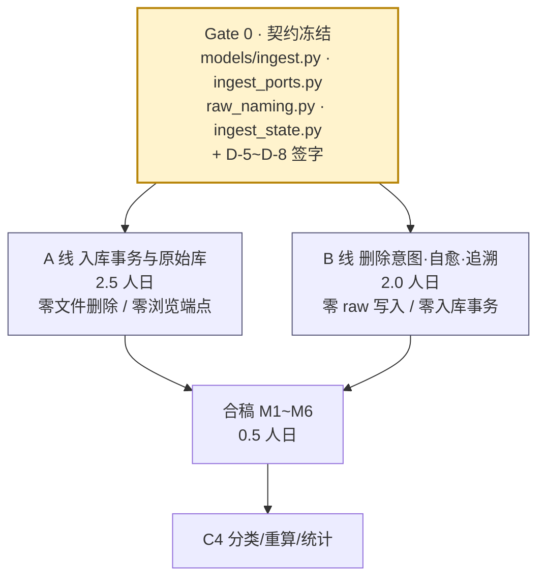

# C3 合稿与耦合收口

> 定位：A 线（入库事务与原始库）与 B 线（删除意图、自愈与追溯）各自绿 ≠ C3 绿。本文件定义**两条线靠什么咬合**、按什么顺序合并、合不起来时怎么判责与回退。
> 人日：**0.8**（Gate 0 契约 0.3 + 合稿验证 0.5）
> 关联：[`C3-A-入库事务与原始库线.md`](./C3-A-入库事务与原始库线.md)、[`C3-B-删除意图自愈与追溯线.md`](./C3-B-删除意图自愈与追溯线.md)、验收基线 [`C3-入库原始库与故障自愈.md`](./C3-入库原始库与故障自愈.md)

---

## 1. 为什么值得并行（以及这次的代价更高）

| 维度 | 串行（原 C3） | A/B 并行 |
|------|--------------|----------|
| 人日 | 4.5 | **5.3**（+0.8 协调成本） |
| 墙钟时间 | 约 4.5 天 | **约 3.3 天**（max(2.5, 2.0) + 0.8） |
| 长极 | 真实样例 669 行跨 5 月 + 4 条故障注入，串行时全压在一人身上 | A 线扛长极，B 线并行推进 |
| 风险 | 事务写错 → 脏数据，且读路径一起返工 | 写路径出错不影响读路径独立验证 |
| 返工点 | 无 | 契约签字不严 → 两侧都要改 |

**与 C2 的差别，必须说清楚**：C2 的并行是「+1.0 人日换 -2.5 天」，本周期是「+0.8 人日换 -1.2 天」，性价比明显更低。仍然值得拆的三条理由：

1. **C3 是不可逆写入周期**。写路径（A）出错 = 脏数据；读/自愈路径（B）出错 = 只是看不见。把两者隔离后，B 线可以在**完全没有入库能力**的情况下用 SQL 夹具独立验证，不必等 A 线造数据。
2. **长极可并行化**。A 线的验证强依赖真实大样例（669 行跨 5 月）与 4 条故障注入，是串行时的全部瓶颈；B 线几乎不依赖样例规模。
3. **契约面比 C2 小**：只有 10 个 DTO + 1 个 Protocol + 1 个命名工具，Gate 0 只需 0.3 人日（C2 是 0.35）。

> **单人不拆**：如果只有一个人开发 C3，**按串行做**（A → 合稿 → B 的顺序读即可），拆分带来的是沟通成本而不是速度。本拆分的收益只在两人并行时兑现。



---

## 2. 耦合点全景（K1~K10）

| # | 耦合点 | A 侧交付 | B 侧消费 | 合不上的典型症状 |
|---|--------|----------|----------|------------------|
| **K1** | `raw_YYYY_MM` 表名与列序 | `RawTableManager` 建 16 列 + 2 索引 | 按名读 | 列名/顺序差一个，B 线查询结果错位；表名前缀多一个 `raw_` 就查空表 |
| **K2** | 月份键的两种形态 | `IngestReportDTO.monthly` 键为 `raw_2026_06` | `/raw/months[].month` 为 `2026_06` | 前端列表点月份 → 请求 `/raw/raw_2026_06/records` → 404 |
| **K3** | `DeleteFailureSink` 注入点 | 事务外调 `on_committed`，拿 `DeleteOutcome` | `CleanupService` 实现 | A 把删除写进事务内 → 违反 I9，崩溃时"数据没了文件也没了" |
| **K4** | `pending_delete_flag` 生命周期 | 事务内置 1 | 事务外清零 / 入队 | A 自己清零 → B 的启动对账永远空转，文件堆积 |
| **K5** | `staging_batch` 双写方 | 写 `status` / `report_json` / `mapping_snapshot` / `flag=1` | 写 `flag=0` / 中断重置 | 两处各写一套 `UPDATE`，中间态无法解释 |
| **K6** | `transaction` 表归属 | `insert_many` + C4 空壳签名 | 只读（经 `trace_repo`） | B 自己加写方法 → C4 出现两套插入逻辑 |
| **K7** | 追溯主键 `(batch_id, row_no)` | 写入时保证唯一且等于 `ParsedRow.row_no` | 按此查 raw | A 跳过无效行 → B 查不到 → 误报"数据分叉"（**D-6 必须两侧一致**） |
| **K8** | 月份推导规则 | `occurred_at[:7].replace("-","_")` 建表 | 同一规则查表 | 差一个字符就查空表；月份必须由 `occurred_at` 推，**不信任文件名** |
| **K9** | 依赖注入 | `get_ingest_service` | `get_cleanup_service` | `api/deps.py` 被两条线同时改；约定只增不改，合稿人工合并 |
| **K10** | 错误码归属 | 抛 `E2002` / `E3001` / `E3002` / `E4001` | 抛 `E2010` / `E4003` / `E1008` / `E1011` | `errors.py` 已中性化（C2 完成），C3 **不得新增码值**；需要新码属 BREAKING，先评审 |

---

## 3. Gate 0：合稿前必须先做完的四件事（0.3 人日）

### 3.1 `models/ingest.py` —— FZ-3 的 DTO 全量冻结

```python
class SkippedRowDTO(BaseModel):
    row_no: int
    reason: str          # "AMOUNT_PARSE" / "TIME_PARSE" / "DUP"
    field: str | None = None
    raw: str | None = None        # 原始值，截断 64 字符

class IngestReportDTO(BaseModel):
    batch_id: str
    total: int
    inserted: int
    skipped_dup: int
    skipped_invalid: int = 0
    pending: int
    monthly: dict[str, int] = {}          # {"raw_2026_06": 101}
    files_deleted: bool = True
    cleanup_pending: bool = False
    cleanup_id: str | None = None
    finished_at: str                      # DB 列叫 committed_at，DTO 字段改名（前端已按 finished_at）

class IngestReportDetailDTO(IngestReportDTO):
    skipped: list[SkippedRowDTO] = []     # 仅 include_skipped=true 时填充

class RawMonthDTO(BaseModel):
    month: str                            # "2026_06"，无 raw_ 前缀
    count: int

class RawRecordDTO(BaseModel):
    id: int
    batch_id: str
    row_no: int
    occurred_at: str
    amount_cents: int
    direction: str
    counterparty: str | None = None
    item: str | None = None
    txn_type: str | None = None
    payment_method: str | None = None
    platform_category: str | None = None
    platform_status: str | None = None
    channel: str
    fp: str | None = None
    imported_at: str

class RawRecordDetailDTO(RawRecordDTO):
    raw_payload: dict[str, Any]

class TraceTransactionDTO(BaseModel):
    id: str
    batch_id: str
    row_no: int
    occurred_at: str
    amount_cents: int
    direction: str
    counterparty: str | None = None
    item: str | None = None
    channel: str
    status: str

class TraceDTO(BaseModel):
    transaction: TraceTransactionDTO
    batch: BatchDTO | None = None
    raw_record: RawRecordDTO | None = None
    mapping_snapshot: dict[str, Any] | None = None

class CleanupItemDTO(BaseModel):
    id: str
    batch_id: str | None = None
    file_path: str
    file_name: str | None = None          # 由 LEFT JOIN staging_batch 派生，DDL 无此列
    reason: str
    attempts: int
    last_error: str | None = None
    status: str                           # pending / done / abandoned
    created_at: str
    updated_at: str

class OrphanCleanupDTO(BaseModel):
    removed: list[str] = []
    failed: list[dict[str, str]] = []     # [{"name": ..., "code": "E4003"}]
```

> `TraceTransactionDTO` 是 C4 完整 `TransactionDTO` 的**子集**；C4 扩展时必须保留这些字段名，否则追溯页与流水列表会不一致。

### 3.2 `services/ingest_ports.py` —— K3 的注入协议

```python
class DeleteOutcome(BaseModel):
    deleted: bool
    cleanup_id: str | None = None     # deleted=False 时必填

class DeleteFailureSink(Protocol):
    def on_committed(self, batch_id: str, file_path: str) -> DeleteOutcome: ...

class NullSink:                        # A 线开发期默认实现
    def on_committed(self, batch_id: str, file_path: str) -> DeleteOutcome:
        return DeleteOutcome(deleted=True)
```

### 3.3 `infra/raw_naming.py` —— K1/K2/K8 的唯一收口

```python
RAW_MONTH_RE = re.compile(r"^\d{4}_\d{2}$")

def month_key(occurred_at: str) -> str: ...        # "2026-10-21T19:48:03" → "2026_10"
def table_name(month: str) -> str: ...             # "2026_10" → "raw_2026_10"（非法 → E3002）
```

全项目**唯一**允许拼接 SQL 标识符的地方。两侧都不得自己拼 `f"raw_{...}"`。

### 3.4 `tests/helpers/ingest_state.py` —— B 线的独立性来源

```python
def make_ingested_batch(conn, *, batch_id, stored_name, file_name,
                        pending_delete_flag=1, report_json=None) -> None
def seed_raw_rows(conn, month, batch_id, rows, *, start_row_no=1) -> None
def seed_transactions(conn, batch_id, rows) -> None
```

纯 SQL，不 import 任何 A/B 线模块。

### 3.5 签字清单

- [ ] 10 个 DTO 的字段名、类型、默认值（前端 `pages/import.js` / `raw.js` / `buffer.js` 已按此实现，逐字段核对一遍）
- [ ] `monthly` 键为 `raw_YYYY_MM`；`RawMonthDTO.month` 为 `YYYY_MM`（**两处不同构是有意的**，写进注释）
- [ ] `finished_at` ≠ DB 列名 `committed_at`
- [ ] `DeleteOutcome.cleanup_id` 在 `deleted=False` 时必填
- [ ] `CleanupItemDTO.file_name` 由 JOIN 派生，不落表
- [ ] D-5 ~ D-8 四条裁决全部签字

---

## 4. 需要签字的裁决（D-5 ~ D-8）

| 编号 | 争议 | 本方案裁决 | 理由 | 落地位置 |
|------|------|-----------|------|----------|
| **D-5** | SDD §7.5 说 `mapping_snapshot` 在入库时写（I11 只写一次），但 C2 实现已在**预检**时写、重解析时置 `NULL`（可变） | **两段式**：C2 的预检写入保留（供预检可重放）；C3 在**入库事务内**读取该快照并原样回写（`sort_keys=True`），此后该字段只读。守卫：`UPDATE ... SET mapping_snapshot` 只允许出现在 `update_precheck` 与 `finish_ingest` | I11 要的是"入库时刻的不可变快照"。C3 在事务内回写，保证"用来入库的那份"与"存下来的那份"是同一串字节 | A §4.6、A §6.3 门禁 2 |
| **D-6** | 时间/金额不可解析的行（`is_valid=False`）在入库时的归宿：SDD 未定；`raw.occurred_at` 与 `amount_cents` 都是 `NOT NULL` | **既不写 raw 也不写 `transaction`**，计入 `IngestReportDTO.skipped_invalid`，明细进 `report_json.skipped[]`（`row_no` + 原因 + 原始值） | 写进 raw 必须造假值，违反 I7「保留原貌」；只写 raw 不写 `transaction` 会让"raw 与 transaction 行数相等"这条自洽断言失效。文件会被删，**报告是这批行唯一的留痕**，所以明细必须进 `report_json` | A §4.2/§4.5、B §4.6 |
| **D-7** | SDD §7.5 写「删文件失败 → 返回 409 `E4003` 但数据已入库」 | **改为 200 + `IngestReportDTO{files_deleted=false, cleanup_pending=true, cleanup_id}`**。409 `E4003` 保留给孤儿清理与 `retry` 失败的同步返回 | 前端 `pages/import.js` 的 catch 分支对所有非 `E2002` 错误统一提示「（已回滚，可重试）」；返回 409 会让用户以为数据没入库而去**重复导入**。且前端已实现 `files_deleted=false` 的渲染分支（"原文件删除失败，已加入待清理列表，数据不受影响"），说明 200 + 报告才是对齐的实现 | A §5.1、B §4.1、§9 缺口表 |
| **D-8** | 幂等闸门在事务内 ⇒ `ingesting` 永不落库，而 SDD §7.6 的对账第 ① 步是「把 `ingesting` 置回 `prechecked`」，这是**永不会命中的自愈** | **第 ① 步降级为防御性保险丝**：正常情况恒命中 0 条；命中即记 **WARN**（视为"有人在事务外改状态"的缺陷信号），不做静默修复。真正的中断自愈是「批次仍是 `prechecked`，用户重发 `confirm` 即可」（闸门天然幂等）。出口检查表第 7 条相应改写 | 闸门在事务内是 A 线 §2 的硬约束（崩溃自动回滚）；保留第 ① 步的价值是防御未来有人在事务外改状态。验收断言必须改成可验证的形式 | B §4.3、§6.2 |

> D-7 是对 SDD §7.5 的**显式偏离**，需在 `CONTRACT-CHANGELOG` 记 ADDITIVE 并签字；D-8 是对 SDD §7.6 的**解释性澄清**，不改代码语义，记 INTERNAL 备查。

---

## 5. 合稿步骤（M1~M6，每步可独立验证）

### M1 · 契约对齐（0.05 人日）

```bash
git diff --name-only c3a-done..c3b-done | grep -v '^tests/' || echo "no overlap"
```

断言：`repositories/raw_repo.py` 只被 A 改过、`services/cleanup_service.py` 只被 B 改过；`api/deps.py` 是唯一双方都改的文件（只在末尾追加 provider）。

### M2 · NullSink → CleanupService（0.05 人日）

只改一处：

```python
# api/deps.py
def get_delete_sink() -> DeleteFailureSink:
    return get_cleanup_service()      # 原来是 NullSink()
```

若此时 A 线的"删文件成功"类用例大面积红 → 说明 K3/K4 没对齐，回 M1 查协议，**不要**改 B 线业务代码去迁就。

### M3 · 真实样例端到端（0.2 人日）

| 断言 | 微信 689 | 支付宝 669 |
|------|----------|-----------|
| raw 表数 | 5 | 5 |
| 逐月行数 | 172 / 114 / 153 / 142 / 108 | **101 / 136 / 182 / 143 / 107** |
| `inserted` | 689 | 669 |
| `skipped_dup` | 0（首次） | 0（首次） |
| `skipped_invalid` | 0（真实样例无不可解析行） | 0 |
| `pending` | 689 | 669 |
| `sum(monthly.values())` | 689 | 669 |
| `/raw/months` 的 `count` 逐月 | 与 `monthly` 相等 | 与 `monthly` 相等 |
| 二次入库同一文件 | `inserted=0`、`skipped_dup=689` | `inserted=0`、`skipped_dup=669` |

### M4 · 故障注入 4 条合并跑（0.1 人日）

| # | 用例 | 归属 | 断言 |
|---|------|------|------|
| 1 | `test_fi_tx_failure.py` | A | 批次回 `prechecked`；raw 与 transaction 无残留；500 `E3001`；可立即重试成功 |
| 2 | `test_fi_crash_after_commit.py` | B | 数据已入库、`flag=1`；重启对账补删、`flag=0` |
| 3 | `test_fi_concurrent_confirm.py` | A | 一个 200、一个 409 `E2002`；`transaction` 无重复 `fp` |
| 4 | `test_fi_disk_full.py` | A | 上传阶段 507 `E4001`；入库阶段回滚 + 507；`raw_%` 表数量不变 |

附加断言：`sqlite_master` 里存在 `idx_raw_YYYY_MM_batch`（B 线追溯依赖它，A 线建表时必须建）。

### M5 · 崩溃自愈闭环（0.05 人日）

唯一一条真正跨两线的用例：

```
① A 线真实 confirm 一个批次（事务提交）
② 在 sink 执行前 kill 进程（monkeypatch on_committed 抛 KeyboardInterrupt）
③ 断言：transaction 有 689/669 行、批次 ingested、flag=1、文件仍在
④ 重启（跑 startup）→ B 线对账第 ② 步补删 → flag=0、文件消失
```

这条绿了，才说明"事务边界 + 删除意图 + 启动对账"三段真的接上了。

### M6 · 边界自证与 FZ-3 冻结（0.05 人日）

```sql
SELECT DISTINCT status FROM "transaction";   -- 只应返回 pending
SELECT COUNT(*) FROM staging_batch WHERE status='ingesting';   -- 必须 0
```

`CONTRACT-CHANGELOG` 追加：FZ-3 冻结 v1（含 D-7 的 ADDITIVE 与 D-8 的 INTERNAL）。

---

## 6. 合稿验收清单（12 条，逐条留证据）

| # | 场景 | 期望 |
|---|------|------|
| 1 | 支付宝全量入库 | 5 张 raw 表，101/136/182/143/107；`inserted=669` |
| 2 | 微信全量入库 | 5 张 raw 表，172/114/153/142/108；`inserted=689` |
| 3 | 同一文件二次入库 | `inserted=0`、`skipped_dup=669`、批次 `ingested`、文件已删 |
| 4 | `/raw/months` 与报告 `monthly` | 逐月 `count` 相等；`month` 为 `2026_06` 形态 |
| 5 | `raw_payload` 保真 | 抽 5 条与原文件行逐项一致（含 `已退款¥26.40` 变体） |
| 6 | 并发确认 | 一个 200、一个 409 `E2002`，`transaction` 无重复 `fp` |
| 7 | 崩溃后重发 | 批次仍 `prechecked`，重发 `confirm` 成功（**D-8 改写后**） |
| 8 | 删文件失败 | 200 + `files_deleted=false` + 队列 +1；批次仍 `ingested` |
| 9 | 重启补删 | 对账第 ② 步删掉文件、`flag=0`、日志有记录 |
| 10 | 孤儿文件 | 出现在清单且**文件仍在**；清理需走三重白名单 |
| 11 | 追溯 | 随机 5 条主数据 → raw 行 11 字段一致；`trace` 四块齐全 |
| 12 | 边界自证 | `SELECT DISTINCT status FROM "transaction"` 只有 `pending`；`ingesting` 计数为 0 |

**必须保留的反例**：C3 收口时 `transaction.category_l1` 与 `category_l2` 全为 `NULL`。若有值，说明有人越界做了分类，C4 的口径会失效。

---

## 7. 文件所有权（防冲突）

| 文件/目录 | 归属 | 说明 |
|-----------|------|------|
| `models/ingest.py` | **Gate 0** | 冻结后谁都不改（要改走 CONTRACT-CHANGELOG） |
| `services/ingest_ports.py` | **Gate 0** | 同上 |
| `infra/raw_naming.py` | **Gate 0** | 同上 |
| `tests/helpers/ingest_state.py` | **Gate 0** | 双方只读 |
| `services/ingest_service.py` | **A** | B 不 import（只经 Sink 协议） |
| `repositories/raw_repo.py` | **A** | 只增不改的写入器 |
| `repositories/transaction_repo.py` | **A** | B 只读，且只经 `trace_repo` |
| `repositories/staging_repo.py` | **A** | B 只调用，不改；`flag` 清零走 B 自己的 repo |
| `services/batch_guard.py` | **A** | 补 `ingest`/`confirm` 两列 |
| `api/routers/ingest.py` | **A** | |
| `services/cleanup_service.py` | **B** | 实现 `DeleteFailureSink` |
| `repositories/cleanup_repo.py` | **B** | 唯一允许写 `flag=0` 的地方 |
| `repositories/raw_read_repo.py`、`repositories/trace_repo.py` | **B** | 只读 |
| `infra/reconciliation.py`、`main.py` | **B** | 升级为写动作，签名不变 |
| `infra/buffer_file.py` | **B** | 只**新增** `delete_with_retry`，不改既有 `delete` |
| `api/routers/{raw,maintenance,transactions}.py` | **B** | |
| `api/routers/staging.py` | **B** | 追加 `POST /orphans/cleanup` |
| `api/deps.py` | **双方** | 只增不改；合稿 M1 人工合并 |
| `tests/fault_injection/*` | A(1/3/4) + B(2) | 按用例归属，文件名不冲突 |

**规则**：需要改对方文件时提 PR 说明并让对方 review；不要"顺手改一下"。

---

## 8. 合稿出口（DoD）

- [ ] A 线出口检查表全勾（`c3a-done`）
- [ ] B 线出口检查表全勾（`c3b-done`）
- [ ] Gate 0 四件交付完成，签字清单全勾
- [ ] D-5 ~ D-8 已签字并写入 `CONTRACT-CHANGELOG`
- [ ] M1 文件交集为空（除 `api/deps.py` 与 `tests/`）
- [ ] M2 换成 `CleanupService` 后 A 线用例零改动全绿
- [ ] M3 真实样例 689/669 全部通过，逐月行数相等
- [ ] M4 四条故障注入全绿 + `idx_raw_YYYY_MM_batch` 存在
- [ ] M5 崩溃自愈闭环通过
- [ ] M6 边界自证两条 SQL 通过
- [ ] 12 条合稿验收全勾
- [ ] 静态检查：`ruff` / `mypy` 零告警；分层测试全绿
- [ ] 覆盖率：`services/ingest_service.py` ≥ 90%、`services/cleanup_service.py` ≥ 80%
- [ ] 打 tag `c3-done`

---

## 9. 前端已实现、但后端契约里缺的部分（本次补齐）

前端（`src/account_dashboard/static/`）已按推定契约实现，C3 必须对齐，否则联调期集中爆：

| 缺口 | 前端现状 | C3 处理 |
|------|----------|---------|
| `POST /api/v1/staging/orphans/cleanup` | `pages/buffer.js` 的"清理"按钮已调用，**C3 原端点表未列** | B 线补齐（C3B.3），白名单见 B §4.4 |
| `IngestReportDTO.finished_at` | `pages/import.js` 读 `r.finished_at` | DTO 字段改名（DB 列仍是 `committed_at`） |
| `TraceDTO.transaction` 块 | `pages/raw.js` 的 trace 渲染依赖 `t.transaction.*`，C3 原文档只写了三块 | 补 `TraceTransactionDTO`（Gate 0） |
| `GET /maintenance/cleanup` 返回数组 | `buffer.js` 直接 `cleanup.map(...)` | 返回 `list[CleanupItemDTO]`，不套分页 |
| `CleanupItemDTO.file_name` | 前端 `c.file_name \|\| c.file_path` | DDL 无该列，由 `LEFT JOIN staging_batch` 派生 |
| `confirm` 失败提示 | 非 `E2002` 错误统一提示「（已回滚，可重试）」 | 促成 **D-7**：删文件失败必须 200 + 报告，不能 409 |
| `/raw/months[].month` | `raw.js` 用 `x.month.slice(5)` 取月份、拼 `raw_${ym}` | 固定为 `YYYY_MM`，与 `monthly` 的 `raw_YYYY_MM` 有意为之不同构 |

---

## 10. 回退方案

| 场景 | 动作 | 影响 |
|------|------|------|
| M2 全红 | 回退 `get_delete_sink` 到 `NullSink`，回 M1 查协议 | 零数据影响（此时还没真实入库） |
| M3 行数差 1 | **停止**，回 A 线查重放行号与 `row_no`；不允许在 B 线"补偿" | 零数据影响 |
| M4 注入 1 失败（raw 有残留） | 说明 DDL 被移到事务外；回 A 线 §2 | 零数据影响 |
| M5 补删不生效 | 只改 B 线的对账第 ② 步；A 线事务不变 | 文件残留，数据不受影响 |
| D-7 被推翻（仍要 409） | 改 A 线返回值 + 前端 catch 分支加 `err.is('E4003')` 特判 | 需前端同步改 |
| 合稿期发现契约缺字段 | 走 `CONTRACT-CHANGELOG` BREAKING，两侧同改；**只允许在 C3 内发生**，C4 起禁止 | 需重跑 A/B 出口 |

> 所有合稿验证都在 `tmp_path` 数据目录里跑，绝不指向真实 `data/`。C3 一旦写入真实数据就不可逆，回退只能靠 C5 的备份能力。

---

## 11. 留给 C4 的接口（明确不越界）

| 项 | C3 状态 | C4 接手 |
|----|---------|---------|
| `transaction` 表 | 已有真实数据，`status` 全 `pending`、`category_*` 为 `NULL` | 分类引擎写 `status` / `category_*` |
| `transaction_repo` 空壳签名 | `iter_for_recalc` / `count_by` / `sum_by_category` / `patch_status` 已就位 | 填实现，不改签名 |
| `mapping_snapshot` | 已冻结（D-5），可稳定重放 | 重算靠它得到与入库一致的 `ParsedRow` |
| `raw_read_repo.iter_month(month)` | 可用 | 「从原始库重算」的读源（前端按钮已存在） |
| `TraceTransactionDTO` | 已定义（C4 完整 DTO 的子集） | 扩展时保留这些字段名 |
| 批次 `ingested` + `report_json` | 有值 | 「按批次重算」依赖批次状态 |
| 4 条故障注入 | 已进 CI | 每次提交都跑，防回归 |
| `/pending/*`、统计口径 | 未实现 | C4 |
