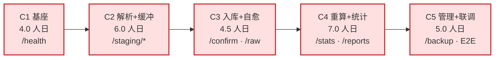

# 后端开发计划 · docs/devel

> 依据《个人财务分析仪表盘-软件设计文档-v1.0》拆分。**5 个开发周期**，每周期独立可验收，最后统一联调。
> 后端范围，共 **27.0 人日**；不含前端页面（前端另行排期，但联调阶段需完成一次类型生成）。

---

## 文档清单

| 顺序 | 文件 | 内容 | 什么时候读 |
|------|------|------|-----------|
| 1 | [`00-后端开发周期总览-v1.0.md`](./00-后端开发周期总览-v1.0.md) | 划分原则、5 周期一览、依赖图、4 个契约冻结点、通用 DoD、风险 | **先读这份** |
| 2 | [`C1-工程基座与横切能力.md`](./C1-工程基座与横切能力.md) | 工程骨架、DB/UoW/迁移、统一响应与错误码、路径守卫、启动六阶段 | 第 1 周开工前 |
| 3 | [`C2-解析内核与导入缓冲区.md`](./C2-解析内核与导入缓冲区.md) | 真实样例校准事实、表头打分、金额/时间清洗、15 个缓冲区端点 | 第 2 周开工前 |
| 4 | [`C3-入库原始库与故障自愈.md`](./C3-入库原始库与故障自愈.md) | 单事务边界、幂等闸门、raw 分表、删除意图、启动对账、故障注入 4 条 | 第 3 周开工前 |
| 5 | [`C4-分类规则重算与统计.md`](./C4-分类规则重算与统计.md) | 规则优先级、重算语义、`base_filter`、12 指标、口径核对 10 项 | 第 4 周开工前 |
| 6 | [`C5-管理域与交付收口.md`](./C5-管理域与交付收口.md) | 设置、备份/恢复/回退、数据目录迁移、事件日志、打包 | 第 6 周开工前 |
| 7 | [`联调方案与端到端验收-v1.0.md`](./联调方案与端到端验收-v1.0.md) | 三级联调、30 条验收项、口径核对表、缺陷分级、回退 | C5.6 前必读 |
| 8 | [`CONTRACT-CHANGELOG.md`](./CONTRACT-CHANGELOG.md) | 契约变更流水 + 当前冻结基线 + 禁止变更清单 | 全程，改动契约时必写 |

---

## 五个周期速览

| 周期 | 一句话目标 | 出口证据 |
|------|-----------|----------|
| C1 | 服务起得来、库建得出、错误与日志全站统一 | `/health` 200；12 张表；退出码 1~5 |
| C2 | 真实账单能走完「上传→解析→映射→预检」 | 689 / 669 行全解析；预检零写入 |
| C3 | 确认入库单事务 + 原始库 + 崩溃可自愈 | 5 张 raw 表；4 条故障注入全绿 |
| C4 | 规则能分类、重算能收敛、统计只有一个口径 | 三入口逐分类相等；口径 10 项全勾 |
| C5 | 能改设置、能备份救数据、能打包交付 | 恢复/回退演练通过；wheel 5 条命令可跑 |

---

## 使用方式

**开工前**：读 `00` 的第 2 章（周期一览）与第 4 章（冻结点），确认本周期在依赖图上的位置。

**编码中**：按周期分册的「任务分解」表逐行做，每行都有 `验收断言` 列 —— 断言就是 DoD，不要自行放宽。

**收工前**：跑该周期分册的「出口检查表」，全勾才打 tag；有契约改动就写 `CONTRACT-CHANGELOG.md`。

**联调期**：只用 `联调方案` 的 30 条验收项，不要临时发明标准；失败项回到引入周期修，不在联调层打补丁。

---

## 三条硬约束（贯穿全项目）

1. **金额一律整数分**，禁止 `float * 100`；换算只允许在 `parse_amount_to_cents` 内部用 `Decimal`。
2. **`direction` 与 `status` 的过滤条件只允许出现在 `stats_service.py`**；出现第二处即为缺陷。
3. **`status` 只能由 4 个写入点修改**：分类引擎、`transaction_service`（修正）、`exclude`、`recalc_service`。其他任何地方 `UPDATE status` 都是越界。

---

## 进度看板

| 周期 | 计划人日 | 实际 | 状态 | tag |
|------|----------|------|------|-----|
| C1 工程基座 | 4.0 | 4.0 | **已完成**（65 passed / 覆盖率 90%） | `c1-done` |
| C2 解析与缓冲区 | 6.0 | 6.0 | **已完成**（275 passed / 覆盖率 92%，689·669 逐项相等） | `c2-done`（待提交后打） |
| C3 入库与原始库 | 4.5 | | 未开始 | `c3-done` |
| C4 分类/重算/统计 | 7.0 | | 未开始 | `c4-done` |
| C5 管理域与联调 | 5.0 | | 未开始 | `c5-done` |
| **合计** | **27.0** | 10.0 | | |

> C1 的实施差异、缺陷复盘与退出码证据见 [`C1-工程基座与横切能力.md`](./C1-工程基座与横切能力.md) §9。
> C2 的实施差异、真实缺陷复盘（GB18030 内容探测失效）、出口检查表证据与 C3 交接物见
> [`C2-解析内核与导入缓冲区.md`](./C2-解析内核与导入缓冲区.md) §9。
