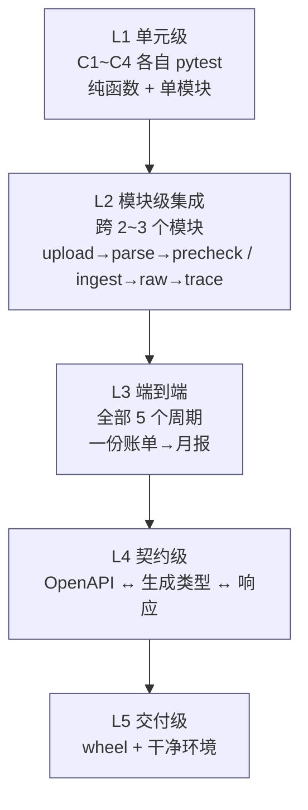

# 联调方案与端到端验收 v1.0

> 定位：C1~C4 各自绿不等于系统绿。本文件定义"把五个周期的产物组合起来"的顺序、数据、检查项、判据与回退方式。
> 适用对象：后端开发、测试、以及对接的前端开发者。
> 关联：`00-后端开发周期总览`（周期与冻结点）、`C1`~`C5`（各周期出口标准）。

---

## 1. 联调目标

| # | 目标 | 可验证判据 |
|---|------|-----------|
| L1 | **主链路跑通** | 一份真实账单从上传到月报，一条命令跑完，无人工干预 |
| L2 | **口径唯一** | `/stats`、`/reports`、`/transactions/summary` 逐分类金额相等 |
| L3 | **失败可恢复** | 4 条故障注入在完整链路上仍全绿；重启后数据自洽 |
| L4 | **契约不漂移** | `openapi.json` ↔ 前端生成类型 ↔ 实际响应，字段名/类型/`null` 语义一致 |
| L5 | **可交付** | 干净机器 5 条命令跑起来，wheel 含前端产物 |

> **不追求**：并发吞吐、多用户隔离、云端同步 —— 本项目是单机单用户，联调不为这些场景引入复杂度。

---

## 2. 联调的三个层级



| 层级 | 何时做 | 谁做 | 失败含义 |
|------|--------|------|----------|
| L1 | 每周期内 | 开发者 | 该周期未完成，不能进下一周期 |
| L2 | C3 起每周期末 | 开发者 | 跨模块接口不匹配，通常是 DTO 或事务边界问题 |
| L3 | C5.6 | 全员 | 集成缺陷，定位到周期 |
| L4 | C5.5 起 | 后端 + 前端 | 契约漂移，查 `CONTRACT-CHANGELOG.md` |
| L5 | C5.6 末 | 后端 | 打包遗漏，通常是数据文件或迁移脚本没进 wheel |

**关键纪律**：L3 失败时**不允许**在 L3 层打补丁。必须回到对应周期修，修完重跑该周期出口检查表 —— 否则会出现"联调期补丁"和"周期内实现"两套逻辑。

---

## 3. 联调前置准入（Entry Criteria）

任一条不满足，联调不开始：

| # | 准入项 | 证据 |
|---|--------|------|
| E1 | 五个 tag 齐备 | `git tag` 含 `c1-done` ~ `c5-done` |
| E2 | 全量单测绿 | `uv run pytest -q` 0 failed |
| E3 | 静态检查绿 | `ruff check` / `mypy src` 无新增问题 |
| E4 | 契约已导出 | `docs/api/openapi.json` 存在且两次导出字节一致 |
| E5 | 前端类型可生成 | `npx openapi-typescript` 成功，无 TS error |
| E6 | 联调数据就位 | 见 §4，脱敏样例 + 构造样例 + 大文件生成器 |
| E7 | 干净数据目录 | `data/` 为空或已备份，禁止在开发者的真实数据上联调 |
| E8 | 端口与锁空闲 | 8765 未被占用；无残留 `*.lock` |

---

## 4. 联调数据准备

| 数据 | 用途 | 要求 |
|------|------|------|
| `wechat_sample_sanitized.xlsx`（60 行） | 日常回归，进 git | 保留前言 17 行、表头第 18 行、序列号时间、`8.8` 这类 float 金额 |
| `alipay_sample_gb18030.csv`（60 行） | 编码回归，进 git | GB18030、13 列尾随空列、Tab 尾随、`不计收支` |
| 微信全量样例（689 行） | 联调主数据，**不进 git** | 本地脱敏后放 `tests/fixtures/local/`，`.gitignore` 排除 |
| 支付宝全量样例（669 行） | 跨 5 月分表验证 | 月份分布必须是 101/136/182/143/107 |
| `wechat_header_shifted.xlsx` | 表头探测鲁棒性 | 前言 +5 行，表头落到第 23 行 |
| `no_header.csv` / `broken_structure.csv` | EX-03 / EX-04 | 无表头 / 0 数据行 |
| `corrupt_backup.db` | EX-19 | 非 SQLite 文件 |
| 5000 行 / 50000 行生成器 | 性能与行数上限 | 生成器函数，不落盘大文件 |

**脱敏原则**（照 SDD §13.2）：人名/账号替换为 `某某`/`138****0000`，但**必须保留**结构性特征（序列号时间、float 金额、GB18030、Tab、尾随空列、`/` 与 `不计收支`）。否则解析回归失去意义。

---

## 5. 联调时序（建议 5 个工作日）

| 日 | 内容 | 产出 |
|----|------|------|
| **D1 上午** | 环境就位：干净 `data_dir`、`init-db`、启动、`/health`、单实例、退出码 | 环境确认单 |
| **D1 下午** | L2 回归：C2 + C3 的 6 条集成用例在完整环境重跑 | 回归日志 |
| **D2** | 主链路 L3：上传 → 解析 → 映射 → 预检 → 入库 → 分类 → 统计 → 月报 | `test_e2e.py` 首版 + 手工核对表 |
| **D3** | 口径核对 10 项 + 三入口三元比对 + 12 指标逐项 | 口径核对表（10 项全勾） |
| **D4** | 异常与故障：EX-01~EX-23 共 23 条 + 故障注入 4 条 + 重启对账 | 异常矩阵表 |
| **D5** | 契约核对 + 性能 + 打包 + 干净环境验证 + 缺陷收敛 | 联调报告 + 发布候选 |

> D4 的异常路径最容易超时。若 D3 发现 P0 缺陷，D4 顺延，D5 压缩为"只验契约与打包"。**不要为了赶时间跳过异常路径** —— 用户是非技术用户，异常文案与降级路径就是他的全部体验。

---

## 6. 接口联动矩阵（谁依赖谁）

| 上游 | 下游 | 契约 | 冻结版本 | 联调验证点 |
|------|------|------|----------|-----------|
| C2 `ImportOrchestrator.reparse` | C3 入库、C4 重算 | `list[ParsedRow]` | FZ-2 | 同一 `mapping_snapshot` 重放两次，`ParsedRow` 逐字段一致 |
| C2 `DedupChecker.label_rows` | C3 二次去重 | `dict[row_no, label]` | FZ-2 | 预检与入库之间插入一条同 fp 数据 → 入库 `skipped_dup` +1 |
| C3 `transaction` 行 | C4 分类/统计 | 表结构 + `status` 枚举 | FZ-3 | 入库后 `status` 全 `pending`；C4 后出现 `confirmed` |
| C3 `mapping_snapshot` | C4 重算 | JSON 只读 | FZ-3 | 重算前后 raw 零改动，分类可回退 |
| C4 `StatsService.base_filter` | C4 报表 + 明细汇总 | 字符串常量 | FZ-4 | 三入口逐分类相等 |
| C1 `ApiResponse` | 全部端点 | 三字段 | FZ-1 | 全站响应无裸对象（遍历所有路由断言） |
| C1 `AppError` | 全部异常 | `code` + HTTP | FZ-1 | 23 条 EX（EX-01~EX-23）的 `code` 与 HTTP 逐条匹配 |
| C5 `backup_service` | C4 校验 | 条数 + 汇总 | FZ-4 | 恢复后重跑 `StatsService`，数字与备份前一致 |

---

## 7. 30 条联调验收项

### A. 链路连通（1~6）

| # | 验收项 | 期望 | 命令/方法 |
|---|--------|------|-----------|
| 1 | 服务启动 | `/health` 200，`db_ok=true`，`data_dir` 为配置值 | `curl /api/v1/health` |
| 2 | 上传 + 自动解析 | 批次 `mapped_pending`，`total_rows=669` | `POST /staging/batches` |
| 3 | 映射保存 | 五核心齐 → 200；缺一 → `E1007` | `PUT /mapping` |
| 4 | 预检 | `summary.total=669`，且前后计数不变 | `POST /precheck` |
| 5 | 确认入库 | `inserted=669`，5 张 raw 表，报告四数字自洽 | `POST /confirm` |
| 6 | 追溯 | 随机 5 条可回溯到 raw 行与快照 | `GET /transactions/{id}/trace` |

### B. 口径一致（7~14）

| # | 验收项 | 期望 |
|---|--------|------|
| 7 | 四卡 | 总收入/总支出/结余/储蓄率与手工 SQL 一致 |
| 8 | 分类结构 | 一级 = 二级聚合；「未分类」切片存在 |
| 9 | 趋势 | 月内按日、季内按周、年内按月；空桶补 0 |
| 10 | Top 5 | 仅 expense，按金额降序，`txn_count` 正确 |
| 11 | 待确认 | 计入总额，且「未分类」金额 = pending 支出之和 |
| 12 | excluded | 排除后所有 KPI/分类/Top 均减少对应金额 |
| 13 | neutral | 改分类后总支出、总收入均不变 |
| 14 | 三元一致 | `/stats` == `/reports` == `/transactions/summary`，**逐分类**相等 |

### C. 边界与异常（15~22）

| # | 验收项 | 期望 |
|---|--------|------|
| 15 | 全量重复入库 | `inserted=0`、`skipped_dup=669`、批次 `ingested`、文件已删 |
| 16 | 超大文件 | >5MB → `E1005`(413)；>50000 行 → `E1006` |
| 17 | 编码/表头失败 | `E1002`/`E1003`，批次 `failed` 可重试 |
| 18 | 重复确认 | 第二次 409 `E2002`，数据无重复 |
| 19 | 删文件失败 | 数据已入库，409 `E4003`，进入待清理 |
| 20 | 缓冲区目录被删 | `E4004` 或重建成功，相关批次提示重新上传 |
| 21 | 损坏备份 | `E4005`，**零文件替换** |
| 22 | 数据目录迁移 | 新目录可启动、条数一致、旧目录保留 |

### D. 性能与稳定（23~27）

| # | 验收项 | 期望 |
|---|--------|------|
| 23 | 5000 行入库 | ≤ 10s（预算 1.5s，留余量） |
| 24 | 统计 P95 | `/stats/overview`、`/stats/categories`、`/transactions` ≤ 200ms |
| 25 | 并发确认 | 两线程同时 confirm，恰一个 200 |
| 26 | 重启对账 | `ingesting` 自愈为 `prechecked`；`flag=1` 补删成功 |
| 27 | 内存 | 5MB 上传峰值 < 8MB；5000 行入库峰值 < 300MB |

### E. 契约与交付（28~30）

| # | 验收项 | 期望 |
|---|--------|------|
| 28 | `openapi.json` 稳定 | 两次导出 `sha256` 相同；无 `additionalProperties: true` 空壳 |
| 29 | 前端类型 | `generated.ts` 可生成、无 TS error、DTO 字段名一致 |
| 30 | 打包 | wheel 含 `static/` 与 `migrations/`；干净环境 5 条命令可跑 |

---

## 8. 口径核对表（与 SDD §14.7 一致，联调期逐条签字）

| # | 核对项 | 期望 | 实测 | 结论 |
|---|--------|------|------|------|
| 1 | `base_filter()` 内容 | `direction IN ('income','expense') AND status <> 'excluded'` | | |
| 2 | neutral 改分类后总支出 | 不变 | | |
| 3 | pending 是否计入 | 计入，且未分类切片相等 | | |
| 4 | excluded | 不进任何 KPI/分类/Top | | |
| 5 | 储蓄率 0 分母 | `null` | | |
| 6 | 日均分母 | 31/92/365 | | |
| 7 | 环比基期 0 | `mom_flag='new'` | | |
| 8 | 同比无数据 | `null` 非 0% | | |
| 9 | 明细汇总 vs 月报 | 逐分类相等 | | |
| 10 | 预检 vs 报告 | 以报告为准 | | |

> 第 9 条是唯一不能靠"看总额"过关的一条。必须写脚本逐分类 diff，输出差异表。

---

## 9. 契约核对方法

```bash
# 1) 导出并比对稳定性
uv run account-dashboard export-openapi --out /tmp/o1.json
uv run account-dashboard export-openapi --out /tmp/o2.json
sha256sum /tmp/o1.json /tmp/o2.json        # 必须相同

# 2) 生成前端类型
npx openapi-typescript /tmp/o1.json -o /tmp/generated.ts
npx tsc --noEmit /tmp/generated.ts

# 3) 抽样核对字段（以 IngestReportDTO 为例）
jq '.components.schemas.IngestReportDTO.properties | keys' /tmp/o1.json
# 期望：batch_id,total,inserted,skipped_dup,pending,monthly,overrides,files_deleted,cleanup_enqueued,finished_at
```

**三个易错点**：

1. **`null` 语义不进 OpenAPI**。`savings_rate: float | None` 在 schema 里是 `anyOf[number, null]`，生成到 TS 是 `number | null`。前端若按 `number` 处理会运行时崩 —— 联调时必须实际请求一次空数据周期验证。
2. **金额单位**。所有 `*_cents` 都是整数分；前端负责 `/100`。若出现 `amount: 45.9` 说明某处漏了 `_cents` 后缀，属契约缺陷。
3. **时间格式**。恒为 `YYYY-MM-DDTHH:MM:SS`，无时区后缀。若出现 `Z` 或 `+08:00`，说明某处用了 `datetime.isoformat()` 默认行为。

---

## 10. 缺陷分级与处理

| 级别 | 定义 | 例子 | 处理 |
|------|------|------|------|
| **P0** | 数据错误或口径分歧 | 总支出少算、raw 与 transaction 分叉、三入口不一致 | 阻塞发布；回到引入周期修；修后重跑该周期出口 + 全部 L3 |
| **P1** | 主链路阻断 | 上传 500、入库失败、重启后数据不一致 | 阻塞发布；当日修复 |
| **P2** | 异常路径或降级不正确 | EX-* 文案错、错误码错、待清理未入队 | 可发布前修；若涉及数据安全升级为 P1 |
| **P3** | 体验/文案 | 错别字、提示不清晰 | 记录，可下一迭代 |

**禁止**：把 P0 降级为"已知问题"。财务数据错一分就是错，没有"轻微不一致"。

---

## 11. 回退方案

| 场景 | 动作 | 数据影响 |
|------|------|----------|
| 某条链路在联调期发现设计缺陷 | `git checkout c{N}-done` 定位，回到对应周期修，重打 tag | 无（开发期用临时 `data_dir`） |
| 已用真实数据联调，发现 P0 | 用联调前备份恢复（`POST /backup/restore`），再回到代码修复 | 恢复到联调前 |
| 打包产物不可用 | 回退到上一个可用的 wheel | 无 |
| 契约变更导致前端不可用 | 回退 `openapi.json` 到上一版，前端用旧类型 | 无 |

**铁律**：联调一律使用**独立的数据目录**（`D:/tmp/ledger-e2e` 或 `tmp_path`），禁止指向开发者的真实财务数据目录。

---

## 12. 联调出口（Exit Criteria）

全部满足才算交付：

- [ ] 30 条验收项逐条签字，P0/P1 缺陷为 0
- [ ] 口径核对表 10 项全勾，附逐分类 diff 输出
- [ ] 4 条故障注入在完整链路全绿
- [ ] 性能：入库 ≤10s/5000 行；统计 P95 ≤200ms
- [ ] 契约：两次导出字节一致；`generated.ts` 无 TS error
- [ ] 打包：干净虚拟环境 5 条命令跑通，`/` 与 `/api/v1/health` 均正常
- [ ] 文档：C1~C5 的"实际产出 vs 计划"差异已回填；`CONTRACT-CHANGELOG.md` 完整
- [ ] 备份/恢复/回退三项演练各通过一次
- [ ] 数据目录迁移演练通过（含回退到旧目录）

---

## 13. 联调后必须留下什么

| 物 | 用途 | 位置 |
|----|------|------|
| 联调报告（30 项结果 + 缺陷清单） | 交付证据；下一轮回归基线 | `docs/devel/联调报告-v1.0.md`（联调完成后生成） |
| 口径核对表（签字版） | 证明符合 PRD 10.3 | 同上附录 |
| 性能基线（P95 原始输出） | 后续版本对比 | 同上附录 |
| `openapi.json` 定版 | 前端唯一契约 | `docs/api/openapi.json` |
| E2E 用例 | 每次发版必跑 | `tests/integration/test_e2e.py` |

> 联调不是"最后跑一遍"，而是**把五个周期的边界缝合成一条可重复执行的用例**。`test_e2e.py` 是这次联调最重要的产物 —— 它让下一次改动有了回归网。
