# 个人财务分析仪表盘 · 软件设计文档（SDD）v1.0

> 定位：本文件是《个人财务分析仪表盘-PRD-v2.0》的**唯一工程落地依据**。架构评审已定分层与信任边界，本文件只做一件事——把 PRD 的契约与不变量翻译成**可直接编码**的模块、签名、DDL、接口、时序与任务清单。
> 阅读顺序建议：先读 §2（总体设计）与 §3（工程结构），再读 §4/§5/§6（模块、数据、接口），最后按 §14 任务表开工。

---

## 0. 文档信息与追溯

### 0.1 文档信息

| 项目 | 内容 |
|------|------|
| 文档名称 | 个人财务分析仪表盘 · 软件设计文档 |
| 版本 | v1.0（设计与工程落地首版） |
| 作者 | 高见远（Gao）· 架构师 |
| 日期 | 2026-10-22 |
| 上游输入 | PRD v2.0（定稿）、架构评审与分层设计 v1.0（含第十一节委托方决策对齐）、真实账单样例 2 份 |
| 下游用途 | 工程师编码依据；测试用例设计依据；代码评审 Checklist |
| 状态 | 待工程师评审（Review 后进入 M1 编码） |
| 篇幅 | 17 章；任务分解见 §14 |

### 0.2 与上游文档的追溯关系

| 本文章节 | PRD v2.0 依据 | 架构评审 v1.0 依据 | 落地性质 |
|----------|---------------|--------------------|----------|
| §1 设计目标与约束 | 5.3、8（NFR）、11 | 二、4.2、4.3、11.1 | 约束固化 |
| §2 总体设计 | 8.1.1、8.1.2、9.1 | 3.1、3.3、11.2 | 分层细化到包 |
| §3 工程结构与打包 | 8（NFR·可维护性）、13.2、RK-15 | 11.2.3、11.2.4 | 新增（评审未覆盖） |
| §4 后端模块设计 | 8.1.2 | 3.2、3.3 全表 | 职责 → 签名 |
| §5 数据设计 | 10.1、10.2、9.3、9.4 | 3.2（repositories / raw-table-manager） | 实体 → 可执行 DDL |
| §6 接口设计 | 7.x 全部 FR、8.1.3 | 4.2 清单 13 项、4.4 | 需求 → REST 契约 |
| §7 关键流程 | 9.1、9.2、13.4、EX-01~23 | 8.2 故障注入 4 用例 | 流程 → 时序 + 事务边界 |
| §8 解析适配器 | 7.1 FR-01~04、12 EX-06/07/21 | 第五节（适配器扩展点） | **按真实样例校准** |
| §9 统计服务 | 10.3 全表、FR-13/16/17/18/19 | 3.3（单一来源） | 口径 → SQL |
| §10 前端设计 | 5.3、7.3、8（配色）、9.2 | 3.2 前端四模块 | 页面 → 组件 → API |
| §11 配置与运行 | 11、FR-22、FR-07 | 11.3 决策 4 | 路径 → 校验函数 |
| §12 异常处理 | 第十二章 EX-01~23 | 4.2、4.3 | EX → code 映射 |
| §13 测试设计 | 13.4、US-03 构造用例、M-01 | 8.2 第 4 条 | 验收 → 用例 |
| §14 任务分解 | 13.1 M1~M5 | 8.1、8.2 | 里程碑 → 工作包 |
| §15 ADR | — | 第六节、第十一节 | 推翻/继承记录 |
| §16 风险 | 14.1 RK-01~15 | 8.3 RK-09~15 | 新增技术风险 |

### 0.3 与 PRD 术语的一致性声明

本文**不引入任何新术语**。以下词汇与 PRD 完全同义，禁止在代码注释、界面文案、日志中换词：

`direction`（income / expense / neutral）、`neutral` 不计收支、`资金流转`（neutral 的默认分类标签，**不是统计开关**）、`缓冲区`/`staging`、`批次`/`batch`、`待确认`/`pending`、`已修正`/`corrected`、`已排除`/`excluded`、`原始库`/`raw_YYYY_MM`、`主数据层`/`transaction`、`去重指纹`/`fingerprint`、`强制新增`/`override`、`删除意图`/`pending_delete_flag`、`启动对账`/`reconciliation`、`映射快照`/`mapping_snapshot`。

---

## 1. 设计目标与约束

### 1.1 设计目标（按优先级）

| # | 目标 | 可验证判据 |
|---|------|-----------|
| G1 | **契约不漂移**：PRD 的不变量在代码里只有一个实现点 | `direction` 过滤只有 `stats_service.base_filter()` 一处；删除意图只有一处写入；重算只有一个服务 |
| G2 | **可实现**：工程师拿到本文即可写出第一天代码 | §4 给出函数签名、§5 给出可执行 DDL、§6 给出请求/响应模型、§7 给出事务边界 |
| G3 | **可移植**：换一台机器 ≤ 5 条命令跑起来 | §3.5 引导流程；`uv sync` + `uv run` 两条命令即可 |
| G4 | **隐私闭环**：数据不出本机，原始文件零残留 | 后端仅绑 127.0.0.1；`data/` 不入 git；启动对账兜底 |
| G5 | **口径单一**：仪表盘/报表/明细三处数字必然一致 | 三类 API 全部委托同一组计算函数（§9.1） |
| G6 | **可测**：每条 FR 有对应 pytest 用例落点 | §13 用例矩阵 |

### 1.2 硬性约束（委托方指定，不可协商）

| 类别 | 约束 | 落地位置 |
|------|------|----------|
| 依赖管理 | **uv + `pyproject.toml`(PEP 621) + `uv.lock` + `.python-version`**；`requirements.txt`/`pip`/`conda` 不作主路径 | §3.2 / §3.4 |
| Python | 下限 **3.11**；类型注解用 3.11 语法（`X \| None`、`Self`、`TypedDict`、`datetime.UTC` 不用） | §3.4 |
| 可打包 | `uv build` 产出 wheel/sdist；**前端构建产物打进 wheel**，后端在 `/` 挂载 | §3.3（ADR-06） |
| 数据隔离 | SQLite 库、缓冲区、备份**不进包、不入 git**，路径由配置解析（FR-22 可自定义） | §11.1 / §11.2 |
| 后端 | Python 3.11+ / FastAPI / Pydantic v2 / uvicorn / 标准库 `sqlite3`（显式 `BEGIN IMMEDIATE`）/ openpyxl / csv / chardet / python-multipart | §4 |
| 前端 | React 18 + TS + Vite + ECharts + TanStack Query + React Router | §10 |
| 契约 | Pydantic 为单一事实源 → OpenAPI 3 → `openapi-typescript` 生成前端类型 | §6.6 |
| 绑定 | 后端**仅** 127.0.0.1，不提供 0.0.0.0 开关 | §11.5 |

### 1.3 PRD 不变量清单（代码级强制，改动即为缺陷）

| # | 不变量 | 强制手段 | 违反后果 |
|---|--------|----------|----------|
| I1 | `direction` 是统计唯一准绳；`neutral` 一律不计收支，与分类归属无关 | 统计过滤函数白名单 `direction IN ('income','expense')`；分类变更**不写 direction** | 出现「改分类就改统计」的隐性开关 |
| I2 | `status='excluded'` 不进任何收支统计 | 过滤函数 `status <> 'excluded'` | 已排除记录被算进总额 |
| I3 | `status='pending'` **计入**总额，分类结构单列「未分类」 | 聚合 SQL 用 `CASE WHEN status='pending' THEN '未分类'` | 未分类金额凭空消失，总额对不上 |
| I4 | 金额一律整数分（`amount_cents INTEGER`） | 入库前 `Decimal` 换算；DDL `CHECK(amount_cents >= 0)`；展示层 `/100` | 浮点累计误差 |
| I5 | 时间一律 ISO 8601 **本地时间**字符串（不做 UTC 转换） | `occurred_at TEXT`，格式 `YYYY-MM-DDTHH:MM:SS` | 「昨天/今天」错乱、跨时区偏移 |
| I6 | 统一响应 `{code, data, message}` | `ApiResponse[T]` 泛型 + 全局异常处理器 | 前端需兼容多套错误结构 |
| I7 | raw 只增不改；主数据层**不得**与 raw 分叉 | raw 无 UPDATE 语句（仓库层不提供 update 方法）；`PATCH /transactions/{id}` 字段白名单仅 `category_l1/l2/note` | 审计链断裂 |
| I8 | raw 与主数据层可回溯到 `batch_id + row_no` | 两表均建 `(batch_id, row_no)` 索引；`transaction.batch_id/row_no NOT NULL` | 无法按批次重算/追溯 |
| I9 | 删除意图先落库，物理删除在后 | 同一事务内 `pending_delete_flag=1` + `status='入库中'→'已入库'`；删除成功后才清零 | 崩溃后文件永久残留 |
| I10 | 确认入库幂等（非「待确认」→ 409） | `BEGIN IMMEDIATE` 内条件 UPDATE + `rowcount` 判定 | 双击产生重复流水 |
| I11 | `mapping_snapshot` 随批次永久保存 | 入库时快照写入 `staging_batch.mapping_snapshot`，全程只读 | 重算口径无法还原 |
| I12 | FR-08 与 FR-11 是**同一个重算服务**的两个入口 | 只有 `RecalcService.recalculate(scope)` 一个实现；两处路由都调它 | 两套口径漂移 |
| I13 | 明细仅分类/备注可编辑 | Pydantic 请求模型只含这两个字段（多余字段 422） | 原始事实被改，与 raw 分叉 |
| I14 | 统计只由后端算，前端不聚合 | 前端禁止 `reduce(sum)` 业务金额；ESLint 自定义规则可选 | 同口径核对失败 |

### 1.4 设计取舍（5 条，均已在 §15 展开为 ADR）

| # | 取舍 | 选择 | 放弃的替代方案 | 主要理由 |
|---|------|------|----------------|----------|
| D1 | 依赖与运行环境 | uv（lock + 项目内 venv） | pip + requirements.txt / conda | 可复现、跨机一致、单命令同步，直接满足「可打包可移植」 |
| D2 | 数据访问 | 标准库 `sqlite3` + 手写 Repository + 显式 `BEGIN IMMEDIATE` | SQLAlchemy / peewee | 零额外依赖、事务边界显式可见（I9/I10 需要精确控制）、表结构简单（12 张固定表 + 按月新增的 raw 分表） |
| D3 | 原始库形态 | **按月物理分表** `raw_YYYY_MM` | 单表 + 月份分区列 | PRD 9.3 已定；物理分表使「按月查看」零成本，且天然只增不改 |
| D4 | 前端产物托管 | **打进 wheel，由后端 `StaticFiles` 挂 `/`** | 独立 Nginx / 前端独立 `vite preview` | 单进程单端口、无 CORS、非技术用户一键启动；后端已绑 127.0.0.1，无需额外防护 |
| D5 | 前端类型来源 | `openapi-typescript` 生成 | 手写 DTO | Pydantic 单一事实源（PRD 5.3）；漂移用 `npm run gen:api` + CI diff 检查兜住 |

---

## 2. 总体设计

### 2.1 进程与部署视图

单机、单用户、两进程（生产形态下前端为静态资源，由后端同进程托管，实际只有**一个**后端进程监听 127.0.0.1）。

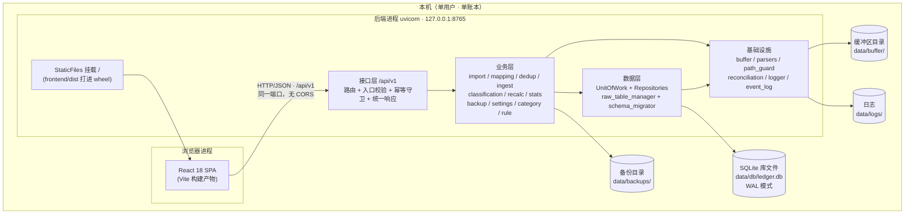

**边界说明**（对应架构评审 4.3 信任边界）：

1. 浏览器 → 后端是**唯一**不可信边界，全部校验在 `/api/v1` 入口一次性完成（§6.5 入口校验清单）；后端内部模块间不重复校验形状与取值。
2. 后端 → 文件系统只有三个落点：`data/db`、`data/buffer`、`data/backups`（+ `data/logs`），全部经 `path_guard` 解析，禁止任意路径写入。
3. 前端**看不到**数据库文件与缓冲区目录，只能经 API 访问（PRD 8.1.1 原则 1）。

### 2.2 五层落地映射（PRD 8.1.2 → 实际 Python 包）

| PRD 层 | 承载业务 | 落地包/模块 | 关键约束（代码级） |
|--------|----------|-------------|--------------------|
| 展示层（前端） | 仪表盘、三期报表、明细、导入向导、缓冲区、原始库、规则、待确认、设置、帮助 | `frontend/src/{pages,components,hooks,api,charts}` | 禁止 `reduce` 业务金额；禁止直连 DB |
| 接口层 | 路由、请求解析、入口校验、幂等守卫、统一响应与错误码 | `account_dashboard/api/**`、`api/deps.py`、`api/errors.py`、`api/response.py` | **禁止 import `repositories`**（CI 静态检查） |
| 业务层 | 导入编排、映射、去重、入库、分类、重算、统计、备份、设置、分类/规则管理、清理 | `account_dashboard/services/**` | 承载事务边界；不写 SQL 字符串（只用 Repository） |
| 数据层 | 仓储、raw 分表、事务控制、参数化查询（唯一 SQL 出口） | `account_dashboard/repositories/**` | 唯一允许出现 SQL 的层；不 import `services` |
| 基础设施 | 缓冲区文件、解析适配器、编码、路径守卫、启动对账、日志、事件日志 | `account_dashboard/infra/**` | 不定义业务规则；不 import `services` |

**跨层规则**：`api → services → repositories → infra`，单向；`services` 之间可互相调用（如 `ingest_service → classification_engine`）。禁止 `api → repositories` 跳层，用 `tests/test_layering.py` + `ruff` 的 `flake8-tidy-imports`（`banned-api`）做静态约束。

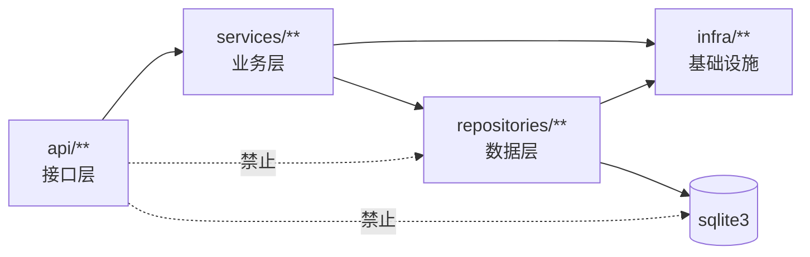

### 2.3 运行时启动时序（`lifespan`）

启动是**唯一**允许执行「自愈/对账」的时机。任何异常都不能让服务「静默降级启动」——宁可拒绝启动并打印可读原因（非技术用户需要明确指引）。

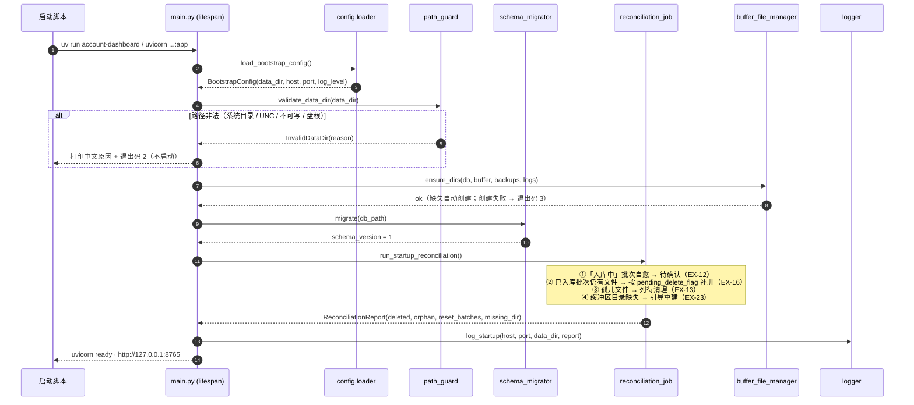

**启动阶段约定**：

| 阶段 | 失败表现 | 退出码 | 用户可见信息 |
|------|----------|--------|--------------|
| 配置装载 | `app.toml` 语法错误 | 1 | 「配置文件第 N 行格式错误」 |
| 数据目录校验 | 敏感目录/UNC/不可写 | 2 | 「数据目录不可用：<原因>，请修改 app.toml 的 data_dir」 |
| 目录创建 | 权限不足 | 3 | 「无法创建目录 <path>，请检查权限」 |
| schema 迁移 | SQL 执行失败 | 4 | 「数据库升级失败，已回滚；请从 data/backups 恢复」 |
| 启动对账 | 单文件删除失败 | **不退出** | 记日志 + 进待清理列表（数据不受影响） |
| 端口占用 | 8765 被占 | 5 | 「端口 8765 已被占用，请在 app.toml 修改 port」 |

> 对账失败**不阻塞启动**：PRD EX-11/EX-16 要求「数据不受影响 + 可重试」，阻塞启动反而让用户无法进入界面处理。
---

## 3. 工程结构与打包设计（重点）

### 3.1 完整目录树

采用 **src 布局**（`src/account_dashboard/`），理由：wheel 只打包 `src` 下的包，`tests/`、`docs/`、`scripts/` 不会误入包；`uv sync` 后 `uv run` 直接可 import，无需 `PYTHONPATH` 技巧。

```
account_dashboard/
├─ pyproject.toml                     # PEP 621 元数据 + 依赖 + 工具配置（唯一依赖声明处）
├─ uv.lock                            # 锁文件（必须入库，见 §3.4）
├─ .python-version                    # "3.11"（uv 自动安装/切换解释器）
├─ README.md                          # 5 条命令上手
├─ app.toml.example                   # 引导配置模板（复制为 app.toml）
├─ .gitignore                         # 排除 data/ dist/ .venv/ node_modules/ app.toml
├─ .editorconfig
├─ Makefile                           # 可选：dev/test/build/gen-api 快捷入口（Windows 用 scripts/*.ps1）
│
├─ src/account_dashboard/
│  ├─ __init__.py                     # __version__ = "1.0.0"
│  ├─ __main__.py                     # python -m account_dashboard → cli.main()
│  ├─ main.py                         # create_app() + lifespan（§2.3）
│  ├─ cli.py                          # 子命令：run / init-db / doctor / migrate-data / build-frontend / export-openapi
│  ├─ config.py                       # BootstrapConfig + Settings（§11.1）
│  │
│  ├─ api/                            # ── 接口层 ──
│  │  ├─ __init__.py
│  │  ├─ app_factory.py               # 路由注册、中间件、静态挂载、异常处理器装配
│  │  ├─ response.py                  # ApiResponse[T] / Page[T] / ok() / fail()
│  │  ├─ errors.py                    # ErrorCode 枚举 + AppError 层级 + 处理器
│  │  ├─ deps.py                      # get_uow / get_*_service 依赖
│  │  ├─ guards.py                    # idempotency-guard（批次状态机前置守卫）
│  │  ├─ validators.py                # 入口校验：文件、分页、周期、路径、金额
│  │  ├─ static_mount.py              # 挂载 frontend 产物 + SPA fallback
│  │  └─ routers/
│  │     ├─ __init__.py
│  │     ├─ health.py                 # GET /health
│  │     ├─ staging.py                # 上传/解析/映射/预检/丢弃/孤儿/占用
│  │     ├─ ingest.py                 # 确认入库、报告、override 标记
│  │     ├─ raw.py                    # 按月查看、按批次追溯
│  │     ├─ transactions.py           # 明细查询、汇总、编辑、批量分类、待确认
│  │     ├─ stats.py                  # overview / categories / trend / top-merchants
│  │     ├─ reports.py                # monthly / quarterly / yearly
│  │     ├─ rules.py                  # 规则 CRUD + 启停
│  │     ├─ categories.py             # 分类 CRUD + 停用迁移
│  │     ├─ recalc.py                 # 重算预览 / 执行（单一服务两入口）
│  │     ├─ settings.py               # 设置读写 + 数据目录校验/迁移
│  │     ├─ backup.py                 # 备份/清单/恢复/回退/导出
│  │     └─ maintenance.py            # 待清理列表、重试、事件日志开关
│  │
│  ├─ services/                       # ── 业务层 ──
│  │  ├─ __init__.py
│  │  ├─ import_orchestrator.py       # 上传→解析→映射→预检 编排
│  │  ├─ mapping_service.py           # 表头映射、模板 CRUD、冲突处理（EX-20）
│  │  ├─ dedup_checker.py             # 指纹比对（只读）+ 强制新增标记
│  │  ├─ ingest_service.py            # 确认入库单事务（raw + transaction + 删除意图）
│  │  ├─ classification_engine.py     # 规则评估、direction 判定、待确认判定
│  │  ├─ recalc_service.py            # 唯一重算服务（FR-08 / FR-11 两入口）
│  │  ├─ stats_service.py             # 唯一统计源（§9）
│  │  ├─ transaction_service.py       # 明细查询/编辑（字段白名单）/批量修正
│  │  ├─ pending_service.py           # 待确认队列（按对方聚合）
│  │  ├─ rule_service.py              # 规则管理 + 入口校验
│  │  ├─ category_service.py          # 分类管理 + 停用迁移
│  │  ├─ settings_service.py          # 设置读写 + 类型校验（settings_store）
│  │  ├─ backup_service.py            # 备份/恢复/回退/导出（EX-19）
│  │  ├─ cleanup_service.py           # 待清理队列、删除重试
│  │  └─ migration_service.py         # 数据目录迁移向导（FR-22 / M5）
│  │
│  ├─ repositories/                   # ── 数据层 ──
│  │  ├─ __init__.py
│  │  ├─ database.py                  # 连接管理、PRAGMA、RLock、row_factory
│  │  ├─ unit_of_work.py              # BEGIN IMMEDIATE / COMMIT / ROLLBACK
│  │  ├─ schema_migrator.py           # 版本化迁移（幂等）
│  │  ├─ migrations/
│  │  │  ├─ V001__init.sql
│  │  │  ├─ V002__channel_template.sql
│  │  │  └─ (后续增量，只增不改)
│  │  ├─ staging_repo.py
│  │  ├─ raw_repo.py                  # 含 raw_table_manager（建表/写入/UNION 查询）
│  │  ├─ transaction_repo.py
│  │  ├─ rule_repo.py
│  │  ├─ category_repo.py
│  │  ├─ setting_repo.py
│  │  ├─ template_repo.py             # 渠道映射模板
│  │  ├─ override_repo.py             # 强制新增留痕
│  │  ├─ cleanup_repo.py              # 待清理队列
│  │  ├─ backup_repo.py               # 备份日志
│  │  └─ event_repo.py                # 本地事件日志（默认关闭）
│  │
│  ├─ infra/                          # ── 基础设施 ──
│  │  ├─ __init__.py
│  │  ├─ paths.py                     # DataPaths：data_dir 下的 db/buffer/backups/logs
│  │  ├─ path_guard.py                # 数据目录合法化（§11.3）
│  │  ├─ buffer_file.py               # buffer-file-manager：落盘/删除/扫描/占用
│  │  ├─ logger.py                    # logging 配置 + 文件轮转
│  │  ├─ event_log.py                 # 本地事件日志门面（开关来自 setting）
│  │  ├─ reconciliation.py            # 启动对账作业（§7.6）
│  │  ├─ filelock.py                  # 单实例锁（防止双服务写同一库）
│  │  └─ parsers/
│  │     ├─ base.py                   # ParseAdapter Protocol + 数据类
│  │     ├─ registry.py               # 适配器注册与 sniff 选择
│  │     ├─ header_detect.py          # 表头探测打分（§8.3）
│  │     ├─ encoding.py               # 编码探测与解码（§8.4）
│  │     ├─ cleaning.py               # 单元格/金额/时间清洗（§8.5）
│  │     ├─ fingerprint.py            # 指纹构造（§8.7）
│  │     ├─ wechat_xlsx.py            # 微信 xlsx 适配器
│  │     ├─ alipay_csv.py             # 支付宝 csv 适配器
│  │     └─ generic.py                # 通用 csv/xlsx 兜底适配器
│  │
│  └─ models/                         # ── 契约（Pydantic 单一事实源）──
│     ├─ __init__.py
│     ├─ enums.py                     # Direction/Status/Channel/BatchStatus/ErrorCode
│     ├─ common.py                    # ApiResponse/Page/Period/DateRange
│     ├─ staging.py                   # 批次 DTO、预览 DTO、映射 DTO、预检 DTO
│     ├─ ingest.py                    # 确认请求/导入报告 DTO
│     ├─ transaction.py               # 明细 DTO、筛选参数、编辑请求
│     ├─ stats.py                     # KPI/分类/趋势/Top/报表 DTO
│     ├─ admin.py                     # 规则/分类/设置/备份 DTO
│     └─ internal.py                  # ParsedRow / ParseIssue / HeaderMatch / RawRecord
│
├─ frontend/
│  ├─ package.json                    # react18, react-router-dom, @tanstack/react-query, echarts
│  ├─ vite.config.ts                  # dev proxy /api → 127.0.0.1:8765；build outDir=dist
│  ├─ tsconfig.json / tsconfig.node.json
│  ├─ index.html
│  ├─ .eslintrc.cjs
│  └─ src/
│     ├─ main.tsx / App.tsx / router.tsx
│     ├─ api/client.ts                # fetch 封装 + ApiResponse 解包 + 错误码映射
│     ├─ api/generated.ts             # openapi-typescript 产物（勿手改）
│     ├─ api/endpoints.ts             # 按资源分组的强类型函数
│     ├─ hooks/                       # useStats / useBatches / useTransactions / useSettings
│     ├─ charts/echartsTheme.ts       # 涨红跌绿主题
│     ├─ state/importWizard.tsx       # 向导状态机（useReducer + Context）
│     ├─ components/                  # KpiCard / ChartCard / DataTable / WizardSteps / ...
│     ├─ pages/                       # Dashboard / Monthly / Quarterly / Yearly / Transactions
│     │                               # ImportWizard / Staging / RawArchive / Pending / Rules
│     │                               # Settings / Help
│     └─ styles/                      # tokens.css / global.css
│
├─ scripts/
│  ├─ start.ps1                       # Windows 一键启动（§11.6）
│  ├─ start.sh                        # macOS / Linux 一键启动
│  ├─ build_frontend.py               # npm ci && npm run build → 复制到 src/.../static
│  └─ gen_api_types.sh                # 导出 openapi.json + openapi-typescript
│
├─ tests/                             # pytest（§13）
│  ├─ conftest.py
│  ├─ fixtures/
│  │  ├─ wechat_sample_sanitized.xlsx # 脱敏副本（≤ 60 行）
│  │  ├─ alipay_sample_gb18030.csv    # 脱敏副本（≤ 60 行）
│  │  ├─ broken_structure.csv
│  │  ├─ same_day_same_amount.py      # 构造用例生成器
│  │  └─ corrupt.db
│  ├─ unit/                           # 解析/清洗/指纹/口径/路径守卫
│  ├─ integration/                    # API 全链路（TestClient + 临时 data_dir）
│  └─ fault_injection/                # §13.4 四条故障注入
│
├─ docs/
│  ├─ 个人财务分析仪表盘-PRD-v2.0.md
│  ├─ architecture/架构评审与分层设计-v1.0.md
│  ├─ reviews/PRD-v1.1-需求评审-产品经理.md
│  └─ devel/个人财务分析仪表盘-软件设计文档-v1.0.md   ← 本文件
│
└─ data/                              # 运行期数据（.gitignore；首次启动自动创建）
   ├─ db/ledger.db (+ -wal/-shm)
   ├─ buffer/
   ├─ backups/{auto,manual}/
   ├─ logs/app.log
   └─ .lock                           # 单实例锁
```

> **注意**：`src/account_dashboard/static/`（前端产物落地目录）**不入 git**，由 `scripts/build_frontend.py` 在打包前生成；源码在 `frontend/src`。

### 3.2 uv 工作流（实际命令）

```bash
# 0) 一次性地准备解释器（uv 自动下载 3.11，无需系统预装）
uv python install 3.11

# 1) 按 lock 创建/同步 .venv（日常开发每天第一条命令；默认含 dev 组）
uv sync

# 2) 严格按 lock 安装（CI / 换机复现，lock 与 pyproject 不一致即报错；同样含 dev 组）
uv sync --frozen

# 2b) 只要运行期依赖（生产/打包机器；不装 pytest/ruff/mypy）
uv sync --frozen --no-dev

# 3) 新增运行期依赖（自动写 pyproject + 更新 uv.lock）
uv add openpyxl chardet

# 4) 新增开发依赖（写入 [dependency-groups].dev，uv sync 会安装）
uv add --dev pytest pytest-cov httpx ruff mypy

# 5) 运行（不激活 venv，直接借 uv 的执行环境）
uv run uvicorn account_dashboard.main:app --host 127.0.0.1 --port 8765 --reload
uv run account-dashboard run          # 等价的 CLI 入口（生产用）
uv run pytest -q
uv run ruff check src tests
uv run mypy src

# 6) 依赖升级（显式、可评审）
uv lock --upgrade                     # 全量升级并重写 lock
uv lock --upgrade-package fastapi     # 单包升级
uv sync                               # 应用新 lock

# 7) 打包
uv build                              # → dist/*.whl + dist/*.tar.gz

# 8) 离线/内网（无外网时的降级路径）
uv sync --offline                     # 仅用本地 cache（需之前 uv sync 过一遍）
uv export --format requirements-txt > requirements.lock.txt   # 兼容说明：仅供审计，不作主路径
```

**目录位置约定**：所有命令在**仓库根**（`pyproject.toml` 所在目录）执行；`.venv/` 由 uv 建在根目录，不入 git。

### 3.3 打包与分发

**决策：前端构建产物打进 wheel，由后端 `StaticFiles` 挂载 `/`。**（ADR-06）

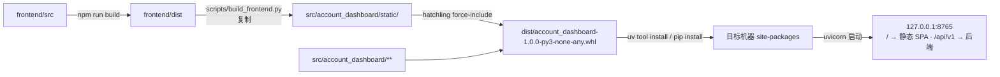

`pyproject.toml` 关键片段（可直接使用）：

```toml
[build-system]
requires = ["hatchling>=1.24"]
build-backend = "hatchling.build"

[project]
name = "account-dashboard"
version = "1.0.0"
description = "个人财务分析仪表盘（本地部署 · 单用户）"
requires-python = ">=3.11,<3.14"
dependencies = [
  "fastapi>=0.110,<1.0",
  "uvicorn[standard]>=0.29,<1.0",
  "pydantic>=2.7,<3.0",
  "python-multipart>=0.0.9,<1.0",
  "openpyxl>=3.1,<4.0",
  "chardet>=5.2,<6.0",
]

# dev 依赖用 PEP 735 dependency-groups（uv add --dev 写入此处；uv sync 默认安装）
[dependency-groups]
dev = ["pytest>=8.0", "pytest-cov>=5.0", "httpx>=0.27", "ruff>=0.4", "mypy>=1.10"]

[tool.uv]
default-groups = ["dev"]        # 显式声明，避免 uv 版本差异导致 dev 组不被默认安装

[project.scripts]
account-dashboard = "account_dashboard.cli:main"

[tool.hatch.build.targets.wheel]
packages = ["src/account_dashboard"]

[tool.hatch.build.targets.wheel.force-include]
"src/account_dashboard/static" = "account_dashboard/static"

[tool.pytest.ini_options]
testpaths = ["tests"]
addopts = "-q --strict-markers"

[tool.ruff]
line-length = 100
target-version = "py311"
```

> **dev 依赖的承载方式（易踩坑，必须统一）**：`uv add --dev` 写入的是 **PEP 735 `[dependency-groups].dev`**，而 `uv sync` **默认安装** `dependency-groups` 里的 `dev` 组（本文件用 `[tool.uv] default-groups = ["dev"]` 显式固定，避免 uv 版本差异）。因此 §3.5 第 3 步 `uv sync` 之后 `uv run pytest` 可直接用。
> **禁止**用 `[project.optional-dependencies]` 的 extras 表达 dev 依赖：extras **不会**被 `uv sync` 默认安装，必须 `uv sync --extra dev`，与 `uv add --dev` 的写入位置不一致 —— 混用会出现「严格按文档执行，但 `pytest: command not found`」，直接违背委托方「换机器简单配置后继续开发」的约束。
> 生产/打包安装去掉 dev：`uv sync --no-dev`（或直接 `uv tool install <wheel>`，wheel 本身不含 dev 依赖）。

**为什么选打进 wheel 而不是独立 Nginx**：

| 维度 | 打进 wheel（选） | 独立 Nginx / 静态服务 |
|------|------------------|----------------------|
| 用户侧复杂度 | 一条 `uv run` 起全站 | 需装 Nginx 或再起一个 node 进程 |
| CORS | 同源，零配置 | 需配 CORS 或反向代理 |
| 端口暴露面 | 只有 127.0.0.1:8765 | 两个端口，都要单独限制绑定 |
| 包体积 | +1.5~2.5 MB（gzip 后 ~600KB） | 包更小 |
| 缺点 | 前端改动需重新打包（开发期用 Vite dev server 规避） | — |

**开发期形态**：`uv run uvicorn ... --port 8765` + `cd frontend && npm run dev -- --port 5173`，`vite.config.ts` 里 `server.proxy['/api'] = 'http://127.0.0.1:8765'`；此时后端静态挂载自动跳过（`static/` 不存在则 `/` 返回提示页）。

### 3.4 版本与依赖策略

| 项 | 策略 | 说明 |
|----|------|------|
| Python 下限 | **3.11** | `requires-python = ">=3.11,<3.14"`；`.python-version` 写 `3.11`；不使用 3.12+ 独有语法 |
| 依赖上下界 | **下界 = 首个含所需特性的版本；上界 = 下一个大版本** | 例 `fastapi>=0.110,<1.0`；避免 `~=` 锁死补丁导致安全更新困难 |
| 精确复现 | `uv.lock` **必须入库** | `uv sync --frozen` 在 CI/换机时保证完全一致（含 hash） |
| **dev 依赖承载方式** | **`[dependency-groups].dev`（PEP 735），禁止用 `[project.optional-dependencies]` 表达 dev** | `uv add --dev` 只写 dependency-groups，`uv sync` **默认安装**它；extras 默认不装（须 `--extra dev`），二者混用会出现「按文档执行但 `pytest: command not found`」。生产安装用 `uv sync --no-dev` |
| lock 平台性 | uv lock 为**跨平台通用锁** | Windows/macOS/Linux 共用一份；无 `--platform` 分叉 |
| 安全更新 | 每季度 `uv lock --upgrade` 一次并跑全量测试 | 记录在 `docs/devel/CHANGELOG` |
| 大版本升级 | 需 ADR + 全量回归 | 尤其 `pydantic`（v2 → v3）、`openpyxl` |
| 前端依赖 | `package-lock.json` 入库，`npm ci` 安装 | 与 `uv.lock` 同等级别的复现保证 |
| 离线/内网 | ① 先在有网机器 `uv sync` 预热 cache；② `uv sync --offline`；③ 或 `uv build` 出 wheel + `uv pip install --find-links=wheelhouse` | 三条路径在 README 均写明 |

### 3.5 新机器引导（≤ 5 条命令）

```bash
# 1. 安装 uv（Windows: powershell -c "irm https://astral.sh/uv/install.ps1 | iex"
#                    macOS/Linux: curl -LsSf https://astral.sh/uv/install.sh | sh）
# 2. 取代码
git clone <repo> account_dashboard && cd account_dashboard
# 3. 同步依赖（自动装 Python 3.11）
uv sync
# 4. 初始化数据目录与库（创建 data/ 四个子目录 + 建表 + 种子规则/分类）
uv run account-dashboard init-db
# 5. 启动
uv run account-dashboard run
```

启动后浏览器打开 `http://127.0.0.1:8765`（脚本会打印并尝试自动打开）。`init-db` 幂等，重复执行无副作用。

**`account-dashboard` CLI 子命令**：

| 子命令 | 作用 | 关键参数 |
|--------|------|----------|
| `run` | 启动服务（读 `app.toml`） | `--data-dir`, `--port`, `--no-browser` |
| `init-db` | 创建 data 目录 + 迁移 schema + 种子数据 | `--force-seed`（重置种子，不动业务数据） |
| `doctor` | 环境自检：Python 版本、data 目录可写、端口占用、依赖完整性 | 输出 5 项体检结果 |
| `migrate-data` | 数据目录迁移（CLI 形态，供 M5 向导与脚本复用） | `--to <path>` |
| `build-frontend` | 调 `scripts/build_frontend.py`（npm build + 复制到 `src/account_dashboard/static`） | 供打包前使用 |
| `export-openapi` | 导出 `openapi.json`，供前端类型生成（`npm run gen:api`）与 CI 契约漂移检查 | `--output <path>`（缺省写 stdout，便于 `> frontend/openapi.json`） |

### 3.6 git 忽略与数据隔离

`.gitignore` 关键行：

```gitignore
# 运行期数据 —— 绝不入库
data/
*.db
*.db-wal
*.db-shm
app.toml

# 构建产物
dist/
build/
.venv/
src/account_dashboard/static/
frontend/node_modules/
frontend/dist/

# Python/前端杂项
__pycache__/
*.py[cod]
.pytest_cache/
.ruff_cache/
.mypy_cache/
.DS_Store
```

**隔离三原则**：

1. **代码与数据物理分离**：`data/` 在仓库内但被忽略；生产安装时数据目录默认在**用户数据目录**（见 §11.1 解析顺序），避免装在 `site-packages` 里被升级覆盖。
2. **数据不进包**：wheel 的 `force-include` 只含 `static`；`data/` 不在 `packages` 路径下，物理上不可能被打包。
3. **敏感文件不入库**：`app.toml`（可能含自定义绝对路径）也被忽略，仓库只留 `app.toml.example`。

### 3.7 可选 CI 检查（GitHub Actions 精简版）

```yaml
name: ci
on: [push, pull_request]
jobs:
  check:
    runs-on: ubuntu-latest
    steps:
      - uses: actions/checkout@v4
      - uses: astral-sh/setup-uv@v3
        with: { enable-cache: true }
      - run: uv sync --frozen
      - run: uv run ruff check src tests
      - run: uv run mypy src
      - run: uv run pytest -q --cov=account_dashboard --cov-fail-under=80
      - name: OpenAPI 类型漂移检查
        run: |
          uv run python -m account_dashboard.cli export-openapi > /tmp/openapi.json
          cd frontend && npm ci && npx openapi-typescript /tmp/openapi.json -o src/api/generated.ts
          git diff --exit-code frontend/src/api/generated.ts
```

最后一步是**契约漂移的机械防线**（对应 §6.6 / ADR-07）：Pydantic 改了但前端类型没重新生成 → CI 失败。

---

## 4. 后端模块详细设计

### 4.0 模块总表（架构评审 13 模块 → 实际包，含必要补充）

| # | 架构评审模块名 | 本设计落位 | 层 | 说明 |
|---|----------------|------------|----|------|
| 1 | api-routes | `api/routers/*.py` + `api/app_factory.py` | 接口层 | 13 个 router 文件 |
| 2 | idempotency-guard | `api/guards.py` | 接口层 | 批次状态机守卫（与业务层同事务，见 §7.5） |
| 3 | import-orchestrator | `services/import_orchestrator.py` | 业务层 | 上传落盘 → 解析 → 映射 → 预检编排 |
| 4 | classification-engine | `services/classification_engine.py` | 业务层 | 规则评估 + direction 判定 + 待确认判定 |
| 5 | stats-service | `services/stats_service.py` | 业务层 | 唯一统计源 |
| 6 | backup-service | `services/backup_service.py` | 业务层 | 备份/恢复/回退/导出 |
| 7 | dedup-checker | `services/dedup_checker.py` | 业务层 | 指纹比对（只读）+ 强制新增 |
| 8 | reconciliation-job | `infra/reconciliation.py` | 基础设施 | 启动对账 + 自愈 |
| 9 | buffer-file-manager | `infra/buffer_file.py` | 基础设施 | 落盘/删除/扫描/占用 |
| 10 | parser-adapters | `infra/parsers/*` | 基础设施 | 3 个适配器 + 4 个工具 |
| 11 | logger | `infra/logger.py` + `infra/event_log.py` | 基础设施 | 文件日志 + 事件日志（默认关） |
| 12 | repositories | `repositories/*_repo.py` | 数据层 | 12 个仓储 |
| 13 | raw-table-manager | `repositories/raw_repo.py`（`RawTableManager`） | 数据层 | 动态建表 + UNION 查询 |
| A1 | unit_of_work / transaction_manager | `repositories/unit_of_work.py` + `database.py` | 数据层 | 显式 `BEGIN IMMEDIATE` |
| A2 | schema_migrator | `repositories/schema_migrator.py` | 数据层 | 版本化 SQL、幂等 |
| A3 | path_guard | `infra/path_guard.py` | 基础设施 | 数据目录合法化（FR-22） |
| A4 | settings_store | `services/settings_service.py` + `repositories/setting_repo.py` | 业务/数据 | 类型化键值读取 |
| A5 | event_log | `infra/event_log.py` | 基础设施 | PRD 10.4，默认关闭 |
| A6 | static_mount | `api/static_mount.py` | 接口层 | SPA 挂载 + fallback |
| A7 | exception_handlers | `api/errors.py` | 接口层 | 统一响应与错误码 |
| A8 | deps | `api/deps.py` | 接口层 | 依赖注入（UoW/Service） |
| A9 | mapping_service | `services/mapping_service.py` | 业务层 | 映射模板 CRUD 与冲突（EX-20） |
| A10 | ingest_service | `services/ingest_service.py` | 业务层 | 确认入库单事务 |
| A11 | recalc_service | `services/recalc_service.py` | 业务层 | FR-08/FR-11 唯一实现 |
| A12 | cleanup_service | `services/cleanup_service.py` | 业务层 | 待清理队列 |
| A13 | migration_service | `services/migration_service.py` | 业务层 | 数据目录迁移（M5） |

> 「明确不负责」列沿用架构评审 3.2，本节不再重复，仅在易越界处补注。

### 4.1 接口层

#### 4.1.1 `api/response.py` — 统一响应与分页

```python
from typing import Generic, TypeVar
from pydantic import BaseModel, Field

T = TypeVar("T")

class ApiResponse(BaseModel, Generic[T]):
    code: str = "OK"                      # ErrorCode 枚举名；成功恒为 "OK"
    data: T | None = None
    message: str = ""

class PageMeta(BaseModel):
    page: int = 1
    page_size: int = 50
    total: int = 0
    total_pages: int = 0

class Page(BaseModel, Generic[T]):
    items: list[T]
    meta: PageMeta

def ok(data: T | None = None, message: str = "") -> ApiResponse[T]: ...
def fail(code: str, message: str, data: T | None = None) -> ApiResponse[T]: ...
```

契约：所有路由的 `response_model` 均为 `ApiResponse[X]`；**禁止**返回裸对象（OpenAPI 里会出现不一致的 schema）。

#### 4.1.2 `api/errors.py` — 错误码与处理器

```python
from enum import StrEnum

class ErrorCode(StrEnum):
    # ── 1xxx 入口校验（400/413/415/422）──
    FILE_TYPE_UNSUPPORTED = "E1001"      # EX-01
    ENCODING_UNDETECTABLE = "E1002"      # EX-02
    HEADER_UNRECOGNIZED   = "E1003"      # EX-03
    EMPTY_FILE            = "E1004"      # EX-04
    FILE_TOO_LARGE        = "E1005"      # EX-05
    ROW_LIMIT_EXCEEDED    = "E1006"      # EX-05
    MAPPING_INCOMPLETE    = "E1007"      # FR-03
    INVALID_ENUM_VALUE    = "E1008"
    INVALID_PERIOD        = "E1009"
    INVALID_PAGINATION    = "E1010"
    INVALID_DATA_DIR      = "E1011"      # FR-22
    # ── 2xxx 业务规则（400/404/409）──
    BATCH_NOT_FOUND       = "E2001"
    BATCH_STATE_CONFLICT  = "E2002"      # EX-18 / 丢弃冲突
    DUPLICATE_TEMPLATE    = "E2003"      # EX-20
    FINGERPRINT_INCOMPLETE= "E2004"      # EX-21（提示级）
    CATEGORY_IN_USE       = "E2005"      # FR-21
    CATEGORY_NOT_FOUND    = "E2006"
    RULE_INVALID          = "E2007"
    SETTING_INVALID       = "E2008"
    FIELD_NOT_EDITABLE    = "E2009"      # FR-19
    TRANSACTION_NOT_FOUND = "E2010"
    RECALC_NO_SCOPE       = "E2011"
    # ── 3xxx 数据/事务（500/409）──
    INGEST_TX_FAILED      = "E3001"      # EX-10
    RAW_TABLE_ERROR       = "E3002"
    DB_BUSY               = "E3003"
    DB_CORRUPT            = "E3004"      # EX-15
    MIGRATION_FAILED      = "E3005"
    # ── 4xxx 文件 IO（409/500/507）──
    DISK_FULL             = "E4001"      # EX-17
    FILE_WRITE_FAILED     = "E4002"      # EX-17
    FILE_DELETE_FAILED    = "E4003"      # EX-11
    BUFFER_DIR_MISSING    = "E4004"      # EX-23
    BACKUP_INVALID        = "E4005"      # EX-19
    BACKUP_RESTORE_FAILED = "E4006"      # EX-19
    BACKUP_ROLLBACK_FAILED= "E4007"
    # ── 5xxx 系统 ──
    INTERNAL_ERROR        = "E5001"
    DATA_DIR_UNWRITABLE   = "E5002"
    PORT_IN_USE           = "E5003"

class AppError(Exception):
    code: ErrorCode
    http_status: int
    message: str                          # 面向非技术用户的中文
    detail: dict | None = None            # 排障用（不返回给前端时为 None）

class EntryValidationError(AppError): ...
class BusinessRuleError(AppError): ...
class TransactionError(AppError): ...
class FileIOError(AppError): ...
```

**三个处理器**（`app_factory` 注册）：

| 处理器 | 捕获 | 行为 |
|--------|------|------|
| `app_error_handler` | `AppError` | 取 `code/http_status/message` 组 `ApiResponse`，`data={"detail":...}` |
| `validation_handler` | `RequestValidationError` | 映射为 `E1008/E1010`，`data.errors` 保留 Pydantic 的 `loc/msg`（便于前端定位字段） |
| `unhandled_handler` | `Exception` | 记 `logger.exception`，返回 `E5001` + 「服务内部错误，详情见 data/logs/app.log」；**绝不返回堆栈** |

#### 4.1.3 `api/guards.py` — 幂等守卫

```python
class BatchGuard:
    """批次状态机守卫。校验即写入（条件 UPDATE），与业务事务同一 BEGIN IMMEDIATE。"""

    @staticmethod
    def assert_transition(current: BatchStatus, action: Literal["parse","map","precheck","confirm","discard"]) -> None:
        """非法流转抛 BusinessRuleError(BATCH_STATE_CONFLICT, E2002)。规则表见 §5.6。"""

    @staticmethod
    def try_enter_ingesting(uow: UnitOfWork, batch_id: str) -> None:
        """在已开启的事务内执行：
           UPDATE staging_batch SET status='入库中', ingest_started_at=?
            WHERE id=? AND status='待确认'
           rowcount==0 → 抛 BusinessRuleError(E2002)（EX-18 幂等拒绝）
        """
```

关键设计：**幂等不是「先查后改」**（存在 TOCTOU：并发两次都查到「待确认」），而是「条件 UPDATE + rowcount」，靠 SQLite 写锁天然串行化。

#### 4.1.4 `api/validators.py` + `api/deps.py`

```python
# validators.py
ALLOWED_EXT = {".csv", ".xlsx"}
ALLOWED_MIME = {
    "text/csv", "application/csv", "text/plain",
    "application/vnd.openxmlformats-officedocument.spreadsheetml.sheet",
    "application/octet-stream",          # 浏览器对 .csv 常见兜底
}
MAX_FILE_BYTES = 5 * 1024 * 1024
MAX_ROWS = 50_000
MIN_DISK_FREE_BYTES = 200 * 1024 * 1024   # 上传前最低余量

def validate_upload_meta(filename: str, content_type: str | None, declared_size: int) -> None: ...
def validate_page(page: int, page_size: int) -> None: ...            # 1<=page, 10<=size<=200
def parse_period(period: str | None, anchor: str | None, week_start: int) -> DateRange: ...
def validate_sort(sort: str | None, allowed: set[str]) -> None: ...

# deps.py
def get_uow() -> Iterator[UnitOfWork]: ...                           # yield + 自动 rollback 兜底
def get_import_orchestrator(uow: UnitOfWork = Depends(get_uow)) -> ImportOrchestrator: ...
def get_stats_service(...) -> StatsService: ...
# 每个 Service 一个 provider；Service 只接受「接口」参数（便于测试注入 Fake）
```

#### 4.1.5 `api/static_mount.py`

```python
def mount_spa(app: FastAPI, static_dir: Path) -> None:
    """1) 存在 static/index.html 才挂载（开发期跳过）；
       2) /assets/* 走 StaticFiles；
       3) 其余 GET 非 /api 路径回 index.html（React Router 的 history 模式 fallback）；
       4) 显式排除 /openapi.json、/docs、/api/*，避免被 fallback 吞掉。"""
```

### 4.2 业务层

#### 4.2.1 `services/import_orchestrator.py`（import-orchestrator）

| 项 | 内容 |
|----|------|
| 职责 | 编排「上传 → 解析 → 映射 → 预检」；不写 SQL、不直接操作 openpyxl |
| 依赖 | `buffer_file_manager`、`parser_registry`、`staging_repo`、`template_repo`、`dedup_checker`、`mapping_service`、`event_log` |
| 明确不负责 | 入库事务（属 ingest_service）、统计 |

```python
class ImportOrchestrator:
    def __init__(self, uow: UnitOfWork, buffer: BufferFileManager,
                 parsers: ParserRegistry, dedup: DedupChecker,
                 mapping: MappingService, events: EventLog) -> None: ...

    def create_batch(self, stream: BinaryIO, file_name: str,
                     declared_size: int, channel_hint: Channel | None = None) -> BatchDTO:
        """流式落盘（分块 1MB，边写边查余量）→ 生成批次（status=已上传）→ 自动尝试解析。
        EX-17：写入过程中 OSError(errno.ENOSPC) → 删除半成品 → 抛 FileIOError(E4001)。"""

    def parse_batch(self, batch_id: str) -> ParseResultDTO:
        """编码探测 → 适配器选择（sniff 最高分）→ 表头探测 → 逐行解析。
        成功：status=待映射，写 parse_meta(编码/表头行/适配器/总行数)；
        失败：status=失败 + fail_reason（EX-02/03/04）；**全程零业务表写入**（FR-02 规则 3）。"""

    def preview(self, batch_id: str, limit: int = 20) -> PreviewDTO:
        """前 N 行 + 识别到的字段 + 总行数 + 逐行 parse_issues。只读。"""

    def apply_mapping(self, batch_id: str, mapping: MappingSpec,
                      save_template: bool = False,
                      template_conflict_policy: Literal["overwrite","save_as","abort"] = "abort") -> MappingResultDTO:
        """校验五核心字段 → 持久化到 batch.mapped_fields；save_template=True 时走模板冲突规则（EX-20）。"""

    def run_precheck(self, batch_id: str) -> PrecheckResultDTO:
        """委托 dedup_checker；返回逐行 new/dup 标注 + 汇总 + 指纹缺失行；
        写回 batch.new_count/dup_count/pending_count，status=待确认。只读（FR-04 规则 6）。"""
```

#### 4.2.2 `services/mapping_service.py`

```python
class MappingService:
    def list_templates(self, channel: Channel | None = None) -> list[TemplateDTO]: ...
    def save_template(self, channel: Channel, name: str, spec: MappingSpec,
                      policy: Literal["overwrite","save_as","abort"]) -> TemplateDTO:
        """EX-20：同渠道已有 default 模板时——
           overwrite → 覆盖 default（旧模板 is_default=0 保留，可另存）；
           save_as  → 新建 name 模板，is_default=0；
           abort    → 抛 BusinessRuleError(DUPLICATE_TEMPLATE, E2003)。"""
    def detect_and_suggest(self, header: list[str], channel: Channel) -> MappingSpec:
        return HeaderDetector.detect(header, channel)     # §8.3
```

#### 4.2.3 `services/dedup_checker.py`（dedup-checker）

```python
class DedupChecker:
    def check(self, rows: Sequence[ParsedRow]) -> PrecheckResult:
        """1) 逐行算指纹；指纹缺时间或金额 → fingerprint=None，label='pending_manual'（EX-21）
           2) 对 fingerprint 非空者批量查 transaction.fp（IN 分片，每片 500）
           3) 命中 → label='dup'；未命中 → label='new'
           4) **只读**：不写 transaction / raw（FR-04 规则 6）"""

    def mark_override(self, uow: UnitOfWork, batch_id: str, row_no: int,
                      reason: str, operator_note: str = "") -> OverrideMarkDTO:
        """强制新增留痕（P0-1）：写 override_mark(batch_id,row_no,reason,created_at)。
        重复标记同一行 → 幂等返回已有记录。"""

    def apply_overrides(self, batch_id: str, labels: dict[int, str]) -> dict[int, str]:
        """把 override_mark 中存在的行，label 从 'dup' 翻转为 'new'（含 override 标记）。"""
```

#### 4.2.4 `services/ingest_service.py`（确认入库）

| 项 | 内容 |
|----|------|
| 职责 | **单事务**完成：raw 分月写入 + 主数据层写入 + 删除意图 + 批次终态 + 报告；提交后执行物理删除 |
| 事务边界 | 一个 `BEGIN IMMEDIATE`；物理删除在事务**之外**（I9） |
| 幂等 | `BatchGuard.try_enter_ingesting` 条件 UPDATE（I10） |

```python
class IngestService:
    def confirm(self, batch_id: str) -> IngestReportDTO:
        with self.uow.begin():                       # BEGIN IMMEDIATE（取写锁）
            BatchGuard.try_enter_ingesting(self.uow, batch_id)   # 非「待确认」→ 409 E2002
            batch = self.staging.get(batch_id)                   # 已过入口校验，不再重复校验形状
            rows = self.parser_registry.reparse(batch)           # 用 mapping_snapshot 重放解析
            labels = self.dedup.label_rows(rows, batch_id)       # 入库时刻的二次去重（EX-22）
            accepted = [r for r, lb in zip(rows, labels) if lb != "dup"]
            raw_counts = self.raw_writer.write_rows(accepted)    # 动态建表 + 分批 executemany
            drafts = self.classifier.classify_all(accepted)      # 含 direction 判定与待确认判定
            self.transactions.insert_many(drafts)
            report = IngestReportDTO(
                total=len(rows), inserted=len(accepted),
                skipped_dup=len(rows) - len(accepted),
                pending=sum(1 for d in drafts if d.status == "pending"),
                monthly=raw_counts, overrides=self.dedup.count_overrides(batch_id),
                files_deleted=False, cleanup_enqueued=False, finished_at=now_iso(),
            )
            self.staging.finish_ingest(batch_id, report,
                                       mapping_snapshot=batch.mapping_snapshot,
                                       pending_delete=True)      # 删除意图随事务落库（I9）
        # ── 事务已提交，此后失败不影响数据 ──
        self._delete_source_file(batch_id)           # 失败 → cleanup_service.enqueue(...)
        return self.staging.get_report(batch_id)
```

`DedupChecker` 提供两个内部方法（`label_rows` 为入库态二次去重，`count_overrides` 供报告统计），对外 API 仍只有 §4.2.3 的 `check` / `mark_override` / `apply_overrides`。

异常语义：事务内任何异常 → `rollback` → 批次退回「待确认」+ 写 `fail_reason`（**不进入「失败」**，EX-10）→ 抛 `TransactionError(E3001)`。

#### 4.2.5 `services/classification_engine.py`（classification-engine）

```python
class ClassificationEngine:
    def __init__(self, rules: RuleRepo, categories: CategoryRepo,
                 direction_policy: DirectionPolicy) -> None: ...

    def decide_direction(self, row: ParsedRow) -> Direction:
        """① 渠道 direction 映射（§8.6）已给值 → 用它；
           ② 映射为 neutral 且 交易类型/商品命中「申赎/还款/互转/提现」关键词 → neutral（保持）；
           ③ 映射缺失/未知 → neutral + issue=DIRECTION_UNKNOWN（该行进待确认）。"""

    def classify_all(self, rows: Sequence[ParsedRow]) -> list[TransactionDraft]:
        """对每行：按优先级降序、同级 created_at 降序评估启用规则；
           命中 → status='confirmed' + category_l1/l2；
           未命中 → status='pending' + category_l1=NULL + hint 来自 platform_category（只作提示）；"""

    def classify_one(self, row: ParsedRow, rules_snapshot: list[Rule]) -> ClassificationResult: ...

    def apply_manual(self, txn_ids: list[str], l1: str, l2: str) -> int:
        """人工修正：status='corrected' + updated_at；**不改 direction**（I1）。"""
```

> **规则评估必须一次性加载规则集**（≤ 数百条）到内存，避免逐行查库（5000 行 × N 次查询会突破 10 秒性能预算）。规则集在 `classify_all` 开头快照加载。

#### 4.2.6 `services/recalc_service.py`（唯一重算服务）

```python
class RecalcScope(StrEnum):
    BATCH = "batch"       # FR-08 入口
    RULES = "rules"       # FR-11 入口

class RecalcPreview(BaseModel):
    to_recalc: int          # 将重算条数
    manual_kept: int        # 人工修正/排除，默认不重算
    by_month: dict[str, int]

class RecalcService:
    def preview(self, scope: RecalcScope, batch_id: str | None = None,
                rule_ids: list[str] | None = None) -> RecalcPreview:
        """只读统计，供二次确认弹窗文案：「将重算 N 条，其中人工修正 M 条（不重算）」。"""

    def recalculate(self, scope: RecalcScope, *, batch_id: str | None = None,
                    rule_ids: list[str] | None = None,
                    overwrite_manual: bool = False) -> RecalcReportDTO:
        """单事务。① 选目标行（status IN ('pending','confirmed')，overwrite_manual 时含 corrected，
              excluded 仅在 overwrite_manual=True 且显式勾选时纳入）；② 从 raw 取原始事实字段
              重建 ParsedRow；③ 重新分类；④ 批量 UPDATE category_l1/l2/status；
             ⑤ 失败整体 rollback（FR-08 规则 6，禁止半新半旧）。
           返回 RecalcReportDTO(updated, manual_kept, unchanged)。raw 表零改动。"""
```

两处路由（`/recalc` 与 `/rules/{id}/recalc`）都只调 `RecalcService.recalculate`，scope 不同而已（I12）。

#### 4.2.7 `services/stats_service.py`（唯一统计源）

签名与 SQL 见 §9；此处只固定**唯一入口**：

```python
class StatsService:
    def base_filter(self) -> str: ...                      # 口径唯一实现（§9.1）
    def overview(self, period: DateRange) -> OverviewDTO: ...
    def category_breakdown(self, period: DateRange, level: Literal[1,2]) -> list[CategorySliceDTO]: ...
    def trend(self, period: DateRange, granularity: Granularity) -> list[TrendPointDTO]: ...
    def top_counterparties(self, period: DateRange, limit: int = 5) -> list[TopItemDTO]: ...
    def summary(self, filters: TransactionFilters) -> SummaryDTO: ...   # /transactions/summary
    def monthly_report(self, year: int, month: int) -> MonthlyReportDTO: ...
    def quarterly_report(self, year: int, quarter: int) -> QuarterlyReportDTO: ...
    def yearly_report(self, year: int) -> YearlyReportDTO: ...
```

#### 4.2.8 其余业务服务（签名要点）

| 服务 | 关键方法 | 要点 |
|------|----------|------|
| `transaction_service` | `list(filters, page, sort)`, `summary(filters)`, `patch(id, PatchTxnReq)`, `batch_set_category(ids, l1, l2, create_rule)`, `get_trace(id)` | `PatchTxnReq` 只含 `category_l1/category_l2/note`；多余字段 422（I13） |
| `pending_service` | `list(group_by="counterparty", page)`, `batch_assign(...)`, `count()` | 按对方聚合便于批量；返回 `suggested_l1/l1`（来自 `category_hint`，仅提示） |
| `rule_service` | `create/update/toggle/delete/list`，`validate(keyword, l1, l2, priority)` | 关键词非空、目标分类存在且启用、priority 为 int（FR-11 规则 4） |
| `category_service` | `tree()`, `create/update`, `disable(id, migrate_to)` | 停用被引用分类必须指定迁移目标，`migrate_to` 为「其他」或新分类（FR-21） |
| `settings_service` | `get_all()`, `get_typed(key)`, `update(dict)`, `validate_data_dir(path)` | 类型校验表见 §11.2；`update` 只接受白名单键 |
| `backup_service` | `create_db_backup()`, `list_backups()`, `validate_backup(path)`, `restore(path, confirm)`, `rollback(pre_backup_id)`, `export(format)` | 恢复前自动备份 + 一键回退（EX-19，§7.9） |
| `cleanup_service` | `enqueue(batch_id, path, reason)`, `list()`, `retry(id)`, `delete_now(id)` | 删除失败不影响数据（EX-11） |
| `migration_service` | `dry_run(to_path)`, `migrate(to_path, confirm)` | 校验目标 → 停写 → 复制 → 校验 → 切配置 → 重启提示（§7.10） |

### 4.3 接口层与业务层的错误契约

| 场景 | 抛出 | code | HTTP |
|------|------|------|------|
| 文件扩展名不对 | `EntryValidationError` | E1001 | 415 |
| 磁盘满（流式落盘时） | `FileIOError` | E4001 | 507 |
| 表头识别不出 | `EntryValidationError` | E1003 | 422 |
| 五核心字段未映射齐 | `EntryValidationError` | E1007 | 422 |
| 重复点击确认入库 | `BusinessRuleError` | E2002 | 409 |
| 同渠道模板冲突（abort 策略） | `BusinessRuleError` | E2003 | 409 |
| 编辑金额字段 | `EntryValidationError`/422 | E2009 | 422 |
| 入库事务失败 | `TransactionError` | E3001 | 500 |
| 删除文件失败 | `FileIOError` | E4003 | 409（**非 500**：数据已成功） |

完整 EX-01~EX-23 → HTTP + code 映射见 §6.5。

### 4.4 单测要点（每模块 2~4 条）

| 模块 | 必测用例 |
|------|----------|
| `guards` | ① 待确认→入库中 成功；② 已入库→入库中 rowcount=0 抛 E2002；③ 并发两线程仅一成功 |
| `import_orchestrator` | ① 上传后 status=已上传且文件存在；② 解析失败 status=失败 + fail_reason；③ 解析失败时 `transaction`/`raw_*` 计数不变 |
| `dedup_checker` | ① 指纹命中标 dup；② 同天同额不同对方均标 new；③ 指纹缺失标 pending_manual 且不参与比对 |
| `ingest_service` | ① 跨月文件写入 3 张 raw 表；② 中途异常 rollback 后两表均无残留、批次回待确认；③ 全量重复 → inserted=0、status=已入库 |
| `classification_engine` | ① 优先级取高、同级取最新；② neutral 保持 neutral 且分类可为资金流转；③ 未命中 → pending |
| `recalc_service` | ① 默认不覆盖 corrected；② overwrite_manual=True 覆盖；③ 失败回滚后 classification 与执行前完全一致 |
| `stats_service` | ① 口径过滤排除 excluded；② pending 计入总额且单列未分类；③ 储蓄率分母为 0 返回 None |
| `backup_service` | ① 恢复前生成 auto 备份；② 损坏备份在校验阶段被拒（E4005）；③ rollback 后文件恢复一致 |
### 4.4 数据层

#### 4.4.1 `repositories/database.py` + `unit_of_work.py`

```python
class Database:
    """单连接 + 写锁。理由：单机单用户、SQLite 单写者；避免连接池带来的
       'database is locked' 与跨连接事务可见性问题。"""

    def __init__(self, db_path: Path) -> None:
        self._conn = sqlite3.connect(db_path, isolation_level=None, check_same_thread=False)
        self._conn.row_factory = sqlite3.Row
        self._lock = threading.RLock()
        self._configure()

    def _configure(self) -> None:
        cur = self._conn.cursor()
        cur.execute("PRAGMA journal_mode=WAL")        # 读写并发；崩溃安全
        cur.execute("PRAGMA synchronous=NORMAL")      # 单机足够，性能更好
        cur.execute("PRAGMA foreign_keys=ON")
        cur.execute("PRAGMA busy_timeout=5000")       # 并发写等待 5s 再报 E3003
        cur.execute("PRAGMA temp_store=MEMORY")

    @property
    def conn(self) -> sqlite3.Connection: ...
    def close(self) -> None: ...

class UnitOfWork:
    """显式事务。BEGIN IMMEDIATE = 立即取写锁，避免「先读后写」的升级失败。"""

    def __init__(self, db: Database) -> None: ...
    def __enter__(self) -> "UnitOfWork":          # BEGIN IMMEDIATE
    def __exit__(self, exc_type, exc, tb) -> None:  # 异常自动 ROLLBACK
    def begin(self) -> AbstractContextManager[None]: ...
    def commit(self) -> None: ...
    def rollback(self) -> None: ...
    # 仓储以属性形式暴露，保证「同一事务内的仓储共享同一连接」
    @property
    def staging(self) -> StagingRepo: ...
    @property
    def raw(self) -> RawRepo: ...
    @property
    def transactions(self) -> TransactionRepo: ...
    ...
```

`deps.get_uow()` 的兜底逻辑：`try: yield uow; finally: if uow.in_tx: uow.rollback()` —— 任何忘记 commit 的路径都不会留下悬挂事务。

#### 4.4.2 `repositories/schema_migrator.py`

```python
SCHEMA_VERSION_TARGET = 1

class SchemaMigrator:
    def __init__(self, db: Database, migrations_dir: Path) -> None: ...

    def current_version(self) -> int:
        """读 schema_version；表不存在 → 0。"""

    def migrate(self) -> int:
        """① 建 schema_version（IF NOT EXISTS）；② 按文件名 V###__*.sql 升序执行 > current 的脚本；
           ③ 每个脚本在其自身事务内执行 + 写入 (version, applied_at, checksum)；
           ④ checksum 不一致 → 抛 MigrationFailed（禁止静默漂移）；
           ⑤ 返回新版本号。幂等：重复执行无脚本可跑。"""

    def _checksum(self, sql: str) -> str:  # sha256(normalized_sql)[:16]
        ...
```

**迁移铁律**：脚本一旦提交**永不修改**（改则 checksum 变化 → 启动失败），只能新增 `V002__*.sql`。raw 分表由 `RawTableManager` 动态创建，**不进迁移脚本**。

#### 4.4.3 `repositories/raw_repo.py`（raw-table-manager）

```python
RAW_TABLE_RE = re.compile(r"^raw_(\d{4})_(\d{2})$")

class RawTableManager:
    def table_name(self, occurred_at: date) -> str:            # raw_2026_10
    def ensure_table(self, conn, table: str) -> None:          # CREATE TABLE IF NOT EXISTS（DDL 见 §5.2）
    def existing_tables(self, conn) -> list[str]:              # 从 sqlite_master 过滤 RAW_TABLE_RE
    def write_rows(self, rows: Sequence[RawRecord]) -> dict[str, int]:
        """按 occurred_at 的月份分组 → ensure_table → executemany 分批（500/批）。
           返回 {'raw_2026_06': 172, ...}。同一批次跨月写入同事务。"""
    def query(self, months: list[str] | None, page: int, page_size: int) -> tuple[list[RawRecord], int]:
        """多表 UNION ALL（按 months 过滤），ORDER BY occurred_at DESC。"""
    def count_by_batch(self, batch_id: str) -> int:
        """遍历 existing_tables 求和 —— 用于入库后自检（应等于 inserted）。"""
    # 故意不提供 update/delete：raw 只增不改（I7）
```

> **仓储签名约定**：所有 Repository 在构造时绑定 UoW 的连接（`RawRepo(conn)`），实例方法的签名里**不出现 `conn`**；只有 `RawTableManager` 的 DDL 辅助函数（`ensure_table` / `existing_tables`）保留显式 `conn`，因为它们会被迁移/自检脚本在事务外单独调用。

#### 4.4.4 其余仓储（方法清单）

| 仓储 | 关键方法 | 约束 |
|------|----------|------|
| `staging_repo` | `create`, `get`, `list(status,page)`, `update_parse_meta`, `set_status`, `finish_ingest`, `mark_pending_delete`, `clear_pending_delete`, `list_by_status`, `count_by_status` | 无物理删除（批次是审计对象）；`set_status` 必须带 `expected_from` 做条件更新 |
| `transaction_repo` | `insert_many`, `find_by_fp(fps)`, `list(filters,page,sort)`, `count(filters)`, `patch(id, l1, l2, note)`, `bulk_set_category(ids,l1,l2,status)`, `iter_for_recalc(scope)`, `aggregate_*`（供 stats） | `patch` 的 SET 子句白名单写死；`insert_many` 用 `executemany` |
| `rule_repo` | `list(enabled_only)`, `create`, `update`, `toggle`, `delete`, `get_many(ids)` | 关键词 UNIQUE(lower(keyword), match_field, l1, l2) 防重复规则 |
| `category_repo` | `tree()`, `create`, `update`, `disable`, `count_refs(l1,l2)`, `exists_enabled(l1,l2)` | `(l1,l2)` UNIQUE |
| `setting_repo` | `get(key)`, `all()`, `upsert(key, value)` | 值为 TEXT（JSON 编码），类型在 service 层解释 |
| `template_repo` | `list(channel)`, `get_default(channel)`, `create`, `update`, `set_default` | 部分唯一索引保证每渠道至多一个 default |
| `override_repo` | `upsert(batch_id,row_no,reason)`, `list_by_batch`, `exists` | `(batch_id,row_no)` PK |
| `cleanup_repo` | `enqueue`, `list(status)`, `mark_done`, `bump_attempt` | — |
| `backup_repo` | `create`, `list`, `get`, `mark_restored` | — |
| `event_repo` | `append(kind, payload)`, `list(limit)` | 仅当设置开启 |

### 4.5 基础设施

#### 4.5.1 `infra/buffer_file.py`（buffer-file-manager）

| 项 | 内容 |
|----|------|
| 职责 | 文件落盘（流式 + 余量检测）、原子改名、删除、目录扫描、占用统计、半成品清理 |
| 明确不负责 | 批次状态（属 staging_repo） |

```python
class BufferFileManager:
    def __init__(self, buffer_dir: Path, min_free_bytes: int) -> None: ...

    def ensure_dir(self) -> bool:
        """目录不存在 → mkdir(parents=True, exist_ok=True)；仍不可写 → 抛 FileIOError(E4004)，EX-23。"""

    def save_stream(self, stream: BinaryIO, file_name: str, declared_size: int) -> StoredFile:
        """1) 目标名 = f"{uuid4().hex}{ext}"（原名只存 DB，防路径穿越/重名）；
           2) 写 .part 临时文件，每 1MB 检查 shutil.disk_usage().free；
              free < min_free_bytes → 关闭+unlink(.part) → FileIOError(E4001)，EX-17；
           3) 写完 fsync → os.replace(.part, final)（原子可见）；
           4) 返回 StoredFile(stored_name, path, size, sha256)。"""

    def delete(self, path: Path) -> None:
        """缺失视为成功（幂等）；PermissionError/占用 → FileIOError(E4003)，EX-11。"""

    def scan_orphans(self, known_names: set[str]) -> list[OrphanFile]:
        """扫描目录内不在 known_names 的文件（排除 *.part 残留 → 直接归类为孤儿）。"""

    def usage(self) -> BufferUsage:      # file_count, total_bytes, oldest_at
        ...

    def cleanup_partials(self) -> int:   # 删除启动时残留的 *.part
        ...
```

#### 4.5.2 `infra/parsers/*`（parser-adapters）

模块与职责见 §8；此处只固定 `registry` 与 `base` 的契约：

```python
class ParserRegistry:
    def __init__(self, adapters: Sequence[ParseAdapter]) -> None: ...
    def select(self, path: Path, channel_hint: Channel | None) -> ParseAdapter:
        """① channel_hint 存在且适配器 channel 匹配 → 直接用；
           ② 否则对所有适配器 sniff() 打分，取最高且 > 0.5 者；
           ③ 都为 0 → GenericAdapter（兜底，配合手动映射，EX-03）。"""
    def reparse(self, batch: StagingBatch) -> list[ParsedRow]:
        """用 batch.mapping_snapshot 重放解析（入库与重算的一致性来源，I11）。"""
```

#### 4.5.3 `infra/path_guard.py`（path_guard）

见 §11.3 完整规则表；契约：

```python
FORBIDDEN_PREFIXES_WIN = [
    r"C:\Windows", r"C:\Program Files", r"C:\Program Files (x86)", r"C:\ProgramData",
    r"C:\System Volume Information", r"C:\$Recycle.Bin",
]
FORBIDDEN_EXACT_WIN = [r"C:\\", r"C:\Windows\System32"]
FORBIDDEN_PREFIXES_POSIX = ["/System", "/usr", "/bin", "/sbin", "/etc", "/var", "/proc", "/sys", "/dev", "/boot"]
FORBIDDEN_SUBSTR = ["site-packages", "node_modules", ".git"]

def validate_data_dir(raw: str) -> Path:
    """校验顺序：非空 → 绝对路径 → 非 UNC/网络盘 → 非根目录 → 非系统敏感前缀
       → 非安装目录内部 → 路径长度 ≤ 180 → 父目录存在可写（不存在则尝试 mkdir）
       → 写探针文件 .probe 后删除（验证可写）。
       任一失败抛 EntryValidationError(E1011, 具体中文原因)。"""
```

#### 4.5.4 `infra/reconciliation.py`（reconciliation-job）

```python
class StartupReconciler:
    def run(self) -> ReconciliationReport:
        """四步，顺序固定（后一步依赖前一步的清理结果）：
           ① reset_stuck_batches(): UPDATE staging_batch SET status='待确认',
                fail_reason='服务重启中断，请重新确认'
                WHERE status='入库中'   → 覆盖 EX-12（本设计在单事务内改状态，
                若极端情况下事务外残留该状态，这里兜底）
           ② retry_pending_deletes(): 已入库 且 pending_delete_flag=1 → 逐条删除文件；
                成功 → clear flag + deleted_at；失败 → cleanup_queue.enqueue(E4003)
           ③ find_inconsistent(): 已入库 且 文件仍存在 但 pending_delete_flag=0
                （理论上不应出现）→ 记 WARN 日志 + 入待清理（人工确认）
           ④ scan_orphans(): 目录内文件 - 数据库中「未入库且未丢弃」的 stored_name
                → 返回孤儿清单（不自动删，等用户一键清理，EX-13）
           ⑤ ensure_dir(): 缓冲区目录缺失 → 自动重建 + 记 WARN（EX-23）
        """
```

#### 4.5.5 `infra/logger.py` + `infra/event_log.py`

```python
def setup_logging(log_dir: Path, level: str = "INFO") -> None:
    """RotatingFileHandler(app.log, maxBytes=5MB, backupCount=5, encoding='utf-8')
       + StreamHandler（控制台，供一键启动窗口看）。
       格式：%(asctime)s %(levelname)s [%(name)s] %(message)s
       脱敏：Filter 把 len>12 的纯数字串（卡号/账号）替换为前 4 后 4 掩码。"""

class EventLog:      # PRD 10.4，默认关闭
    def emit(self, kind: EventKind, **payload) -> None:
        """当 setting['event_log_enabled'] 为 true 才落库；否则 no-op。
           kind ∈ {IMPORT_OK, IMPORT_FAIL, PENDING_RATE, RULE_HIT,
                   FILE_DELETE, FILE_DELETE_RETRY, RECONCILE}"""
```

#### 4.5.6 `infra/filelock.py`（单实例守卫，设计补充）

```python
class SingleInstanceLock:
    """data/.lock 上的 OS 级独占锁（Windows: msvcrt.locking；POSIX: fcntl.flock）。
       获取失败 → 打印「服务已在运行（PID=xxx），请勿重复启动」并退出码 6。
       用途：防止用户双击两次启动脚本导致两个进程写同一 SQLite 库。"""
```

> 这是 PRD 未列但工程必需的保护：两个 uvicorn 进程 + 同一 WAL 库 + 启动对账并发，会产生「A 补删了 B 正在用的文件」这类难排查问题。

---

## 5. 数据设计

### 5.1 类型与单位约定（全库统一）

| 概念 | 存储类型 | 约定 | 校验位置 |
|------|----------|------|----------|
| 金额 | `INTEGER` | **整数分**；入库前 `Decimal(str(raw)).quantize(0.01)` → `int(*100)`；`CHECK(amount_cents >= 0)`；方向由 `direction` 承载，金额永不为负（I4） | `infra/parsers/cleaning.py` |
| 时间 | `TEXT` | ISO 8601 **本地时间** `YYYY-MM-DDTHH:MM:SS`（无时区后缀、秒级截断）；字典序 == 时间序，可直接比较排序（I5） | 同上 |
| 日期区间 | `TEXT` | `[start, end)` 半开区间，`end` 为下月 1 日 00:00:00，避免月末边界重复计数 | `stats_service` |
| 布尔 | `INTEGER` | 0/1，`CHECK(x IN (0,1))` | DDL |
| 枚举 | `TEXT` | **统一英文小写字面量**（`income/expense/neutral`、`pending/confirmed/corrected/excluded`、`uploaded/mapped_pending/…`），界面层负责中文映射（见下表） | `models/enums.py` |
| JSON | `TEXT` | `json.dumps(..., ensure_ascii=False)`；读取时 `json.loads`；SQLite 3.38+ 有 `json_*` 函数但**不依赖** | repository |
| 主键 | `TEXT` | 业务主键用 `uuid4().hex`（批次/规则/分类等）；raw 用 `INTEGER AUTOINCREMENT` | service |
| 渠道 | `TEXT` | `wechat / alipay / bank / other` | DDL CHECK |

**批次状态英文字面量映射**（DDL 与 9.2 一一对应，禁止新增）：

| 中文（PRD 9.2） | DB 值 | 说明 |
|-----------------|-------|------|
| 已上传 | `uploaded` | 文件已落盘，未解析 |
| 待映射 | `mapped_pending` | 解析成功，待映射确认 |
| 待确认 | `prechecked` | 映射已确认 + 预检完成 |
| 入库中 | `ingesting` | 事务执行中（锁定） |
| 已入库 | `ingested` | 终态 |
| 已丢弃 | `discarded` | 终态 |
| 失败 | `failed` | **仅解析失败** |

> 状态枚举故意**不含**「待上传」（PRD 9.2 收口规则 1）。

### 5.2 `V001__init.sql`（可直接执行）

```sql
-- ============================================================
-- V001__init.sql   个人财务分析仪表盘 初始 schema
-- 执行方式：SchemaMigrator 在单事务内执行本文件全文
-- ============================================================

CREATE TABLE IF NOT EXISTS schema_version (
    version     INTEGER PRIMARY KEY,
    applied_at  TEXT NOT NULL,
    checksum    TEXT NOT NULL
);

-- ── 缓冲区批次 ──────────────────────────────────────────────
CREATE TABLE IF NOT EXISTS staging_batch (
    id                TEXT PRIMARY KEY,
    file_name         TEXT NOT NULL,                 -- 用户上传时的原始文件名（仅展示）
    stored_name       TEXT NOT NULL,                 -- 缓冲区内的实际文件名（uuid.ext）
    file_size         INTEGER NOT NULL CHECK (file_size >= 0),
    channel           TEXT NOT NULL DEFAULT 'other'
                      CHECK (channel IN ('wechat','alipay','bank','other')),
    status            TEXT NOT NULL DEFAULT 'uploaded'
                      CHECK (status IN ('uploaded','mapped_pending','prechecked',
                                        'ingesting','ingested','discarded','failed')),
    total_rows        INTEGER NOT NULL DEFAULT 0,
    new_count         INTEGER NOT NULL DEFAULT 0,
    dup_count         INTEGER NOT NULL DEFAULT 0,
    pending_count     INTEGER NOT NULL DEFAULT 0,
    encoding          TEXT,
    adapter           TEXT,
    header_row_no     INTEGER,                       -- 表头在文件中的 0-based 行号
    mapped_fields     TEXT,                          -- JSON: {field: col_index}
    mapping_snapshot  TEXT,                          -- JSON: 入库时快照（I11，只写一次）
    parse_meta        TEXT,                          -- JSON: {sheet, delimiter, preamble_rows, ...}
    report_json       TEXT,                          -- JSON: 导入报告四数字 + 按月分布
    pending_delete_flag INTEGER NOT NULL DEFAULT 0 CHECK (pending_delete_flag IN (0,1)),
    deleted_at        TEXT,
    fail_reason       TEXT,
    ingest_started_at TEXT,
    committed_at      TEXT,
    created_at        TEXT NOT NULL,
    updated_at        TEXT NOT NULL
);
CREATE INDEX IF NOT EXISTS idx_batch_status   ON staging_batch(status);
CREATE INDEX IF NOT EXISTS idx_batch_created  ON staging_batch(created_at DESC);

-- ── 原始库按月分表模板（RawTableManager 动态执行，{YYYY_MM} 由代码替换）──
-- 注意：本段不是迁移脚本内容，仅作文档基准；实际由 ensure_table() 逐月创建。
/*
CREATE TABLE IF NOT EXISTS raw_YYYY_MM (
    id           INTEGER PRIMARY KEY AUTOINCREMENT,
    batch_id     TEXT    NOT NULL,
    row_no       INTEGER NOT NULL,               -- 原始文件内的数据行序号（1-based，不含前言与表头）
    occurred_at  TEXT    NOT NULL,               -- ISO 8601 本地时间
    amount_cents INTEGER NOT NULL CHECK (amount_cents >= 0),
    direction    TEXT    NOT NULL CHECK (direction IN ('income','expense','neutral')),
    counterparty TEXT,
    item         TEXT,
    txn_type     TEXT,
    payment_method TEXT,
    platform_category TEXT,                      -- 平台自带分类（支付宝「交易分类」），仅作线索
    platform_status   TEXT,                      -- 平台交易状态（如「已全额退款」）
    channel      TEXT    NOT NULL,
    fp           TEXT,                           -- 去重指纹（可为 NULL：字段缺失，EX-21）
    raw_payload  TEXT    NOT NULL,               -- JSON：整行原貌（保留导入原貌，只增不改）
    imported_at  TEXT    NOT NULL
);
CREATE INDEX IF NOT EXISTS idx_raw_YYYY_MM_time   ON raw_YYYY_MM(occurred_at DESC);
CREATE INDEX IF NOT EXISTS idx_raw_YYYY_MM_batch  ON raw_YYYY_MM(batch_id, row_no);
*/

-- ── 主数据层 ────────────────────────────────────────────────
CREATE TABLE IF NOT EXISTS "transaction" (
    id            TEXT PRIMARY KEY,
    occurred_at   TEXT    NOT NULL,
    amount_cents  INTEGER NOT NULL CHECK (amount_cents >= 0),
    direction     TEXT    NOT NULL CHECK (direction IN ('income','expense','neutral')),
    category_l1   TEXT,
    category_l2   TEXT,
    counterparty  TEXT,
    item          TEXT,
    txn_type      TEXT,
    payment_method TEXT,
    channel       TEXT    NOT NULL
                  CHECK (channel IN ('wechat','alipay','bank','other')),
    status        TEXT    NOT NULL DEFAULT 'pending'
                  CHECK (status IN ('pending','confirmed','corrected','excluded')),
    note          TEXT,
    hint_l1       TEXT,                       -- 待确认时的分类建议（来自平台分类映射，仅提示）
    hint_l2       TEXT,
    batch_id      TEXT    NOT NULL,           -- I8：可回溯
    row_no        INTEGER NOT NULL,
    fp            TEXT,
    override_reason TEXT,                     -- 强制新增原因（P0-1）
    override_at   TEXT,
    created_at    TEXT NOT NULL,
    updated_at    TEXT NOT NULL
);
CREATE INDEX IF NOT EXISTS idx_txn_time        ON "transaction"(occurred_at DESC);
CREATE INDEX IF NOT EXISTS idx_txn_period      ON "transaction"(occurred_at, direction, status);
CREATE INDEX IF NOT EXISTS idx_txn_category    ON "transaction"(category_l1, category_l2);
CREATE INDEX IF NOT EXISTS idx_txn_status      ON "transaction"(status);
CREATE INDEX IF NOT EXISTS idx_txn_batch       ON "transaction"(batch_id, row_no);
CREATE INDEX IF NOT EXISTS idx_txn_fp          ON "transaction"(fp);
CREATE INDEX IF NOT EXISTS idx_txn_counterparty ON "transaction"(counterparty);

-- ── 元数据 ──────────────────────────────────────────────────
CREATE TABLE IF NOT EXISTS category (
    id         TEXT PRIMARY KEY,
    l1         TEXT NOT NULL,
    l2         TEXT NOT NULL,
    sort       INTEGER NOT NULL DEFAULT 0,
    enabled    INTEGER NOT NULL DEFAULT 1 CHECK (enabled IN (0,1)),
    is_builtin INTEGER NOT NULL DEFAULT 0 CHECK (is_builtin IN (0,1)),
    created_at TEXT NOT NULL,
    UNIQUE (l1, l2)
);
CREATE INDEX IF NOT EXISTS idx_category_l1 ON category(l1, sort);

CREATE TABLE IF NOT EXISTS rule (
    id          TEXT PRIMARY KEY,
    keyword     TEXT NOT NULL,
    match_field TEXT NOT NULL DEFAULT 'counterparty'
                CHECK (match_field IN ('counterparty','item','txn_type','any')),
    category_l1 TEXT NOT NULL,
    category_l2 TEXT NOT NULL,
    priority    INTEGER NOT NULL DEFAULT 100,
    enabled     INTEGER NOT NULL DEFAULT 1 CHECK (enabled IN (0,1)),
    is_builtin  INTEGER NOT NULL DEFAULT 0 CHECK (is_builtin IN (0,1)),
    created_at  TEXT NOT NULL,
    updated_at  TEXT NOT NULL
);
CREATE UNIQUE INDEX IF NOT EXISTS uq_rule_kw
    ON rule(lower(keyword), match_field, category_l1, category_l2);
CREATE INDEX IF NOT EXISTS idx_rule_priority ON rule(enabled, priority DESC, created_at DESC);

-- 平台分类 → 自有分类的「提示映射」（只用于 pending 队列的建议，绝不直接写 category_*）
CREATE TABLE IF NOT EXISTS category_hint (
    platform_category TEXT NOT NULL,
    channel           TEXT NOT NULL DEFAULT 'alipay'
                      CHECK (channel IN ('wechat','alipay','bank','other')),
    l1                TEXT NOT NULL,
    l2                TEXT NOT NULL,
    weight            INTEGER NOT NULL DEFAULT 100,
    enabled           INTEGER NOT NULL DEFAULT 1 CHECK (enabled IN (0,1)),
    PRIMARY KEY (channel, platform_category)
);

CREATE TABLE IF NOT EXISTS setting (
    key        TEXT PRIMARY KEY,
    value      TEXT NOT NULL,          -- JSON 编码
    updated_at TEXT NOT NULL
);

CREATE TABLE IF NOT EXISTS channel_template (
    id          TEXT PRIMARY KEY,
    channel     TEXT NOT NULL CHECK (channel IN ('wechat','alipay','bank','other')),
    name        TEXT NOT NULL,
    spec_json   TEXT NOT NULL,         -- MappingSpec
    is_default  INTEGER NOT NULL DEFAULT 0 CHECK (is_default IN (0,1)),
    created_at  TEXT NOT NULL,
    updated_at  TEXT NOT NULL
);
CREATE UNIQUE INDEX IF NOT EXISTS uq_template_default
    ON channel_template(channel) WHERE is_default = 1;   -- 每渠道至多一个默认（EX-20）
CREATE UNIQUE INDEX IF NOT EXISTS uq_template_name ON channel_template(channel, name);

-- 强制新增留痕（P0-1）
CREATE TABLE IF NOT EXISTS override_mark (
    batch_id   TEXT NOT NULL,
    row_no     INTEGER NOT NULL,
    reason     TEXT NOT NULL,
    note       TEXT,
    created_at TEXT NOT NULL,
    PRIMARY KEY (batch_id, row_no)
);

-- 待清理队列（EX-11）
CREATE TABLE IF NOT EXISTS cleanup_queue (
    id         TEXT PRIMARY KEY,
    batch_id   TEXT,
    file_path  TEXT NOT NULL,
    reason     TEXT NOT NULL,
    attempts   INTEGER NOT NULL DEFAULT 0,
    last_error TEXT,
    status     TEXT NOT NULL DEFAULT 'pending' CHECK (status IN ('pending','done','abandoned')),
    created_at TEXT NOT NULL,
    updated_at TEXT NOT NULL
);
CREATE INDEX IF NOT EXISTS idx_cleanup_status ON cleanup_queue(status);

-- 备份日志（FR-20 / EX-19）
CREATE TABLE IF NOT EXISTS backup_log (
    id            TEXT PRIMARY KEY,
    kind          TEXT NOT NULL CHECK (kind IN ('db','export_json','export_csv','pre_restore','rollback')),
    file_name     TEXT NOT NULL,
    file_path     TEXT NOT NULL,
    size_bytes    INTEGER NOT NULL DEFAULT 0,
    checksum      TEXT,
    row_counts    TEXT,                -- JSON: {"transaction": n, "raw": m}
    created_at    TEXT NOT NULL,
    restored_at   TEXT
);
CREATE INDEX IF NOT EXISTS idx_backup_created ON backup_log(created_at DESC);

-- 本地事件日志（PRD 10.4，默认关闭）
CREATE TABLE IF NOT EXISTS event_log (
    id         INTEGER PRIMARY KEY AUTOINCREMENT,
    ts         TEXT NOT NULL,
    kind       TEXT NOT NULL,
    batch_id   TEXT,
    payload    TEXT
);
CREATE INDEX IF NOT EXISTS idx_event_ts ON event_log(ts DESC);
```

### 5.3 索引设计与性能预算

| 查询场景（对应 API） | 使用索引 | 预算 |
|----------------------|----------|------|
| 统计：按周期 + 口径过滤（所有 `/stats/*`、`/reports/*`） | `idx_txn_period(occurred_at, direction, status)` 覆盖过滤 | P95 ≤ 120ms（5 年 15k 行） |
| 明细：按周期 + 状态 + 分类筛选 + 排序 | `idx_txn_period` / `idx_txn_category` | P95 ≤ 200ms（分页 50） |
| 去重预检：`fp IN (...)`（500/片） | `idx_txn_fp` | 5000 行预检 ≤ 400ms |
| 待确认队列按对方聚合 | `idx_txn_status` + `idx_txn_counterparty` | ≤ 150ms |
| 按批次重算选行 | `idx_txn_batch` | — |
| raw 按月浏览 | `raw_YYYY_MM` 上的 `(occurred_at DESC)` | ≤ 120ms |
| 启动对账：按状态扫批次 | `idx_batch_status` | 批次量 < 500，忽略 |

**写入预算**：5000 行入库 = 1 次建表 + 5 批 `executemany`（raw）+ 5 批 `executemany`（transaction）+ 1 次批次更新 ≈ 1.5s（WAL + `synchronous=NORMAL`），远低于 PRD「5000 行 ≤ 10 秒」。

### 5.4 实体关系图

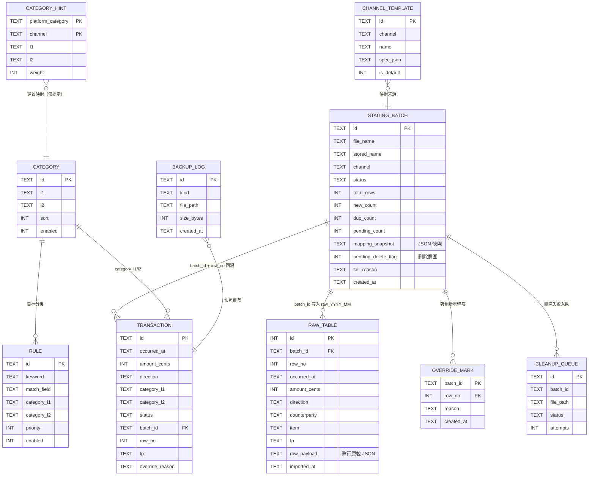

### 5.5 迁移机制

| 项 | 规则 |
|----|------|
| 脚本命名 | `V{3位序号}__{描述}.sql`（如 `V002__add_recalc_log.sql`） |
| 执行时机 | 仅 `lifespan` 启动阶段（`init-db` 命令同路径） |
| 幂等 | 已应用的版本号跳过；`checksum` 不一致 → **拒绝启动**（防止有人手改历史脚本） |
| 事务 | 每个脚本单独事务；失败即回滚该脚本并停止迁移 |
| 不可变 | 已提交脚本永不修改，只追加新版本 |
| 数据保底 | 迁移前若库非空 → 自动生成 `pre_migrate` 备份（复用 `backup_service.create_db_backup()`） |
| raw 分表 | **不进迁移**，由 `RawTableManager.ensure_table` 按需创建（幂等 `IF NOT EXISTS`） |

### 5.6 批次状态机（DDL 落地版）

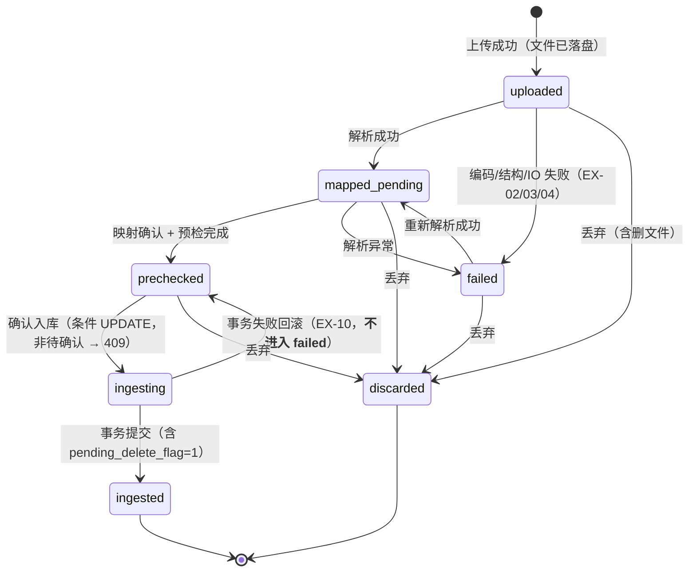

**允许操作矩阵**（`BatchGuard.assert_transition` 的依据）：

| 状态 | 解析 | 改映射 | 预检 | 确认入库 | 丢弃 | 按批次重算 |
|------|------|--------|------|----------|------|------------|
| uploaded | ✅ | ❌ | ❌ | ❌ | ✅ | ❌ |
| mapped_pending | ❌ | ✅ | ❌ | ❌ | ✅ | ❌ |
| prechecked | ✅（重新解析） | ✅ | ✅ | ✅ | ✅ | ❌ |
| ingesting | ❌ | ❌ | ❌ | ❌（409 E2002） | ❌ | ❌ |
| ingested | ❌ | ❌ | ❌ | ❌（409 E2002） | ❌ | ✅（FR-08 唯一入口） |
| discarded | ❌ | ❌ | ❌ | ❌ | ❌ | ❌（未入库，无 raw 记录） |
| failed | ✅ | ❌ | ❌ | ❌ | ✅ | ❌ |

> 说明：`discarded` 批次可能已产生 raw 记录吗？**不会** —— raw 只在入库事务内写入，而丢弃与入库互斥。故「按批次重算」只对 `ingested` 开放；`BatchGuard` 对此断言，测试用例覆盖。

### 5.7 主数据层状态机（与统计口径的对应）

| status | 谁能写 | 统计 | 重算默认 |
|--------|--------|------|----------|
| `pending` | 分类引擎（未命中） | **计入**总额，分类结构单列「未分类」 | 会被重算 |
| `confirmed` | 分类引擎（规则命中） | 计入，按分类归集 | 会被重算 |
| `corrected` | 用户（单条/批量） | 计入，按人工分类归集 | **不重算**（`overwrite_manual=True` 除外） |
| `excluded` | 用户 | **不进任何统计** | **不重算** |

**唯一写入点**：`status` 只能由 `classification_engine`（pending/confirmed）、`transaction_service`（corrected）、`transaction_service.exclude`（excluded）、`recalc_service`（pending/confirmed，条件更新）写入。DDL 无触发器，靠代码约束 + 代码评审把关。

### 5.8 种子数据（`init-db --force-seed`）

| 表 | 内容 | 来源 |
|----|------|------|
| `category` | 3 个一级 × 共 19 个二级（收入 5 / 支出 9 / 资金流转 4 + 其他） | PRD 附录 B |
| `rule` | 保守规则包 ≈ 18 条：美团/饿了么→餐饮美食；滴滴/地铁/公交/青桔/哈啰/高德→交通出行；零钱通/余额宝/理财→资金流转；信用卡还款→资金流转；学费/教材/书店→学习资料；药房/医院→医疗健康 | PRD FR-09 规则 1 + Q-01 fallback 保守集 |
| `category_hint` | 支付宝 23 个平台分类中可映射的 ≈ 15 条（如：餐饮美食→支出/餐饮美食，交通出行→支出/交通出行，投资理财→资金流转/零钱通余额宝申赎，账户存取→资金流转/提现…） | **真实样例分布**（§8.9） |
| `setting` | 见 §11.2 默认值 | PRD FR-22 |
| `channel_template` | wechat_xlsx / alipay_csv 各一条 default（含真实列序，§8.8） | **真实样例** |
---

## 6. 接口设计

### 6.1 全局约定

| 项 | 约定 |
|----|------|
| 前缀 | `/api/v1`（版本化，为 PRD 5.4 的 v1.2 云同步预留） |
| 方法语义 | `GET` 读（幂等）、`POST` 创建/动作（非幂等，除标注外）、`PUT` 整体替换（幂等）、`PATCH` 部分更新、`DELETE` 删除（幂等） |
| 响应 | 恒为 `ApiResponse[T]`：`{"code":"OK","data":...,"message":""}` |
| 时间格式 | 请求与响应均为 `YYYY-MM-DDTHH:MM:SS`（本地时间，无时区后缀） |
| 金额 | 请求与响应均为**整数分**（`amount_cents`），前端负责 `/100` 展示 |
| 排序 | `sort=-occurred_at,amount_cents`（`-` 前缀为降序，仅白名单字段） |
| 分页 | `page`（≥1，默认 1）、`page_size`（10~200，默认 50）→ `Page{items, meta}` |
| 幂等键 | 仅「确认入库」靠状态机（不加 `Idempotency-Key` 头，避免多一套机制） |
| 长任务 | 本期全部同步返回（5 万行 / 5000 行均在 10s 内）；前端以 loading 态 + 进度轮询 `/staging/batches/{id}` 展示 |
| 文档 | `/api/docs`（Swagger，仅 127.0.0.1 可访问）、`/api/openapi.json` |

### 6.2 资源与端点清单

#### 6.2.1 健康检查

| 方法 | 路径 | 用途 | 请求 | 响应 | 错误 |
|------|------|------|------|------|------|
| GET | `/health` | 一键启动脚本存活探测 | — | `{status, version, data_dir, db_ok, backlog:{cleanup, orphans}}` | — |

#### 6.2.2 缓冲区 / 导入缓冲区链路（对应 FR-01~04、FR-07）

| 方法 | 路径 | 用途 | 请求模型 | 响应模型 | 幂等 | 入口校验项 |
|------|------|------|----------|----------|------|-----------|
| POST | `/staging/batches` | 上传文件至缓冲区（流式落盘 + 自动解析） | `multipart/form-data: file, channel?` | `BatchDTO` | 否 | 扩展名/MIME(E1001)、大小(E1005)、磁盘余量(E4001)、行数(E1006) |
| GET | `/staging/batches` | 批次列表（缓冲区管理） | query: `status?, page, page_size` | `Page[BatchDTO]` | — | 分页(E1010) |
| GET | `/staging/batches/{id}` | 批次详情（含 parse_meta、计数、报告） | — | `BatchDetailDTO` | — | 存在性(E2001) |
| POST | `/staging/batches/{id}/parse` | 重新解析（失败批次重试 / 重新解析） | — | `BatchDTO` + `ParseInfoDTO` | 是（同态重复调用结果一致） | 状态机(E2002)、编码(E1002)、表头(E1003)、空文件(E1004) |
| GET | `/staging/batches/{id}/preview` | 前 N 行预览 + 字段识别 | query: `limit=20` | `PreviewDTO` | — | 存在性 |
| PUT | `/staging/batches/{id}/mapping` | 保存字段映射 | `MappingReq` | `MappingResultDTO` | 是 | 五核心字段(E1007)、列索引范围、direction 枚举(E1008) |
| GET | `/staging/templates` | 渠道模板列表 | query: `channel?` | `list[TemplateDTO]` | — | — |
| POST | `/staging/templates` | 保存渠道模板（EX-20 冲突） | `TemplateReq{channel,name,spec,policy}` | `TemplateDTO` | 否 | 冲突(E2003) |
| POST | `/staging/batches/{id}/precheck` | 去重预检（只读） | — | `PrecheckResultDTO` | 是 | 状态机、指纹完整性提示(E2004) |
| POST | `/staging/batches/{id}/overrides` | 单条「强制新增」标记 | `{row_no, reason}` | `OverrideDTO` | 是（同 key 覆盖） | row_no 有效、reason 非空 |
| DELETE | `/staging/batches/{id}/overrides/{row_no}` | 撤销强制新增 | — | `{removed: bool}` | 是 | — |
| POST | `/staging/batches/{id}/confirm` | 确认入库（**核心**） | — | `IngestReportDTO` | **是（409）** | 状态机 E2002、幂等 E2002 |
| GET | `/staging/batches/{id}/report` | 导入报告（四数字 + 跳过列表） | query: `include_skipped=true` | `IngestReportDTO` | — | — |
| POST | `/staging/batches/{id}/discard` | 丢弃批次（删文件） | `{confirm: true}` | `BatchDTO` | 是 | 状态机、二次确认 |
| GET | `/staging/orphans` | 孤儿文件扫描（EX-13） | — | `list[OrphanFileDTO]` | — | — |
| POST | `/staging/orphans/cleanup` | 一键清理孤儿 | `{names: [...]}` | `{deleted: int, failed: [...]}` | 否 | 文件名白名单校验 |
| GET | `/staging/usage` | 缓冲区占用（FR-07 规则 4） | — | `{file_count,total_bytes,threshold,exceeded}` | — | — |
| POST | `/staging/ensure-dir` | 重建缓冲区目录（EX-23） | — | `{path, created: bool}` | 是 | 路径合法化 E1011 |

#### 6.2.3 原始库（FR-08 规则 1~3）

| 方法 | 路径 | 用途 | 请求 | 响应 | 校验 |
|------|------|------|------|------|------|
| GET | `/raw/months` | 可用月份与每月条数 | — | `list[{month, count, bytes}]` | — |
| GET | `/raw/{yyyy_mm}/records` | 某月原始记录（只读） | `page,page_size` | `Page[RawRecordDTO]` | 月份格式 `YYYY_MM`(E1009) |
| GET | `/raw/records/{id}` | 单条原始记录 + 来源批次 | — | `RawRecordDetailDTO` | — |
| GET | `/transactions/{id}/trace` | 主数据 → 批次与原始行（FR-08 规则 2） | — | `{batch, raw_record, mapping_snapshot}` | E2010 |

#### 6.2.4 主数据层 / 明细（FR-19、FR-12、FR-10）

| 方法 | 路径 | 用途 | 请求 | 响应 | 校验 |
|------|------|------|------|------|------|
| GET | `/transactions` | 明细查询（筛选/排序/分页） | `TransactionQuery` | `Page[TransactionDTO]` | 枚举(E1008)、排序白名单(E1010) |
| GET | `/transactions/summary` | 筛选汇总（**委托 stats_service**） | `TransactionQuery`（忽略分页） | `SummaryDTO` | 同上 |
| PATCH | `/transactions/{id}` | 编辑（**仅** `category_l1/l2`、`note`） | `TransactionPatchReq` | `TransactionDTO` | 非白名单字段(E2009)、分类存在(E2006) |
| POST | `/transactions/batch-category` | 批量修正 + 可选生成规则 | `{ids?, counterparty?, l1, l2, create_rule:bool}` | `{updated:int, rule_id?}` | 分类存在(E2006)、至少一个选择条件 |
| POST | `/transactions/{id}/exclude` | 标记已排除（不计收支） | `{reason?}` | `TransactionDTO` | 状态迁移合法 |
| POST | `/transactions/{id}/restore` | 取消排除 | — | `TransactionDTO` | 当前为 excluded |
| GET | `/pending` | 待确认队列（按对方聚合） | `page,page_size` | `Page[PendingGroupDTO]` | — |
| GET | `/pending/count` | 待确认条数（报表顶部提示） | — | `{count, amount_cents}` | — |

#### 6.2.5 统计与报表（FR-13~18，全部委托 stats_service）

| 方法 | 路径 | 用途 | 关键参数 | 响应 |
|------|------|------|----------|------|
| GET | `/stats/overview` | KPI 四卡 + 环比 + 未分类/待确认计数 | `period=month\|quarter\|year`、`anchor=2026-10\|2026Q3\|2026` | `OverviewDTO` |
| GET | `/stats/categories` | 分类结构（一级/二级） | 同上 + `level=1\|2` | `list[CategorySliceDTO]` |
| GET | `/stats/trend` | 趋势序列（粒度自适应） | 同上 + `granularity=day\|week\|month` | `TrendDTO` |
| GET | `/stats/top-counterparties` | Top N 商户 | 同上 + `limit=5` | `list[TopItemDTO]` |
| GET | `/stats/daily-threshold` | 单日超阈值日期（FR-15） | 同上 | `{threshold_cents, days:[{date,amount_cents,over}]}` |
| GET | `/reports/monthly` | 月报（含文字摘要） | `year, month` | `MonthlyReportDTO` |
| GET | `/reports/quarterly` | 季报 | `year, quarter` | `QuarterlyReportDTO` |
| GET | `/reports/yearly` | 年报（同比可为 null → 前端显示「—」） | `year` | `YearlyReportDTO` |

#### 6.2.6 规则 / 分类 / 重算（FR-09~11）

| 方法 | 路径 | 用途 | 请求 | 响应 | 校验 |
|------|------|------|------|------|------|
| GET | `/rules` | 规则列表 | `enabled?` | `list[RuleDTO]` | — |
| POST | `/rules` | 新建规则 | `RuleReq{keyword,match_field,l1,l2,priority}` | `RuleDTO` | 关键词非空、分类存在且启用(E2007/E2006)、priority int |
| PATCH | `/rules/{id}` | 修改规则 | `RulePatchReq` | `RuleDTO` | 同上 |
| POST | `/rules/{id}/toggle` | 启停 | `{enabled: bool}` | `RuleDTO` | — |
| DELETE | `/rules/{id}` | 删除规则（自定义才可删） | — | `{deleted:bool}` | `is_builtin=1` → 409 |
| GET | `/categories` | 分类树（含引用计数） | `enabled?` | `list[CategoryNodeDTO]` | — |
| POST | `/categories` | 新增二级分类 | `{l1,l2,sort}` | `CategoryDTO` | 唯一(E2005)、非空 |
| PATCH | `/categories/{id}` | 改名/排序 | `{l2?,sort?,enabled?}` | `CategoryDTO` | 唯一 |
| POST | `/categories/{id}/disable` | 停用并迁移 | `{migrate_to_l1, migrate_to_l2}` | `{migrated:int}` | 目标存在且启用(E2006)、不得自迁 |
| POST | `/recalc/preview` | 重算影响范围（**FR-08/FR-11 共用**） | `RecalcReq{scope,batch_id?,rule_ids?,overwrite_manual?}` | `RecalcPreview` | scope 与参数匹配(E2011) |
| POST | `/recalc` | 执行重算（**唯一实现**） | 同上 + `confirm:true` | `RecalcReportDTO` | 同上 + 二次确认 |

#### 6.2.7 设置 / 数据目录 / 备份（FR-20~22）

| 方法 | 路径 | 用途 | 请求 | 响应 | 校验 |
|------|------|------|------|------|------|
| GET | `/settings` | 全部设置（含类型化值） | — | `SettingsDTO` | — |
| PUT | `/settings` | 批量更新（白名单键） | `SettingsPatchReq` | `SettingsDTO` | 类型校验(E2008)：阈值>0、间隔≥1 |
| POST | `/settings/data-dir/validate` | 校验候选数据目录（不落盘） | `{path}` | `{valid, resolved, reason?}` | 路径合法化(E1011) |
| POST | `/settings/data-dir/migrate` | 迁移数据目录（M5 向导） | `{to, confirm:true, copy_only?}` | `MigrationResultDTO` | 目标合法、磁盘余量、非同一路径 |
| POST | `/backup/db` | 创建数据库备份 | `{note?}` | `BackupDTO` | 数据目录可写 |
| GET | `/backup` | 备份清单 + 上次备份时间/过期天数 | — | `{items:[BackupDTO], last_at, overdue, interval_days}` | — |
| POST | `/backup/restore/validate` | 备份有效性预检 | `{file_name}` | `{valid, schema_version, counts, reason?}` | 备份头/`integrity_check`(E4005) |
| POST | `/backup/restore` | 执行恢复（**恢复前自动备份**） | `{file_name, confirm:true}` | `RestoreResultDTO` | 预检通过(E4005)、失败可回退(E4006) |
| POST | `/backup/restore/rollback` | 一键回退到恢复前状态 | `{pre_backup_id}` | `RestoreResultDTO` | 备份存在 |
| POST | `/backup/export` | 全量导出（第二通道） | `{format: json\|csv}` | `{file_name, path, rows}` | 格式枚举 |
| GET | `/maintenance/cleanup` | 待清理列表（EX-11） | `status=pending` | `list[CleanupItemDTO]` | — |
| POST | `/maintenance/cleanup/{id}/retry` | 重试删除 | — | `CleanupItemDTO` | — |
| GET | `/maintenance/events` | 事件日志（PRD 10.4，开启时） | `limit=100` | `list[EventDTO]` | 设置未开启 → 空列表 |

> FR-23 帮助页为**纯前端静态页**，不设 API（内容随前端发版，避免后端为静态文案写接口）。

### 6.3 关键请求/响应模型（摘自 `models/`）

```python
# models/staging.py
class BatchDTO(BaseModel):
    id: str
    file_name: str
    file_size: int
    channel: Channel
    status: BatchStatus
    total_rows: int = 0
    new_count: int = 0
    dup_count: int = 0
    pending_count: int = 0
    encoding: str | None = None
    adapter: str | None = None
    fail_reason: str | None = None
    created_at: str
    updated_at: str

class ParseMetaDTO(BaseModel):
    """解析元信息：只在批次详情返回，用于「为什么行数和平台报的不一样」这类追问。"""
    sheet: str | None = None
    delimiter: str | None = None
    preamble_rows: int = 0
    header_row_no: int = 0
    empty_rows_skipped: int = 0        # 数据区整行空行被跳过数（§8.10），必须可见、不得静默丢弃
    issues: dict[str, int] = Field(default_factory=dict)   # 如 {"AMOUNT_PARSE": 2, "TIME_PARSE": 1}

class BatchDetailDTO(BatchDTO):
    header_row_no: int | None = None
    mapped_fields: MappingReq | None = None
    mapping_snapshot: dict | None = None
    parse_meta: ParseMetaDTO | None = None
    report: IngestReportDTO | None = None
    file_exists: bool = False

class MappingReq(BaseModel):
    """列索引映射；-1 或 None 表示未映射。"""
    occurred_at: int
    amount: int
    direction: int
    counterparty: int | None = None
    item: int | None = None
    txn_type: int | None = None
    payment_method: int | None = None
    platform_category: int | None = None
    platform_status: int | None = None
    direction_map: dict[str, Direction] = Field(default_factory=dict)   # 渠道值 → direction
    amount_scale: int = 1
    save_template: bool = False

class PrecheckRowDTO(BaseModel):
    row_no: int
    label: Literal["new", "dup", "pending_manual"]
    occurred_at: str | None
    amount_cents: int | None
    direction: Direction | None
    counterparty: str | None
    item: str | None
    issues: list[ParseIssueDTO] = []
    override: bool = False

class PrecheckResultDTO(BaseModel):
    summary: dict[str, int]            # {"total":669,"new":600,"dup":60,"pending_manual":9}
    rows: list[PrecheckRowDTO]
    snapshot_at: str

# models/ingest.py
class IngestReportDTO(BaseModel):
    batch_id: str
    total: int
    inserted: int
    skipped_dup: int
    pending: int
    monthly: dict[str, int]            # {"raw_2026_06": 101, ...}
    overrides: int
    files_deleted: bool
    cleanup_enqueued: bool
    finished_at: str

# models/stats.py
class KpiDTO(BaseModel):
    total_income_cents: int
    total_expense_cents: int
    balance_cents: int
    savings_rate: float | None          # None → 前端「—」（总收入为 0）
    income_mom: float | None            # None → 「—」；0 基期 → None + flag
    expense_mom: float | None
    mom_flag: Literal["ok", "new", "na"]  # "新增" / "—"
    pending_count: int
    uncategorized_cents: int
```

### 6.4 分页、筛选、排序参数约定

| 参数 | 类型 | 说明 |
|------|------|------|
| `page` / `page_size` | int | `1 ≤ page`；`10 ≤ page_size ≤ 200`；越界 → E1010 |
| `period` | `month\|quarter\|year` | 与 `anchor` 组合解析区间（§9.2） |
| `anchor` | `2026-10` / `2026Q3` / `2026` | 格式随 period 校验，不匹配 → E1009 |
| `direction` | `income\|expense\|neutral`（可多值逗号分隔） | 明细筛选 |
| `status` | `pending\|confirmed\|corrected\|excluded`（多值） | 明细筛选（含已排除） |
| `category_l1` / `category_l2` | str | 精确匹配；`未分类` 为特殊值 → 翻译成 `status='pending'` |
| `keyword` | str | `LIKE %kw%` 匹配 `counterparty`/`item`（去空格、≤ 50 字符） |
| `sort` | `occurred_at\|amount_cents`，可前缀 `-` | 白名单外 → E1010 |
| `payment_method` | str | 精确匹配（含 `&` 组合值，原样比较） |

### 6.5 EX-01~EX-23 → HTTP + code 完整映射表

| EX | 场景 | HTTP | code | 用户文案要点（面向非技术用户） |
|----|------|------|------|-------------------------------|
| EX-01 | 格式不支持 | 415 | E1001 | 「只支持 CSV 或 Excel(.xlsx) 文件，请重新导出」 |
| EX-02 | 编码探测失败 | 422 | E1002 | 「无法识别文件编码，请用 Excel 另存为『CSV UTF-8』后重试」 |
| EX-03 | 表头无法识别 | 422 | E1003 | 「没有找到表头，请在下一步手动指定各列含义」+ 批次置 `failed` 可重试 |
| EX-04 | 空文件/无有效行 | 422 | E1004 | 「文件里没有数据行，请检查导出范围」 |
| EX-05 | 超大文件/超行数 | 413 / 422 | E1005 / E1006 | 「文件超过 5MB / 50000 行，请按月份分批导出」 |
| EX-06 | 金额解析失败 | 200（行级 issue，不阻断批次） | 行级 `AMOUNT_PARSE`（非 AppError） | 「该行金额无法识别，已置为待确认」 |
| EX-07 | 时间格式异常 | 200（行级 issue） | 行级 `TIME_PARSE` | 「该行时间无法识别，已置为待确认」 |
| EX-08 | 重复导入 | 200（报告 skipped_dup>0） | — | 「已跳过 N 条重复流水，可在报告查看」 |
| EX-09 | 全量重复 | 200 | — | 「未发现新流水」+ 批次归宿 `ingested`（inserted=0） |
| EX-10 | 入库事务失败 | 500 | E3001 | 「入库失败，已回滚，数据未改变，可重试」+ 批次回 `prechecked` |
| EX-11 | 删除文件失败 | 409 | E4003 | 「数据已入库，但原文件未能删除，已加入待清理」 |
| EX-12 | 重启时批次恢复 | —（启动日志） | — | 启动日志：「发现 1 个中断批次，已置回待确认」 |
| EX-13 | 孤儿文件 | 200（清单） | — | 「发现 N 个无对应批次的文件，可一键清理」 |
| EX-14 | 存在待确认 | 200（带计数） | — | 报表顶部：「有 N 笔待确认（已计入收支，单列未分类）」 |
| EX-15 | 数据库损坏 | 500 | E3004 | 「数据库文件异常，请从 data/backups 恢复最新备份」 |
| EX-16 | 提交后删文件前崩溃 | —（启动对账） | — | 启动日志 + 待清理列表；自动补删成功则不打扰用户 |
| EX-17 | 上传磁盘满/写失败 | 507 / 500 | E4001 / E4002 | 「磁盘空间不足（剩余 X MB），已清理未完成文件」 |
| EX-18 | 并发/重复确认入库 | 409 | E2002 | 「该批次当前状态为『已入库』，无需重复提交」 |
| EX-19 | 恢复备份失败 | 422 / 500 | E4005 / E4006 | 「备份文件无效/恢复失败，可一键回退到恢复前的数据」 |
| EX-20 | 同渠道模板冲突 | 409 | E2003 | 「该渠道已有默认模板，是否覆盖？也可另存为新模板」 |
| EX-21 | 指纹字段缺失 | 200（标记 `pending_manual`） | E2004（提示级，随响应 data.issues） | 「N 条记录时间或金额缺失，未参与自动去重，请人工核对」 |
| EX-22 | 预检与报告不一致 | 200 | — | 报告页固定文案：「以入库时实际执行结果为准」 |
| EX-23 | 缓冲区目录被移动/删除 | 500 或 200 | E4004 | 「缓冲区目录不存在，已重建；相关批次需重新上传」 |

### 6.6 OpenAPI 生成与前端类型同步流程

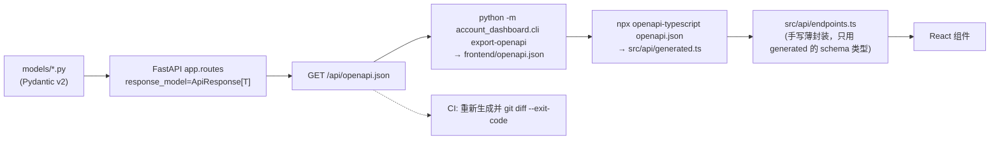

命令（纳入 `scripts/gen_api_types.sh` 与 `package.json` 的 `gen:api`）：

```bash
uv run python -m account_dashboard.cli export-openapi > frontend/openapi.json
cd frontend && npx openapi-typescript openapi.json -o src/api/generated.ts
```

**契约纪律**：

1. 改接口 → 先改 `models/` → 再改 router → 跑 `gen:api` → 提交 `generated.ts` 的 diff（评审可见契约变化）。
2. 破坏性变更（删字段/改语义）提交信息加 `contract:` 前缀（架构评审 4.4 / 11.2.2）。
3. `generated.ts` 顶部加注释 `/* eslint-disable */ /* 自动生成，勿手改 */`。
4. 契约变更记录追加到 `docs/devel/CONTRACT-CHANGELOG.md`（首次创建于 M1）。

---

## 7. 关键流程设计

十条流程覆盖 PRD 9.1 主链路 + 全部故障分支。每条固定给：**时序（mermaid）→ 事务边界 → 关键伪代码 → 失败分支表**。

| # | 流程 | PRD/EX 依据 | 事务边界 |
|---|------|-------------|----------|
| 7.1 | 上传流式落盘与磁盘余量 | FR-01、EX-17 | 无事务（仅文件 + 一条批次插入） |
| 7.2 | 解析与表头探测/编码探测 | FR-02、EX-02/03/04 | 单条 UPDATE（失败也只写批次表） |
| 7.3 | 映射与模板保存 | FR-03、EX-20 | 单事务（模板 + 批次映射） |
| 7.4 | 去重预检与强制新增 | FR-04、EX-21/22 | **只读**（override 标记独立小事务） |
| 7.5 | 确认入库 | FR-05、EX-09/10/18 | **单事务**（raw + transaction + 删除意图）|
| 7.6 | 删除与失败待清理 + 启动对账 | FR-06、EX-11/13/16/23 | 事务外（文件 IO）+ 独立小事务记账 |
| 7.7 | 重算（单一服务两入口） | FR-08、FR-11 | 单事务 |
| 7.8 | 统计口径计算 | 10.3、FR-13/16/19 | 只读（快照一致性） |
| 7.9 | 备份 / 恢复 / 回退 | FR-20、EX-19 | 文件级（非 SQL 事务），用「换文件 + 回退」保底 |
| 7.10 | 数据目录迁移 | FR-22、决策 4 | 停写 → 复制 → 校验 → 切配置 |

### 7.1 上传流式落盘与磁盘余量（EX-17）

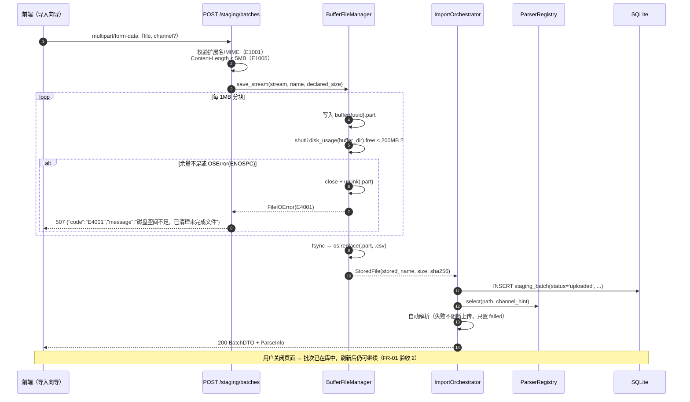

**事务边界**：批次插入是单条自动提交语句；解析结果另一次 UPDATE。上传成功是「文件存在 + 批次存在」的最小一致集。

**伪代码**：

```python
def create_batch(self, stream, file_name, declared_size, channel_hint=None) -> BatchDTO:
    self.validators.validate_upload_meta(file_name, content_type, declared_size)
    stored = self.buffer.save_stream(stream, file_name, declared_size)   # 可能抛 E4001
    try:
        batch = self.staging.create(file_name=file_name, stored_name=stored.name,
                                    file_size=stored.size, channel=channel_hint or Channel.OTHER)
    except Exception:
        self.buffer.delete(stored.path)          # 记账失败则回滚文件，避免孤儿
        raise
    try:
        return self.parse_batch(batch.id)        # 自动解析，失败仅置 failed
    except AppError as exc:
        self.staging.set_status(batch.id, to="failed", reason=exc.message)
        return self.staging.get(batch.id)
```

| 失败分支 | 处理 | 结果 |
|----------|------|------|
| 扩展名/MIME 不符 | 抛 E1001 | 不落盘、不建批次 |
| 大小超限 | 抛 E1005 | 同上 |
| 写入中磁盘满 | 删 `.part`，抛 E4001 | 无残留文件、无批次（或批次置 failed） |
| 批次插入失败 | 删已落盘文件 | 无孤儿 |
| 自动解析失败 | 批次 `failed` + fail_reason | 用户可「重新解析」或丢弃 |

### 7.2 解析与表头探测/编码探测（EX-02/03/04）

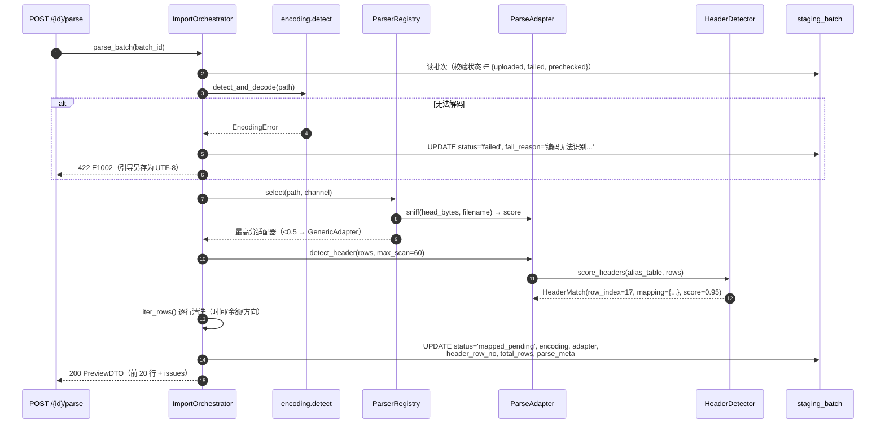

**关键实现约束**：

1. **表头探测按打分，不按固定行号**（微信表头在第 18 行、支付宝在第 24 行；不同导出版本会变）。
2. 逐行清洗失败**不抛异常**，收集为 `ParseIssue(code, row_no, field, raw_value)`，行仍保留（EX-06/07）。
3. 解析阶段**零业务表写入**（FR-02 规则 3）：只写 `staging_batch`。

```python
def parse_batch(self, batch_id: str) -> ParseResultDTO:
    batch = self.staging.get_or_raise(batch_id)
    BatchGuard.assert_transition(batch.status, "parse")
    try:
        text_or_sheet = self.encoding.load(batch.path)         # 抛 EncodingError
        adapter = self.parsers.select(batch.path, batch.channel)
        header = adapter.detect_header(text_or_sheet)          # 抛 HeaderUnrecognizedError
        rows = list(adapter.iter_rows(text_or_sheet, header))  # 不抛，带 issues
        self.staging.update_parse_meta(batch_id, encoding=..., adapter=adapter.name,
                                       header_row_no=header.row_index, total_rows=len(rows),
                                       parse_meta=header.meta)
        self.staging.set_status(batch_id, to="mapped_pending", expected_from=batch.status)
        return ParseResultDTO(batch_id=batch_id, header=header, sample=rows[:20], issues=count_issues(rows))
    except AppError as exc:
        self.staging.set_status(batch_id, to="failed", reason=exc.message)
        raise
```

| 失败分支 | code | 批次状态 |
|----------|------|----------|
| 编码无法识别 | E1002 | failed（可重试） |
| 表头 0 命中 | E1003 | failed（用户可改走手动映射，`/mapping` 允许在 failed 上先解析） |
| 0 数据行 | E1004 | failed |
| 行数 > 50000 | E1006 | failed（提示分批） |
| 单个 xlsx 多 sheet | — | 取第一个含表头的 sheet，记入 `parse_meta.sheet` |
| 损坏 xlsx（zip 异常） | E1004/E3002 | failed |

### 7.3 映射与模板保存（EX-20）

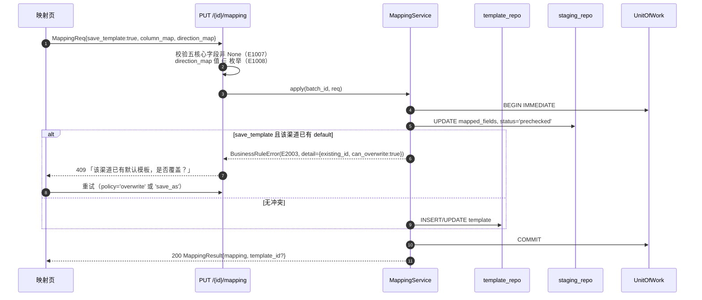

**五核心字段**：`occurred_at`、`amount`、`direction`、`counterparty`、`item`。缺任一 → E1007 阻断确认（FR-03 规则 5）。

**映射快照生成时机**：`precheck` 成功后写入 `mapping_snapshot`（含 `adapter`、`header_row_no`、`column_map`、`direction_map`、`amount_scale`、`template_id`、`created_at`）。入库与重算都重放这个快照 → 保证「当时口径」（I11）。

| 失败分支 | 处理 |
|----------|------|
| 五核心字段缺失 | 422 E1007，不落库 |
| 列索引越界（> 实际列数） | 422 E1008 |
| 同渠道模板冲突 + policy=abort | 409 E2003，前端弹「覆盖 / 另存 / 取消」 |
| 模板名重复（save_as） | 409 E2003（提示改名） |
| 映射改了但未重新预检 | `prechecked` → 映射变更后自动退回 `mapped_pending`，强制重跑预检（防 EX-22） |

### 7.4 去重预检与强制新增（EX-21/22）

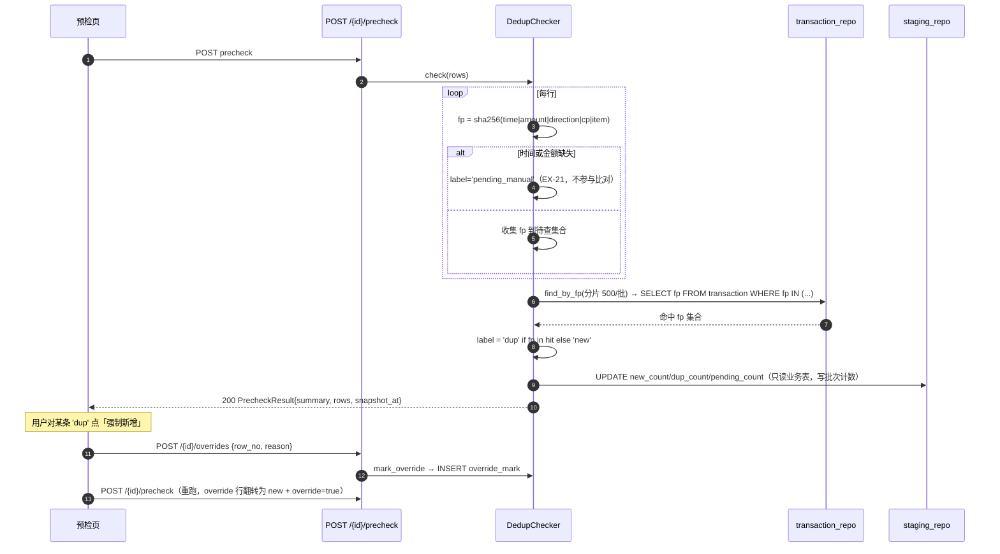

**只读保证**：`check()` 只执行 SELECT；唯一写操作是批次计数字段（`staging_batch`，非业务数据）。测试用「预检前后 `SELECT COUNT(*) FROM transaction/raw_*` 相等」断言（FR-04 规则 6）。

| 失败分支 | 处理 |
|----------|------|
| 指纹缺失（时间/金额解析失败） | 标记 `pending_manual`，**不比对**，入库后进待确认（EX-21） |
| 指纹命中但实为真实消费 | 用户标记强制新增 → 入库时按 new 处理，`override_reason/override_at` 落到 transaction |
| 预检后改了映射 | 批次强制退回 `mapped_pending`，需重新预检（EX-22 的前置防护） |
| 预检后其他批次入库了同指纹数据 | 入库时**二次校验**（`find_by_fp` 在入库事务内再跑一次），以实际结果为准（EX-22） |

> **入库时二次校验**是 EX-22 的必要动作：预检是快照，入库才是事实。二次校验命中且未 override → 跳过并计入 `skipped_dup`。

### 7.5 确认入库（单事务，EX-09/10/18）

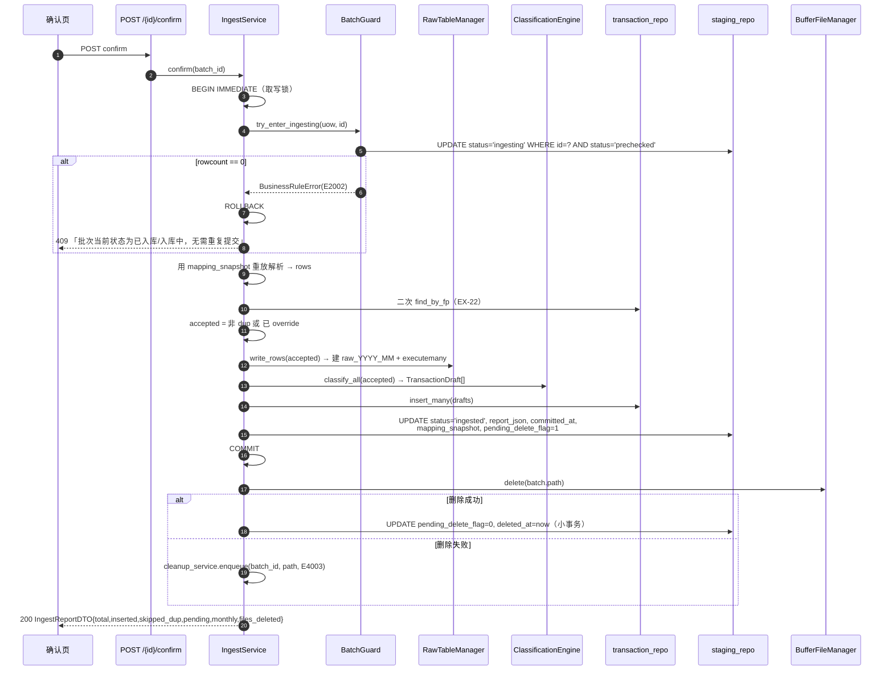

**事务边界（严格）**：

```
BEGIN IMMEDIATE
  ├─ UPDATE staging_batch SET status='ingesting' WHERE status='prechecked'   ← 幂等闸门
  ├─ 重放解析 + 二次去重
  ├─ CREATE TABLE IF NOT EXISTS raw_YYYY_MM × N（按需）
  ├─ INSERT INTO raw_YYYY_MM ... （分批 executemany）
  ├─ INSERT INTO transaction ...  （分批 executemany）
  └─ UPDATE staging_batch SET status='ingested', pending_delete_flag=1, report_json=...
COMMIT
  ↓（事务外）
DELETE 物理文件 → UPDATE pending_delete_flag=0
```

| 失败分支 | 事务结果 | 批次状态 | 用户可见 | EX |
|----------|----------|----------|----------|-----|
| 任一 INSERT 异常 | ROLLBACK（raw 与 transaction 均无残留） | `prechecked` + fail_reason | 500 E3001「已回滚，可重试」 | EX-10 |
| 建表失败（磁盘满/权限） | ROLLBACK | `prechecked` | 507/500 | EX-10/17 |
| 并发第二次提交 | 第二次 `rowcount=0` → ROLLBACK | 保持首次结果 | 409 E2002 | EX-18 |
| 全量重复 | COMMIT（inserted=0） | `ingested` | 200「未发现新流水」 | EX-09 |
| 提交后删文件失败 | 已提交，数据完好 | `ingested` + `pending_delete_flag=1` | 409 E4003 + 待清理列表 | EX-11 |
| 提交后进程崩溃 | 已提交 | `ingested` + flag=1 | 启动对账补删 | **EX-16** |

**为什么把状态闸门放在同一事务内**：若先单独提交 `ingesting` 再开事务，崩溃会留下永久 `ingesting` 脏状态，需要额外自愈；放在同一事务里，`ingesting` 只存在于事务可见期内，崩溃由 SQLite 自动回滚 → 批次仍是 `prechecked`，天然满足 PRD 9.2 收口规则 4。
### 7.6 删除、待清理与启动对账（EX-11/13/16/23）

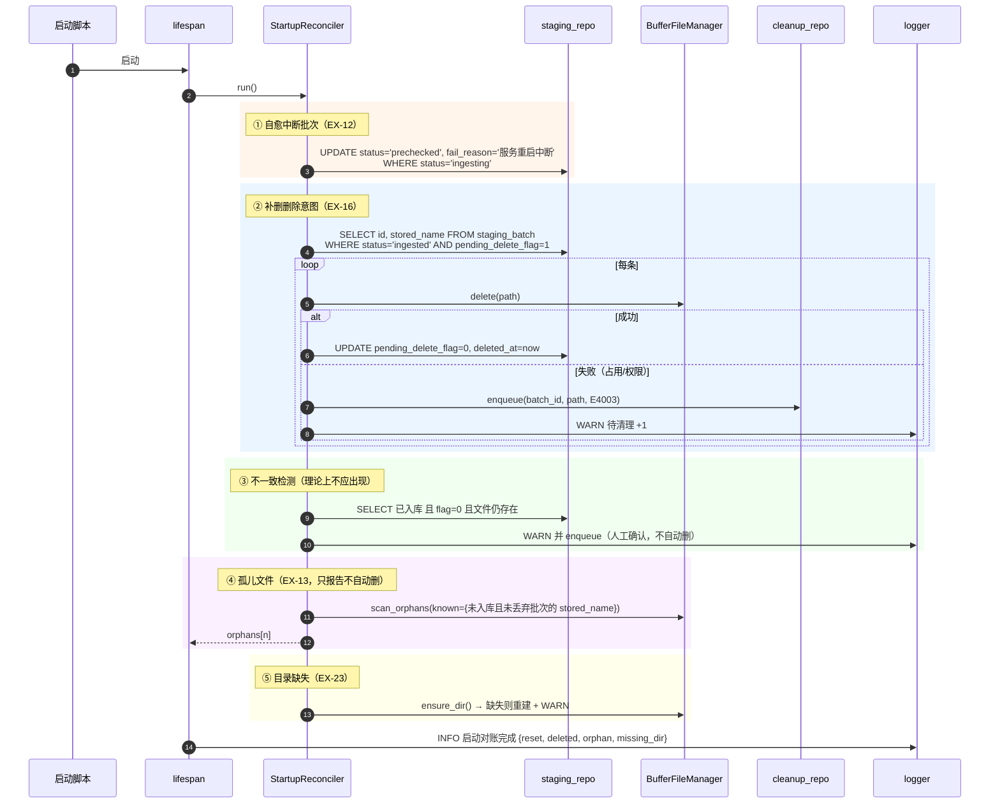

**运行期删除失败**（用户点「丢弃」或入库后删除报错）：

```python
def _delete_source_file(self, batch_id: str) -> None:
    batch = self.staging.get(batch_id)
    try:
        self.buffer.delete(batch.path)
    except FileIOError as exc:
        self.cleanup.enqueue(batch_id, str(batch.path), str(exc))   # 数据不受影响
        self.events.emit(EventKind.FILE_DELETE_RETRY, batch_id=batch_id)
        raise BusinessRuleError(ErrorCode.FILE_DELETE_FAILED,
                               "数据已入库，但原文件未删除，已加入待清理列表")
    else:
        self.staging.clear_pending_delete(batch_id)
```

| 失败分支 | 处理 | 用户可见 |
|----------|------|----------|
| 文件被占用（Windows 常见） | 入待清理 + 409 E4003 | 「数据已入库；原文件待清理」 |
| 目录被删（EX-23） | 重建目录；该批次标记 `failed`（文件已不存在，无从解析） | 「缓冲区目录已重建」 |
| 待清理重试仍失败（3 次） | `status='abandoned'` + 日志 | 待清理列表显示「需手动删除」 |
| 孤儿文件 | 只报告，等用户点「一键清理」 | 「发现 N 个无主文件」 |

### 7.7 重算（单一服务，两入口：FR-08 / FR-11）

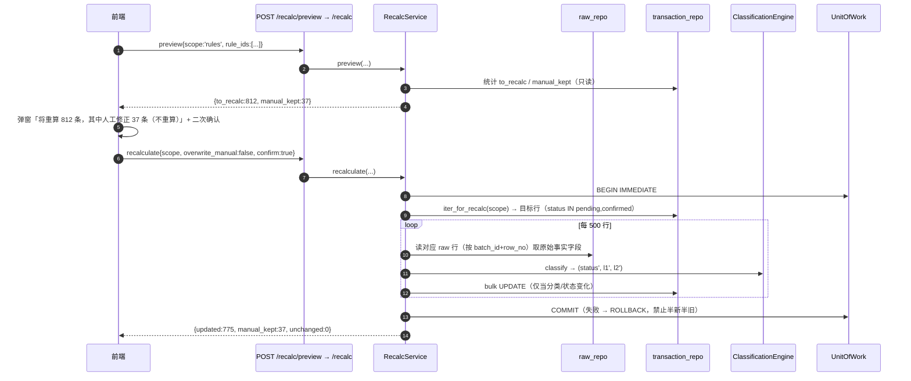

**规则集语义（两入口共用，FR-08 规则 5 = FR-11 规则 3）**：

| 目标行 status | 默认行为 | `overwrite_manual=True` |
|---------------|----------|------------------------|
| `pending` | 重算 | 重算 |
| `confirmed` | 重算 | 重算 |
| `corrected` | **跳过**，计入 `manual_kept` | 重算（并置回 `confirmed`） |
| `excluded` | **跳过**，计入 `manual_kept` | 重算（并可能脱离 excluded，需二次确认文案明确） |

**关键约束**：

1. 重算**不写 raw**（FR-08 规则 7）。
2. 重算是「从 raw 重放 + 重新分类」，因此必须依赖 `mapping_snapshot` 才能得到与入库时一致的 `ParsedRow`（金额/时间/对方/商品）。
3. 单事务，批量 UPDATE 用 `executemany`；812 行实测 < 300ms。
4. 重算后可触发前端 `invalidateQueries(['stats'])`，报表即时反映。

| 失败分支 | 处理 |
|----------|------|
| scope=batch 但 batch 未入库 | 422 E2011 |
| rule_ids 全为停用规则 | 允许（等价「全部不命中」→ 大量转 pending），但 preview 必须展示 `to_pending` 预估 |
| 事务中途失败 | ROLLBACK，报表数据与执行前完全一致 |
| 重算期间用户同时编辑分类 | `BEGIN IMMEDIATE` 写锁串行化；后到者等待或 E3003 |

### 7.8 统计口径计算（10.3）

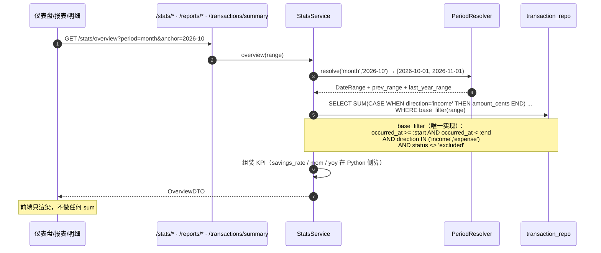

**三个入口同一实现**（I12/§9.1）：`/stats/*`、`/reports/*`、`/transactions/summary` 全部调 `StatsService`，仅入参不同。测试断言：「明细筛选汇总 == 月报同分类金额」（FR-19 验收）。

### 7.9 备份 / 恢复 / 回退（EX-19）

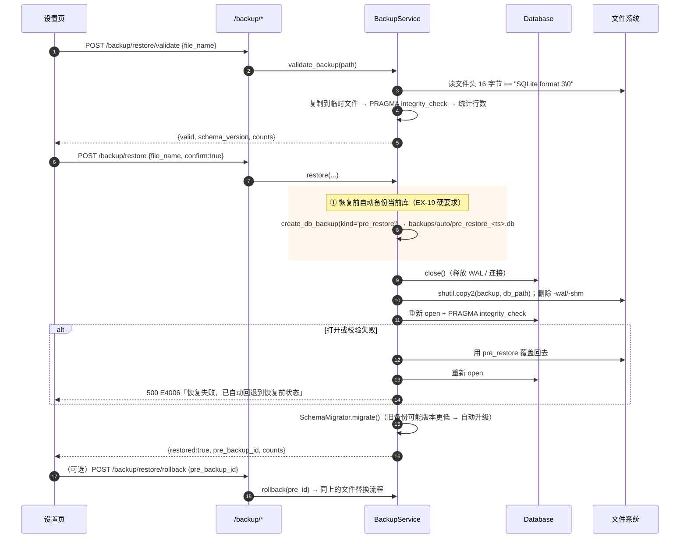

| 失败分支 | 处理 |
|----------|------|
| 备份文件不是 SQLite | 预检阶段拒绝 E4005（**不进入恢复流程**） |
| `integrity_check` 失败 | 同上 |
| 恢复中途写盘失败/断电 | 启动时 `DB_CORRUPT` → 用户手动用 `pre_restore_*` 回退；文档在帮助页写明路径 |
| 自动备份本身失败（磁盘满） | **拒绝执行恢复**（否则失去回退能力）→ 507 E4001 |
| 备份 schema 版本高于当前程序 | 拒绝恢复 E4005「备份来自更新版本，请先升级程序」 |

### 7.10 数据目录迁移（FR-22 / M5 向导）

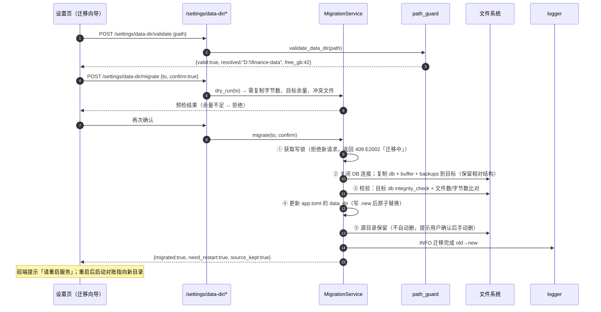

| 失败分支 | 处理 |
|----------|------|
| 目标非法（系统目录/UNC） | 422 E1011（validate 阶段就拦住） |
| 目标余量 < 源大小 × 1.2 | 拒绝，返回需多少 GB |
| 复制中途失败 | 删除目标中已复制的部分；源目录不动；程序仍指向旧目录 |
| 校验不一致 | 同上回退，E3005 |
| 迁移中崩溃 | app.toml 未改 → 下次启动仍用旧目录（**配置最后切换**是关键设计） |

> 「配置文件最后切换」是数据安全的唯一保证：任何中途失败，系统都停在旧目录完整状态。
---

## 8. 解析适配器与渠道模板规格（基于真实样例校准）

### 8.1 统一 `ParseAdapter` 协议

```python
# infra/parsers/base.py
from typing import Protocol, Iterator, Sequence, Any
from dataclasses import dataclass, field

@dataclass(frozen=True, slots=True)
class HeaderMatch:
    row_index: int                       # 0-based，表头在 rows[row_index]
    mapping: dict[str, int]              # canonical_field -> column index
    score: float                         # 0..1
    matched_core: int                    # 命中核心字段数（0..5）
    columns: list[str]                   # 归一化后的表头文本
    meta: dict[str, Any] = field(default_factory=dict)   # {preamble_rows, sheet, delimiter}

@dataclass(slots=True)
class ParsedRow:
    row_no: int                          # 1-based，数据行序号（不含前言与表头）
    occurred_at: datetime | None
    amount_cents: int | None
    direction: Direction | None
    counterparty: str | None
    item: str | None
    txn_type: str | None
    payment_method: str | None
    platform_category: str | None
    platform_status: str | None
    fingerprint: str | None
    payload: dict[str, Any]              # 整行原貌（列名→值），入 raw.raw_payload
    issues: list[ParseIssue] = field(default_factory=list)

class ParseAdapter(Protocol):
    name: str                            # 'wechat_xlsx' / 'alipay_csv' / 'generic'
    channel: Channel
    extensions: tuple[str, ...]

    def sniff(self, path: Path, head: bytes) -> float: ...
    def detect_header(self, table: RowSource) -> HeaderMatch: ...
    def iter_rows(self, table: RowSource, header: HeaderMatch,
                  mapping: MappingSpec) -> Iterator[ParsedRow]: ...
```

`RowSource` 抽象 CSV 与 xlsx 的差异（统一 `list[list[Any]]` 或惰性迭代器），使 `header_detect` / `cleaning` 逻辑只写一份。

### 8.2 真实样例事实（本设计的校准依据）

| 项 | 微信支付 xlsx | 支付宝 csv |
|----|---------------|-----------|
| 文件名 | `微信支付账单流水文件(20260601-20261021)_20261021195421.xlsx` | `支付宝交易明细(20260601-20261021).csv` |
| 字节数 | 64,235 | 114,509 |
| 工作簿 / sheet | `Sheet1`（单 sheet） | —（纯文本） |
| 总行数（含前言） | 707（= openpyxl 按行号补齐后的行数） | 693 |
| **前言行数** | **17**（第 6、16 行为空行；XML 中整行缺失） | **23**（含空行 12、22） |
| **表头行（1-based）** | **第 18 行** | **第 24 行** |
| 数据行数 | 689 | 669 |
| 编码 | xlsx（zip + UTF-8 XML） | **GB18030**（UTF-8 解码失败） |
| 列数 | 11（无尾随空列） | **13（末列为空，行尾多余逗号）** |
| 时间单元格类型 | XML 为序列号浮点 `46316.82503472222`，**应用日期样式后 openpyxl 返回 `datetime`**；无样式导出时会返回 `float` → 两种都要兼容 | 字符串 `2026-10-21 09:42:31`（669/669 格式一致） |
| 金额单元格类型 | **数值**（`int` 461 行 + `float` 228 行，如 `8.8`），**不是字符串** → 必须走 `Decimal(str(v))` | 字符串 `"45.90"` / `"0.01"`（两位小数） |
| 方向取值 | `支出` 613 / `收入` 72 / `/` 4 | `支出` 512 / `不计收支` 155 / `收入` 2 |
| 备注空值 | `/`（687/689） | 空字符串（669/669） |
| 特殊字符 | 无 Tail Tab | **669/669 行含 Tab**（交易订单号/商家订单号尾部） |
| 状态下拉值 | `支付成功/已存入零钱/已转账/已全额退款/已收钱/…`，含 `已退款¥26.40`、`已退款(¥0.69)` 等 20+ 变体 | `交易成功/支付成功/退款成功/交易关闭/等待确认收货/…` |
| 月份分布 | 2026-06 172 / 07 114 / 08 153 / 09 142 / 10 108 | 2026-06 101 / 07 136 / 08 182 / 09 143 / 10 107 |
| 指纹碰撞（文件内） | **0** | **0** |
| 同日同额不同对方组合 | 20 组 | 29 组（US-03 构造用例可直接取材） |

> **行数口径脚注（复核时最易生歧义的一处，必须按此口径）**
> - 微信：XML `<row>` 元素 **705 个**，缺的是 `r="6"` 与 `r="16"`，**两行都在前言区**；openpyxl 按行号补齐后为 **707 行**；表头在第 18 行 → 数据行 = 707 − 18 = **689**，与平台自报「共689笔记录」**完全一致**。
> - 支付宝：693 行 = 前言 23 + 表头 1 + 数据 **669**，与平台自报「共669笔记录」一致。
> - 结论：**数据区缺失行数为 0**，不存在「689 应为 687」的情况；705 与 707 的差额来自前言区被补齐的两个空行。
> - 若未来某导出版本在**数据区**出现整行缺失或整行全空，`iter_rows` 一律按 `row_no` 补齐占位后跳过，累计到 `parse_meta.empty_rows_skipped`（JSON 字段，不改 DTO），并在导入报告页提示「已跳过空行 N 行」——**不得静默丢弃**（见 §8.10）。

**两条结论**：

1. **不能按固定行号取表头** —— 两份样例一个 18 行、一个 24 行，同一平台不同导出版本还会变。
2. **时间与金额的 Python 类型不可假设** —— xlsx 走 openpyxl 可能是 `datetime`/`float`/`int`/`str` 四种，csv 全是 `str`。清洗层必须做类型分派。

### 8.3 表头探测：按核心列名命中数打分

```python
# infra/parsers/header_detect.py
CORE_FIELDS = ("occurred_at", "amount", "direction", "counterparty", "item")
SECONDARY_FIELDS = ("txn_type", "payment_method", "platform_category", "platform_status", "note")

ALIASES: dict[str, tuple[str, ...]] = {
    "occurred_at":       ("交易时间", "交易日期", "时间", "日期", "发生时间", "记账时间", "付款时间"),
    "amount":            ("金额(元)", "金额（元）", "金额", "交易金额", "发生金额", "amount"),
    "direction":         ("收/支", "收支", "收／支", "收入/支出", "借贷标志", "收支类型"),
    "counterparty":      ("交易对方", "对方", "商户名称", "交易商户", "商家", "收/付款方"),
    "item":              ("商品", "商品说明", "商品名称", "摘要", "交易摘要", "说明", "用途"),
    "txn_type":          ("交易类型", "交易分类", "业务类型", "交易方式"),
    "payment_method":    ("支付方式", "收/付款方式", "付款方式", "收付款方式"),
    "platform_category": ("交易分类", "分类", "账单分类"),
    "platform_status":   ("当前状态", "交易状态", "状态"),
    "note":              ("备注", "交易备注", "附言"),
}

def normalize_header_cell(v: Any) -> str:
    """str → NFKC（全角转半角）→ 去 BOM/零宽/Tab/换行 → 折叠空白 → 去尾部冒号 → lower。"""

def score_headers(table: RowSource, max_scan: int = 60) -> list[HeaderMatch]:
    """对前 max_scan 行逐行打分：
         score = Σ(命中核心字段 × 2 + 命中次要字段 × 1) / (5×2 + 5×1)
       过滤：matched_core < 5 → 丢弃（五核心必须全中才算候选，EX-03 才走手动映射）
       排序：score 降序 → 命中字段多者优先 → 行号小者优先（先出现者胜）
       返回值：[0] 即最佳；空列表 = 表头不可识别（E1003）
    """
```

**为什么用「分母固定 15」而非「命中数/该行非空列数」**：后者会让「只有 5 列且全命中」的行得到 1.0 分，与「11 列全命中」并列，容易误选。固定分母保证列越全分越高。

**边界处理**：

| 情况 | 处理 |
|------|------|
| 第 6/16 行整行为空（XML 中 `<row>` 缺失） | 迭代器按 `row_no` 补齐空行，保证 `row_index` 与文件行号一致（`header_row_no` 可被人读懂） |
| 表头只命中 4 个核心（如无「商品」列） | `matched_core=4` → 不作为自动候选；但在 `detect_header(allow_partial=True)` 时返回最佳候选给人确认（EX-03） |
| 多行同分 | 取行号最小者（前言里出现「交易时间：[...]」这类字样时可能虚构命中；固定分母 + 要求 5 核心全中可排除绝大多数） |
| 支付宝末列空字符串 | `columns` 保留该空列（索引 12），映射时不使用；`MappingSpec` 允许列索引存在但未映射 |
| 微信第 1~17 行含「微信支付账单明细」等文本 | 核心字段命中 0 → 自然被过滤 |

### 8.4 编码探测与解码

```python
# infra/parsers/encoding.py
BOM_MAP = {b"\xef\xbb\xbf": "utf-8-sig", b"\xff\xfe": "utf-16-le", b"\xfe\xff": "utf-16-be"}

def detect_and_decode(raw: bytes) -> tuple[str, str]:
    """顺序：
       ① BOM 命中 → 直接解；
       ② 严格 utf-8 解码成功 → 'utf-8'；
       ③ 严格 gb18030 解码成功 → 'gb18030'（GBK/GB2312 的超集，覆盖国内账单）；
       ④ chardet.detect(raw[:64KB]) 置信度 > 0.7 且 ∈ 白名单 → 用它试解；
       ⑤ 全部失败 → EncodingError(E1002)「无法识别文件编码」。
       返回 (text, encoding_name)。"""
```

**实测**：支付宝样例 `utf-8` 严格解码失败、`gb18030` 成功 → 走第 ③ 步；微信是 xlsx，不经过此路径（zip 内部 XML 恒 UTF-8）。

| 情况 | 处理 |
|------|------|
| UTF-8 带 BOM | `utf-8-sig`（首个表头单元格会带 `\ufeff`，`normalize_header_cell` 兜住） |
| 解码后含 `\ufffd` 替换字符 | 视为解码失败（严格模式不会产生，防御性检查） |
| 单文件混合编码 | 不支持，报 E1002 引导另存 |

### 8.5 字段清洗规则（逐条可执行）

```python
# infra/parsers/cleaning.py
_TAB = "\t\r\n\u00a0\u3000"
def clean_text(v: Any, *, empty_markers=("", "/", "-", "—", "N/A")) -> str | None:
    """None → None；str → strip 空白/BOM/Tab/全角空格 → 折叠内部多空白 →
       在 empty_markers 中 → None；数值 → str(v)。"""

_AMOUNT_NOISE = re.compile(r"[¥￥,，\s\t\u00a0元]")
def parse_amount_to_cents(v: Any) -> int:
    """1) None/''/'/' → AmountParseError
       2) int/float/Decimal → Decimal(str(v))（**禁止 float 直接 ×100**：8.8*100=880.0000000000001）
       3) str → 去 ¥￥,，空格 Tab 「元」→ Decimal
       4) 负数 → 取绝对值（方向由 direction 承载；I4）
       5) quantize(Decimal('0.01'), ROUND_HALF_UP) → int(x * 100)
       6) 超过 3 位小数或 > 1e9 分 → AmountParseError"""
```

**实测反例（必须在单测中固定）**：

| 输入 | 错误做法 | 正确输出 |
|------|----------|----------|
| `8.8`（float） | `int(8.8*100)=880` ✅ 但 `int(4.35*100)=434` ❌ | `Decimal("8.8")*100 = 880` |
| `4.35`（float） | `int(4.35*100)=434` | `435` |
| `"45.90"` | — | `4590` |
| `"¥1,234.5"` | — | `123450` |
| `"0.01"` | — | `1` |
| `"/"` | `0` | `AmountParseError` |

```python
_TIME_FORMATS = (
    "%Y-%m-%d %H:%M:%S", "%Y/%m/%d %H:%M:%S", "%Y-%m-%d %H:%M", "%Y/%m/%d %H:%M",
    "%Y-%m-%d", "%Y%m%d%H%M%S", "%Y年%m月%d日 %H:%M:%S", "%Y年%m月%d日",
)
EXCEL_EPOCH = datetime(1899, 12, 30)     # Excel 1900 日期系统（含 1900-02-29 兼容）

def parse_time(v: Any) -> datetime:
    """1) datetime → 去微秒（truncate to second）
       2) int/float（Excel 序列号，如 46316.82503472222）→ EXCEL_EPOCH + timedelta(days=serial)
          · 序列号 < 1 或 > 200000 → TimeParseError
          · 说明：openpyxl 在单元格带日期样式时已转 datetime，无样式时才给 float，
            本分支是**兼容路径**（其他导出工具/手工另存常见）
       3) str → clean_text → 逐个 _TIME_FORMATS 尝试 → ISO8601 'T' 分隔也试
       4) 全失败 → TimeParseError"""
```

**时间一律截断到秒并格式化为 `%Y-%m-%dT%H:%M:%S`**（I5），与时区无关（账单导出的都是本地时间，PRD 明确不做 UTC 转换）。

**方向判定**：

```python
def parse_direction(v: Any, channel: Channel) -> tuple[Direction | None, ParseIssue | None]:
    """先 clean_text；再查渠道映射表（§8.6）；未命中 → (None, issue=DIRECTION_UNKNOWN)。
       注意：'/' 在微信是 neutral 的合法表示，不能当空值（clean_text 会当空 → 必须先映射后清洗）。"""
```

> **实现顺序陷阱**：`clean_text` 默认把 `/` 当空值，但微信 `收/支` 的 `/` 是 **neutral 语义**。因此 `parse_direction` 必须**先做映射再回退到通用清洗**，且 `empty_markers` 要显式排除在方向字段上生效。

### 8.6 `direction` 渠道级映射表（脚本级硬编码，可被模板覆盖）

| 渠道 | 原始值 | `direction` | 计数（样例实测） | 备注 |
|------|--------|-------------|------------------|------|
| wechat | `支出` | `expense` | 613 | |
| wechat | `收入` | `income` | 72 | |
| wechat | `/` | `neutral` | 4 | 例：转入零钱通、零钱通转出到银行 |
| wechat | 空 / 未知 | `neutral` + issue | 0 | 进待确认 |
| alipay | `支出` | `expense` | 512 | |
| alipay | `收入` | `income` | 2 | |
| alipay | `不计收支` | `neutral` | 155 | |
| alipay | 空 / 未知 | `neutral` + issue | 0 | 进待确认 |
| generic | 借/贷、支/收、+/- 等 | 按别名词典 | — | 兜底 |
| 任意 | 映射结果为空 | 继承「交易类型/商品」关键词推断 | — | 见下 |

**二次推断（仅当渠道映射缺失）**：命中 `零钱通/余额宝/理财通/申购/赎回/信用卡还款/还款/转账/提现/存入/转出` → `neutral`；命中 `奖学金/助学金/父母/生活费/拨款/红包` → 倾向 `income`（**仅在原始方向为空时使用**，绝不覆盖渠道给出的值）。实现为 `DirectionPolicy` 常量关键词表，与 `rule` 表解耦（规则表管分类，不管方向）。

### 8.7 指纹构造（含缺失字段处理，EX-21）

```python
# infra/parsers/fingerprint.py
def build_fingerprint(r: ParsedRow) -> str | None:
    """缺 occurred_at 或 amount_cents → 返回 None（不参与去重，EX-21）。
       fp = sha256("|".join([
              occurred_at.strftime("%Y-%m-%dT%H:%M:%S"),
              str(amount_cents),
              direction.value,
              norm(counterparty),      # NFKC → strip → 折叠空白 → casefold
              norm(item),
            ])).hexdigest()
       设计说明：
       · 用「秒级时间」而非日期：同日两笔同额同对方不同时刻 → 指纹不同 → 不会误判（FR-04 规则 3）
       · 含 direction：同一笔的「支出」与「退款收入」是两条真实记录，不应互相判重
       · 不含 batch_id / row_no / 平台单号：跨文件重复导入才能被识别
       · 平台交易单号（微信「交易单号」、支付宝「交易订单号」）**不作为指纹成分**：
         部分渠道单号带 Tab 且格式不稳，且 PRD 已定义指纹字段清单，改动属契约变更
    """
```

**设计取舍**：PRD 定义指纹为「时间秒级 + 金额分 + direction + 对方 + 商品说明」五项，本实现严格照此，不擅自加入平台单号。平台单号仅入 `raw_payload` 供追溯。

样例验证：两份样例文件内部指纹碰撞均为 0，跨文件（微信 vs 支付宝）也不会有交集（不同渠道的对方/商品文本不同），符合预期。

### 8.8 「微信 11 列 / 支付宝 13 列 → 标准字段」映射表

**微信支付 xlsx（表头行第 18 行，11 列）**

| 列索引 | 原始列名 | 标准字段 | 清洗规则 | 缺失处理 |
|--------|----------|----------|----------|----------|
| 0 | 交易时间 | `occurred_at` | `parse_time`（datetime / float / str 三分派） | 缺失 → 该行待确认 |
| 1 | 交易类型 | `txn_type` | `clean_text`；`/` → None | 允许空 |
| 2 | 交易对方 | `counterparty` | `clean_text` | 允许空（转账类多为 `/`） |
| 3 | 商品 | `item` | `clean_text` | 允许空 |
| 4 | 收/支 | `direction` | §8.6 映射（`/` → neutral） | 未知 → neutral + issue |
| 5 | 金额(元) | `amount_cents` | `parse_amount_to_cents`（**数值型，非字符串**） | 缺失 → 待确认 |
| 6 | 支付方式 | `payment_method` | `clean_text`；`/` → None | 允许空（49 行为 `/`） |
| 7 | 当前状态 | `platform_status` | 原样保留（含 `已退款¥26.40` 等变体） | 允许空 |
| 8 | 交易单号 | → `raw_payload` | 原样（**不做指纹成分**） | — |
| 9 | 商户单号 | → `raw_payload` | 原样 | — |
| 10 | 备注 | `note` → `raw_payload` | `clean_text`；`/` → None | 允许空 |

**支付宝 csv（表头行第 24 行，13 列，末列空）**

| 列索引 | 原始列名 | 标准字段 | 清洗规则 | 缺失处理 |
|--------|----------|----------|----------|----------|
| 0 | 交易时间 | `occurred_at` | `parse_time`（字符串，格式统一） | 缺失 → 待确认 |
| 1 | 交易分类 | `platform_category` | `clean_text`（**只作 hint，不写 category_***） | 允许空 |
| 2 | 交易对方 | `counterparty` | `clean_text`（注意 `浪漫**店` 这类脱敏名原样保留） | 允许空 |
| 3 | 对方账号 | → `raw_payload` | 原样（含邮箱/手机掩码） | — |
| 4 | 商品说明 | `item` | `clean_text`；`/` → None（95 行账户存取为 `/`） | 允许空 |
| 5 | 收/支 | `direction` | §8.6 映射（`不计收支` → neutral） | 未知 → neutral + issue |
| 6 | 金额 | `amount_cents` | `parse_amount_to_cents`（`"45.90"`） | 缺失 → 待确认 |
| 7 | 收/付款方式 | `payment_method` | `clean_text`；**含 `&` 组合值原样保留**（`余额宝&红包`），不拆分；空 → None（12 行） | 允许空 |
| 8 | 交易状态 | `platform_status` | 原样（`退款成功`/`交易关闭` 等） | 允许空 |
| 9 | 交易订单号 | → `raw_payload` | **必须 strip 尾部 Tab**（669/669 行带 Tab） | — |
| 10 | 商家订单号 | → `raw_payload` | strip Tab 后可为空 | — |
| 11 | 备注 | → `raw_payload` | 全空 | — |
| 12 | （空列名） | — | **忽略**；映射时该列索引不参与 | 尾随逗号产物 |

**尾随空列容错实现**：

```python
def normalize_rows(rows: list[list[str]]) -> list[list[str]]:
    """1) 若末列全部为空字符串 → 视为尾随空列，逻辑列数 = len-1（但保留物理索引不变）；
       2) 若某行列数 < 表头列数 → 右侧补 ''（不抛异常）；
       3) 若某行列数 > 表头列数 → 截断并记 issue=EXTRA_COLUMNS（EX-03 提示级）。"""
```

### 8.9 平台分类 → 分类建议（`category_hint` 种子，样例实测分布）

支付宝 23 个平台分类中可映射的（**只用于 pending 队列的「建议」按钮，绝不自动写 `category_l1/l2`，以守住 FR-09 规则 5「未命中必须进待确认」**）：

| 平台分类 | 样例条数 | 建议 l1 | 建议 l2 |
|----------|----------|---------|---------|
| 投资理财 | 146 | 资金流转 | 零钱通/余额宝申赎 |
| 交通出行 | 143 | 支出 | 交通出行 |
| 生活服务 | 121 | 支出 | 其他支出 |
| 账户存取 | 95 | 资金流转 | 提现 |
| 日用百货 | 38 | 支出 | 购物消费 |
| 餐饮美食 | 37 | 支出 | 餐饮美食 |
| 教育培训 | 31 | 支出 | 学习资料 |
| 商业服务 | 13 | 支出 | 其他支出 |
| 医疗健康 | 8 | 支出 | 医疗健康 |
| 家居家装 | 6 | 支出 | 购物消费 |
| 数码电器 | 5 | 支出 | 购物消费 |
| 美容美发 | 4 | 支出 | 其他支出 |
| 服饰装扮 | 3 | 支出 | 购物消费 |
| 爱车养车 | 2 | 支出 | 交通出行 |
| 转账红包 | 2 | 资金流转 | 银行卡互转 |
| 退款 | 4 | （不映射） | 由原始 direction 决定回流 |
| 信用借还 | 1 | 资金流转 | 信用卡还款 |
| 住房物业 | 1 | 支出 | 居住缴费 |
| 酒店旅游/运动户外/文化休闲/母婴亲子/其他 | 各 1 | 支出 | 其他支出（低权重） |

> 微信无平台分类列，`platform_category` 一律 None；微信的「交易类型」可作为 hint 来源（如 `商户消费`→餐饮/购物待定、`转账`→资金流转/银行卡互转），同样只作建议。

### 8.10 异常与降级矩阵

| 情况 | 检测点 | 处理 | 用户可见 |
|------|--------|------|----------|
| 扩展名/魔数不符（.csv 实为 xlsx） | `sniff()` 读首 4 字节 `PK\x03\x04` | 改用 xlsx 适配器（不报错，宽容处理） | 无感 |
| xlsx 多 sheet | `openpyxl.load_workbook` | 逐 sheet 打分，取最高分；记 `parse_meta.sheet` | 预览页显示「读取工作表：Sheet1」 |
| CSV 分隔符不是逗号 | 统计首 20 行 `,` vs `\t` 频次 | 自动选分隔符；记 `parse_meta.delimiter` | 无感 |
| 单元格内换行（引号包裹） | `csv.reader` 天然处理 | 保留 `\n` → `clean_text` 折叠为空格 | 无感 |
| 金额含 `¥`/逗号 | `parse_amount_to_cents` | 清洗后转换（EX-06） | 无感 |
| 金额无法解析 | 同上 | 该行 `amount_cents=None`，`issue=AMOUNT_PARSE`，行保留 | 预检页标黄「金额无法识别」 |
| 时间无法解析 | `parse_time` | `occurred_at=None`，`issue=TIME_PARSE` | 同上 |
| 方向未知 | `parse_direction` | `neutral` + `issue=DIRECTION_UNKNOWN` | 待确认队列标「方向需确认」 |
| 5 核心字段有 1 个全列缺失 | 映射页 | `matched_core<5` → 自动探测失败，转手动映射（EX-03） | 「请手动指定『商品说明』对应哪一列」 |
| 全文件 0 数据行 | 解析尾部统计 | `E1004`，批次 `failed` | 「文件里没有数据」 |
| 行数 > 50000 | 解析中计数 | 立即停止，`E1006`（不继续占内存） | 「请按月份分批导出」 |
| 单行字段数异常 | `normalize_rows` | 补空/截断 + issue | 预检页提示「N 行结构异常」 |
| 数据区出现整行缺失 / 整行全空 | `iter_rows` 逐行判空 | 按 `row_no` 补齐占位后**跳过**，累加 `parse_meta.empty_rows_skipped`；`total_rows` 不计该行 | 导入报告页提示「已跳过空行 N 行」（**不得静默丢弃**） |

### 8.11 模板持久化与同渠道冲突规则（EX-20）

| 场景 | 行为 |
|------|------|
| 首次为 wechat 保存模板 | `INSERT channel_template(channel='wechat', name='默认', is_default=1)` |
| 同渠道已有 default，`policy='overwrite'` | 旧行 `is_default=0`（保留可查），新行 `is_default=1`（DB 部分唯一索引保证唯一） |
| `policy='save_as'` + 新 name | 插入 `is_default=0`；`name` 冲突 → E2003 |
| `policy='abort'`（默认，前端先弹窗） | 409 E2003 + `detail={existing: TemplateDTO, options:["overwrite","save_as"]}` |
| 导入时模板选择顺序 | `① 批次指定的 template_id → ② 该渠道 default → ③ 适配器内置列序（§8.8）→ ④ 手动映射` |
| 模板与适配器不一致（如微信 12 列新版本） | 保存时校验 `column_map` 索引 < 实际列数；导入时若列数不匹配 → 自动降级到内置列序并提示「模板与文件列数不符，已使用自动识别」 |
---

## 9. 统计服务设计

### 9.1 唯一口径过滤（全系统只有这一处）

```python
# services/stats_service.py
BASE_FILTER_SQL = (
    "occurred_at >= :start AND occurred_at < :end "
    "AND direction IN ('income','expense') "
    "AND status <> 'excluded'"
)

def base_filter(self) -> str:
    """返回 BASE_FILTER_SQL 常量。**任何统计 SQL 必须拼接此串，禁止手写过滤条件。**"""
    return BASE_FILTER_SQL
```

对应 PRD 10.3 第一行。三条硬性质：

| 性质 | 实现保证 | 反例（必须被测试捕获） |
|------|----------|----------------------|
| `neutral` 不进统计 | `direction IN ('income','expense')` | 把一笔 neutral 改成「餐饮美食」后总支出不应变化 |
| `excluded` 不进统计 | `status <> 'excluded'` | 排除一笔 100 元支出后总支出减少 10000 分 |
| `pending` **计入** | 不过滤 `pending`；聚合时 `CASE WHEN status='pending'` 归入「未分类」 | 3 笔待确认时总支出包含其金额，且「未分类」切片非零 |

**半开区间** `[start, end)`：`end` 恒为「下一周期第一天 00:00:00」，杜绝 `BETWEEN` 的月末边界双计。

### 9.2 周期区间解析器（新增周期只加解析器，不复制统计逻辑）

```python
@dataclass(frozen=True)
class DateRange:
    kind: Literal["month", "quarter", "year"]
    label: str                 # '2026-10' / '2026Q4' / '2026'
    start: str                 # '2026-10-01T00:00:00'
    end: str                   # '2026-11-01T00:00:00'（exclusive）
    days: int                  # 实际自然日数（日均分母，10.3）
    prev: "DateRange"          # 环比基期
    last_year: "DateRange | None"   # 同比基期（无数据区间也算出范围，由查询结果决定是否 None）

class PeriodResolver:
    def resolve(self, kind: str, anchor: str | None, today: date, week_start: int = 1) -> DateRange: ...
```

| kind | anchor 示例 | start | end | days | prev |
|------|-------------|-------|-----|------|------|
| month | `2026-10` | 2026-10-01 | 2026-11-01 | 31 | 2026-09 |
| quarter | `2026Q4` | 2026-10-01 | 2027-01-01 | 92 | 2026Q3 |
| year | `2026` | 2026-01-01 | 2027-01-01 | 365 | 2025 |

- `anchor=None` → 取 `today` 所属周期。
- 日均支出分母用 `range.days`（自然日，**不是有流水的天数**，PRD 10.3）。
- 环比基期跨年（1 月的上期是上年 12 月）；同比基期 `last_year` 若无任何记录 → DTO 字段置 `None`，前端显示「—」而非 `0%`（FR-18 验收）。

```python
def shift_months(d: date, n: int) -> date:      # 处理 1/31 + 1 月等边界
def quarter_of(d: date) -> int:                 # (month-1)//3 + 1
def quarter_start(year: int, q: int) -> date:
```

### 9.3 十二个指标的计算落点

| # | 指标（10.3） | SQL / Python | 公式 | 空值语义 |
|---|--------------|--------------|------|----------|
| 1 | 总收入 | SQL | `SUM(CASE WHEN direction='income' THEN amount_cents ELSE 0 END)` | 0 |
| 2 | 总支出 | SQL | `SUM(CASE WHEN direction='expense' THEN amount_cents ELSE 0 END)` | 0 |
| 3 | 结余 | Python | `income - expense` | 0 |
| 4 | 储蓄率 | Python | `balance / income * 100`；`income==0 → None` | None →「—」 |
| 5 | 分类占比（一级/二级） | SQL GROUP BY + Python | `cat_amount / expense_total * 100`；`expense_total==0 → 0` | 0 |
| 6 | 环比 | Python | `(cur - prev) / prev * 100`；`prev==0 → None + flag='new'` | 「新增」/「—」 |
| 7 | 同比 | Python | 同上，基期 `last_year`；无数据 → None | 「—」 |
| 8 | 日均支出 | Python | `expense / range.days`（分 → 元，保留 2 位） | 0 |
| 9 | Top 5 商户 | SQL | `GROUP BY counterparty ORDER BY SUM(amount_cents) DESC LIMIT 5`（仅 expense） | 空列表 |
| 10 | 待确认计数/金额 | SQL | `COUNT/SUM WHERE status='pending'`（含 neutral？**否**：按 base_filter，仅 income/expense） | 0 |
| 11 | 未分类金额 | SQL | 同 10 的 `expense` 部分（分类结构中的「未分类」切片） | 0 |
| 12 | 趋势序列 | SQL GROUP BY 桶 | 月内按日、季内按周（`week_start` 可配）、年内按月 | 空桶补 0 |

### 9.4 核心 SQL（可直接使用，全部参数化）

**① KPI（一次查询取 8 个数字，避免多次全表扫）**

```sql
SELECT
  COALESCE(SUM(CASE WHEN direction = 'income'  THEN amount_cents END), 0) AS income,
  COALESCE(SUM(CASE WHEN direction = 'expense' THEN amount_cents END), 0) AS expense,
  COALESCE(SUM(CASE WHEN direction = 'expense' AND status = 'pending' THEN amount_cents END), 0) AS pending_expense,
  SUM(CASE WHEN status = 'pending' AND direction IN ('income','expense') THEN 1 ELSE 0 END)      AS pending_count
FROM "transaction"
WHERE :start <= occurred_at AND occurred_at < :end
  AND direction IN ('income','expense')
  AND status <> 'excluded';
```

**② 分类结构（一级；`level=2` 时 GROUP BY 加 `category_l2`）**

```sql
SELECT
  CASE WHEN status = 'pending' THEN '未分类' ELSE category_l1 END AS l1,
  CASE WHEN status = 'pending' THEN '未分类' ELSE COALESCE(category_l2, '其他') END AS l2,
  SUM(amount_cents) AS amount_cents,
  COUNT(*)          AS txn_count
FROM "transaction"
WHERE :start <= occurred_at AND occurred_at < :end
  AND direction = 'expense'
  AND status <> 'excluded'
GROUP BY l1, l2
ORDER BY amount_cents DESC;
```

> 一级视图由二级结果在 Python 侧再聚合（同一批数据，避免两次查库）；「未分类」切片由 SQL 的 `CASE` 保证存在（I3）。

**③ 趋势序列（月内按日）**

```sql
SELECT substr(occurred_at, 1, 10) AS bucket,
       COALESCE(SUM(CASE WHEN direction='income'  THEN amount_cents END), 0) AS income,
       COALESCE(SUM(CASE WHEN direction='expense' THEN amount_cents END), 0) AS expense
FROM "transaction"
WHERE :start <= occurred_at AND occurred_at < :end
  AND direction IN ('income','expense') AND status <> 'excluded'
GROUP BY bucket ORDER BY bucket;
```

按周时改用 Python 侧分桶（`date.fromisoformat(bucket)` → 按 `week_start` 归并），避免 `strftime('%W')` 的跨年坑；按年时 `substr(occurred_at,1,7)`。

**④ Top 商户**

```sql
SELECT counterparty, SUM(amount_cents) AS amount_cents, COUNT(*) AS txn_count
FROM "transaction"
WHERE :start <= occurred_at AND occurred_at < :end
  AND direction = 'expense' AND status <> 'excluded'
  AND counterparty IS NOT NULL AND counterparty <> ''
GROUP BY counterparty
ORDER BY amount_cents DESC, txn_count DESC
LIMIT :limit;
```

**⑤ 明细筛选汇总（`/transactions/summary`，与报表同源）**

```sql
SELECT COALESCE(SUM(CASE WHEN t.direction='income'  THEN t.amount_cents END),0) AS income,
       COALESCE(SUM(CASE WHEN t.direction='expense' THEN t.amount_cents END),0) AS expense,
       COUNT(*) AS total
FROM "transaction" t
WHERE /* base_filter 同款 */ :start <= t.occurred_at AND t.occurred_at < :end
  AND t.direction IN ('income','expense') AND t.status <> 'excluded'
  /* + 动态筛选项（category_l1 / keyword / payment_method …） */
;
```

**⑥ 待确认按对方聚合（`/pending`）**

```sql
SELECT counterparty,
       COUNT(*) AS txn_count,
       SUM(amount_cents) AS amount_cents,
       MIN(occurred_at) AS first_at,
       MAX(occurred_at) AS last_at,
       MAX(hint_l1) AS hint_l1, MAX(hint_l2) AS hint_l2
FROM "transaction"
WHERE status = 'pending'
GROUP BY counterparty
ORDER BY txn_count DESC, amount_cents DESC;
```

### 9.5 raw 分表 UNION 策略

```python
class RawRepo:
    def _union_sql(self, tables: list[str]) -> str:
        """SELECT * FROM raw_2026_06 UNION ALL SELECT * FROM raw_2026_07 ..."""
    def query(self, months: list[str] | None, page: int, page_size: int):
        tables = months or self.existing_tables()          # 从 sqlite_master 动态发现
        if not tables: return [], 0
        # 表名来自 sqlite_master 且经 RAW_TABLE_RE 白名单校验 → 无注入面
        sql = f"SELECT * FROM ({self._union_sql(tables)}) ORDER BY occurred_at DESC LIMIT ? OFFSET ?"
```

**使用场景与限制**：

| 场景 | 是否用 UNION | 说明 |
|------|--------------|------|
| `/raw/months` | 否 | 每表 `COUNT(*)`，约 36 次轻查询 |
| `/raw/{yyyy_mm}/records` | 否 | 单表查询（用户指定月份） |
| 全量 raw 检索（跨月关键词） | 是 | 上限 36 表（3 年），SQLite 无压力 |
| 重算 | **否** | 按 `batch_id + row_no` 精确读单表（`iterate_for_recalc` 会带月份） |
| 统计 | **否** | 统计只读 `transaction`，raw 不参与统计 |

> 铁律：**统计永远不查 raw**。raw 是审计与重算来源，`transaction` 是唯一分析数据源。这条规则让统计性能与 raw 分表数量彻底解耦。

### 9.6 结果模型

```python
class OverviewDTO(BaseModel):
    period: PeriodDTO                       # kind/label/start/end/days
    kpi: KpiDTO
    category_top: list[CategorySliceDTO]    # 一级，前 8 + 「其他」
    trend: TrendDTO
    top_counterparties: list[TopItemDTO]
    pending: PendingBriefDTO
    generated_at: str

class CategorySliceDTO(BaseModel):
    l1: str
    l2: str | None
    amount_cents: int
    ratio: float                            # 0..100，2 位小数
    txn_count: int
    mom: float | None
    mom_flag: Literal["ok", "new", "na"]

class TrendDTO(BaseModel):
    granularity: Literal["day", "week", "month"]
    points: list[TrendPointDTO]             # {bucket, income_cents, expense_cents, over_threshold?}

class MonthlyReportDTO(BaseModel):
    period: PeriodDTO
    kpi: KpiDTO
    categories: list[CategorySliceDTO]
    top_counterparties: list[TopItemDTO]
    daily_avg_cents: int
    pending: PendingBriefDTO
    summary_text: list[str]                 # 3~5 条自动结论（FR-16）
    generated_at: str
```

**自动文字摘要（FR-16，规则式生成，不做 NLP）**：

| 模板 | 触发条件 | 示例 |
|------|----------|------|
| `本期总支出 {x} 元，较上期{增/减} {p}%` | 恒有 | 「本期总支出 1,384.62 元，较上期增加 12.4%」 |
| `支出最多的是「{l1}」，占比 {p}%` | 有分类数据 | 「支出最多的是『餐饮美食』，占比 38.2%」 |
| `Top 商户为「{name}」，共 {x} 元（{n} 笔）` | Top1 存在 | — |
| `有 {n} 笔待确认（{x} 元）未分类` | `pending_count>0` | — |
| `储蓄率 {p}%` / `本期无收入记录，储蓄率无法计算` | income>0 / ==0 | — |

### 9.7 性能预算与验证方法

| API | 数据规模假设 | 预算 | 验证 |
|-----|--------------|------|------|
| `/stats/overview` | 3 年 15k 行 | P95 ≤ 200ms | pytest benchmark（100 次取 P95） |
| `/stats/categories` | 同上 | ≤ 150ms | 同上 |
| `/stats/trend` | 同上 | ≤ 180ms | 同上 |
| `/reports/yearly` | 同上 | ≤ 400ms（含同比/环比 4 次聚合） | 同上 |
| `/transactions`（分页 50） | 同上 | ≤ 200ms | 同上 |
| 仪表盘首屏 | 4 个并行请求 | ≤ 2s（PRD FR-13 规则 6） | 前端 Performance API 打点 |

优化手段（按需启用，不提前做）：① SQLite 的 `ANALYZE`（首次启动后跑一次，写入 `sqlite_stat1`）；② 年度报表的 12 个月聚合改为单次 `GROUP BY substr(occurred_at,1,7)`；③ 前端 `staleTime: 60_000` 减少重复请求（§10.4）。

---

## 10. 前端设计

### 10.1 目录树

```
frontend/
├─ package.json
├─ vite.config.ts
├─ tsconfig.json / tsconfig.node.json
├─ index.html
├─ openapi.json                      # 由后端导出（构建前产物，入库便于 diff）
└─ src/
   ├─ main.tsx                       # createRoot + QueryClientProvider + RouterProvider
   ├─ App.tsx                        # 布局骨架：侧边导航 + 内容区 + 全局提示
   ├─ router.tsx                     # createBrowserRouter，路由表见 §10.2
   ├─ api/
   │  ├─ client.ts                   # fetch 封装：解包 ApiResponse、错误码→文案、超时/取消
   │  ├─ generated.ts                # openapi-typescript 产物（勿手改）
   │  └─ endpoints.ts                # batches.ts / txns.ts / stats.ts / admin.ts 分组函数
   ├─ hooks/
   │  ├─ usePeriod.ts                # 周期状态（kind + anchor），与 URL query 同步
   │  ├─ useStats.ts                 # useOverview / useCategories / useTrend / useTop
   │  ├─ useBatches.ts               # 列表/详情/上传/解析/预检/确认/丢弃
   │  ├─ useTransactions.ts
   │  └─ useSettings.ts
   ├─ charts/
   │  ├─ echartsTheme.ts             # 涨红跌绿 + 字体/网格/提示框统一
   │  ├─ CategoryDonut.tsx
   │  ├─ TrendLine.tsx
   │  └─ MonthBarCompare.tsx
   ├─ components/
   │  ├─ KpiCard.tsx                 # 值 + 环比徽标（红/绿）
   │  ├─ DeltaBadge.tsx              # favorable → 绿，unfavorable → 红
   │  ├─ AmountText.tsx              # cents → "¥1,234.56"，等宽数字
   │  ├─ ChartCard.tsx / DataTable.tsx / EmptyState.tsx / Loading.tsx
   │  ├─ ConfirmDialog.tsx           # 二次确认（丢弃/重算/恢复/迁移复用）
   │  ├─ PeriodSwitcher.tsx          # 月/季/年 + 上一期/下一期
   │  ├─ WizardSteps.tsx             # 步骤指示器
   │  ├─ PendingBadge.tsx            # 待确认数量徽标（FR-12）
   │  └─ ErrorBanner.tsx
   ├─ state/
   │  └─ importWizard.tsx            # useReducer + Context（§10.5）
   ├─ pages/
   │  ├─ Dashboard.tsx
   │  ├─ reports/{Monthly,Quarterly,Yearly}.tsx
   │  ├─ Transactions.tsx
   │  ├─ import/{ImportWizard,UploadStep,PreviewStep,MappingStep,PrecheckStep,ConfirmStep}.tsx
   │  ├─ Staging.tsx                 # 缓冲区管理（FR-07）
   │  ├─ RawArchive.tsx              # 原始库按月 + 批次追溯（FR-08）
   │  ├─ Pending.tsx                 # 待确认队列（FR-12）
   │  ├─ Rules.tsx                   # 规则管理（FR-11）
   │  ├─ Settings.tsx                # 设置 + 数据目录 + 备份（FR-20/21/22）
   │  └─ Help.tsx                    # 帮助与说明（FR-23，静态内容）
   └─ styles/
      ├─ tokens.css                  # 颜色/间距/字号 CSS 变量（含涨红跌绿）
      └─ global.css
```

### 10.2 路由表

| 路径 | 页面 | 主要 API | 说明 |
|------|------|----------|------|
| `/` | Dashboard | `/stats/overview`、`/stats/categories`、`/stats/trend`、`/stats/top-counterparties` | 默认 `period=month`，`anchor` 缺省为本月 |
| `/reports/monthly` | 月报 | `/reports/monthly` | `?period=month&anchor=2026-10` |
| `/reports/quarterly` | 季报 | `/reports/quarterly` | 环比上季度 |
| `/reports/yearly` | 年报 | `/reports/yearly` | 同比；无上年数据 →「—」 |
| `/transactions` | 明细 | `/transactions`、`/transactions/summary`、`PATCH /transactions/{id}` | 筛选状态写进 URL query（可分享/刷新保持） |
| `/import` | 导入向导 | `POST /staging/batches` → … → `POST /confirm` | 五步状态机（§10.5） |
| `/staging` | 缓冲区管理 | `/staging/batches`、`/staging/orphans`、`/staging/usage` | 丢弃/重试/清理/占用 |
| `/raw` | 原始库 | `/raw/months`、`/raw/{yyyy_mm}/records`、`/transactions/{id}/trace` | 只读 |
| `/pending` | 待确认 | `/pending`、`POST /transactions/batch-category` | 按对方聚合 |
| `/rules` | 规则 | `/rules`、`POST /recalc` | 启停 + 重算入口 |
| `/settings` | 设置 | `/settings`、`/backup/*`、`/settings/data-dir/*` | 含备份/恢复/迁移 |
| `/help` | 帮助 | 无（纯静态） | 口径说明 + 备份指引 + 导入引导 |

### 10.3 页面 - 组件 - API 映射

| 页面 | 复用组件 | 使用的 hook | 关键交互约束 |
|------|----------|-------------|--------------|
| Dashboard | `KpiCard`×4、`CategoryDonut`、`TrendLine`、`TopList`、`PendingBadge` | `useOverview` / `useCategories` / `useTrend` / `useTop` | 四张卡与三张图**同时**取数（`Promise.all` 由 4 个独立 query 自然并行）；数字全部来自后端 |
| Monthly/Quarterly/Yearly | `ReportSection`、`SummaryList`、`CategoryTable`、`MonthBarCompare` | `useMonthlyReport` 等 | 年报同比为 `null` → 显示「—」（**禁止**显示 0%） |
| Transactions | `DataTable`、`FilterBar`、`CategoryPicker`、`NoteEditor` | `useTransactions` / `useSummary` | 金额/时间/对方/商品为**只读文本**（无输入框）；编辑弹层只有分类与备注 |
| ImportWizard | `WizardSteps`、`Dropzone`、`PreviewTable`、`MappingForm`、`PrecheckTable`、`ReportPanel` | `useUploadBatch` 等 | 五步不可跳跃；失败可回退上一步 |
| Staging | `BatchTable`、`StatusTag`、`OrphanPanel`、`UsageBar` | `useBatches` | 丢弃必须二次确认；「文件待清理」显示重试按钮 |
| RawArchive | `MonthPicker`、`RawTable`、`TraceDrawer` | `useRawMonths` / `useRawRecords` | 全只读，无编辑入口 |
| Pending | `PendingGroupList`、`BatchAssignBar`、`SuggestionChip` | `usePending` | 「建议」来自 `hint_l1/l2`，点击仅填入表单，需用户再提交 |
| Rules | `RuleTable`、`RuleForm`、`RecalcPanel` | `useRules` / `useRecalc` | 重算前必须调 `/recalc/preview` 并展示影响范围 |
| Settings | `SettingsForm`、`BackupPanel`、`DataDirPanel` | `useSettings` / `useBackups` | 数据目录先 `validate` 再 `migrate`；恢复前展示预检结果 |
| Help | `Prose`、`AnchorNav` | — | 内容与 PRD 9.5 / FR-23 逐条对应；**不含理财内容** |

### 10.4 TanStack Query 约定

```ts
// api/queryKeys.ts
export const qk = {
  stats:      (p: Period) => ['stats', p.kind, p.anchor] as const,
  categories: (p: Period, level: 1 | 2) => ['stats', 'categories', p.kind, p.anchor, level] as const,
  trend:      (p: Period, g: Granularity) => ['stats', 'trend', p.kind, p.anchor, g] as const,
  report:     (kind: ReportKind, anchor: string) => ['reports', kind, anchor] as const,
  batches:    (status?: string) => ['staging', 'batches', status ?? 'all'] as const,
  batch:      (id: string) => ['staging', 'batch', id] as const,
  precheck:   (id: string, v: number) => ['staging', 'precheck', id, v] as const,   // v = 映射版本号
  txns:       (q: TxnQuery) => ['transactions', q] as const,
  summary:    (q: TxnQuery) => ['transactions', 'summary', q] as const,
  pending:    () => ['pending'] as const,
  rules:      () => ['rules'] as const,
  settings:   () => ['settings'] as const,
  backups:    () => ['backups'] as const,
};
```

| QueryClient 默认 | 值 | 理由 |
|------------------|-----|------|
| `staleTime` | 60_000（统计类）/ 5_000（批次类） | 统计一分钟内不会变；批次状态变化快 |
| `retry` | 1（GET）/ 0（POST） | 写操作不自动重试（避免重复入库） |
| `refetchOnWindowFocus` | false | 本地工具，避免无意义请求 |
| `gcTime` | 5 分钟 | — |

**缓存失效矩阵**（写操作后 `invalidateQueries`）：

| 写操作 | 失效的 key |
|--------|-----------|
| 上传 / 解析 / 映射 / 预检 | `batches`, `batch(id)` |
| **确认入库** | `batches`, `batch(id)`, `stats(*)`, `reports(*)`, `transactions(*)`, `pending`, `raw(*)` |
| 丢弃 / 清理孤儿 | `batches`, `batch(id)` |
| 编辑分类 / 批量修正 | `transactions(*)`, `stats(*)`, `reports(*)`, `pending` |
| 规则增删改 / 启停 | `rules` |
| **执行重算** | `stats(*)`, `reports(*)`, `transactions(*)`, `pending` |
| 设置更新 / 数据目录迁移 / 恢复备份 | 全部（`queryClient.clear()`） |

### 10.5 导入向导状态机

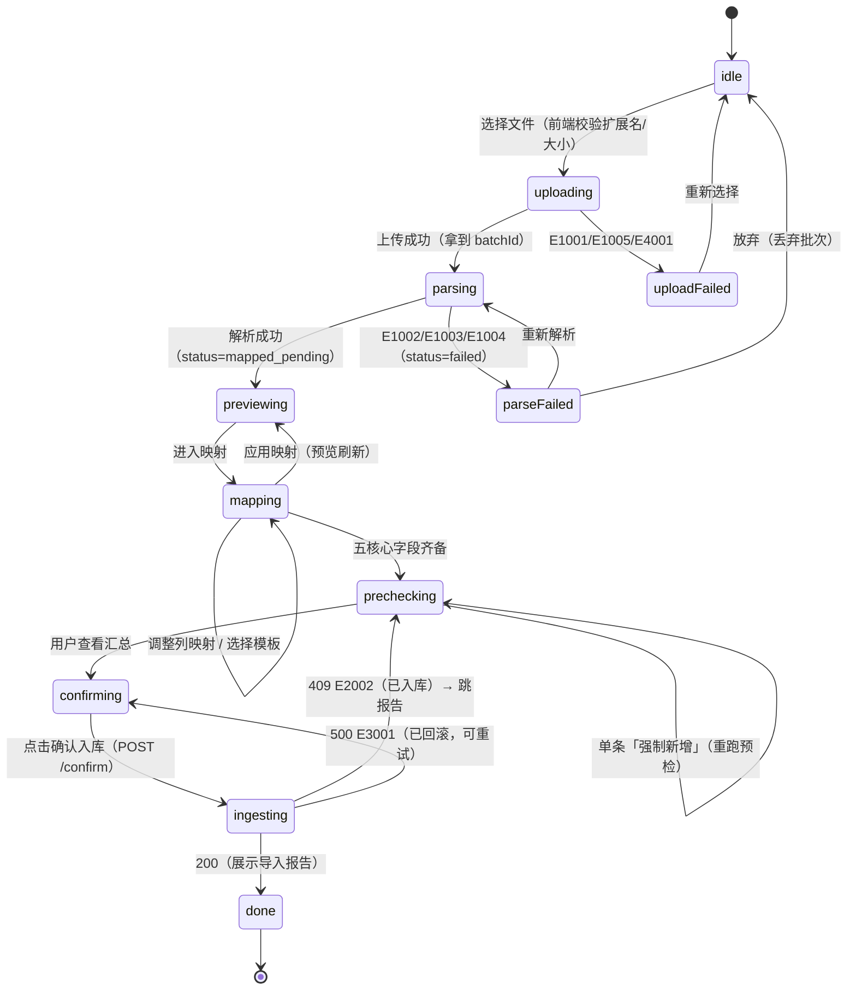

向导本地状态（`useReducer`，不落持久化——PRD 9.2 收口规则 1：无「待上传」落库态）：

```ts
type WizardState = {
  step: 1 | 2 | 3 | 4 | 5;
  batchId: string | null;
  mappingVersion: number;          // 每次改映射 +1，用于 precheck query key
  precheckSummary: Record<string, number> | null;
  overrides: number[];             // 已标记强制新增的 row_no
  report: IngestReport | null;
  error: { code: string; message: string } | null;
};
```

### 10.6 ECharts 主题与配色（涨红跌绿）

```ts
// charts/echartsTheme.ts
export const COLORS = {
  expense: '#C62828',      // 支出：红
  income:  '#2E7D32',      // 收入：绿
  neutral: '#9E9E9E',      // 中性（资金流转）：灰
  favorable: '#2E7D32',    // 有利变化（结余增加/支出减少）：绿
  unfavorable: '#C62828',  // 不利变化（支出增加/结余减少）：红
  uncategorized: '#B0BEC5',// 未分类：中性灰蓝（不与红绿混淆）
  palette: ['#C62828','#EF6C00','#F9A825','#2E7D32','#00838F','#1565C0','#6A1B9A','#B0BEC5'],
};

export const dashboardTheme = {
  color: COLORS.palette,
  textStyle: { fontFamily: 'system-ui, "PingFang SC", "Microsoft YaHei", sans-serif', fontSize: 12 },
  grid: { left: 8, right: 12, top: 24, bottom: 8, containLabel: true },
  tooltip: { trigger: 'axis', valueFormatter: (v: number) => `¥${(v / 100).toFixed(2)}` },
};
```

**配色规则表**（PRD 8 NFR · 配色规范）：

| 元素 | 颜色 | 依据 |
|------|------|------|
| 支出序列/支出 KPI | 红 `#C62828` | 支出是「不利」方向 |
| 收入序列/收入 KPI | 绿 `#2E7D32` | 收入是「有利」方向 |
| 支出环比 ↑ | 红 + `▲` | 不利变化 |
| 支出环比 ↓ | 绿 + `▼` | 有利变化 |
| 结余环比 ↑ | 绿 | 有利 |
| 「未分类」切片 | 灰蓝 `#B0BEC5` | 提示问题项，不抢红绿语义 |
| 资金流转（neutral） | 灰 `#9E9E9E` | 不计收支，视觉上「弱化」 |
| 待确认徽标 | 橙 `#EF6C00` | 需处理，但非错误 |

> 说明：PRD 表述为「涨跌遵循国内习惯：增加/不利变化用红色，减少/有利变化用绿色」。在记账语境下「涨」指支出上升（不利），因此支出序列为红——与股票红涨绿跌的**语义方向一致**（都表示「数值上升用红」）。`DeltaBadge` 的 `favorable` 属性由后端 DTO 的语义决定（结余增加=favorable），**不在前端推断正负**。

### 10.7 类型生成与开发/生产差异

| 场景 | 前端服务方式 | API 地址 | 启动 |
|------|--------------|----------|------|
| 开发 | Vite dev server（5173） | `vite.config.ts` proxy `/api` → `http://127.0.0.1:8765` | `npm run dev` |
| 生产 | 后端 `StaticFiles` 挂 `/` | 同源相对路径 `/api/v1` | `uv run account-dashboard run` |

```ts
// vite.config.ts
export default defineConfig({
  plugins: [react()],
  server: { port: 5173, proxy: { '/api': { target: 'http://127.0.0.1:8765', changeOrigin: false } } },
  build: { outDir: 'dist', sourcemap: false, chunkSizeWarningLimit: 900,
           rollupOptions: { output: { manualChunks: { echarts: ['echarts'], vendor: ['react','react-dom','react-router-dom'] } } } },
});
```

**类型生成命令**（`npm run gen:api`）：

```json
{
  "scripts": {
    "dev": "vite",
    "build": "tsc -b && vite build",
    "gen:api": "openapi-typescript ../frontend/openapi.json -o src/api/generated.ts",
    "lint": "eslint src --ext .ts,.tsx",
    "test": "vitest run"
  }
}
```

`src/api/generated.ts` 顶部固定：`/* eslint-disable */\n/* 自动生成：npx openapi-typescript openapi.json —— 请勿手改 */`。

### 10.8 前端硬性纪律

| # | 纪律 | 检查手段 |
|---|------|----------|
| F1 | 不做业务金额聚合（`reduce`/`sum` 只允许用于图表数据格式转换，且数据来自后端已聚合结果） | Code Review + `grep -n "reduce(" src/pages` |
| F2 | 请求/响应类型只来自 `generated.ts`，不手写 DTO | `tsc --noEmit` + Review |
| F3 | 所有写操作后有明确成功/失败反馈（Toast + 缓存失效） | Review |
| F4 | 破坏性操作（丢弃/重算/恢复/迁移）必须 `ConfirmDialog` | Review + 组件强制 |
| F5 | 空态与错误态必须实现（`EmptyState`/`ErrorBanner`），不只画有数据的页面 | 逐页验收 |
| F6 | 响应式：≥360px 可查看（导入操作提示用电脑） | 375px 视口手测 |
| F7 | 不引入 PRD 5.3 之外的 UI 框架（MUI/AntD/Tailwind 均不引入），样式用 CSS 变量 + 语义化 class | `package.json` 依赖评审 |
---

## 11. 配置、日志与运行

### 11.1 两级配置：引导配置（文件） + 业务设置（数据库）

**为什么要两级**：`data_dir` 决定数据库在哪，**不能存在数据库里**（先有鸡还是先有蛋）。因此：

| 级别 | 载体 | 内容 | 谁改 |
|------|------|------|------|
| 引导配置 | `app.toml`（或环境变量） | `data_dir`、`host`、`port`、`log_level`、`open_browser`、`single_instance` | 用户手工编辑 / 迁移向导改写 |
| 业务设置 | `setting` 表（经 `/settings` API） | 单日阈值、备份间隔、每周起始日、缓冲区阈值、事件日志开关、数据目录（**只读镜像用于展示**） | 界面操作 |

**`data_dir` 解析优先级**（高 → 低）：

```
1. 命令行 --data-dir
2. 环境变量 ACCOUNT_DASHBOARD_DATA_DIR
3. app.toml 的 [paths].data_dir
4. 默认：用户数据目录 / account_dashboard/data
   · Windows: %LOCALAPPDATA%\account_dashboard\data
   · macOS:   ~/Library/Application Support/account_dashboard/data
   · Linux:   ${XDG_DATA_HOME:-~/.local/share}/account_dashboard/data
```

`data/` 下固定四个子目录，**不允许**用户单独改（缓冲区随数据目录走，符合 FR-22「统一根目录」）：

```
<data_dir>/
├─ db/ledger.db
├─ db/ledger.db-wal, -shm
├─ buffer/
├─ backups/{auto,manual}/
├─ logs/app.log (+ .1 ~ .5)
└─ .lock
```

### 11.2 `app.toml.example`（可直接复制使用）

```toml
# ── 个人财务分析仪表盘 引导配置 ──────────────────────────────
# 复制为 app.toml 后按需修改；app.toml 已在 .gitignore 中

[server]
host = "127.0.0.1"          # 只允许 127.0.0.1 / localhost，其他值启动即拒绝
port = 8765
open_browser = true         # 启动后自动打开浏览器
single_instance = true      # 检测到已运行时提示并退出

[paths]
# 留空 → 使用系统用户数据目录（推荐）。填写示例：
#   Windows: "D:/finance/account_dashboard"
#   macOS  : "/Users/me/Documents/finance"
# 规则：必须是本地绝对路径；禁止系统敏感目录、网络路径(UNC)、磁盘根目录
data_dir = ""

[logging]
level = "INFO"              # DEBUG / INFO / WARNING / ERROR
max_bytes = 5242880         # 单文件 5MB
backup_count = 5
```

### 11.3 配置项清单（键 / 类型 / 默认 / 校验 / 落点）

| 键 | 类型 | 默认 | 校验规则 | 落点 | 对应 |
|----|------|------|----------|------|------|
| `server.host` | str | `127.0.0.1` | **只允许** `127.0.0.1`/`localhost`；其他 → 启动失败（退出码 2） | app.toml | PRD 11.2 |
| `server.port` | int | `8765` | `1024 ≤ p ≤ 65535`；占用 → 退出码 5 | app.toml | — |
| `server.open_browser` | bool | `true` | — | app.toml | — |
| `server.single_instance` | bool | `true` | — | app.toml | — |
| `paths.data_dir` | str | `""` → 系统默认 | `path_guard.validate_data_dir` | app.toml | FR-22 |
| `logging.level` | str | `INFO` | ∈ {DEBUG,INFO,WARNING,ERROR} | app.toml | — |
| `daily_expense_threshold_cents` | int | `30000`（300 元） | `> 0` 且 `≤ 100_000_00` | setting | FR-22 规则 1、FR-15 |
| `backup_reminder_days` | int | `7` | `≥ 1` 且 `≤ 365` | setting | FR-20 规则 4 |
| `week_start` | int | `1`（周一） | `∈ {1..7}`（ISO 周一=1） | setting | FR-22、周趋势分桶 |
| `buffer_size_threshold_mb` | int | `500` | `≥ 10` | setting | FR-07 规则 4（should） |
| `event_log_enabled` | bool | `false` | — | setting | PRD 10.4 |
| `data_dir_display` | str | 空 | **只读**，由引导配置回填，用于界面展示 | setting（镜像） | FR-22 |
| `last_backup_at` | str\|null | `null` | 由备份动作写入 | setting | FR-20 |
| `first_run_at` | str | 首次启动时间 | 由 init-db 写入 | setting | 帮助页引导 |

**校验实现**（`settings_service.SCHEMA`）：

```python
SETTING_SCHEMA: dict[str, SettingSpec] = {
    "daily_expense_threshold_cents": SettingSpec(int, 30000, lambda v: 0 < v <= 100_000_00,
                                                 "单日支出阈值必须大于 0"),
    "backup_reminder_days":          SettingSpec(int, 7, lambda v: 1 <= v <= 365,
                                                 "备份提醒间隔需在 1~365 天之间"),
    "week_start":                    SettingSpec(int, 1, lambda v: 1 <= v <= 7, "每周起始日需在 1~7 之间"),
    "buffer_size_threshold_mb":      SettingSpec(int, 500, lambda v: v >= 10, "缓冲区阈值不得小于 10MB"),
    "event_log_enabled":             SettingSpec(bool, False, None, ""),
}
```

### 11.4 数据目录路径合法化（`path_guard`）

| 校验项 | 规则 | 失败文案 |
|--------|------|----------|
| 非空 / 类型 | `str` 且 strip 后非空 | 「数据目录不能为空」 |
| 绝对路径 | `Path(p).is_absolute()`；含 `..` 段 → 规范化后判断 | 「请填写完整的绝对路径，如 D:/finance/data」 |
| UNC / 网络路径 | 拒绝 `\\server\share`、`//server/share`；Windows 上 `os.path.splitdrive` 且盘符不是本地固定盘（用 `GetDriveType` 可选，缺省保守拒绝 UNC） | 「数据目录必须在本机磁盘，不能使用网络路径」 |
| 磁盘根目录 | `p.resolve() == p.anchor`（如 `C:\`、`/`） | 「不能直接使用磁盘根目录」 |
| 系统敏感目录 | Windows: `C:\Windows`、`C:\Program Files*`、`C:\ProgramData`、`C:\System Volume Information`、`C:\$Recycle.Bin`；POSIX: `/System`、`/usr`、`/bin`、`/sbin`、`/etc`、`/var`、`/proc`、`/sys`、`/dev`、`/boot` | 「该目录属于系统目录，请换一个普通文件夹」 |
| 程序安装目录内部 | 路径包含 `site-packages` / `node_modules` / `.git` → 拒绝 | 「不能放在程序安装目录内，升级会覆盖」 |
| 长度 | `len(str(p)) ≤ 180` | 「路径太长，请选择层级更浅的目录」 |
| 可写 | 目标存在 → `os.access(p, W_OK)`；不存在 → 逐级取最近存在父目录检查，再尝试 `mkdir`；最终写 `.probe` 后删除 | 「该目录不可写入，请检查权限或以管理员身份运行」 |
| 符号链接 | `p.resolve()` 后再跑一遍上述前缀检查（防 symlink 逃逸） | 同上 |

### 11.5 端口、绑定与优雅关闭

```python
# cli.py / main.py
assert host in ("127.0.0.1", "localhost"), "只允许绑定回环地址"

uvicorn.run(
    "account_dashboard.main:app",
    host="127.0.0.1", port=cfg.port,
    log_config=None,                 # 用自建 logging
    access_log=True,
    timeout_graceful_shutdown=10,    # 10s 内完成在途请求
)
```

**优雅关闭**（`lifespan` 的 `yield` 之后）：

```python
finally:
    db.close()                        # 触发 WAL checkpoint
    lock.release()                    # 释放单实例锁
    logger.info("服务已停止，数据目录：%s", paths.data_dir)
```

关闭期间若正在入库：`BEGIN IMMEDIATE` 事务被中断 → SQLite 自动回滚 → 批次保持 `prechecked`（不产生半成品），符合 PRD 9.2 收口规则 4。

### 11.6 启动脚本

**`scripts/start.ps1`（Windows）**

```powershell
$ErrorActionPreference = "Stop"
Set-Location (Split-Path $PSScriptRoot -Parent)

Write-Host "[1/3] 检查 uv ..."
if (-not (Get-Command uv -ErrorAction SilentlyContinue)) {
    Write-Host "未检测到 uv。请先安装： powershell -c `"irm https://astral.sh/uv/install.ps1 | iex`"" -ForegroundColor Yellow
    exit 1
}
Write-Host "[2/3] 同步依赖（首次约 1~2 分钟）..."
uv sync --frozen
Write-Host "[3/3] 启动服务（仅监听 127.0.0.1）..."
uv run account-dashboard run
```

**`scripts/start.sh`（macOS / Linux）**

```bash
set -euo pipefail
cd "$(dirname "$0")/.."
command -v uv >/dev/null 2>&1 || { echo "未检测到 uv，请先安装：curl -LsSf https://astral.sh/uv/install.sh | sh"; exit 1; }
uv sync --frozen
exec uv run account-dashboard run
```

**启动输出样例**（用户可见，必须包含监听地址与数据目录，PRD 11.2 要求「启动日志明示监听地址」）：

```
========================================
 个人财务分析仪表盘  v1.0.0
 访问地址：http://127.0.0.1:8765
 监听范围：仅本机（127.0.0.1），局域网不可访问
 数据目录：C:\Users\me\AppData\Local\account_dashboard\data
 日志文件：<数据目录>\logs\app.log
 启动对账：已补删 1 个残留文件，发现 0 个孤儿文件
========================================
```

### 11.7 日志方案

| 项 | 方案 |
|----|------|
| 库 | 标准库 `logging`（零依赖） |
| 文件 | `data/logs/app.log`，`RotatingFileHandler(maxBytes=5MB, backupCount=5)` → 最多 30MB |
| 控制台 | `StreamHandler`（一键启动窗口可见） |
| 格式 | `%(asctime)s %(levelname)s [%(name)s] %(message)s` |
| 级别 | 默认 INFO；`DEBUG` 打开时记录 SQL 与解析逐行 issue |
| 关键事件（INFO） | 启动/停止、上传成功、解析结果（行数/编码/表头行）、入库报告、删除文件、对账结果、重算报告、备份/恢复/迁移 |
| 异常（ERROR） | 事务失败、文件 IO 失败、恢复失败、迁移失败，均带 `batch_id`/`file` |
| 脱敏 | `SensitiveFilter`：≥12 位连续数字（卡号/订单号）、邮箱、手机号 → 掩码（`****1234`） |
| 禁止 | **任何日志不得包含完整原始文件内容**；不得包含 `raw_payload` 全文 |

事件日志（`event_log` 表）与文件日志的分工：文件日志面向排障（开发者看），事件日志面向产品统计（PRD 10.4，默认关，用户可开）。

---

## 12. 异常与错误处理

### 12.1 错误码分层

| 层 | 前缀 | HTTP | 语义 | 典型 |
|----|------|------|------|------|
| 入口校验 | `E1xxx` | 400/413/415/422 | 输入不合法，**未进入业务层** | E1001 格式、E1007 映射不全 |
| 业务规则 | `E2xxx` | 400/404/409 | 状态机/幂等/唯一性/引用约束 | E2002 状态冲突、E2005 分类被引用 |
| 数据与事务 | `E3xxx` | 500/409 | 事务失败、DB 忙/损坏、迁移失败 | E3001 入库回滚、E3003 DB busy |
| 文件 IO | `E4xxx` | 409/500/507 | 磁盘满、删除失败、备份无效 | E4001 磁盘满、E4005 备份无效 |
| 系统 | `E5xxx` | 500 | 兜底（未预期异常） | E5001 |

**分层原则**：能归到「用户可自行修正」（E1）就不要归到「系统问题」（E5）；**「数据已成功但文件没删」（E4003）必须是 409 而非 500** —— 因为业务结果已达成，用户不需要重试整批。

### 12.2 用户可读文案原则（面向非技术用户，PRD 6.1）

| 原则 | 反例 ❌ | 正例 ✅ |
|------|---------|---------|
| 说「怎么办」而非「哪里错」 | 「UnicodeDecodeError: invalid continuation byte」 | 「无法识别文件编码。请用 Excel 打开后另存为『CSV UTF-8』再上传。」 |
| 不带堆栈、不带 SQL | `sqlite3.OperationalError: no such table raw_2026_13` | 「原始库归档失败，数据已回滚，请重试或联系支持。」 |
| 给具体量 | 「文件太大」 | 「文件 8.2MB，超过 5MB 上限。请按月份分批导出。」 |
| 明确数据是否安全 | 「入库失败」 | 「入库失败，已回滚，你的数据没有任何改变，可以放心重试。」 |
| 保留可操作入口 | 「模板冲突」 | 「该渠道已有默认模板『默认』。可以覆盖它，或另存为新模板。」 |

**文案落点**：`ErrorCode → 中文模板` 集中在 `api/errors.py` 的 `MESSAGES: dict[ErrorCode, str]`，支持 `{}` 占位符由 `detail` 填充（如剩余空间、文件大小）。**前端不再重写文案**，只做展示 + 按 code 决定交互（是否显示重试按钮）。

### 12.3 日志脱敏实现

```python
class SensitiveFilter(logging.Filter):
    PATTERNS = [
        (re.compile(r"\b\d{12,}\b"), lambda m: m.group()[:4] + "*" * 8 + m.group()[-4:]),
        (re.compile(r"\b1[3-9]\d{9}\b"), lambda m: m.group()[:3] + "****" + m.group()[-4:]),
        (re.compile(r"[\w.+-]+@[\w-]+\.[\w.]+"), lambda m: m.group()[:2] + "***@" + m.group().split("@")[1]),
    ]
    def filter(self, record: logging.LogRecord) -> bool:
        record.msg = redact(str(record.msg))
        return True
```

另有一条硬规则：**`raw_payload` 绝不进日志**。`/transactions/{id}/trace` 返回的 `raw_payload` 也只到前端内存，不写日志、不写事件表。

### 12.4 异常-处理对照（开发者视角速查）

| 抛出点 | 异常类型 | 处理器 | 是否记 ERROR 日志 | 是否告警用户 |
|--------|----------|--------|-------------------|--------------|
| Pydantic 请求校验 | `RequestValidationError` | `validation_handler` | 否（DEBUG） | 是（字段级） |
| 业务守卫 | `AppError(E2xxx)` | `app_error_handler` | 否（INFO） | 是 |
| 事务失败 | `TransactionError(E3001)` | `app_error_handler` | **是**（含 batch_id） | 是（说明已回滚） |
| 文件 IO | `FileIOError(E4xxx)` | `app_error_handler` | **是** | 是 |
| 未预期 | `Exception` | `unhandled_handler` | **是**（含堆栈，仅入文件） | 是（E5001 泛化文案） |
---

## 13. 测试设计

### 13.1 pytest 布局

```
tests/
├─ conftest.py                  # 全局 fixtures：tmp_data_dir / db / client / uow / seed
├─ fixtures/
│  ├─ wechat_sample_sanitized.xlsx     # 真实样例脱敏副本（60 行，保留前言+表头+序列号时间+数值金额）
│  ├─ alipay_sample_gb18030.csv        # 真实样例脱敏副本（60 行，GB18030，含 Tab 与尾随空列）
│  ├─ wechat_serial_float.xlsx         # 构造：时间单元格无日期样式 → openpyxl 返回 float
│  ├─ wechat_header_shifted.xlsx       # 构造：前言多 5 行 → 表头在第 23 行（验证打分探测）
│  ├─ alipay_utf8.csv                  # 构造：同内容 UTF-8 版（编码无关性验证）
│  ├─ broken_structure.csv             # 构造：0 数据行
│  ├─ no_header.csv                    # 构造：无表头
│  ├─ huge_50001_rows.csv              # 构造（生成器，不落盘大文件）
│  └─ corrupt_backup.db                # 构造：非 SQLite 文件
├─ unit/
│  ├─ test_header_detect.py
│  ├─ test_encoding.py
│  ├─ test_cleaning_amount.py
│  ├─ test_cleaning_time.py
│  ├─ test_fingerprint.py
│  ├─ test_direction_map.py
│  ├─ test_period_resolver.py
│  ├─ test_stats_filter.py
│  ├─ test_path_guard.py
│  └─ test_batch_guard.py
├─ integration/
│  ├─ test_upload_parse_flow.py
│  ├─ test_mapping_template_conflict.py
│  ├─ test_precheck_dedup.py
│  ├─ test_ingest_multi_month.py
│  ├─ test_recalc_overwrite_policy.py
│  ├─ test_stats_consistency.py
│  ├─ test_backup_restore.py
│  ├─ test_data_dir_migration.py
│  └─ test_layering.py                 # 静态检查：api 不 import repositories
└─ fault_injection/
   ├─ test_fi_tx_failure.py            # 用例 1
   ├─ test_fi_crash_after_commit.py    # 用例 2
   ├─ test_fi_concurrent_confirm.py    # 用例 3
   └─ test_fi_disk_full.py             # 用例 4
```

### 13.2 关键 fixtures

```python
# conftest.py
@pytest.fixture
def data_dir(tmp_path) -> DataPaths:
    """临时数据目录：db/buffer/backups/logs 全部就位，不污染真实 data/。"""

@pytest.fixture
def db(data_dir) -> Database:
    d = Database(data_dir.db_file)
    SchemaMigrator(d, MIGRATIONS_DIR).migrate()
    yield d
    d.close()

@pytest.fixture
def client(db, data_dir) -> TestClient:
    """TestClient(app)，注入临时 data_dir 与 db；override get_uow 依赖。"""

@pytest.fixture
def seeded(client):
    """跑 init-db 种子：19 分类 + 18 规则 + 15 category_hint + 2 模板。"""
```

**脱敏原则**：真实样例只保留结构与统计特征，人名/账号替换为 `某某`/`138****0000`；**但必须保留**：Excel 序列号时间、数值型金额（含 `8.8` 这种 float）、GB18030 编码、Tab 尾随、尾随空列、`/` 与 `不计收支` 取值。否则解析器回归测试会失去意义。

### 13.3 用例矩阵（按 PRD RTM 覆盖 FR-01~23）

| 用例 ID | 覆盖 | 断言要点 |
|---------|------|----------|
| U-HD-01 | FR-03 表头探测 | 微信样例：`header_row_no==17`（0-based），5 核心全中 |
| U-HD-02 | FR-03 | 支付宝样例：`header_row_no==23`，13 列（末列空）正确识别 |
| U-HD-03 | EX-03 | `no_header.csv` → 抛 E1003；`allow_partial=True` 返回最佳候选 |
| U-HD-04 | 鲁棒性 | `wechat_header_shifted.xlsx`（前言 +5 行）仍能定位 |
| U-EN-01 | FR-01 编码 | GB18030 文件中文无乱码；UTF-8 同名文件解析结果与之一致 |
| U-EN-02 | EX-02 | 人为破坏字节 → E1002 |
| U-AM-01 | FR-04/I4 | `8.8` → `880`；`4.35` → `435`；`"45.90"` → `4590`；`"¥1,234.5"` → `123450` |
| U-AM-02 | EX-06 | `"/"`、`"abc"` → `AmountParseError`，行保留 + issue |
| U-TM-01 | EX-07 | `46316.82503472222` → `2026-10-21T19:48:03`（与 datetime 分支结果一致） |
| U-TM-02 | EX-07 | 8 种格式全部解析；`datetime` 微秒被截断 |
| U-FP-01 | FR-04 | 五项全同 → 指纹相同；改任一字段 → 不同 |
| U-FP-02 | EX-21 | 缺时间或缺金额 → `fingerprint is None` |
| U-DM-01 | FR-09 | 微信 `/`→neutral；支付宝 `不计收支`→neutral；未知值 → neutral + issue |
| U-PR-01 | 10.3 | 月末边界：`2026-10-31T23:59:59` 属于 10 月，`2026-11-01T00:00:00` 属于 11 月 |
| U-PR-02 | FR-18 | 1 月的 prev 是上年 12 月；`last_year` 无数据 → None |
| U-ST-01 | 10.3/I1 | neutral 改分类到「餐饮美食」后，总支出不变 |
| U-ST-02 | 10.3/I2 | excluded 记录不进任何统计 |
| U-ST-03 | 10.3/I3 | 3 笔 pending → 总支出含其金额，且「未分类」切片 = 其金额 |
| U-ST-04 | FR-16/19 | 明细筛选汇总 == 月报同分类金额（逐分类比对） |
| U-PG-01 | FR-22 | `C:\Windows`、`\\nas\share`、`C:\`、`site-packages/x` 全部拒绝；正常目录通过 |
| U-BG-01 | EX-18 | 状态机矩阵 7×6 全覆盖；非法流转全部 E2002 |
| I-UP-01 | FR-01/02 | 上传 → 文件在 buffer 且批次 `uploaded` → 解析后 `mapped_pending` |
| I-MP-01 | FR-03/EX-20 | 同渠道二次保存：abort→409、overwrite→旧 default 降级、save_as→新行 |
| I-PC-01 | FR-04 | 预检前后 `transaction`/`raw_*` 计数不变（只读验证） |
| I-PC-02 | FR-04 规则 3 | 同日同额不同对方两笔均标 `new`（用样例中 29 组真实组合） |
| I-PC-03 | P0-1 | 标 override 后 label 翻转 `new` 且 `override=true` |
| I-IN-01 | FR-05 | 跨 5 个月样例 → 建 5 张 raw 表，行数与月分布一致（101/136/182/143/107） |
| I-IN-02 | EX-09 | 全量重复 → `inserted=0`，批次 `ingested`，文件已删 |
| I-IN-03 | I8 | 随机抽 5 条 transaction，`batch_id+row_no` 能在 raw 找到且字段一致 |
| I-RC-01 | FR-08/11 | 默认不覆盖 corrected；`overwrite_manual=True` 覆盖 |
| I-RC-02 | FR-08 规则 6 | 注入失败 → 报表数字与执行前逐字段一致 |
| I-BK-01 | FR-20 | 备份 → 恢复 → 条数与各周期汇总一致 |
| I-BK-02 | EX-19 | 损坏备份 → 预检 E4005，**未发生任何文件替换** |
| I-MG-01 | FR-22 | 迁移后新目录文件齐全、app.toml 指向新目录、旧目录保留 |

### 13.4 故障注入 4 条用例（PRD 13.4 / M2 出口证据）

#### 用例 1：事务写入中失败 → 全回滚（EX-10）

```python
def test_fi_tx_failure(client, monkeypatch, data_dir):
    """在 transaction_repo.insert_many 的第 2 批注入 RuntimeError。"""
    batch = _prepare_prechecked_batch(client)              # 上传+解析+映射+预检
    original = TransactionRepo.insert_many
    calls = {"n": 0}
    def boom(self, drafts):
        calls["n"] += 1
        if calls["n"] == 2:
            raise RuntimeError("injected failure")
        return original(self, drafts)
    monkeypatch.setattr(TransactionRepo, "insert_many", boom)

    r = client.post(f"/api/v1/staging/batches/{batch}/confirm")
    assert r.json()["code"] == "E3001"
    assert _count("transaction") == 0                       # 主数据层无残留
    assert _raw_total() == 0                                # raw 无残留（含已成功的第 1 批）
    assert _batch(batch).status == "prechecked"             # 回待确认，非 failed
    assert Path(_batch(batch).file_path).exists()            # 原文件保留
```

#### 用例 2：事务提交后、删文件前崩溃 → 启动对账补删（EX-16）

```python
def test_fi_crash_after_commit(client, data_dir, monkeypatch):
    """让 BufferFileManager.delete 抛 SystemExit（模拟进程被杀），
       然后重建 app（模拟重启），断言启动对账把文件删掉。"""
    batch = _prepare_prechecked_batch(client)
    monkeypatch.setattr(BufferFileManager, "delete",
                        lambda self, p: (_ for _ in ()).throw(SystemExit))
    with pytest.raises(SystemExit):
        client.post(f"/api/v1/staging/batches/{batch}/confirm")

    b = _batch(batch)
    assert b.status == "ingested" and b.pending_delete_flag == 1     # 删除意图已落库
    assert Path(b.file_path).exists()                                # 文件残留

    monkeypatch.undo()
    report = _simulate_restart(data_dir)                             # 重新跑 lifespan
    assert report.deleted == 1
    assert not Path(b.file_path).exists()
    assert _batch(batch).pending_delete_flag == 0
```

#### 用例 3：并发双提交确认入库 → 仅一次成功（EX-18）

```python
def test_fi_concurrent_confirm(client, data_dir):
    batch = _prepare_prechecked_batch(client)
    results = []
    def hit():
        results.append(client.post(f"/api/v1/staging/batches/{batch}/confirm").json()["code"])
    threads = [threading.Thread(target=hit) for _ in range(2)]
    [t.start() for t in threads]; [t.join() for t in threads]

    assert sorted(results) == ["E2002", "OK"]                # 一成一败
    assert _count("transaction") == _expected_rows(batch)    # 无重复数据
```

> 说明：SQLite 写锁 + `BEGIN IMMEDIATE` 保证串行；被拒绝的一方是 `rowcount==0` → E2002，而不是 `database is locked`（`busy_timeout=5000` 让等待方拿到锁后立即发现状态已变）。

#### 用例 4：磁盘满上传 → 半成品清理（EX-17）

```python
def test_fi_disk_full(client, data_dir, monkeypatch):
    monkeypatch.setattr(shutil, "disk_usage",
                        lambda p: shutil._ntuple_diskusage(100, 50, 1))   # free=1B
    r = client.post("/api/v1/staging/batches", files={"file": ("a.csv", b"x" * 10)})
    assert r.json()["code"] == "E4001"
    assert list(data_dir.buffer.glob("*")) == []                          # 无 .part 残留
    assert _count("staging_batch") == 0                                   # 未建批次
```

### 13.5 前端测试（可选但推荐）

| 类型 | 工具 | 覆盖 |
|------|------|------|
| 单元 | Vitest | `AmountText`（分→元）、`DeltaBadge`（favorable/unfavorable 颜色）、`PeriodSwitcher`（锚点计算） |
| 组件 | Vitest + RTL | `ImportWizard` 五步流转（mock API）：上传成功→预览→映射缺字段→阻断→补齐→预检→确认→报告 |
| 契约 | `tsc --noEmit` | `generated.ts` 与 `endpoints.ts` 类型一致 |
| 冒烟 | Playwright（可选，M5） | 上传样例 → 确认入库 → 仪表盘出现数字 |

**不做的**：不追求前端 80% 覆盖率。前端风险点在「向导状态机」与「配色语义」，只针对这两处写测试。

### 13.6 覆盖率目标与门禁

| 模块 | 目标 | 说明 |
|------|------|------|
| `infra/parsers/**` | **≥ 90%** | 解析是最大风险面（RK-04 格式变更） |
| `services/stats_service.py` | **≥ 90%** | 口径是产品生命线（RK-14） |
| `services/ingest_service.py` + `recalc_service.py` | **≥ 85%** | 事务正确性 |
| `infra/path_guard.py` | **≥ 95%** | 安全相关，分支多但都是纯函数 |
| 整体 | **≥ 80%** | `--cov-fail-under=80` 进 CI |

**门禁清单（M2 出口，对应 PRD 13.1）**：

1. `uv run pytest -q` 全绿（≥ 120 用例）
2. 4 条故障注入用例全部通过
3. `uv run ruff check` / `uv run mypy src` 无 error
4. 契约漂移检查通过（`generated.ts` 无 diff）

---

## 14. 任务分解与实施顺序（重点）

### 14.1 分解原则

| 规则 | 说明 |
|------|------|
| 按**工作包**分组，不按单文件拆 | 每个二级任务覆盖一个可独立验收的能力，产出 ≥ 3 个文件 |
| 5 个一级工作包 | T01~T05（各自对应一组里程碑能力），二级任务编号 `T0x.y` |
| 依赖显式化 | 只允许「同包内顺序」或「跨包已定义接口」，禁止环形依赖 |
| 里程碑对齐 | 每个二级任务标注 `M1~M5`，与 PRD 13.1 出口标准一一对应 |
| 估时口径 | 人日 = 单人有效编码 + 自测（不含评审/返工；返工余量见 §14.5） |

### 14.2 T01 · 工程基础设施与横切能力（M1）

| ID | 任务 | 产出文件 | 依赖 | 验收点 | 人日 |
|----|------|----------|------|--------|------|
| T01.1 | 工程骨架与依赖声明 | `pyproject.toml`、`uv.lock`、`.python-version`、`.gitignore`、`app.toml.example`、`src/account_dashboard/__init__.py`、`__main__.py`、`config.py` | — | `uv sync` 成功；`uv run python -c "import account_dashboard"` 通过；`uv build` 出包 | 1.0 |
| T01.2 | 数据层基座与迁移 | `repositories/database.py`、`unit_of_work.py`、`schema_migrator.py`、`migrations/V001__init.sql` | T01.1 | `init-db` 建出 12 张表 + 索引（`schema_version`/`staging_batch`/`transaction`/`category`/`rule`/`category_hint`/`setting`/`channel_template`/`override_mark`/`cleanup_queue`/`backup_log`/`event_log`）；重复执行幂等；改动 V001 的 checksum → 启动失败 | 1.0 |
| T01.3 | 统一响应、错误码、日志、路径守卫 | `api/response.py`、`api/errors.py`、`api/deps.py`、`api/app_factory.py`、`infra/logger.py`、`infra/path_guard.py`、`infra/paths.py`、`infra/filelock.py` | T01.1 | `{code,data,message}` 全站生效；`path_guard` 16 条用例全过；日志轮转可验证 | 1.0 |
| T01.4 | 启动入口、CLI、静态挂载、启动脚本 | `main.py`、`cli.py`、`api/static_mount.py`、`scripts/start.ps1`、`scripts/start.sh`、`scripts/build_frontend.py` | T01.2、T01.3 | `lifespan` **六阶段**按序执行（配置装载→数据目录校验→目录创建→schema 迁移→启动对账→端口占用），退出码 1~5 可复现，**对账失败不退出**；`/health` 返回 data_dir 与 backlog；双启动被单实例锁拦 | 1.0 |

**T01 出口（M1 第 1 周）**：`uv run account-dashboard run` 能起来，`/health` 200，日志与数据目录就绪。

### 14.3 T02 · 导入缓冲区链路（M1）

| ID | 任务 | 产出文件 | 依赖 | 验收点 | 人日 |
|----|------|----------|------|--------|------|
| T02.1 | 解析内核（编码/表头/清洗/指纹） | `infra/parsers/base.py`、`encoding.py`、`header_detect.py`、`cleaning.py`、`fingerprint.py`、`registry.py`、`models/internal.py` | T01.3 | 微信表头行=17、支付宝=23；`8.8→880`；`46316.82503472222→2026-10-21T19:48:03`；GB18030 无乱码 | 1.5 |
| T02.2 | 三个适配器 | `infra/parsers/wechat_xlsx.py`、`alipay_csv.py`、`generic.py` | T02.1 | 支付宝 **669 行**全部解析；微信 **689 行**全部解析（口径见 §8.2 脚注：707 − 18 = 689，与平台自报「共689笔记录」一致，数据区无缺失行）；`direction` 分布与实测一致（613/72/4 与 512/155/2）；数据区若出现整行空行，须在 `parse_meta.empty_rows_skipped` 可见且报告页提示，**不得静默丢弃** | 1.5 |
| T02.3 | 上传与缓冲区文件管理 | `infra/buffer_file.py`、`infra/filelock.py`、`services/import_orchestrator.py`、`repositories/staging_repo.py`、`api/routers/staging.py`（上传/解析/预览/丢弃部分）、`models/staging.py` | T02.2 | 流式落盘 + 余量检测（EX-17）；刷新后批次仍在；解析失败批次可重试 | 1.0 |
| T02.4 | 映射与渠道模板 | `services/mapping_service.py`、`repositories/template_repo.py`、`models/staging.py` 映射 DTO | T02.3 | 五核心字段缺失阻断（E1007）；同渠道冲突三种策略正确（EX-20） | 1.0 |
| T02.5 | 去重预检与强制新增 | `services/dedup_checker.py`、`repositories/override_repo.py`、`api/routers/staging.py`（precheck 部分） | T02.4 | 预检零写入（计数前后相等）；同日同额不同对方均标 new；override 翻转留痕 | 1.0 |

**T02 出口（M1 结束 / PRD 13.1 M1 出口标准）**：**一份真实账单（脱敏）或构造样例可完成上传 → 解析 → 映射 → 预检**；EX-17/20/21 覆盖。

### 14.4 T03 · 入库与原始库（M2）

| ID | 任务 | 产出文件 | 依赖 | 验收点 | 人日 |
|----|------|----------|------|--------|------|
| T03.1 | 确认入库单事务 | `services/ingest_service.py`、`api/guards.py`、`api/routers/ingest.py`、`models/ingest.py` | T02.5 | 跨 5 月样例 → 5 张 raw 表（101/136/182/143/107）；失败全回滚；报告四数字正确 | 1.5 |
| T03.2 | raw 分表管理 | `repositories/raw_repo.py`（`RawTableManager`）、`api/routers/raw.py` | T03.1 | 无数据月份不建表；`raw_payload` 保留整行原貌；raw 无 update 方法 | 1.0 |
| T03.3 | 删除意图、待清理与启动对账 | `infra/reconciliation.py`、`services/cleanup_service.py`、`repositories/cleanup_repo.py`、`api/routers/maintenance.py` | T03.1 | 提交后 flag=1 → 删成功清零；删失败入队；重启补删（EX-16/EX-23） | 1.0 |
| T03.4 | 幂等与故障注入用例 | `api/guards.py`（条件 UPDATE）、`tests/fault_injection/*`（4 条）、`tests/test_batch_guard.py` | T03.3 | 4 条故障注入全绿；并发双提交仅一次成功（EX-18） | 0.5 |
| T03.5 | 原始库查看与批次追溯 | `api/routers/raw.py`（months/records）、`api/routers/transactions.py`（trace）、`repositories/transaction_repo.py`（基础查询） | T03.2 | 按月浏览只读；任一条主数据可回溯到 raw 行与 mapping_snapshot | 0.5 |

**T03 出口（PRD 13.1 M2 出口标准）**：**回滚 / 启动对账 / 幂等三项可验** + 故障注入 4 条通过。

### 14.5 T04 · 分类、重算与统计（M3 → M4 后端）

| ID | 任务 | 产出文件 | 依赖 | 验收点 | 人日 | 里程碑 |
|----|------|----------|------|--------|------|--------|
| T04.1 | 分类引擎与 direction 判定 | `services/classification_engine.py`、`models/enums.py`、`repositories/rule_repo.py`、`repositories/category_repo.py`、种子规则包 | T03.1 | 优先级取高/同级取最新；neutral 不计收支；未命中 → pending；8.9 的 hint 只写 `hint_*` | 1.5 | M3 |
| T04.2 | 规则 / 分类 / 待确认 / 修正 | `services/rule_service.py`、`category_service.py`、`pending_service.py`、`transaction_service.py`、`api/routers/{rules,categories,transactions}.py`、`models/admin.py` | T04.1 | 规则入口校验；停用分类须迁移；批量修正置 corrected；仅分类/备注可编辑（E2009） | 1.5 | M3 |
| T04.3 | 唯一重算服务 | `services/recalc_service.py`、`api/routers/recalc.py` | T04.2 | 两入口同一实现；默认不覆盖 corrected/excluded；失败整体回滚 | 1.0 | M3 |
| T04.4 | 统计服务（唯一口径源） | `services/stats_service.py`、`api/routers/stats.py`、`api/routers/reports.py`、`models/stats.py`、`services/period_resolver.py` | T03.2、T04.3 | 12 指标口径全部对齐 10.3；储蓄率 0 分母 → None；日均分母为自然日；P95 ≤ 200ms | 2.0 | M4 |
| T04.5 | 接口编排与契约冻结 | `models/*` 全量补齐、OpenAPI 导出、`/transactions/summary`、三处统计入口统一委托、契约变更记录 | T04.4 | `openapi.json` 可导出；`/stats`、`/reports`、`/transactions/summary` 数字一致（FR-19 验收）；10.3 口径对照表逐条勾对 | 1.0 | M4 |

**T04 出口**：M3 → 规则引擎 + 保守规则包可用、重算可验；M4 → 三周期切换正常、口径核对一致（M4 首日执行 §14.7 核对清单）。

### 14.6 T05 · 前端与数据管理（M4 → M5）

| ID | 任务 | 产出文件 | 依赖 | 验收点 | 人日 | 里程碑 |
|----|------|----------|------|--------|------|--------|
| T05.1 | 前端基建与类型生成 | `frontend/package.json`、`vite.config.ts`、`tsconfig*.json`、`index.html`、`src/main.tsx`、`App.tsx`、`router.tsx`、`api/{client,generated,endpoints,queryKeys}.ts`、`styles/*`、`scripts/gen_api_types.sh` | T04.5 | `npm run build` 通过；`gen:api` 产物与 `openapi.json` 一致；dev proxy 联调成功 | 1.5 | M4 |
| T05.2 | 导入向导 + 缓冲区管理页 | `state/importWizard.tsx`、`pages/import/*`（5 步）、`pages/Staging.tsx`、`components/{WizardSteps,Dropzone,PreviewTable,MappingForm,PrecheckTable,ReportPanel}.tsx` | T05.1、T03.3 | 五步全流程打通；「强制新增」可用；失败可回退；丢弃二次确认 | 2.0 | M4–M5 |
| T05.3 | 仪表盘 + 明细 + 待确认 + 规则 | `pages/{Dashboard,Transactions,Pending,Rules,RawArchive}.tsx`、`charts/*`（主题 + 三图）、`components/{KpiCard,DeltaBadge,AmountText,PeriodSwitcher,PendingBadge}.tsx` | T05.1、T04.4 | 四卡三图 2s 内渲染；涨红跌绿正确；明细只读事实字段；待确认「建议」需二次提交 | 2.0 | M4–M5 |
| T05.4 | 三期报表 + 帮助页 | `pages/reports/{Monthly,Quarterly,Yearly}.tsx`、`pages/Help.tsx`、`components/SummaryList.tsx` | T05.3、T04.5 | 同比无数据显示「—」；帮助页三块内容与 9.5/FR-23 一致且无理财内容 | 1.0 | M5 |
| T05.5 | 备份 / 恢复 / 设置 / 数据迁移 | `services/backup_service.py`、`settings_service.py`、`migration_service.py`、`repositories/{backup,setting}_repo.py`、`api/routers/{backup,settings}.py`、`pages/Settings.tsx` | T04.2 | 恢复前自动备份 + 一键回退（EX-19）；数据目录 validate/migrate 全链路；备份过期提醒 | 1.5 | M5 |
| T05.6 | 打包发布与端到端回归 | `scripts/build_frontend.py`、wheel 内容校验、`README.md`、`docs/devel/CONTRACT-CHANGELOG.md`、`tests/integration/test_e2e.py` | T05.2~T05.5 | 新机器 5 条命令可跑；wheel 内含 `static/`；`/` 返回 SPA、`/api/v1/health` 正常 | 1.0 | M5 |

**T05 出口（PRD 13.1 M5 出口标准）**：月报可独立产出；备份恢复与回退验证通过；数据目录迁移演练通过。

### 14.7 M4 首日「口径核对清单」（硬性入口条件）

| # | 核对项 | 期望 | 对应 |
|---|--------|------|------|
| 1 | `base_filter()` 内容 | 恰为 `direction IN ('income','expense') AND status <> 'excluded'` | 10.3 行 1 |
| 2 | neutral 改分类后总支出 | 不变 | I1 / P0-2 |
| 3 | pending 是否计入 | 计入，且「未分类」切片金额相等 | I3 / P0-4 |
| 4 | excluded | 不出现在任何 KPI/分类/Top | I2 |
| 5 | 储蓄率 0 分母 | `null` → 前端「—」 | 10.3 |
| 6 | 日均分母 | 周期自然日（31/92/365） | 10.3 |
| 7 | 环比基期 0 | `mom_flag='new'` → 「新增」 | 10.3 |
| 8 | 同比无数据 | `null` → 「—」非 0% | FR-18 |
| 9 | 明细筛选汇总 vs 月报 | 逐分类金额相等 | FR-16/19 |
| 10 | 预检汇总 vs 入库报告 | 不一致时以报告为准（页面有固定文案） | EX-22 |

### 14.8 关键路径与可并行组

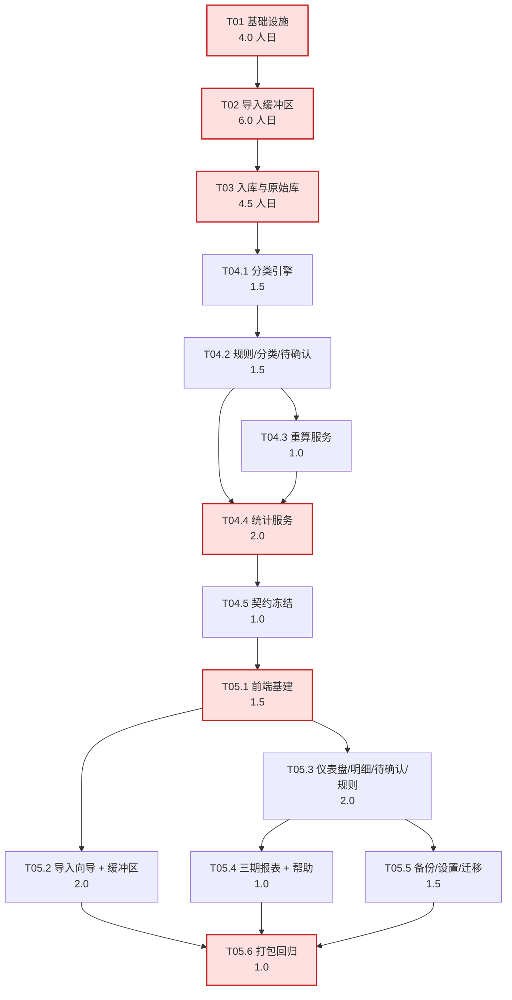

**关键路径**（红色）：T01 → T02 → T03 → T04.4 → T05.1 → T05.6。任何一环延期直接推迟上线。

**可并行组**：

| 组 | 可并行任务 | 前置条件 |
|----|-----------|----------|
| P1 | T04.4（统计） ⟷ T05.1（前端基建） | T04.5 的 OpenAPI 一旦可导出即可启动前端（用 mock 数据） |
| P2 | T05.2（向导） ⟷ T05.3（仪表盘） | T05.1 完成；两页无共享状态 |
| P3 | T05.4（报表） ⟷ T05.5（备份设置） | T05.3 完成 |
| P4 | T02.4（映射） ⟷ T02.5（预检） | T02.3 完成；两者只共享 `staging_batch` 字段 |

### 14.9 容量校核（诚实版）

| 里程碑 | 周数 | 容量（人日） | 计划（人日） | 差额 | 结论 |
|--------|------|--------------|--------------|------|------|
| M1 | 2 | 10.0 | 4.0 + 6.0 = 10.0 | 0 | **刚好满**，无余量 |
| M2 | 1 | 5.0 | 4.5 | +0.5 | 可行 |
| M3 | 1 | 5.0 | 4.0 | +1.0 | 可行（余量用于前端提前起步） |
| M4 | 1 | 5.0 | 2.0+1.0+1.5+1.5 = 6.0 | **−1.0** | **超载**（与 PRD RK-12 同类风险） |
| M5 | 1 | 5.0 | 0.5+1.0+1.5+1.0 = 4.0 | +1.0 | 可行 |
| 合计 | 6 | 30.0 | 28.5 | +1.5 | — |

**M4 超载的卸载杠杆（按优先级）**：

1. **T05.2 拆分**：M4 只做「上传 + 预览」两步（1.0 人日），映射/预检/确认三步移到 M5（1.0 人日）—— M4 = 5.0，M5 = 5.0，总容量刚好。
2. **FR-15 增强项后移**：单日阈值高亮与收入到账标记是 Should 级（PRD FR-15），可移至 M5 末或上线后第一周。
3. **FR-07 should 级后移**：缓冲区占用展示与阈值提醒（PRD FR-07 规则 4 明确标 should）。

> 与 PRD 13.1 的一致性说明：本表**不改变 M1~M5 的功能归属**，只调整 T05.2 在 M4/M5 之间的切分点，属于「同里程碑内的排期微调」，不触发 PRD 变更。

### 14.10 每日节奏建议（单人项目）

| 时段 | 动作 |
|------|------|
| 开工 | `uv sync` → `uv run pytest -q`（确认基线绿） |
| 编码 | 按 §14 顺序取下一个未完成二级任务；先写测试骨架再写实现（解析/统计类必做 TDD） |
| 收工前 | `uv run ruff check && uv run mypy src && uv run pytest -q`；提交（`feat(T02.3): ...`） |
| 里程碑末 | 跑 §14.7 核对清单 / §13.6 门禁；更新 `docs/devel/CONTRACT-CHANGELOG.md`（若契约有变） |
---

## 15. 设计决策记录（ADR 精简版）

> 格式：背景 → 决策 → 替代方案与放弃理由 → 后果。编号可在代码注释中引用。

### ADR-01 依赖与运行环境用 uv，而非 pip/venv/conda

**背景**：委托方硬要求「uv 管理 + `uv.lock` 入库 + 可打包可移植」，且用户为非技术用户（PRD 6.1）。
**决策**：`pyproject.toml`（PEP 621）声明依赖，`uv.lock` 锁定，`.python-version` 钉 3.11；日常只暴露 `uv sync` / `uv run` 两条命令。
**替代**：`pip + requirements.txt`（无跨机一致性保证，需手工 freeze/`-r` 分层）；`conda`（体积大、非技术用户门槛高、与 wheel 生态偶有冲突）。
**后果**：换机复现成本 ≈ 0；代价是团队需理解「不激活 venv，用 `uv run`」这一习惯；离线场景需 `uv sync --offline` + 预热 cache（§3.4 已给三条路径）。

### ADR-02 数据访问用标准库 `sqlite3` + 手写 Repository，而非 ORM

**背景**：12 张固定表（+ raw 分表）、无复杂关系图、事务点少（入库/重算/恢复三处），但事务语义要求极精确（I9/I10）。
**决策**：`sqlite3` + `isolation_level=None` + 显式 `BEGIN IMMEDIATE`；SQL 只出现在 `repositories/`。
**替代**：SQLAlchemy 2.0（引入 session/identity map 的隐式刷写，反而让「删除意图必须在提交前落库」这类顺序难以一眼看懂）；peewee（同理，且额外依赖）。
**后果**：SQL 全部可见、可评审、可测；代价是分页/动态筛选需手写（`TransactionQuery` → WHERE 片段拼装，参数化传值，无注入面）。

### ADR-03 原始库用物理按月分表 `raw_YYYY_MM`，而非单表 + 月份列

**背景**：PRD 9.3 已定「按月分表、只增不改」；3 年约 36 张表。
**决策**：沿用物理分表；`RawTableManager` 按 `occurred_at` 动态建表；查询用 `UNION ALL`（表名来自 `sqlite_master` + 正则白名单，无注入面）。
**替代**：单表 + `month` 冗余列 + 分区索引（SQLite 无原生分区，等于普通索引，失去「按月隔离」的语义；也与 PRD 9.3 明文冲突）。
**后果**：按月浏览零成本、「raw 不可改」在物理层就更自然；代价是跨月查询要 UNION（≤36 表无压力）、迁移脚本不能预建表（由代码按需建，`IF NOT EXISTS` 幂等）。

### ADR-04 时间解析必须同时支持 `datetime` / `float` / `int` / `str`

**背景**：实测微信 xlsx 的 XML 存的是序列号 `46316.82503472222`，但因单元格带日期样式，openpyxl 返回 `datetime`；若导出工具未设样式，则返回 `float`。只在代码里判一种必然在另一台机器上炸。
**决策**：`parse_time` 做四路分派；`float/int` 走 Excel 纪元 `1899-12-30` 换算；全部截断到秒并统一格式化为 ISO 8601 本地时间。
**替代**：只用 `openpyxl` 的 `data_only=True` 信任其转换（不可靠，已证伪）；或先转 CSV 再解析（引入二次转换风险）。
**后果**：解析器对导出版本差异免疫；代价是单测必须固定三种输入产生同一结果（U-TM-01 已覆盖）。

### ADR-05 表头用「核心列名命中打分」探测，而非固定行号

**背景**：微信表头在第 18 行（前言 17 行），支付宝在第 24 行（前言 23 行）；同一平台不同导出版本前言行数还会变（实测微信前言含 2 个空行，XML 中整行缺失）。
**决策**：扫描前 60 行，按「核心字段 ×2 + 次要字段 ×1，固定分母 15」打分，要求 5 个核心字段全中才作候选，取最高分且行号最小者。
**替代**：固定行号（立刻被两份真实样例打脸）；「跳过所有非数据行直到出现日期」（前言里 `起始时间：[2026-06-01]` 会被误判为数据行）。
**后果**：换导出版本无需改代码；代价是极端情况（表头只中 4 个核心）需降级到手动映射（EX-03 已定义该路径）。

### ADR-06 前端构建产物打进 wheel，由后端 `StaticFiles` 挂载 `/`

**背景**：非技术用户需「双击/一条命令」启动；后端已强制绑 127.0.0.1。
**决策**：`npm run build` → 复制到 `src/account_dashboard/static/` → hatchling `force-include` → wheel 内含静态资源；后端 `/` 挂 SPA（含 history fallback），`/api/v1` 为接口。
**替代**：独立 Nginx（多一个需安装配置的组件，且要处理 CORS/反向代理）；前端独立 `vite preview`（两个端口、两个进程要管）。
**后果**：单进程单端口、零 CORS、零额外服务；代价是 wheel +1.5~2.5MB、前端改动需重新打包（开发期用 Vite dev server + proxy 规避）。

### ADR-07 前端类型由 `openapi-typescript` 生成，而非手写 DTO

**背景**：契约单一事实源是 Pydantic（PRD 5.3 / 架构评审 11.2.1）；TypeScript 编译期无强制力，只能靠生成 + 检查。
**决策**：`export-openapi` 导出 `openapi.json` → `openapi-typescript` 生成 `src/api/generated.ts` → 手写薄封装 `endpoints.ts`；CI 里重新生成并 `git diff --exit-code`。
**替代**：手写 TS interface（漂移无检测，且每次改接口要改两处，正是架构评审反对的方案）；`shared/` 共享 DTO（技术栈已改为 Python 后端，不可行）。
**后果**：漂移在 CI 被机械拦住；代价是每次契约变更多一条 `npm run gen:api` 命令，且 `generated.ts` 会产生大量 diff（可读性差，故禁止手改）。

### ADR-08 FR-08 与 FR-11 合并为**唯一** `RecalcService`

**背景**：两处需求都描述「按新规则重新分类历史数据」，若各写一遍必然出现「按批次重算不覆盖人工修正、按规则重算覆盖了」这类口径漂移。
**决策**：只有 `RecalcService.recalculate(scope)`；`scope ∈ {batch, rules}` 只是选行条件不同；规则集（不覆盖 corrected/excluded、事务回滚、二次确认、影响范围提示）在服务内单一实现。
**替代**：两个独立服务（违反 I12，且违反 PRD FR-11 规则 3「禁止两套实现」）。
**后果**：口径一致、代码量更小；代价是 `RecalcService` 需同时理解「批次」与「规则集」两种选行语义（用 `RecalcScope` 分支收敛，不扩散）。

### ADR-09 幂等闸门（`ingesting`）放在入库事务**内部**，而非独立提交

**背景**：PRD 9.2 收口规则 4 要求「不可能停留在 `ingesting`」。
**决策**：`BEGIN IMMEDIATE` → 条件 `UPDATE ... WHERE status='prechecked'`（`rowcount==0` → 409）→ 业务写入 → `UPDATE status='ingested'` → `COMMIT`。
**替代**：先独立提交「进入 ingesting」再开业务事务（能提前暴露「入库中」给前端，但崩溃会留下永久脏状态，必须额外自愈逻辑，且与 PRD 收口规则 4 冲突）。
**后果**：崩溃由 SQLite 自动回滚 → 批次永远回到 `prechecked`，零自愈代码；代价是「入库中」状态几乎观察不到（仅在事务窗口内），前端依赖 409 而非状态轮询来感知冲突。
**补充**：`StartupReconciler` 仍保留 `ingesting → prechecked` 的兜底（防御未来重构引入独立提交）。

### ADR-10 支付宝「交易分类」只作 `hint`，绝不自写 `category_l1/l2`

**背景**：支付宝自带 23 个平台分类（投资理财 146 条、交通出行 143 条…），看起来可以直接用；但 PRD FR-09 规则 5 要求「未命中规则必须进待确认」，FR-21 要求自有分类体系。
**决策**：写入 `transaction.hint_l1/hint_l2`（来自 `category_hint` 映射表），仅在待确认队列显示「建议」，用户点击也只是填入表单、需再次提交；分类与状态仍由 `classification_engine` 决定。
**替代**：直接用平台分类写入 `category_l1/l2` 并置 `confirmed`（会绕过 FR-09 规则 5、破坏「未命中进待确认」的验收标准，并让两套分类体系混在报表里）。
**后果**：合规且用户有「一键采纳」的便利；代价是多一张 `category_hint` 表与一次交互。

### ADR-11 单连接 + `RLock`，不用连接池

**背景**：单机单用户，SQLite 单写者；并发来源只有「前端多个并行查询」+「后台同步任务」。
**决策**：一个 `sqlite3.Connection`（`check_same_thread=False`）+ `threading.RLock`；`busy_timeout=5000`；WAL 模式。
**替代**：连接池（每连接一个事务视图，`BEGIN IMMEDIATE` 争锁更频繁，容易出现 `database is locked`；且跨连接看不到未提交数据，增加调试成本）。
**后果**：事务可见性简单、绝无「锁升级失败」；代价是读也被串行化（本项目读请求 P95 目标 200ms，串行完全够用）。

### ADR-12 增加「单实例文件锁」（PRD 未列，工程必需）

**背景**：用户可能双击两次启动脚本，产生两个 uvicorn 进程指向同一 SQLite 库与同一缓冲区目录。
**决策**：`data/.lock` 上的 OS 级独占锁（Windows `msvcrt.locking` / POSIX `fcntl.flock`），获取失败打印 PID 并退出码 6。
**替代**：端口占用检测（8765 被占时 uvicorn 自己会报错，但若用户改了端口就绕过了）；PID 文件（崩溃后残留，需判断进程是否存活，反而更脆弱）。
**后果**：从根上避免「A 进程补删了 B 进程正在读的文件」；代价是多一个锁文件与 15 行平台分支代码。

---

## 16. 风险、技术债与待确认事项

### 16.1 技术风险（承接 PRD RK-01~15，新增本设计识别项）

| ID | 风险 | 类别 | 概率 | 影响 | 应对 |
|----|------|------|------|------|------|
| DR-01 | uv 生态较新，个别企业内网/代理环境下载失败 | 技术 | 2 | 3 | §3.4 给三条离线路径；`uv.lock` 入库保证可复现；最差降级到 `uv export` 出的 requirements（仅应急） |
| DR-02 | wheel 内含前端产物导致包体积增长（+1.5~2.5MB） | 技术 | 5 | 1 | 可接受（本地安装，非分发场景）；`build.sourcemap=false` + 手动 chunk 拆分控制体积 |
| DR-03 | OpenAPI → TS 类型漂移（忘记 `gen:api`） | 质量 | 3 | 3 | CI 强制 diff 检查（§3.7）；`generated.ts` 顶部警示注释；Review Checklist |
| DR-04 | SQLite 并发写：后台对账与入库争锁 | 技术 | 2 | 3 | `busy_timeout=5000` + `BEGIN IMMEDIATE`；对账在**启动阶段**完成（无并发）；运行期删除不持事务 |
| DR-05 | raw 表数量随时间增长（3 年 36 张） | 技术 | 1 | 2 | PRD RK-08 已评；`UNION` 上限 36；提供归档导出（备份页） |
| DR-06 | Excel 单元格样式依赖（日期样式丢失 → 序列号） | 技术 | 2 | 3 | ADR-04 四路分派；`wechat_serial_float.xlsx` 构造用例固化 |
| DR-07 | 时间被误当 UTC 处理 | 数据 | 1 | 4 | 全链路 `TEXT` ISO 本地时间、无 `utcoffset` 转换；单测断言 `46316.825...` → `19:48:03` 不变 |
| DR-08 | 指纹误判真实重复消费（P0-1 残留风险） | 数据 | 3 | 3 | 秒级时间 + 5 字段组合；「强制新增」留痕补救；US-03 构造用例 |
| DR-09 | 恢复备份时进程被强杀 → 库文件半写 | 数据 | 1 | 5 | 恢复前自动备份 + 启动 `integrity_check` 检出 + 一键回退；帮助页写明 `auto/pre_restore_*` 路径 |
| DR-10 | 前端无 UI 框架，界面观感与开发效率的平衡 | 进度 | 3 | 2 | 用 CSS 变量 + 语义 class 建最小设计系统；只做必要的 12 个页面；见 §16.3 Q5 |
| DR-11 | M4 单周 6.0 人日 > 5.0 容量（§14.9） | 进度 | 4 | 3 | 三条卸载杠杆（T05.2 拆分 / FR-15 后移 / FR-07 should 后移） |
| DR-12 | 单实例锁在部分网络盘/容器文件系统上不可靠 | 技术 | 1 | 2 | `path_guard` 已禁止网络路径；锁失败时降级为「仅警告」而非阻止启动 |

### 16.2 技术债（明确记账，不隐藏）

| ID | 债 | 产生原因 | 偿还计划 |
|----|----|----------|----------|
| TD-01 | `RawTableManager` 的 UNION 查询未做执行计划优化 | 36 表规模无需优化 | 表数 > 60 时改为「按月视图 + 物化汇总」 |
| TD-02 | `import_orchestrator.parse_batch` 一次性 `list(...)` 全部行（≤5 万行） | 简化实现；5 万行 ≈ 30MB 内存，可接受 | 若未来放宽行数上限，改流式分页 + 临时文件 |
| TD-03 | 长任务（入库/重算）同步阻塞 | PRD 允许（≤10s）；异步化需引入任务队列 | 若单批耗时 > 8s 再引入 `concurrent.futures` + 进度表 |
| TD-04 | 前端无 e2e 自动化（仅可选 Playwright） | 单人项目成本权衡 | M5 后补 1 条冒烟链路 |
| TD-05 | 分类规则只支持「包含关键词」一种匹配 | PRD 只要求关键词 + 字段 + 优先级 | 需要正则时在引擎内加策略（扩展点已留） |
| TD-06 | 备份无自动清理策略（§16.3 Q4） | PRD 未定义 | 默认保留最近 20 个 + 手动清理入口 |

### 16.3 待确认事项（≤5 条，需委托方/产品经理裁定）

| # | 问题 | 冲突/空白点 | 本设计默认做法 | 影响 |
|---|------|-------------|----------------|------|
| Q1 | **`direction` 是否允许用户在明细页修改？** | PRD **FR-19 规则 5** 明确「交易时间、金额、**方向**、对方、商品说明等原始事实字段只读」；但 **9.5 第 2 条**写「direction 判定规则（导入时确定，**可由用户在明细页调整方向**）」。二者直接冲突 | 按 **FR-19（只读）** 实现：本期不提供方向编辑；方向解析失败的行进待确认，提供「排除」或「重新导入正确文件」两条路径（与 FR-19 建议的更正方式一致） | 若裁定「可编辑」，需加 `PATCH /transactions/{id}/direction` + `direction_source` 审计字段，约 +0.5 人日（M2 前需定，影响 DDL） |
| Q2 | **退款类记录的统计口径** | 微信有 31 行含「退款」（`已全额退款` 状态 / `xxx-退款` 交易类型）；支付宝有 8 行 `退款成功` + 4 行平台分类「退款」。PRD 未定义「全额退款是否应从支出中剔除」 | **不自动剔除**：`direction` 原样来自平台列；退款行若平台标为「收入」则计收入，标「支出」则计支出，平台状态存 `platform_status` 供用户查看。理由：自动剔除需要「原交易 ↔ 退款」配对，本期无此信息（平台不保证单号对应） | 若要求「全额退款自动排除」，需加状态识别 + 配对逻辑，约 +1.5 人日，且仍有无法配对的兜底问题 |
| Q3 | **5MB 与 50,000 行两个上限是否都保留** | 实测：支付宝 669 行 ≈ 112KB ≈ 167B/行 → 5MB ≈ 3 万行。两个上限中 5MB **先触发**，50,000 行形同虚设；但 xlsx 压缩后体积小、行数可能先触发 | 两者都校验（谁先触发用谁）；错误文案区分「文件过大」与「行数过多」，并都提示「按月份分批」 | 若希望真正支持 5 万行，需把大小上限提到 ~10MB（内存与解析时间仍可控） |
| Q4 | **备份文件的保留策略** | PRD FR-20 未定义自动清理；`restore` 前每次自动备份 `pre_restore_*` 会累积 | 默认：`auto/` 保留最近 20 个、`manual/` 永不自动删；设置页提供手动清理 | 需产品确认是否加「自动清理天数」设置项（+0.2 人日） |
| Q5 | **前端是否需要引入 UI 组件库** | PRD 5.3 只列了 React/ECharts/TanStack Query/Router，未列 UI 库；但 12 个页面全手写表格/表单成本不低 | **不引入**（F7 纪律）：用 CSS 变量 + 语义 class 建最小设计系统，仅手写 `DataTable` / `Form` / `Dialog` 三个基础组件 | 若允许引入（如 MUI/AntD），前端工作量约 −1.5 人日，但增加 ~300KB 体积与 1 个长期依赖 |

---

## 17. 附录

### 17.1 目录树速查（只记「东西放哪」）

| 我要… | 去这里 |
|-------|--------|
| 加一个接口 | `src/account_dashboard/api/routers/<资源>.py` + `models/` 加 DTO |
| 加一个业务流程 | `src/account_dashboard/services/<name>_service.py` |
| 写 SQL | `src/account_dashboard/repositories/*_repo.py`（唯一允许处） |
| 改表结构 | `repositories/migrations/V00N__xxx.sql`（只能新增） |
| 加渠道解析 | `infra/parsers/<channel>.py` + `registry.py` 注册 |
| 改统计口径 | `services/stats_service.py` 的 `BASE_FILTER_SQL`（**只有这里**） |
| 改错误文案 | `api/errors.py` 的 `MESSAGES` |
| 改页面 | `frontend/src/pages/*.tsx` |
| 改配色 | `frontend/src/styles/tokens.css` + `charts/echartsTheme.ts` |
| 加测试 | `tests/unit` / `tests/integration` / `tests/fault_injection` |

### 17.2 命令速查

```bash
# 环境
uv python install 3.11
uv sync                       # 按 lock 建 venv（默认含 dev 组）
uv sync --frozen              # 严格复现（含 dev 组，CI 用）
uv sync --frozen --no-dev     # 仅运行期依赖（生产/打包机器）
uv sync --offline             # 离线（需预热 cache）
uv add <pkg>                  # 加运行期依赖
uv add --dev <pkg>            # 加开发依赖
uv lock --upgrade             # 升级全部依赖

# 开发
uv run uvicorn account_dashboard.main:app --host 127.0.0.1 --port 8765 --reload
cd frontend && npm run dev    # 前端 5173，proxy /api

# 校验
uv run ruff check src tests
uv run ruff format src tests
uv run mypy src
uv run pytest -q
uv run pytest -q --cov=account_dashboard --cov-report=term-missing

# 数据与运行
uv run account-dashboard init-db        # 建表 + 种子
uv run account-dashboard doctor         # 环境自检
uv run account-dashboard run            # 生产启动
uv run account-dashboard migrate-data --to "D:/finance/data"

# 契约与前端产物
uv run python -m account_dashboard.cli export-openapi > frontend/openapi.json
cd frontend && npm run gen:api && npm run build

# 打包
uv run python scripts/build_frontend.py     # 构建前端并复制到 src/account_dashboard/static
uv build                                    # → dist/*.whl, *.tar.gz
uv tool install dist/account_dashboard-1.0.0-py3-none-any.whl   # 可选：全局安装
```

### 17.3 术语与缩写

| 缩写/术语 | 含义 |
|-----------|------|
| SDD | Software Design Document（本文） |
| UoW | Unit of Work（显式事务单元） |
| ADR | Architecture Decision Record |
| RTM | Requirements Traceability Matrix（PRD 附录 A） |
| EX-nn | PRD 第十二章异常场景编号 |
| FR-nn | PRD 第七章功能需求编号 |
| RK-nn | PRD 14.1 风险编号；DR-nn 为本设计新增风险 |
| TD-nn | 技术债编号（本文 §16.2） |
| canonical field | 解析后的标准字段（`occurred_at` / `amount_cents` / `direction` / `counterparty` / `item` …） |
| `hint_l1/l2` | 平台分类给出的**分类建议**，不是分类本身（ADR-10） |
| 半开区间 | `[start, end)`，`end` 为下周期首日 00:00:00 |
| 删除意图 | `staging_batch.pending_delete_flag`（I9） |
| 启动对账 | `StartupReconciler.run()` 五步（§7.6） |

### 17.4 RTM 反向索引（FR → 本设计章节）

| FR | 需求 | 本设计章节 |
|----|------|-----------|
| FR-01 | 文件上传至缓冲区 | §3.3、§4.2.1、§6.2.2、§7.1、§11.3 |
| FR-02 | 缓冲区解析与预览 | §4.5.2、§6.2.2、§7.2、§8.3/8.4、§8.10 |
| FR-03 | 字段映射与模板 | §4.2.2、§5.2（`channel_template`）、§7.3、§8.8、§8.11 |
| FR-04 | 去重预检（含强制新增） | §4.2.3、§5.2（`override_mark`）、§7.4、§8.7 |
| FR-05 | 确认入库与按月归档 | §4.2.4、§4.4.3、§5.2、§7.5 |
| FR-06 | 原始文件清理 + 启动对账 | §4.5.4、§5.2（`cleanup_queue`）、§7.6 |
| FR-07 | 缓冲区管理 | §4.5.1、§6.2.2（orphans/usage）、§7.6 |
| FR-08 | 原始库按月查看与重算 | §4.2.6、§4.4.3、§6.2.3、§6.2.6、§7.7 |
| FR-09 | 自动分类 + direction 判定 | §4.2.5、§8.6、§8.9、§9.1 |
| FR-10 | 手动/批量修正 | §4.2.8、§6.2.4 |
| FR-11 | 规则管理 + 按规则重算 | §4.2.8、§6.2.6、§7.7、ADR-08 |
| FR-12 | 待确认队列 | §6.2.4（`/pending`）、§9.4（SQL⑥）、§9.1（I3） |
| FR-13 | 总览仪表盘 | §6.2.5、§9.3、§10.2、§10.6 |
| FR-14 | 分类分析（下钻） | §6.2.5、§9.4（SQL②）、§10.2 |
| FR-15 | 趋势增强（阈值/标记） | §6.2.5（`daily-threshold`）、§11.3（`daily_expense_threshold_cents`） |
| FR-16 | 月度报表 | §6.2.5、§9.6（`summary_text`）、§10.2 |
| FR-17 | 季度报表 | §6.2.5、§9.2（quarter 区间） |
| FR-18 | 年度报表（同比） | §6.2.5、§9.2（`last_year`）、§9.3（指标 7） |
| FR-19 | 流水明细（仅分类/备注可编辑） | §1.3（I13）、§6.2.4、§7.8、§10.3 |
| FR-20 | 备份与恢复 | §4.2.8、§5.2（`backup_log`）、§7.9 |
| FR-21 | 分类体系管理 | §4.2.8、§6.2.6、§5.8（种子） |
| FR-22 | 基础设置（含数据目录） | §11.1、§11.2、§11.3、§11.4、§7.10 |
| FR-23 | 帮助与说明 | §6.2.7 末注、§10.2（`/help`）、§10.3 |

### 17.5 与 PRD 10.2 的差异说明（新增表/字段，均属必要补充）

| 新增项 | 必要性 | 依据 |
|--------|--------|------|
| `channel_template` 表 | PRD 10.2 未列，但 FR-03 要求「按渠道保存模板」+ EX-20 冲突规则，必须有持久化载体 | FR-03 规则 3/4 |
| `category_hint` 表 | 平台分类→自有分类的建议映射（ADR-10），PRD 未列 | FR-09 规则 5 + 真实样例 23 个平台分类 |
| `override_mark` 表 | 「强制新增」需留痕且跨请求持久（预检→入库是两个请求） | P0-1 / FR-04 规则 4 |
| `cleanup_queue` 表 | FR-06 要求「待清理列表可重试」，PRD 10.2 未列 | FR-06 规则 2 / EX-11 |
| `backup_log` 表 | FR-20 要求备份提醒（需上次备份时间）+ EX-19 需记录 `pre_restore` | FR-20 规则 4 / EX-19 |
| `event_log` 表 | PRD 10.4 事件日志，默认关闭 | 10.4 |
| `staging_batch.encoding/adapter/header_row_no/parse_meta` | 解析结果需持久化，才能「重新解析」与「预览」跨请求复用 | FR-02 |
| `transaction.hint_l1/hint_l2/override_reason/override_at/fp/payment_method` | 分类建议（ADR-10）、强制新增留痕（P0-1）、指纹加速（§5.3）、支付方式筛选（FR-19 规则 2） | FR-19 / P0-1 |
| `raw_*.raw_payload/platform_category/platform_status/payment_method/fp` | 「保留导入原貌」（PRD 9.3）在结构化列之外必须有整行 JSON；平台字段用于追溯 | 9.3 |

> 以上均**不改变 PRD 既定契约与不变量**，只是把 PRD 的「应有之义」补成可执行的表与列。

---

*本文件为设计文档，落地以 PRD v2.0 的契约与不变量为准；若本文件与 PRD 冲突，以 PRD 为准并回改本文件（并在 §17.5 记录差异）。*
