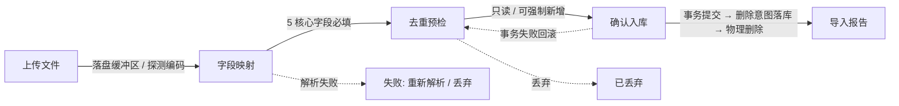
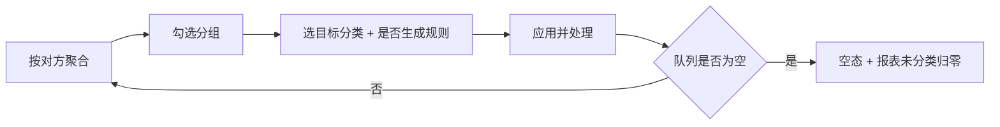
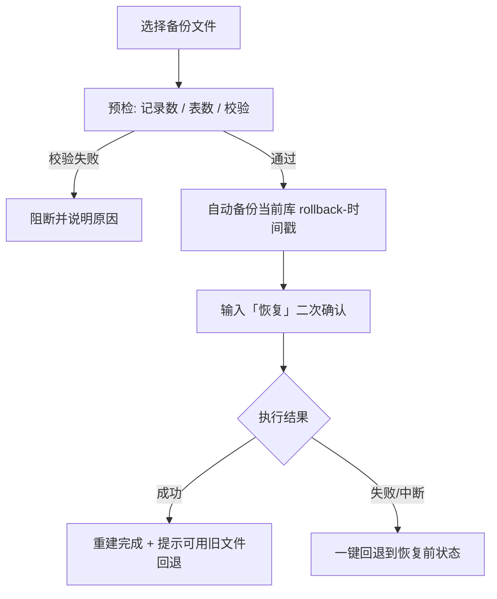

# 个人财务分析仪表盘 · 高保真原型设计规范

> 交付物：`prototype/index.html`（单文件、零外部依赖，双击即可打开）
> 上游依据：《个人财务分析仪表盘 PRD v2.0》第 7 / 9 / 10.3 章

| 项目 | 内容 |
|------|------|
| 文档版本 | v1.0 |
| 设计范围 | 14 个页面 + 双主题变量系统 + 组件库 + 状态映射 |
| 主题 | 玫瑰粉（少女感） / 天青蓝（自然清新） |
| 设计基座 | 语义变量（Token）驱动，组件层零硬编码色值 |
| 无障碍基线 | WCAG 2.1 AA（正文 4.5:1，大字 3:1，焦点可见） |

---

## 一、交付物与打开方式

| 项 | 说明 |
|----|------|
| 主文件 | `prototype/index.html`，内联全部 CSS / JS / SVG 图表，无 CDN、无字体外链 |
| 交互 | 左侧导航切换 14 个页面；主题切换在右上角；所有数据为虚构脱敏样例 |
| 演示参数 | `?theme=sky` 指定主题；`?period=quarter` 指定统计周期；`?step=3` 直接进入导入向导第 N 步；`#route` 指定页面 |
| 示例 | `index.html?theme=sky&step=3#import` |
| 源码分片 | `prototype/_build/`（tokens / base / pages / charts / pages-render / app），`bash build.sh` 重新拼装 |
| 浏览器 | Chrome / Edge / Safari / Firefox 近两年主版本；视口 ≥ 360px 可用 |

**覆盖的 PRD 需求**：FR-01～FR-23 全部；异常态覆盖 EX-01～EX-23 中的 17 条（其余为后端事务类，已在界面文案中留出提示位）。

---

## 二、设计定位

### 2.1 用户与场景

| 维度 | 结论 | 对设计的影响 |
|------|------|--------------|
| 用户 | 在校大学生，非技术用户 | 不出现 SQL / 表名 / 错误码；术语改写为「批次」「待确认」「资金流转」 |
| 情境 | 每月导出一次账单，在电脑上花 5 分钟复盘 | 首屏即结论；导入链路允许中断后续做 |
| 情绪 | 对「钱花哪了」有轻度焦虑 | 用低饱和色、留白、温和文案降低压迫感；不做红色警报式设计 |
| 设备 | 电脑为主，手机偶尔查看 | 桌面优先，1024 / 768 / 360 三档降级 |

### 2.2 两套主题的性格设定

| 主题 | 关键词 | 色彩策略 | 适用 |
|------|--------|----------|------|
| 玫瑰粉（默认） | 温柔、轻盈、被照顾 | 灰玫瑰主色压住甜度，辅以蜜桃与藕荷；中性色带暖红调 | 学生用户日常复盘 |
| 天青蓝 | 透气、克制、有秩序 | 天青主色 + 薄荷辅助；中性色偏冷青，白面留白更多 | 长时间阅读、报表打印 |

两套主题**不是换色皮**：语义变量一一对应（见第五章），布局、间距、组件结构、信息层级完全一致；切换只改变 24 个变量的取值，不改任何 DOM 结构与文案。

### 2.3 五条设计原则

1. **结论先行**：每屏第一眼是可读的结论（结余 / 待确认 / 本期摘要），细节向下展开。
2. **口径外显**：凡是可能被误解的数字，就近标注口径（「计入总支出」「不计收支」「未分类单列」）。
3. **状态可辨**：所有状态同时用「颜色 + 文字 + 形状」三重编码，不依赖单一色彩通道。
4. **破坏性操作可逆**：删除、恢复、重算一律二次确认并给出影响范围；恢复前自动备份。
5. **一屏一个主操作**：每个页面最多一个 `primary` 按钮，其余为 outline / ghost。

---

## 三、页面清单

| # | 路由 | 页面 | 核心区块 | 关键交互 | PRD |
|---|------|------|----------|----------|-----|
| 1 | `#dashboard` | 仪表盘 | 提醒条 · 结余总览带 · 支出趋势 · 支出结构 · 本期结论 · Top5 商户 | 周期切换（月/季/年）联动全部数字与图表；图表悬停 tooltip；点图例下钻 | FR-13 |
| 2 | `#reports` | 报表中心 | 待确认提醒 · 总览带 · 分类结构表 · 周期对比柱 · 自动摘要 | 三期切换；导出 PDF；分类行下钻 | FR-16/17/18 |
| 3 | `#analysis` | 分类分析 | 一级分类排行 · 二级结构表 · 近 6 月走势 | 点一级分类切换右侧下钻；未分类单列提示 | FR-14 |
| 4 | `#import` | 导入账单 | 五步步骤条 + 单步面板 + 底部操作条 | 上传模拟、映射校正、强制新增、确认入库、报告 | FR-01～05 |
| 5 | `#buffer` | 缓冲区 | 批次表 · 目录与占用 · 待清理 | 继续处理 / 丢弃 / 重试删除 / 残留扫描 | FR-07 |
| 6 | `#raw` | 原始库 | 月份列表 · raw 只读表 · 批次追溯 | 切月；重算（影响范围确认）；链路查看 | FR-08 |
| 7 | `#detail` | 流水明细 | 筛选栏 · 口径汇总条 · 明细表 · 详情抽屉 | 筛选/搜索/排序、批量选择、单条编辑分类与备注 | FR-19 |
| 8 | `#pending` | 待确认队列 | 按对方分组的流水 · 批量归类面板 | 勾选分组、批量归类、生成规则、空态 | FR-12 |
| 9 | `#rules` | 分类规则 | 规则表 · 优先级说明 | 启停开关、新增规则、按规则范围重算 | FR-11 |
| 10 | `#categories` | 分类体系 | 一级列表 · 二级列表 | 切换一级、启停、停用引用中分类触发迁移 | FR-21 |
| 11 | `#backup` | 备份与恢复 | 备份状态 · 文件列表 · 恢复与回退 | 立即备份、导出、恢复（预检→确认→回退） | FR-20 |
| 12 | `#settings` | 基础设置 | 记账与提醒 · 数据目录 · 保存 | 阈值/间隔/周期/主题/日志开关；路径校验失败态 | FR-22 |
| 13 | `#help` | 帮助与说明 | 目录锚点 · 口径表 · 导入引导 · 备份指引 · 异常自助 | 锚点跳转 | FR-23 |
| 14 | `#ds` | 设计规范 | 主题预览 · 色板 · 变量表 · 对比度 · 字体 · 组件 · 状态矩阵 · 图表色序 · 空态 · 无障碍 | 主题实时切换对比 | 交付物 |

---

## 四、全局布局与栅格

### 4.1 壳层尺寸

| 区域 | 尺寸 | 说明 |
|------|------|------|
| 左侧导航 | 232px（≤1080px 折叠为 72px 图标栏） | 半透明 + 18px 背景模糊，与内容区分层 |
| 顶部栏 | 66px，吸顶 | 面包屑 + 隐私提示 + 主题切换 + 快捷入口 |
| 内容区 | 最大 1360px，左右留白 28px | 超宽屏不再拉伸，避免行长过长 |
| 卡片圆角 | 16px（大容器 20/26px，控件 9/12px） | 同一层级只用一种圆角 |
| 卡片间距 | 16px（同组）/ 24px（跨组） | 用间距而非分割线划分层次 |

### 4.2 栅格与断点

| 断点 | 布局 | 侧栏 | 卡片列 |
|------|------|------|--------|
| ≥1240px | 12 栅格（8+4 / 7+5） | 232px 展开 | 4 列 KPI、双栏图表 |
| 1080–1240px | 12 栅格（主内容整行） | 232px 展开 | 2 列 KPI、图表堆叠 |
| 760–1080px | 单栏 | 72px 图标栏 | 2 列 KPI |
| <760px | 单栏 | 72px 图标栏 | 全部整行；表格横向滚动 |

**等高规则**：同一行的图表卡片通过 `.g-fill` 拉齐高度，趋势卡的统计条用 `margin-top:auto` 贴底，避免出现半截空白。

### 4.3 垂直节奏

```
页头（标题 23px + 副标题）   →  28px
提醒条                      →  16px
总览带                      →  16px
卡片行                      →  16px
卡片内：头部 16/20 · 主体 20 · 底栏 12/20
```

---

## 五、双主题色彩系统

### 5.1 主题定义

- 主题通过 `<html data-theme="pink|sky">` 切换，所有颜色来自语义变量，组件不写死色值。
- 中性色**不使用纯黑纯白做背景**：粉主题背景 `#FDF5F7`（暖红调），蓝主题 `#F4FAFD`（冷青调）；卡片表面统一纯白以保证内容区对比。
- 背景叠两团径向柔光 + 极淡点阵（账本纸感），透明度 ≤ 11%，不干扰内容。

### 5.2 语义变量映射表

| 语义变量 | 玫瑰粉 | 天青蓝 | 用途 |
|----------|--------|--------|------|
| `--primary` | `#D03F6B` | `#2D7AB2` | 主按钮底、选中态、关键数据 |
| `--primary-hover` | `#BC355F` | `#256BA1` | 悬停（加深约 8%） |
| `--primary-active` | `#A52C52` | `#1D5C8C` | 按下（再加深 8%） |
| `--primary-ink` | `#A62F55` | `#1D5F92` | 浅底上的品牌色文字（导航选中、链接） |
| `--primary-soft` | `#FCE8EE` | `#E2EFF9` | 徽标底、选中底 |
| `--primary-softer` | `#FEF3F6` | `#F0F8FD` | 行选中、提示条底 |
| `--primary-line` | `#F5C8D5` | `#BFDCF0` | 徽标描边、进度轨道 |
| `--accent` | `#E0913F` | `#3FAE97` | 辅助色：第二数据序列、渐变端点 |
| `--accent-soft` | `#FBF0E2` | `#E3F5F0` | 辅助浅底 |
| `--violet` | `#8D7AD4` | `#7A8FD6` | 第三强调（标签、装饰） |
| `--text-1` | `#3A2930` | `#1C2C38` | 标题与关键数字 |
| `--text-2` | `#6B5159` | `#4A6272` | 正文、表格内容 |
| `--text-3` | `#806670` | `#607684` | 说明文字、表头 |
| `--text-4` | `#B09AA3` | `#9DB3C1` | 占位符、禁用（不承载信息） |
| `--bg` | `#FDF5F7` | `#F4FAFD` | 页面背景 |
| `--surface` | `#FFFFFF` | `#FFFFFF` | 卡片、弹层表面 |
| `--surface-2` | `#FFFAFB` | `#F9FCFE` | 表头、底栏、次级表面 |
| `--surface-3` | `#FDF1F5` | `#EEF6FB` | 输入底、轨道、凹陷表面 |
| `--border` | `#F3E1E6` | `#DFEAF2` | 分隔线、卡片描边 |
| `--border-2` | `#E8CDD6` | `#C8DBE8` | 控件描边 |
| `--ok` | `#17795A` | `#17795B` | 成功 / 已入库 / 有利变化 |
| `--warn` | `#8A600C` | `#8A600C` | 警示 / 待确认 / 待清理 |
| `--danger` | `#BC3A2E` | `#BC3A2E` | 危险 / 失败 / 删除 |
| `--fin-up` | `#C63C33` | `#C63C33` | 财务不利（支出上升、结余下降）＝红 |
| `--fin-down` | `#17795B` | `#17795B` | 财务有利（支出下降、结余上升）＝绿 |

### 5.3 对比度实测（WCAG 2.1）

| 组合 | 玫瑰粉 | 天青蓝 | 结论 |
|------|--------|--------|------|
| `--text-1` / `--bg` | 12.7:1 | 13.6:1 | AA / AAA |
| `--text-2` / `--surface` | 7.1:1 | 6.4:1 | AA / AAA |
| `--text-3` / `--surface`（12px 辅助） | 5.2:1 | 4.8:1 | AA |
| `--primary-ink` / `--primary-softer` | 6.1:1 | 6.3:1 | AA |
| 白字 / `--primary`（按钮） | 4.6:1 | 4.6:1 | AA（正文级） |
| `--danger` / `--danger-soft`（徽标） | 4.8:1 | 4.8:1 | AA |
| `--ok` / `--ok-soft` | 4.8:1 | 4.7:1 | AA |
| `--warn` / `--warn-soft` | 5.0:1 | 5.0:1 | AA |

> 设计系统页内嵌了实时计算函数，改色值后对比度会同步刷新，避免「文档说达标、实现不达标」。

### 5.4 主题切换机制

| 项 | 规则 |
|----|------|
| 触发 | 顶栏切换器 / 设置页「界面主题」/ URL 参数 `?theme=` |
| 持久化 | `localStorage['fd-theme']`，跨会话记忆 |
| 过渡 | 背景与文字 480ms 缓动，其余元素即时切换；`prefers-reduced-motion` 下取消 |
| 不变项 | 布局、间距、组件结构、信息层级、图表色序语义（chart-1 永远是最大支出分类） |
| 无障碍 | 切换器为 `role=group` + `aria-pressed`，切换后 toast 播报 |

### 5.5 图表色序

| 序号 | 玫瑰粉 | 天青蓝 | 语义 |
|------|--------|--------|------|
| chart-1 | `#D03F6B` | `#2D7AB2` | 支出主序列 / 最大分类（餐饮） |
| chart-2 | `#E0913F` | `#3FAE97` | 购物消费 |
| chart-3 | `#8D7AD4` | `#7A8FD6` | 交通出行 |
| chart-4 | `#5AA9D6` | `#E0A25B` | 居住缴费 / 收入到账标记 |
| chart-5 | `#62BFA1` | `#4FBFD3` | 学习资料 |
| chart-6 | `#E8BF5E` | `#8AC47C` | 通讯娱乐 |
| chart-7 | `#D4829C` | `#B08BD4` | 人情往来 |
| chart-8 | `#93A6C9` | `#DC8391` | **保留给「未分类 / 其他」**，不参与轮转 |

---

## 六、组件规范

### 6.1 按钮

| 变体 | 用途 | 底色 | 文字 | 描边 |
|------|------|------|------|------|
| primary | 每屏唯一主操作 | `--primary` | 白 | 无 |
| outline | 次级并列操作 | `--surface` | `--text-1` | `--border-2` |
| soft | 行内强调（继续处理） | `--primary-soft` | `--primary-ink` | 无 |
| ghost | 取消 / 更多 / 图标旁 | 透明 | `--text-2` | 无 |
| danger | 恢复、删除等破坏性操作 | `--danger` | 白 | 无 |

| 尺寸 | 高度 | 左右内距 | 字号 | 用于 |
|------|------|----------|------|------|
| sm | 30px | 10px | 12px | 表格行内、卡片头部 |
| md（默认） | 36px | 12px | 13px | 常规操作 |
| lg | 42px | 20px | 14px | 向导底部主操作 |

### 6.2 表单控件

| 控件 | 尺寸 | 关键规则 |
|------|------|----------|
| Input | 高 36px，圆角 9px，描边 `--border-2` | 聚焦：品牌描边 + 3px 外发光；只读：`--surface-3` 底 + 次文字；错误：`--danger` 描边 + 下方 11px 错误文案 |
| 数字输入 | 右对齐 + tabular-nums | 右侧单位（元/天）独立成标签，不塞进占位符 |
| Select | 高 36px / sm 30px | 自绘 chevron，禁用时不改透明度而改底色 |
| Switch | 36×20，滑块 14px | `role=switch` + `aria-checked`；切换即时生效并 toast |
| Checkbox | 16×16，圆角 5px | 勾选时品牌实底 + 白色对勾；整行 label 可点 |
| Radio | 16×16 | 选中用 5px 粗描边实现，不依赖填充差异 |
| 校验 | 入口一次 | 错误文案写「哪里错 + 怎么改」，禁用「操作失败」类文案 |

### 6.3 徽标与标签

| 类型 | 高度 | 结构 | 用途 |
|------|------|------|------|
| badge | 21px 胶囊 | 6px 圆点 + 文案 | 业务状态（已入库 / 待确认 / 失败 …） |
| badge--outline | 同上 | 描边无底 | 中性/次要状态，视觉降权 |
| chip | 30px 胶囊 | 文案 + 可选 × | 筛选条件，选中态为品牌浅底 + 品牌字 |
| delta | 行内 | ▲/▼ + 数值 + 单位 | 环比/同比，颜色由「有利/不利」决定而非正负 |

### 6.4 表格

| 项 | 规则 |
|----|------|
| 表头 | 11px、字距 0.05em、`--surface-2` 底、吸顶 + 6px 模糊 |
| 行高 | 常规 44px；紧凑 32px（预检表、追溯表） |
| 数字列 | 右对齐 + tabular-nums；金额保留 2 位小数 |
| 两行单元格 | 主字段 13px `--text-1`，次字段 11px `--text-4`（对方 + 商品说明、文件名 + 批次号） |
| 可编辑单元格 | hover 出现铅笔图标 + 品牌浅底，点击打开抽屉 |
| 选中行 | `--primary-softer` 底 + 左侧 3px 品牌条 |
| 状态列 | badge 三重编码（色 + 字 + 点），扫描列固定倒数第二列 |
| 空结果 | 表体替换为空态，保留筛选栏，提供「重置筛选」出口 |

### 6.5 卡片与 KPI

- 卡片：白面 + 1px `--border` + 一级阴影；hover 只用于可点击卡片（上浮 2px）。
- 卡片头：标题 14px/600 + 副标题 12px/400 `--text-3` + 右侧操作区。
- **总览带**（仪表盘/报表）：左侧结余大数（42px，数字用 Bahnschrift/DIN，小数降级为 0.6em 灰字），右侧 4 个统计格（2×2），中间虚线分隔。这是全局唯一的「英雄数字」模板。
- KPI 小卡：仅用于非结余指标，标签 12px + 数值 34px + 环比 delta。

### 6.6 步骤条 / 上传 / 进度

| 组件 | 规格 |
|------|------|
| 步骤条 | 24px 圆点（编号/对勾）+ 13px 标签 + 1px 连接线；已完成=品牌浅底、当前=品牌实底 + 4px 光晕、未开始=灰描边 |
| 上传区 | 最小高 226px 虚线框，hover 变品牌浅底；拖拽中加 3px 光晕；上传后替换为文件行 + 4 格元信息 + 前 5 行预览 |
| 进度条 | 高 6px 胶囊，品牌→辅助色渐变；长任务用不定态（38% 宽度循环），完成态显示百分比 |

### 6.7 图表

| 图表 | 规格 | 交互 |
|------|------|------|
| 支出趋势 | 面积折线，2px 描边 + 26%→1% 渐变填充；Y 轴 4 段整数刻度；X 轴按 7 等分抽稀 | 每点一个透明热区，悬停显示日期 + 金额并点亮数据点 |
| 收入到账 | **不用折线**，改为图表上方标注条（虚线垂线 + 金额胶囊） | 避免低频大额收入把支出曲线压扁 |
| 分组柱 | 圆角 4px，同组两序列间距 30%；空月份留空位并降低 X 标签透明度 | 悬停 tooltip；年度 11–12 月为「无数据」而非 0 |
| 环形图 | 环宽 20，段间 2° 间隙，端点圆角；中心显示总支出 | 悬停段显示名称/金额/占比；图例 Top5 + 「其他 N 项」聚合 |
| 迷你折线 | 120×30，末点圆点 | 表格内趋势提示，不交互 |
| 段落柱 | 6 个月柱块，最大值满高，当期实色其余 32% 透明 | hover 降透明度 |

### 6.8 反馈层

| 组件 | 用法 | 规则 |
|------|------|------|
| notice | 页面级提示（待确认、备份、事务说明） | 4 种语义；图标 + 可内嵌链接；不超过 2 行 |
| toast | 操作结果 | 底部居中，3s 自动消失，深色反底；成功/警示用圆点区分 |
| modal | 二次确认、轻表单 | 最大 560px（sm 460 / lg 720）；遮罩模糊 3px；Esc 与遮罩可关闭 |
| drawer | 详情与轻编辑 | 右侧 480px；不离开列表上下文；底部固定操作区 |
| empty | 无数据 | 76px 圆形插画 + 标题 + 一句解释 + 1–2 个出口 |
| skeleton | 首屏加载 | 3 档宽度 + 1 个块级占位，1.5s 微光循环 |

### 6.9 尺寸速查

| 元素 | 数值 |
|------|------|
| 圆角 | 6 / 9 / 12 / 16 / 20 / 26 / 全圆 |
| 间距 | 4 / 6 / 8 / 10 / 12 / 16 / 20 / 24 / 28 / 32 / 40 / 48 |
| 字号 | 11 / 12 / 13 / 14 / 16 / 19 / 23 / 28 / 34 / 42 |
| 阴影 | 1 级（发丝）/ 2 级（悬浮）/ 3 级（弹层），均带品牌色温 |
| 动效 | 110ms（反馈）/ 180ms（控件）/ 300ms（页面）/ 480ms（主题） |

---

## 七、状态映射关系

### 7.1 业务状态 → 语义色

| 业务状态 | 语义色 | 组件 | 出现位置 |
|----------|--------|------|----------|
| 已上传 / 已丢弃 | `--text-3` 灰 | `badge--neutral` | 缓冲区 |
| 待映射 / 入库中 | `--primary` 品牌 | `badge--info` | 缓冲区、向导 |
| 待确认（批次） | `--warn` | `badge--warn` | 缓冲区、预检表 |
| 已入库 | `--ok` | `badge--ok` | 报告、原始库 |
| 失败（仅解析失败） | `--danger` | `badge--danger` | 缓冲区 |
| 文件待清理 | `--warn` + 重试按钮 | `notice--warn` | 缓冲区待清理 |
| 已分类 confirmed | `--text-3` 灰 | `badge--plain` | 明细 |
| 已修正 corrected | `--primary-ink` | `badge--info` | 明细、待确认 |
| 已排除 excluded | `--text-3` + 金额降权 | `badge--neutral` | 明细（按状态筛选可见） |
| 中性 neutral | `--text-3` + 「不计收支」 | `badge--neutral` | 明细、帮助 |

### 7.2 交互状态矩阵

| 状态 | 视觉规则 | 变量 | 约束 |
|------|----------|------|------|
| 默认 | 品牌实底 + 1px 内高光 | `--primary` | 每屏主按钮 ≤ 1 |
| 悬停 | 加深 8%、上浮 1px、阴影升一级 | `--primary-hover` + `shadow-2` | 仅指针设备 |
| 按下 | 再加深 8%、位移归零、去阴影 | `--primary-active` | 反馈 ≤ 110ms |
| 聚焦 | 2px 描边 + 2px 偏移（控件为 3px 光晕） | `--ring` | 键盘可见，鼠标不触发 |
| 禁用 | 整体 46% 不透明，禁用指针 | `opacity:.46` | 保留尺寸不位移 |
| 加载 | 文字透明 + 14px 旋转环 | — | 锁定宽度防抖动 |
| 选中 | 品牌浅底 + 品牌描边 + 品牌字 | `--primary-soft/line/ink` | 可与聚焦叠加 |
| 只读 | 凹陷底 + 次文字，无 hover | `--surface-3` | 明确告知「不可编辑」原因 |

### 7.3 财务涨跌映射（国内习惯）

| 变化 | 颜色 | 变量 | 示例 |
|------|------|------|------|
| 支出增加 / 结余减少 / 储蓄率下降 | 红 | `--fin-up` | 总支出 ▲8.3% |
| 支出减少 / 结余增加 / 储蓄率上升 | 绿 | `--fin-down` | 季度支出 ▼2.4% |
| 无变化或数据不足 | 灰 + 「—」 | `--text-3` | 同比无数据 |

> 颜色由「是否有利」决定，不由正负决定：支出 −2.4% 用绿，结余 −5.2% 用红。

### 7.4 冗余编码

- 状态徽标：颜色 + 文字 + 圆点（色盲用户可读文字）。
- 涨跌：颜色 + ▲▼ 形状 + 数值。
- 图表序列：颜色 + 图例文字 + 悬停数值，且色序语义固定。
- 错误输入：红色描边 + 图标 + 具体文案三重提示。

---

## 八、关键交互流程

### 8.1 导入五步链路



| 步骤 | 关键状态 | 界面表现 | 阻断条件 |
|------|----------|----------|----------|
| 1 上传 | 未上传 / 上传中 / 已落盘 / 失败 | 虚线框 → 进度条 → 文件行 + 4 格元信息 + 前 5 行预览 | 格式/大小/行数超限 |
| 2 映射 | 自动命中 / 手动调整 / 模板冲突 | 5 核心字段带「必填」与「自动」标记；预览按新映射刷新 | 核心字段未映射完成 |
| 3 预检 | 新增 / 重复 / 待确认 | 汇总 4 格 + 逐行徽标；重复行提供「强制新增」并需填原因 | 只读，无阻断 |
| 4 确认 | 待提交 / 入库中 / 回滚 | 归档表预览（raw_YYYY_MM）+ 幂等提示 + 进度条 | 非「待确认」批次拒绝提交 |
| 5 报告 | 成功 / 全量重复 | 4 个数字 + 归档结果 + 「原文件已删除」 | — |

### 8.2 待确认批量归类



### 8.3 重算（FR-08 / FR-11 合并服务）

| 阶段 | 表现 |
|------|------|
| 入口 | 原始库「从原始库重算」/ 规则页「按规则范围重算」——同一服务两个入口 |
| 影响范围 | 弹窗展示「将重算 128 条，其中人工修正 4 条（不重算）」 |
| 选项 | 默认不覆盖人工修正/排除；勾选「覆盖」需二次确认（明确标注不推荐） |
| 执行 | 事务内完成，失败整体回滚；完成后 toast「更新 124 条，人工修正 4 条未重算」 |
| 不变项 | raw 表不变，页脚明示 |

### 8.4 恢复与回退（EX-19）



### 8.5 主题切换

顶栏切换器 / 设置页 / URL 参数三入口 → 更新 `data-theme` → 24 个变量整体替换 → 背景与文字 480ms 过渡 → 写入 localStorage → 设计规范页同步刷新对比度。

---

## 九、逐页布局与交互要点

### 9.1 仪表盘

- **结构**：页头（周期分段控件 + 刷新 + 导入）→ 双提醒条 → 总览带（结余 + 4 指标）→ 8/4 栅格（支出趋势 / 支出结构）→ 7/5 栅格（本期结论 / Top5 商户）。
- **关键状态**：周期切换后总览带、图表、结论、Top5、待确认数量全部联动；无数据时整块替换为空态；备份超期时第二条提醒转为 warning。
- **组件用法**：结余用「英雄数字」模板；收入到账用标注条而非折线；结构卡只放 Top5 + 聚合项，避免卡片过高；结论卡用 01–04 编号 + 数字加粗。

### 9.2 报表中心

- **结构**：页头（三期切换 + 导出 + 生成）→ 待确认提醒 → 总览带 → 7/5 栅格（分类结构表 / 周期对比柱）→ 全宽自动摘要。
- **关键状态**：月报看周度对比、季报看三月对比、年报看十二月对比（11–12 月显示空位而非 0）；同比无数据时显示「—」。
- **组件用法**：分类表把占比条内嵌在分类名下方（避免多一列导致横向压缩）；摘要两列排布，每条一个可核对数字。

### 9.3 分类分析

- **结构**：页头 → 未分类提示 → 4/8 栅格（一级排行 / 二级结构 + 近 6 月走势）。
- **关键状态**：选中一级分类时该行加浅底与左侧色条；右侧标题、环比、表格同步替换；未分类永远排在末位并带「待处理」徽标。
- **组件用法**：一级排行用 8px 进度条表达占比；二级表用迷你折线表达趋势，末端实心点表示当期。

### 9.4 导入账单

- **结构**：页头 → 步骤条卡 → 单步面板 → 底部固定操作条（提示 + 上一步 + 主操作）。
- **关键状态**：未上传时「下一步」禁用；上传中显示进度；预检中重复行灰化并给「强制新增」；入库中按钮转 loading 且禁用回退；失败回滚后回到第 3 步并提示原因。
- **组件用法**：五步用同一卡片容器，仅替换面板内容，避免页面跳动；底部条常驻，主按钮始终在右下角同一位置。

### 9.5 缓冲区

- **结构**：页头 → 批次表（12 列中合并为 8 列两行信息）→ 7/5 栅格（目录占用 / 待清理）。
- **关键状态**：不同状态给不同操作按钮（继续处理/重试/查看报告/重试删除）；接近容量阈值时进度条转橙并给 warning 徽标。
- **组件用法**：文件名与批次号两行排布；预检结果列用「新增/重复/待确认」三段文字。

### 9.6 原始库

- **结构**：3/9 栅格（月份列表 / raw 只读表）→ 批次追溯卡。
- **关键状态**：切月刷新表名与记录数；重算前弹影响范围；raw 表所有单元格只读，页脚说明更正路径。
- **组件用法**：方向列直接展示枚举值（income/expense/neutral）以体现「原貌」；追溯链路用面包屑式胶囊串联 transaction → 批次/行号 → raw。

### 9.7 流水明细

- **结构**：筛选栏 → 口径汇总条（笔数 / 支出 / 收入 / 净额 + 同口径徽标）→ 明细表 → 分页 → 只读说明页脚。
- **关键状态**：有筛选时汇总切为「筛选结果」，无筛选时显示「本期合计」（与报表同口径）；搜索框在重渲染后保持焦点；勾选后底部浮出批量条。
- **组件用法**：分类列可点击（hover 出现铅笔）；点击行打开右侧抽屉，原始事实字段只读灰底，分类/备注可编辑。

### 9.8 待确认队列

- **结构**：8/4 栅格（分组列表 / 批量归类面板）+ 解释卡。
- **关键状态**：勾选分组后左侧加品牌边条、右侧「已选 N 组」更新；处理后组消失，全部处理完显示空态；未勾选直接点应用会提示先勾选。
- **组件用法**：分组头整行可点（含复选框），组内逐条列时间/商品/金额；面板中「同时生成规则」用开关而非复选，强调副作用。

### 9.9 分类规则

- **结构**：页头（重算历史）→ 规则表（关键词 / 字段 / 目标分类 / 优先级 / 命中 / 启用 / 操作）→ 两栏说明。
- **关键状态**：停用后行内开关变灰并 toast 说明「新导入不再套用」；新增规则弹窗校验关键词非空与优先级为整数。
- **组件用法**：关键词用等宽字体胶囊；优先级右对齐数字便于比较。

### 9.10 分类体系

- **结构**：5/7 栅格（一级列表 / 二级列表）+ 底部迁移说明。
- **关键状态**：一级行可点切换，行内开关独立生效；停用被引用分类时弹窗二选一（保留历史 / 迁移），并说明收支总额不变。
- **组件用法**：一级行三行信息（名称 + 二级数/笔数 + 开关）；二级行操作固定为「停用」文字按钮。

### 9.11 备份与恢复

- **结构**：7/5 栅格（备份状态 / 文件列表）→ 5/7 栅格（恢复与回退 / 两条说明）。
- **关键状态**：超期时状态卡转 warning 并显示「已 N 天未备份」；备份中按钮 loading；恢复需预检 + 输入确认 + 自动备份提示。
- **组件用法**：数据库备份给「恢复」，全量导出给「下载」；危险操作使用 danger 变体并全宽。

### 9.12 基础设置

- **结构**：8/4 栅格（分组表单 / 数据目录 + 保存）。
- **关键状态**：路径非法时输入框红描边 + 具体原因（不能指向网络位置），保存被拒绝并 toast；主题开关即时生效。
- **组件用法**：设置项统一「左标题+说明 / 右控件」两列，控件右对齐；数字输入固定 108px 宽。

### 9.13 帮助与说明

- **结构**：3/9 栅格（锚点目录 / 正文卡片组）。
- **关键状态**：目录当前项高亮；口径表逐行标注 direction 与是否计入；口径提示条用品牌浅底强调「改分类不改变统计归属」。
- **组件用法**：正文 13px / 行高 1.9；流程用带序号的步骤；代码与路径用等宽字体。

### 9.14 设计规范

- **结构**：两套主题预览（并排实时渲染）→ 色板 + 变量表 + 对比度 → 字体 / 间距 / 圆角 → 按钮 / 表单 / 徽标 → 交互状态表 → 业务状态映射表 → 图表色序 → 空态/骨架/提示 → 无障碍清单。
- **关键状态**：主题预览用 `data-theme` 局部作用域，两套配色同屏对比；对比度由 JS 实时计算并着色（≥4.5 绿、≥3 橙）。
- **用途**：开发实现时的唯一视觉参照，也是验收时的比对基准。

---

## 十、无障碍与实现约定

### 10.1 无障碍

| 项 | 要求 |
|----|------|
| 对比度 | 正文 ≥ 4.5:1，大字/图形 ≥ 3:1（见 5.3 实测） |
| 焦点 | 所有可交互元素 `:focus-visible` 有 2px 品牌描边 + 2px 偏移，禁止 `outline:none` |
| 触控 | 按钮最小 30px 高，移动端行高 ≥ 44px；图标按钮 34×34 |
| 语义 | 表头用 `th`、状态用文字、图表带 `aria-label`、弹层 `role=dialog` + `aria-modal` |
| 键盘 | Esc 关闭弹层；Tab 顺序与视觉顺序一致；开关支持空格 |
| 动效 | `prefers-reduced-motion` 下全部降至 0.01ms，仅保留终态 |
| 文案 | 错误提示说明「哪里错、怎么改」；按钮动词开头，不用「确定/提交」等含糊词 |

### 10.2 实现约定（交接给前端）

1. 颜色一律走语义变量，组件层禁止出现十六进制色值；新增语义需同时在两套主题下定义。
2. 统计数字必须来自后端 stats-service，前端不得自行聚合；页面上任何汇总都要标注来源与口径。
3. 状态徽标复用 `ST` 映射表（状态 → 文案 + 语义色），新增状态只加映射不改组件。
4. 表格数字列统一加 `font-variant-numeric: tabular-nums`，避免金额跳动。
5. 图表组件只接受「已聚合的数据 + 序列名 + 颜色变量」，不自带业务计算。
6. 弹层与抽屉共用一层 `#layer` 容器，打开时锁滚动，关闭时恢复。

---

## 十一、验收清单

- [ ] 14 个页面均可通过左侧导航与 `#route` 直达，无空白页、无控制台报错
- [ ] 两套主题切换后布局零位移，颜色全部来自语义变量
- [ ] 关键路径可完整走通：上传 → 映射 → 预检 → 确认 → 报告
- [ ] 待确认勾选、批量应用、空态三者闭环
- [ ] 明细的筛选/搜索/排序/批量/抽屉编辑均可用，搜索后焦点不丢失
- [ ] 破坏性操作均有二次确认与影响范围说明
- [ ] 正文与徽标文字对比度 ≥ 4.5:1（设计规范页实测）
- [ ] 1240 / 1080 / 760 / 360 四档断点无横向溢出与文字截断
- [ ] 键盘可完成导航、开关、弹层关闭
- [ ] 设计规范页可直接作为开发实现的唯一视觉参照

---

**设计**：像素君（UI Designer） · **版本**：v1.0 · **日期**：2026-10-22
